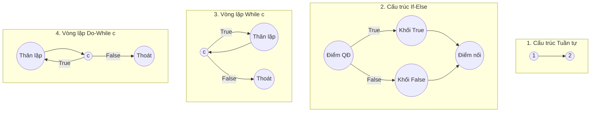
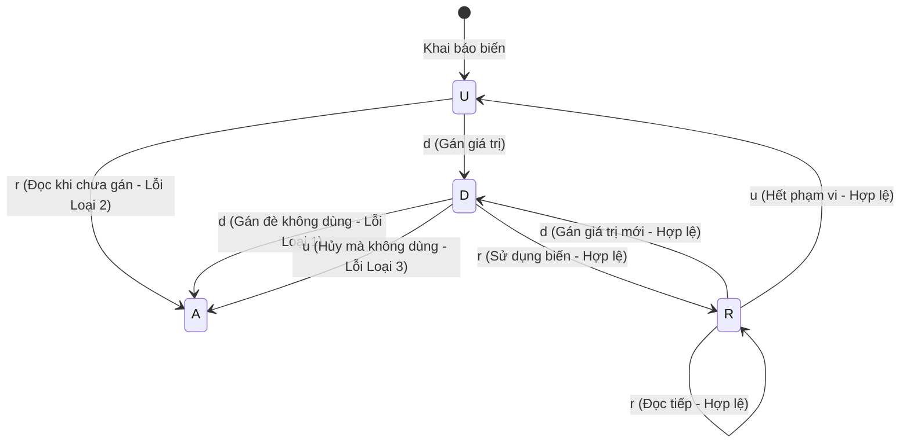

# TÀI LIỆU HỌC TẬP VÀ HƯỚNG DẪN KIỂM THỬ HỘP TRẮNG (WHITE-BOX TESTING)

> **Tài liệu nguồn tham chiếu:** `D:\Dowload\Cac ky thuat kiem thu phan mem 16-9-25.docx`  
> **Chủ đề chính:**
> 1. **Phương pháp kiểm thử dòng điều khiển (Control Flow Testing)**
> 2. **Phương pháp kiểm thử dòng dữ liệu (Data Flow Testing)**

---

## MỤC LỤC
1. [TỔNG QUAN VỀ KIỂM THỬ HỘP TRẮNG](#1-tổng-quan-về-kiểm-thử-hộp-trắng)
2. [PHẦN I: PHƯƠNG PHÁP KIỂM THỬ DÒNG ĐIỀU KHIỂN (CONTROL FLOW TESTING)](#2-phần-i-phương-pháp-kiểm-thử-dòng-điều-khiển-control-flow-testing)
   - [2.1 Khái niệm đồ thị dòng điều khiển (CFG - Control Flow Graph)](#21-khái-niệm-đồ-thị-dòng-điều-khiển-cfg---control-flow-graph)
   - [2.2 Các thành phần cơ bản và cấu trúc điều khiển trong đồ thị](#22-các-thành-phần-cơ-bản-và-cấu-trúc-điều-khiển-trong-đồ-thị)
   - [2.3 Các độ đo kiểm thử (Coverage Metrics)](#23-các-độ-đo-kiểm-thử-coverage-metrics)
     - [Độ đo cấp 1 (C1 - Statement Coverage)](#-độ-đo-kiểm-thử-cấp-1---độ-đo-c1-statement-coverage)
     - [Độ đo cấp 2 (C2 - Branch / Decision Coverage)](#-độ-đo-kiểm-thử-cấp-2---độ-đo-c2-branch--decision-coverage)
     - [Độ đo cấp 3 (C3 - Condition Coverage)](#-độ-đo-kiểm-thử-cấp-3---độ-đo-c3-multiple-condition-coverage)
   - [2.4 Phương pháp sinh đường đi (Path Generation)](#24-phương-pháp-sinh-đường-đi-path-generation)
   - [2.5 Kiểm thử vòng lặp (Loop Testing)](#25-kiểm-thử-vòng-lặp-loop-testing)
   - [2.6 Nghiên cứu tình huống & Bài tập áp dụng (Hàm `foo`, `Grade`, `average`, `LaSoNguyenTo`, `LaNamNhuan`)](#26-nghiên-cứu-tình-huống--bài-tập-áp-dụng)
3. [PHẦN II: PHƯƠNG PHÁP KIỂM THỬ DÒNG DỮ LIỆU (DATA FLOW TESTING)](#3-phần-ii-phương-pháp-kiểm-thử-dòng-dữ-liệu-data-flow-testing)
   - [3.1 Bản chất và phân loại kiểm thử dòng dữ liệu](#31-bản-chất-và-phân-loại-kiểm-thử-dòng-dữ-liệu)
   - [3.2 Kiểm thử dựa trên việc gán và sử dụng biến](#32-kiểm-thử-dựa-trên-việc-gán-và-sử-dụng-biến)
   - [3.3 Các bất thường phổ biến về dòng dữ liệu (Loại 1, Loại 2, Loại 3)](#33-các-vấn-đề-bất-thường-phổ-biến-về-dòng-dữ-liệu)
   - [3.4 Sơ đồ chuyển trạng thái phát hiện bất thường biến (Mô hình U-D-R-A)](#34-sơ-đồ-chuyển-trạng-thái-phát-hiện-bất-thường-biến)
   - [3.5 Kiểm thử dòng dữ liệu động (Dynamic Data Flow Testing)](#35-kiểm-thử-dòng-dữ-liệu-động-dynamic-data-flow-testing)
   - [3.6 Các khái niệm cốt lõi: `def`, `undef`, `c-use`, `p-use`, Đồ thị dòng dữ liệu DFG](#36-các-khái-niệm-cốt-lõi-về-định-nghĩa-và-sử-dụng-biến)
   - [3.7 Phân tích ca mẫu thực tế: Hàm `VarTypes` và `ReturnAverage`](#37-phân-tích-ca-mẫu-thực-tế)
4. [TỔNG KẾT & SO SÁNH ĐỐI CHIẾU](#4-tổng-kết--so-sánh-đối-chiếu)

---

## 1. TỔNG QUAN VỀ KIỂM THỬ HỘP TRẮNG

- **Định nghĩa:** Kiểm thử hộp trắng (White-box testing / Structural testing / Glass-box testing) là kỹ thuật kiểm thử dựa trên việc hiểu biết rõ cấu trúc mã nguồn nội bộ, logic điều khiển và đường đi dữ liệu của chương trình.
- **So sánh với kiểm thử hộp đen:**
  - *Kiểm thử hộp đen:* Xác định được số test case tối thiểu dựa trên đặc tả yêu cầu, phân vùng tương đương, giá trị biên, bảng quyết định mà không quan tâm code bên trong.
  - *Kiểm thử hộp trắng:* Xác định được các đường đi (execution paths) trong code nhằm phủ một độ đo cụ thể $\Rightarrow$ từ đó tính toán dữ liệu đầu vào và đầu ra mong đợi tương ứng cho từng đường đi.
- **Mục tiêu tối thượng:** Đạt độ bao phủ (coverage) tối đa với số ca kiểm thử (test cases) tối thiểu. Độ bao phủ càng lớn thì độ tin cậy của phần mềm sau kiểm thử càng cao.

---

## 2. PHẦN I: PHƯƠNG PHÁP KIỂM THỬ DÒNG ĐIỀU KHIỂN (CONTROL FLOW TESTING)

### 2.1 Khái niệm đồ thị dòng điều khiển (CFG - Control Flow Graph)
- **Đồ thị dòng điều khiển (CFG):** Là một đồ thị có hướng $G = (V, E)$, trong đó:
  - **Tập đỉnh ($V$):** Tương ứng với các câu lệnh đơn hoặc nhóm câu lệnh thực thi tuần tự (basic block).
  - **Tập cạnh ($E$):** Đại diện cho dòng điều khiển chuyển giao giữa các câu lệnh / khối câu lệnh.

### 2.2 Các thành phần cơ bản và cấu trúc điều khiển trong đồ thị

#### A. Các phần tử hình học cơ bản:
1. **Điểm xuất phát (Start node):** Đỉnh bắt đầu thực thi hàm (hình tròn đặc màu đen với mũi tên đi ra).
2. **Khối xử lý (Processing block):** Đỉnh hình tròn có 1 luồng vào và 1 luồng ra, đại diện cho các câu lệnh gán, tính toán tuần tự.
3. **Điểm quyết định (Decision point):** Đỉnh hình tròn có 1 luồng vào và từ 2 luồng ra trở lên (rẽ nhánh: True/False, switch-case).
4. **Điểm nối (Junction point):** Đỉnh hình tròn gom nhiều luồng vào thành 1 luồng ra duy nhất.
5. **Điểm kết thúc (Exit / End node):** Đỉnh đích (vòng tròn có chấm đen lồng bên trong), đại diện cho lệnh `return` hoặc kết thúc hàm.

#### B. Các cấu trúc điều khiển cơ bản biểu diễn trên CFG:
- **Tuần tự (Sequence):** $N_1 \rightarrow N_2$.
- **Rẽ nhánh (If - Else):** Điểm quyết định tách thành nhánh Đúng và nhánh Sai, sau đó hội tụ tại điểm nối.
- **Lựa chọn đa nhánh (Switch - Case):** Điểm quyết định tách thành nhiều nhánh tương ứng với từng giá trị hằng số, sau đó hội tụ tại điểm nối chung.
- **Vòng lặp tiền điều kiện (`while c do ...`):** Kiểm tra điều kiện $c$ trước: nếu đúng thì vào thân lặp rồi quay ngược lại đỉnh $c$; nếu sai thì nhảy ra ngoài.
- **Vòng lặp hậu điều kiện (`do ... while c`):** Đi vào thân lặp trước, sau đó đến đỉnh quyết định $c$: nếu đúng thì quay ngược lại đầu thân lặp; nếu sai thì thoát.



---

### 2.3 Các độ đo kiểm thử (Coverage Metrics)

Độ đo kiểm thử là mức độ bao phủ của một bộ kiểm thử (tập các test case) được đo bằng tỷ lệ các thành phần thực sự được kiểm thử so với tổng số thành phần cần kiểm thử.

$$\text{Coverage Rate} = \frac{\text{Số thành phần được thực thi}}{\text{Tổng số thành phần}} \times 100\%$$

#### 🔹 Độ đo kiểm thử cấp 1 - Độ đo C1 (Statement Coverage)
- **Định nghĩa:** Mỗi câu lệnh trong chương trình đều phải được thực hiện **ít nhất một lần** sau khi chạy toàn bộ bộ kiểm thử.
- **Đặc điểm:** Đây là mức độ kiểm thử yếu nhất trong dòng điều khiển. C1 có thể bỏ sót các nhánh rẽ rỗng (ví dụ: `if` không có `else`) hoặc các lỗi ẩn khi điều kiện rẽ nhánh sai.

#### 🔹 Độ đo kiểm thử cấp 2 - Độ đo C2 (Branch / Decision Coverage)
- **Định nghĩa:** Mọi điểm quyết định trong đồ thị dòng điều khiển của đơn vị kiểm thử đều phải được thực hiện **ít nhất một lần cho cả hai nhánh: ĐÚNG (True) và SAI (False)**.
- **Đặc điểm:** Nếu đạt 100% C2 thì tự động đạt 100% C1 (với điều kiện mã nguồn không có câu lệnh chết / unreachable code). C2 đảm bảo mọi ngã rẽ logic đều được đi qua.

#### 🔹 Độ đo kiểm thử cấp 3 - Độ đo C3 (Multiple Condition Coverage)
- **Định nghĩa:** Mọi **điều kiện con** thuộc các biểu thức điều kiện phức tạp tại các điểm quyết định (liên kết bằng toán tử logic `&&`, `||`, `!`) đều phải được thực hiện **ít nhất một lần cả hai giá trị Đúng và Sai**.
- **Đặc điểm:** Khắt khe hơn C2. Ví dụ với điều kiện phức `(A || B)`, C2 chỉ cần kết quả của cả cụm ra True và False; nhưng C3 yêu cầu chính biến cố $A$ phải có lần Đúng, lần Sai, và $B$ cũng phải có lần Đúng, lần Sai.

---

### 2.4 Phương pháp sinh đường đi (Path Generation)
- **Quy trình:**
  1. Đánh số các đỉnh / câu lệnh trong hàm.
  2. Vẽ đồ thị dòng điều khiển (CFG).
  3. Lập danh sách các đường đi độc lập đi từ đỉnh bắt đầu đến đỉnh kết thúc (bằng bảng liệt kê chuỗi đỉnh).
  4. Xác định điều kiện ràng buộc dọc theo từng đường đi để giải tìm bộ dữ liệu đầu vào (Input) tương ứng.
  5. Tính toán đầu ra mong đợi (Expected Output - EO) cho từng ca kiểm thử.

---

### 2.5 Kiểm thử vòng lặp (Loop Testing)

Với mỗi đơn vị chương trình có chứa vòng lặp, tài liệu phân loại thành 3 hình thái:
1. **Lệnh lặp đơn giản (Simple Loop):** Đơn vị chương trình chỉ chứa đúng 1 vòng lặp duy nhất, thân vòng lặp không lồng vòng lặp khác.
2. **Lệnh lặp liền kề (Concatenated Loops):** Đơn vị chương trình chứa các lệnh lặp kế tiếp nhau.
3. **Lệnh lặp lồng nhau (Nested Loops):** Vòng lặp này nằm trọn trong thân của vòng lặp khác.

#### Chiến lược sinh ca kiểm thử cho vòng lặp (với $n$ là số lần lặp tối đa):
Để phát hiện lỗi tiềm ẩn ở các giá trị biên của vòng lặp, cần tối thiểu 7 trường hợp sau:
1. **Vòng lặp thực hiện 0 lần** (Bỏ qua thân lặp ngay từ đầu).
2. **Vòng lặp thực hiện 1 lần** (Lặp tối thiểu có chạy).
3. **Vòng lặp thực hiện 2 lần**.
4. **Vòng lặp thực hiện $k$ lần** ($2 < k < n - 1$, đại diện cho trường hợp chạy bình thường ở giữa miền).
5. **Vòng lặp thực hiện $n - 1$ lần** (Cận biên trên).
6. **Vòng lặp thực hiện $n$ lần** (Biên trên danh định tối đa).
7. **Vòng lặp thực hiện $n + 1$ lần** (Kiểm tra điều kiện vượt biên hoặc trường hợp không được phép).

---

### 2.6 Nghiên cứu tình huống & Bài tập áp dụng

#### 📌 Ca nghiên cứu 1: Phân tích hàm mẫu `foo`

**Mã nguồn hàm:**
```c
float foo(int a, int b, int c, int d) {
1.  float e;
2.  if (a == 0)
3.      return 0;
4.  int x = 0;
5.  if ((a == b) || (c == d))
6.      x = 1;
7.  e = 1 / x;
8.  return e;
}
```

**Biểu diễn CFG của `foo`:**
- **Đỉnh:** 
  - (1): Khai báo `float e`
  - (2): Điểm quyết định `if (a == 0)`
  - (3): Xử lý `return 0` $\rightarrow$ Điểm kết thúc
  - (4): Xử lý `int x = 0`
  - (5): Điểm quyết định `if ((a == b) || (c == d))`
  - (6): Xử lý `x = 1`
  - (7, 8): Xử lý `e = 1 / x; return e;` $\rightarrow$ Điểm kết thúc

**Phân tích các độ đo C1, C2, C3 cho hàm `foo`:**

##### 1. Thiết kế bộ kiểm thử đạt 100% C1 (Statement Coverage):
Cần thực hiện mọi câu lệnh ít nhất 1 lần. Cần **2 test case**:
| TT | Ca kiểm thử | Đường đi | Đầu vào $(a, b, c, d)$ | Đầu ra mong đợi | Ghi chú |
| :---: | :---: | :---: | :---: | :---: | :---: |
| 1 | **Tc1** | $1 \rightarrow 2 \rightarrow 3$ | $(0, 1, 2, 3)$ | $0$ | Đi qua câu lệnh dòng 3 |
| 2 | **Tc2** | $1 \rightarrow 2 \rightarrow 4 \rightarrow 5 \rightarrow 6 \rightarrow 7,8$ | $(1, 1, 2, 3)$ | $1$ | Đi qua các câu lệnh 4, 5, 6, 7, 8 |

> **Nhận xét quan trọng:** Với độ đo C1, lỗi chia cho 0 tại dòng 7 khi $x = 0$ **hoàn toàn không được phát hiện** vì nhánh bỏ qua dòng 6 chưa từng được kích hoạt!

##### 2. Thiết kế bộ kiểm thử đạt 100% C2 (Branch Coverage):
Các điểm quyết định cần đi qua cả 2 nhánh Đúng và Sai:
- Điểm quyết định 2: $a == 0$ (Đúng: Tc1; Sai: Tc2)
- Điểm quyết định 5: $(a == b) \parallel (c == d)$ (Đúng: Tc2; Sai: Tc3)

Bảng test case 100% C2 (Cần **3 test case**):
| TT | Ca kiểm thử | Đầu vào $(a, b, c, d)$ | Đầu ra mong đợi | Đầu ra thực tế | Ghi chú |
| :---: | :---: | :---: | :---: | :---: | :---: |
| 1 | **Tc1** | $(0, 1, 2, 3)$ | $0$ | $0$ | Nhánh Đúng của ĐQĐ 2 |
| 2 | **Tc2** | $(1, 1, 2, 3)$ | $1$ | $1$ | Nhánh Sai ĐQĐ 2; Nhánh Đúng ĐQĐ 5 |
| 3 | **Tc3** | $(1, 2, 1, 2)$ | Lỗi chia 0 (Exception) | Crash / Division by zero | Nhánh Sai ĐQĐ 5 $\Rightarrow x = 0 \Rightarrow 1/0$ |

##### 3. Thiết kế bộ kiểm thử đạt 100% C3 (Condition Coverage):
Các điều kiện con tại điểm quyết định 5 gồm: $c_1: (a == b)$ và $c_2: (c == d)$ đều phải nhận giá trị Đúng và Sai:
- Điểm quyết định 2: $(a == 0)$ $\rightarrow$ Đúng (Tc1), Sai (Tc2)
- Điều kiện con: $(a == b)$ $\rightarrow$ Đúng (Tc2), Sai (Tc3)
- Điều kiện con: $(c == d)$ $\rightarrow$ Sai (Tc3), Đúng (Tc4)

Bảng test case 100% C3 (Cần **4 test case**):
| TT | Ca kiểm thử | Đầu vào $(a, b, c, d)$ | Đầu ra mong đợi | Đầu ra thực tế | Ghi chú |
| :---: | :---: | :---: | :---: | :---: | :---: |
| 1 | **Tc1** | $(0, 1, 2, 3)$ | $0$ | $0$ | $a == 0$ Đúng |
| 2 | **Tc2** | $(1, 1, 2, 3)$ | $1$ | $1$ | $a == b$ Đúng; $c == d$ Sai |
| 3 | **Tc3** | $(1, 2, 1, 2)$ | Lỗi chia 0 | Lỗi chia 0 | $a == b$ Sai; $c == d$ Sai |
| 4 | **Tc4** | $(1, 2, 1, 1)$ | $1$ | $1$ | $a == b$ Sai; $c == d$ Đúng |

---

#### 📌 Ca nghiên cứu 2: Phân tích hàm `average` và Kiểm thử vòng lặp `while`

**Mã nguồn hàm `average`:**
```cpp
double average(double value[], double min, double max, int &tcnt, int &vcnt) {
1.  double sum = 0;
    int i = 1;
    tcnt = vcnt = 0;
2.  while (value[i] <> -999 && tcnt < 100) { // 2: value[i] <> -999, 3: tcnt < 100
4.      tcnt++;
5.      if (min <= value[i] && value[i] <= max) { // 5: min <= value[i], 6: value[i] <= max
7.          sum += value[i];
            vcnt++;
        }
8.      i++;
    } // end while
9.  if (vcnt > 0)
10.     return sum / vcnt;
11. return -999;
}
```

##### Bộ test case theo độ đo C3 cho hàm `average`:
| ID | Đường đi kiểm thử (Test Path) | Bộ đầu vào (Inputs) | Đầu ra mong đợi (EO) | Ghi chú |
| :---: | :--- | :--- | :---: | :--- |
| **tc1** | $1 \rightarrow 2 \rightarrow 9 \rightarrow 10$ | Không khả thi (Infeasible) | - | Trùng tc6 |
| **tc2** | $1 \rightarrow 2 \rightarrow 9 \rightarrow 11$ | `value = [-999, ...], min = 1, max = 2` | `-999` | Vòng lặp không chạy, `vcnt = 0` |
| **tc3** | $1 \rightarrow 2 \rightarrow 3 \rightarrow 9 \rightarrow 10$ | Không khả thi | - | Trùng tc6 |
| **tc4** | $1 \rightarrow 2 \rightarrow 3 \rightarrow 4 \rightarrow 5 \rightarrow 8 \rightarrow 2 \rightarrow 9 \rightarrow 11$ | `value = [0, -999], min = 1, max = 2` | `-999` | Lặp 1 lần, giá trị `< min` |
| **tc5** | $1 \rightarrow 2 \rightarrow 3 \rightarrow 4 \rightarrow 5 \rightarrow 6 \rightarrow 8 \rightarrow 2 \rightarrow 9 \rightarrow 11$ | `value = [3, -999], min = 1, max = 2` | `-999` | Lặp 1 lần, giá trị `> max` |
| **tc6** | $1 \rightarrow 2 \rightarrow 3 \rightarrow 4 \rightarrow 5 \rightarrow 6 \rightarrow 7 \rightarrow 8 \rightarrow 2 \rightarrow 9 \rightarrow 10$ | `value = [1, -999], min = 1, max = 2` | `1.0` | Lặp 1 lần hợp lệ, tính trung bình |

##### Bộ test case kiểm thử vòng lặp `while` (với giới hạn lặp $n = 100$):
| ID | Số lần lặp | Bộ đầu vào (Inputs) | Đầu ra mong đợi (EO) | Ghi chú |
| :---: | :---: | :--- | :---: | :--- |
| **tcl0** | $0$ | `value = [-999, ...], min = 1, max = 2` | `-999` | Thỏa 0 lần lặp |
| **tcl1** | $1$ | `value = [1, -999], min = 1, max = 2` | `1` | Thỏa 1 lần lặp |
| **tcl2** | $2$ | `value = [1, 2, -999], min = 1, max = 2` | `1.5` | Thỏa 2 lần lặp |
| **tclk** | $k = 5$ | `value = [1, 2, 3, 4, 5, -999], min = 1, max = 10` | `3` | Thỏa $2 < k < n-1$ |
| **tcl(n-1)** | $n-1 = 99$ | `value = [1, 2, ..., 99, -999], min = 1, max = 100` | `50` | Cận biên trên 99 lần |
| **tcln** | $n = 100$ | `value = [1, 2, ..., 100], min = 1, max = 2` | `50.5` | Chạm biên $tcnt = 100$ |
| **tcl(n+1)** | $n+1$ | Không thể xảy ra do điều kiện chặn `tcnt < 100` | - | Biên vượt quá giới hạn |

---

#### 📌 Bài tập 1: Hàm xếp loại `Grade`

**Mã nguồn:**
```c
char Grade(int score) {
    int res;
    if (score < 0 || score > 10)
        return 'I';
    if (score >= 9)
        res = 'A';
    else if (score >= 8)
        res = 'B';
    else if (score >= 6.5)
        res = 'C';
    else if (score >= 5)
        res = 'D';
    else
        res = 'F';
    return res;
}
```

**Bộ test case đạt 100% C1 và C2:**
| TC ID | Đầu vào `score` | Nhánh thực thi | Đường đi tương ứng | Đầu ra mong đợi |
| :---: | :---: | :--- | :--- | :---: |
| **TC1** | `-1` | `score < 0` $\rightarrow$ True | Return 'I' | `'I'` |
| **TC2** | `11` | `score > 10` $\rightarrow$ True | Return 'I' | `'I'` |
| **TC3** | `9.5` | `score >= 9` $\rightarrow$ True | res = 'A' $\rightarrow$ Return res | `'A'` |
| **TC4** | `8.5` | `score >= 8` $\rightarrow$ True | res = 'B' $\rightarrow$ Return res | `'B'` |
| **TC5** | `7.0` | `score >= 6.5` $\rightarrow$ True | res = 'C' $\rightarrow$ Return res | `'C'` |
| **TC6** | `5.5` | `score >= 5` $\rightarrow$ True | res = 'D' $\rightarrow$ Return res | `'D'` |
| **TC7** | `3.0` | Nhánh `else` cuối cùng | res = 'F' $\rightarrow$ Return res | `'F'` |

---

#### 📌 Bài tập 2: Hàm kiểm tra số nguyên tố `LaSoNguyenTo`

**Mã nguồn:**
```c
int LaSoNguyenTo(int n) {
1.  int i = 2;
2.  do {
3.      if ((n % i) == 0)
4.          return 0;
5.      i++;
6.  } while (i <= n / 2);
7.  return 1;
}
```

**CFG của `LaSoNguyenTo`:**
- (1): Khởi tạo `int i = 2`
- (2): Vào thân vòng lặp `do`
- (3): Điểm quyết định `if ((n % i) == 0)`
- (4): `return 0` (kết thúc)
- (5): `i++`
- (6): Điểm quyết định vòng lặp `while (i <= n / 2)` $\rightarrow$ nếu True quay về (2), False đi đến (7)
- (7): `return 1` (kết thúc)

**Bộ test case theo C1, C2 và kiểm thử vòng lặp `do ... while`:**
| TC ID | Đầu vào `n` | Số lần lặp | Đường đi thực thi | Đầu ra mong đợi | Mục tiêu kiểm thử |
| :---: | :---: | :---: | :--- | :---: | :--- |
| **TC1** | `4` | 1 | $1 \rightarrow 2 \rightarrow 3 \rightarrow 4$ | `0` | Nhánh True của (3), thoát ngay |
| **TC2** | `2` hoặc `3` | 1 | $1 \rightarrow 2 \rightarrow 3 \rightarrow 5 \rightarrow 6 \rightarrow 7$ | `1` | Lặp 1 lần, điều kiện lặp (6) nhận False |
| **TC3** | `9` | 2 | $1 \rightarrow 2 \rightarrow 3(F) \rightarrow 5 \rightarrow 6(T) \rightarrow 2 \rightarrow 3(T) \rightarrow 4$ | `0` | Lặp 2 lần, phát hiện chia hết ở vòng 2 |
| **TC4** | `7` | 2 | $1 \rightarrow 2 \rightarrow 3(F) \rightarrow 5 \rightarrow 6(T) \rightarrow 2 \rightarrow 3(F) \rightarrow 5 \rightarrow 6(F) \rightarrow 7$ | `1` | Số nguyên tố lặp nhiều lần đến khi thoát vòng lặp |

---

#### 📌 Bài tập 3: Hàm năm nhuận `LaNamNhuan`

**Đặc tả:** Một năm là năm nhuận nếu chia hết cho 400 hoặc (chia hết cho 4 và không chia hết cho 100).  
**Biểu thức logic:** `(year % 400 == 0) || ((year % 4 == 0) && (year % 100 != 0))`

**Bộ ca kiểm thử theo C1, C2, C3:**
| TC ID | Đầu vào `year` | Điều kiện con $(year \% 400 == 0)$ | Điều kiện con $(year \% 4 == 0)$ | Điều kiện con $(year \% 100 \neq 0)$ | Kết quả mong đợi |
| :---: | :---: | :---: | :---: | :---: | :---: |
| **TC1** | `2000` | **True** | *(short-circuit)* | *(short-circuit)* | `1` (Nhuận) |
| **TC2** | `2024` | **False** | **True** | **True** | `1` (Nhuận) |
| **TC3** | `1900` | **False** | **True** | **False** | `0` (Không nhuận) |
| **TC4** | `2023` | **False** | **False** | *(short-circuit)* | `0` (Không nhuận) |

---

## 3. PHẦN II: PHƯƠNG PHÁP KIỂM THỬ DÒNG DỮ LIỆU (DATA FLOW TESTING)

### 3.1 Bản chất và phân loại kiểm thử dòng dữ liệu
- **Bản chất:** Là phương pháp kiểm thử hộp trắng chú trọng đặc biệt vào vòng đời của các **biến dữ liệu** trong chương trình: từ lúc biến được định nghĩa (gán giá trị), di chuyển qua các câu lệnh, cho đến khi được đọc và tính toán hoặc kiểm tra rẽ nhánh.
- **Phân loại:**
  1. **Kiểm thử dựa trên việc gán và sử dụng các biến** (Variable definition-use testing).
  2. **Kiểm thử dựa trên lát cắt** (Program slicing-based testing).

---

### 3.2 Kiểm thử dựa trên việc gán và sử dụng biến
- Một chương trình là một chuỗi hành động: Nhận dữ liệu đầu vào $\rightarrow$ Tính toán $\rightarrow$ Gán giá trị mới cho các biến (biến cục bộ và toàn cục) $\rightarrow$ Trả về kết quả đầu ra mong muốn.
- **Quy tắc cơ bản:** Khi một biến được khai báo và gán giá trị, nó **bắt buộc phải được sử dụng** ở đâu đó trong chương trình (trong biểu thức tính toán hoặc biểu thức rẽ nhánh/lặp). Nếu biến không được dùng ở các câu lệnh tiếp theo thì việc khai báo/gán giá trị đó là dư thừa hoặc tiềm ẩn lỗi logic.

---

### 3.3 Các vấn đề bất thường phổ biến về dòng dữ liệu

Tài liệu chỉ rõ **3 loại bất thường điển hình**:

| Loại | Hiện tượng | Ví dụ mã nguồn | Các nguyên nhân tiềm ẩn |
| :---: | :--- | :--- | :--- |
| **Loại 1** | **Gán giá trị rồi lại gán tiếp giá trị ngay sau đó** *(Định nghĩa đè mà không sử dụng)* | `x = f1(y);`<br>`x = f2(z);` | 1. Câu lệnh đầu hoàn toàn vô nghĩa do bị câu lệnh hai ghi đè.<br>2. Lập trình viên nhầm biến ở lệnh đầu (định gán `w = f1(y)`).<br>3. Lập trình viên nhầm biến ở lệnh hai (định gán `w = f2(z)`).<br>4. Bị thiếu câu lệnh sử dụng biến `x` ở giữa (ví dụ thiếu `w = f3(x)`). |
| **Loại 2** | **Chưa gán giá trị nhưng đã được sử dụng** *(Sử dụng biến chưa khởi tạo)* | `y = f(x1);`<br>`int z;`<br>`x = y + z;` | 1. Bỏ quên lệnh khởi tạo / gán giá trị cho `z` trước khi tính toán.<br>2. Nhầm lẫn tên biến `z` với một biến khác đã có dữ liệu hợp lệ. |
| **Loại 3** | **Đã khai báo và gán giá trị nhưng không bao giờ được sử dụng** *(Biến chết / Dead variable)* | `int total = calc();`<br>`// không nhắc lại total` | 1. Nhầm lẫn giữa biến này và biến khác trong thiết kế.<br>2. Biến từng được dùng tạm/trung gian lúc nháp nhưng sau đó đổi thuật toán không cần nữa mà quên xóa. |

---

### 3.4 Sơ đồ chuyển trạng thái phát hiện bất thường biến

Để hình thức hóa việc phát hiện lỗi dòng dữ liệu, ta dùng mô hình **Máy trạng thái hữu hạn (State Transition Graph)** biểu diễn vòng đời của từng biến.

#### 1. Bốn trạng thái cơ bản của biến:
- **`U` (Undefined / Unassigned):** Biến chưa được gán giá trị (mới khai báo hoặc vừa ra khỏi phạm vi).
- **`D` (Defined):** Biến đã được định nghĩa / gán giá trị nhưng **chưa** được sử dụng.
- **`R` (Referenced / Used):** Biến đã được đọc/sử dụng hợp lệ.
- **`A` (Anomaly / Error):** Trạng thái lỗi bất thường dòng dữ liệu.

#### 2. Ba hành động tác động lên biến:
- **`d` (define):** Gán giá trị cho biến.
- **`r` (reference):** Đọc / sử dụng giá trị của biến.
- **`u` (undefine):** Biến chưa được gán giá trị hoặc giải phóng bộ nhớ.

#### 3. Bảng phân tích chuỗi hành vi hai ký tự liên tiếp:
- **`dd`** $\rightarrow$ Gán rồi gán tiếp không dùng $\Rightarrow$ **Cảnh báo lỗi Loại 1**.
- **`ur`** $\rightarrow$ Chưa gán mà đã đọc $\Rightarrow$ **Lỗi nghiêm trọng Loại 2** (chuyển sang trạng thái `A`).
- **`du`** $\rightarrow$ Gán xong lại giải phóng mà không hề dùng $\Rightarrow$ **Cảnh báo lỗi Loại 3**.
- **`dr`** $\rightarrow$ Gán rồi đọc $\Rightarrow$ **Hợp lệ** (chuyển từ `D` sang `R`).
- **`rr`** $\rightarrow$ Đọc rồi đọc tiếp $\Rightarrow$ **Hợp lệ**.



---

### 3.5 Kiểm thử dòng dữ liệu động (Dynamic Data Flow Testing)
- **Mục đích:** Cần chắc chắn một biến phải được gán đúng giá trị bằng cách xác định một đường đi của biến từ điểm bắt đầu nơi nó được định nghĩa (`def`) đến điểm mà biến đó được sử dụng (`use`).
- **Lưu ý:** Ngay cả khi biến được gán đúng giá trị thì kết quả sinh ra vẫn có thể sai do tính toán sai hoặc biểu thức rẽ nhánh sai.

#### Quy trình 6 bước thực hiện kiểm thử dòng dữ liệu động:
1. **Bước 1:** Xây dựng đồ thị dòng dữ liệu (DFG) của hàm / đơn vị chương trình.
2. **Bước 2:** Chọn một hoặc một số tiêu chí kiểm thử dòng dữ liệu (ví dụ: All-defs, All-uses, All-du-paths).
3. **Bước 3:** Xác định tập các đường dẫn chương trình phù hợp với tiêu chí kiểm thử đã chọn.
4. **Bước 4:** Lấy ra các biểu thức điều kiện từ tập đường đi, giải biểu thức điều kiện để xác định giá trị đầu vào (Inputs) và tính toán đầu ra mong đợi (Expected Outputs).
5. **Bước 5:** Thực thi các ca kiểm thử để phát hiện các lỗi của chương trình.
6. **Bước 6:** Sửa lỗi (nếu có) và thực hiện kiểm thử hồi quy (regression testing) lại tất cả các ca kiểm thử.

---

### 3.6 Các khái niệm cốt lõi về định nghĩa và sử dụng biến

Tài liệu nêu rõ 6 định nghĩa nền tảng:

- **Định nghĩa 1 (`def` - Definition):** Một câu lệnh thực hiện việc gán giá trị cho một biến được gọi là câu lệnh định nghĩa của biến đó.
- **Định nghĩa 2 (`undef` - Undefined):** Một câu lệnh khai báo một biến nhưng chưa thực hiện việc gán giá trị (hoặc cấp phát con trỏ nhưng chưa trỏ dữ liệu).
- **Định nghĩa 3 (`use` - Usage):** Một câu lệnh sử dụng một biến (để tính toán hoặc kiểm tra điều kiện). Được chia làm 2 loại: `c-use` và `p-use`.
- **Định nghĩa 4 (`c-use` - Computation Use):** Một câu lệnh sử dụng một biến để **tính toán giá trị** của một biến khác.
- **Định nghĩa 5 (`p-use` - Predicate Use):** Một câu lệnh sử dụng một biến trong **biểu thức điều kiện** (rẽ nhánh `if`, vòng lặp `while`, `for`, `switch`).
- **Định nghĩa 6 (Đồ thị dòng dữ liệu - DFG):** Là đồ thị có hướng $G = \langle N, E \rangle$ trong đó:
  - $N$ là tập đỉnh tương ứng với các câu lệnh `def` hoặc `c-use` của các biến. Đồ thị có 2 đỉnh đặc biệt: đỉnh bắt đầu (tương ứng với lệnh `def` của các tham số) và đỉnh kết thúc.
  - $E$ là tập cạnh tương ứng với các câu lệnh `p-use` của các biến.

---

### 3.7 Phân tích ca mẫu thực tế

#### 📌 Ca mẫu 1: Hàm `VarTypes` minh họa `def`, `undef`, `c-use`, `p-use`

**Mã nguồn phân tích:**
```c
void VarTypes(int x, int y) {
1.  int i;
2.  int *iptr;
3.  i = x;
4.  iptr = malloc(sizeof(int));
5.  *iptr = i + x;
6.  if (*iptr > y)
7.      printf("%d", *iptr);
}
```

**Bảng bóc tách chi tiết:**
| Dòng lệnh | Câu lệnh | Hành vi đối với biến | Phân loại | Giải thích chi tiết |
| :---: | :--- | :--- | :---: | :--- |
| **0** | `(int x, int y)` | `def(x), def(y)` | `def` | Tham số đầu vào được khởi tạo giá trị |
| **1-2**| `int i; int *iptr;` | `undef(i), undef(iptr)` | `undef` | Khai báo nhưng chưa gán dữ liệu |
| **3** | `i = x;` | `def(i)`, `c-use(x)` | `def` / `c-use` | `i` được định nghĩa; `x` được dùng để gán cho `i` |
| **4** | `iptr = malloc(...)` | `def(iptr)`, `undef(*iptr)` | `undef` | Bản thân con trỏ `iptr` có địa chỉ, nhưng vùng nhớ trỏ tới `*iptr` chưa có giá trị |
| **5** | `*iptr = i + x;` | `def(*iptr)`, `c-use(i)`, `c-use(x)`| `def` / `c-use` | Định nghĩa `*iptr`; đọc giá trị `i` và `x` để tính toán |
| **6** | `if (*iptr > y)` | `p-use(*iptr)`, `p-use(y)` | `p-use` | Biến `*iptr` và `y` nằm trong biểu thức điều kiện rẽ nhánh |
| **7** | `printf("%d", *iptr)`| `c-use(*iptr)` | `c-use` | Đọc biến để in kết quả |

---

#### 📌 Ca mẫu 2: Xây dựng Đồ thị dòng dữ liệu DFG cho hàm `ReturnAverage`

**Mã nguồn hàm `ReturnAverage`:**
```cpp
double ReturnAverage(double value[], int AS, double MIN, double MAX) {
1.  // Khởi tạo các biến tham số: value[], AS, MIN, MAX
2.  int i, ti, tv; double sum, av;
3.  i = 0; ti = 0; tv = 0; sum = 0;
4.  while ((ti < AS) && (value[i] != -999)) {
5.      ti++;
6.      if ((value[i] >= MIN) && (value[i] <= MAX)) {
7.          tv++;
8.          sum = sum + value[i];
        }
        i++;
    }
9.  if (tv > 0)
10.     av = (double) sum / tv;
    else
11.     av = (double) -999;
12. return av;
}
```

**Bảng tổng hợp `def`, `c-use`, `p-use` theo từng đỉnh của DFG:**
| Đỉnh DFG | Hành động câu lệnh | Biến được định nghĩa (`def`) | Sử dụng tính toán (`c-use`) | Cạnh / Biểu thức điều kiện (`p-use`) |
| :---: | :--- | :--- | :--- | :--- |
| **1** | Bắt đầu hàm | `value, AS, MIN, MAX` | - | $1 \rightarrow 2$ (True) |
| **2** | Khai báo biến cục bộ | `i, ti, tv, sum, av` | - | $2 \rightarrow 3$ (True) |
| **3** | Khởi tạo ban đầu | `i = 0, ti = 0, tv = 0, sum = 0` | - | $3 \rightarrow 4$ (True) |
| **4** | Điều kiện lặp `while` | - | - | Nhánh True: `(ti < AS) && (value[i] != -999)` $\rightarrow$ Đi vào (5)<br>Nhánh False: `~((ti < AS) && (value[i] != -999))` $\rightarrow$ Thoát ra (9) |
| **5** | Tăng biến đếm | `ti = ti + 1` | `ti` | $5 \rightarrow 6$ (True) |
| **6** | Điều kiện lọc `if` | - | - | Nhánh True: `(value[i] >= MIN) && (value[i] <= MAX)` $\rightarrow$ Đi vào (7)<br>Nhánh False: Phủ định $\rightarrow$ Đi tắt sang (8) |
| **7** | Cộng tích lũy | `tv = tv + 1;`<br>`sum = sum + value[i]` | `tv, sum, value, i` | $7 \rightarrow 8$ (True) |
| **8** | Tăng chỉ số mảng | `i = i + 1` | `i` | $8 \rightarrow 4$ (Vòng lặp ngược về đỉnh 4) |
| **9** | Kiểm tra chia | - | - | Nhánh True: `(tv > 0)` $\rightarrow$ Đi vào (10)<br>Nhánh False: `~(tv > 0)` $\rightarrow$ Đi vào (11) |
| **10** | Tính trung bình | `av = sum / tv` | `sum, tv` | $10 \rightarrow 12$ (True) |
| **11** | Gán mã lỗi | `av = -999` | - | $11 \rightarrow 12$ (True) |
| **12** | Trả về kết quả | - | `av` | Kết thúc hàm |

---

## 4. TỔNG KẾT & SO SÁNH ĐỐI CHIẾU

| Tiêu chí | Kiểm thử dòng điều khiển (Control Flow) | Kiểm thử dòng dữ liệu (Data Flow) |
| :--- | :--- | :--- |
| **Trọng tâm kiểm tra** | Thứ tự và luồng rẽ nhánh của các câu lệnh (Statement, Branch, Condition, Loop). | Vòng đời và tính toàn vẹn của biến (`def`, `undef`, `c-use`, `p-use`). |
| **Mô hình toán học** | Đồ thị dòng điều khiển $CFG = \langle V, E \rangle$ (Đỉnh = Khối lệnh, Cạnh = Chuyển giao điều khiển). | Đồ thị dòng dữ liệu $DFG = \langle N, E \rangle$ kết hợp Sơ đồ chuyển trạng thái $U \rightarrow D \rightarrow R \rightarrow A$. |
| **Độ đo chính** | C1 (Statement), C2 (Branch), C3 (Condition), Path, Loop ($0, 1, 2, k, n-1, n, n+1$). | All-defs, All-c-uses, All-p-uses, All-uses, All-du-paths. |
| **Lỗi tiêu biểu phát hiện** | Nhánh chưa thực thi, logic rẽ nhánh sai, lặp vô tận, lỗi cận biên vòng lặp. | Biến chưa khởi tạo đã dùng (Loại 2), gán đè mất giá trị (Loại 1), biến chết dư thừa (Loại 3). |
| **Khi nào áp dụng** | Giai đoạn đầu kiểm thử đơn vị để đảm bảo bao phủ hết tất cả mã nguồn. | Đi sâu kiểm tra tính toán khoa học, thuật toán xử lý dữ liệu phức tạp, biến trạng thái. |

---
*Tài liệu được tổng hợp và biên soạn chi tiết theo cấu trúc nội dung từ bài giảng gốc.*
