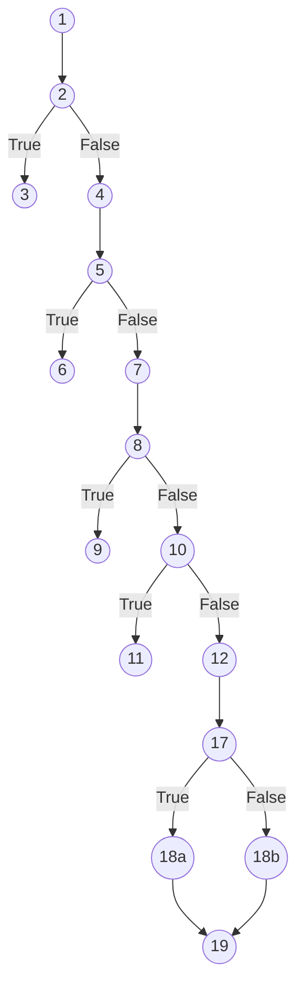
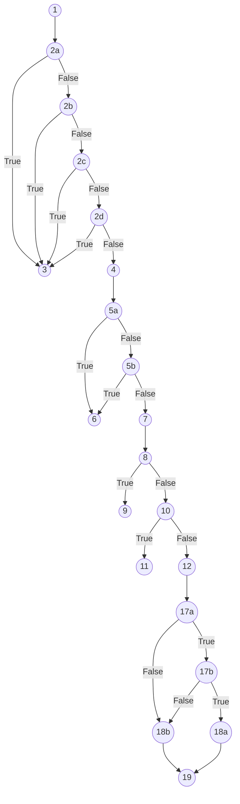
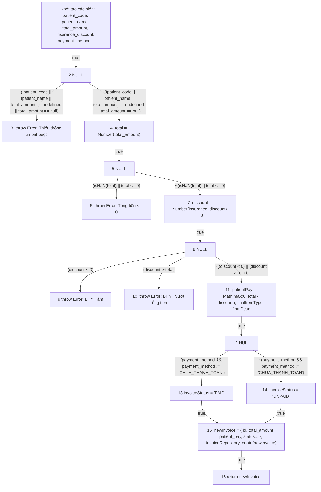
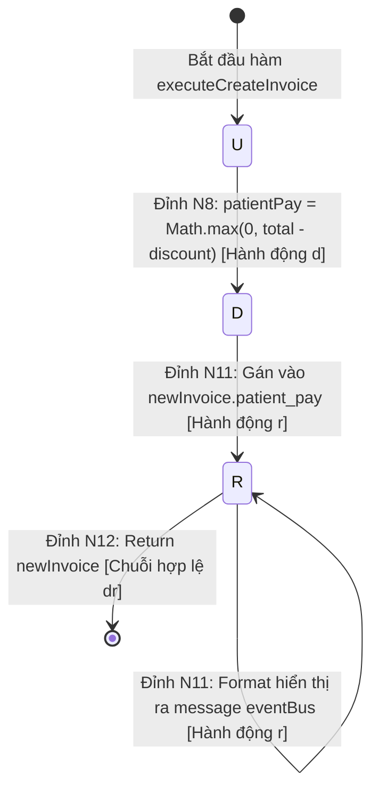

# KẾ HOẠCH & BÁO CÁO KIỂM THỬ HỘP TRẮNG (WHITE-BOX TESTING REPORT)
## CHỨC NĂNG: LẬP HÓA ĐƠN VIỆN PHÍ (HỆ THỐNG HIS-HOSPITAL)

**Người thực hiện:** Senior QA / White-Box Test Engineer (5 năm kinh nghiệm)  
**Phạm vi kiểm thử:** Chức năng Lập hóa đơn viện phí (`createInvoice` kết hợp quy tắc tính toán của `StandardBillingStrategy.calculate`)  
**Tập tin mã nguồn kiểm thử:** 
- [`backend/src/services/invoiceService.js`](file:///d:/KiemThuVaDamBaoChatLuongPhanMem/his-hospital/backend/src/services/invoiceService.js#L285-L347) (`createInvoice`)
- [`backend/src/patterns/strategy/billingStrategy.js`](file:///d:/KiemThuVaDamBaoChatLuongPhanMem/his-hospital/backend/src/patterns/strategy/billingStrategy.js#L6-L26) (`StandardBillingStrategy.calculate`)

**Tài liệu tham chiếu chuẩn:** [`Kiem_Thu_Hop_Trang_Control_Data_Flow.md`](file:///d:/KiemThuVaDamBaoChatLuongPhanMem/his-hospital/Kiem_Thu_Hop_Trang_Control_Data_Flow.md) (Dựa trên tài liệu đào tạo kiểm thử phần mềm `D:\Dowload\Cac ky thuat kiem thu phan mem 16-9-25.docx`).

---

## MỤC LỤC
- [KẾ HOẠCH \& BÁO CÁO KIỂM THỬ HỘP TRẮNG (WHITE-BOX TESTING REPORT)](#kế-hoạch--báo-cáo-kiểm-thử-hộp-trắng-white-box-testing-report)
  - [CHỨC NĂNG: LẬP HÓA ĐƠN VIỆN PHÍ (HỆ THỐNG HIS-HOSPITAL)](#chức-năng-lập-hóa-đơn-viện-phí-hệ-thống-his-hospital)
  - [MỤC LỤC](#mục-lục)
  - [1. TỔNG QUAN NGHIỆP VỤ \& QUY TẮC NGHIỆP VỤ](#1-tổng-quan-nghiệp-vụ--quy-tắc-nghiệp-vụ)
  - [2. ĐÁNH SỐ DÒNG MÃ NGUỒN CHUẨN THUẬT TOÁN (CHỈ ĐÁNH SỐ CÂU LỆNH THỰC THI)](#2-đánh-số-dòng-mã-nguồn-chuẩn-thuật-toán-chỉ-đánh-số-câu-lệnh-thực-thi)
  - [3. PHẦN I: KIỂM THỬ DÒNG ĐIỀU KHIỂN (CONTROL FLOW TESTING)](#3-phần-i-kiểm-thử-dòng-điều-khiển-control-flow-testing)
    - [3.1 Đồ thị dòng điều khiển CFG cho Độ đo C1 và C2](#31-đồ-thị-dòng-điều-khiển-cfg-cho-độ-đo-c1-và-c2)
    - [3.2 Phân tích độ phức tạp Cyclomatic $V(G)$ cho C1/C2](#32-phân-tích-độ-phức-tạp-cyclomatic-vg-cho-c1c2)
    - [3.3 Thiết kế ca kiểm thử cho Độ đo C1 (Statement Coverage)](#33-thiết-kế-ca-kiểm-thử-cho-độ-đo-c1-statement-coverage)
    - [3.4 Thiết kế ca kiểm thử cho Độ đo C2 (Branch / Decision Coverage)](#34-thiết-kế-ca-kiểm-thử-cho-độ-đo-c2-branch--decision-coverage)
      - [Bảng tổng hợp ca kiểm thử đạt 100% C2:](#bảng-tổng-hợp-ca-kiểm-thử-đạt-100-c2)
    - [3.5 Đồ thị dòng điều khiển CFG riêng cho Độ đo C3 (Multiple Condition Coverage)](#35-đồ-thị-dòng-điều-khiển-cfg-riêng-cho-độ-đo-c3-multiple-condition-coverage)
    - [3.6 Bảng phân tích điều kiện con và Thiết kế ca kiểm thử đạt 100% C3](#36-bảng-phân-tích-điều-kiện-con-và-thiết-kế-ca-kiểm-thử-đạt-100-c3)
      - [Bảng trạng thái chân lý của các điều kiện con:](#bảng-trạng-thái-chân-lý-của-các-điều-kiện-con)
      - [Bảng chi tiết bộ ca kiểm thử đạt 100% C3:](#bảng-chi-tiết-bộ-ca-kiểm-thử-đạt-100-c3)
  - [4. PHẦN II: KIỂM THỬ DÒNG DỮ LIỆU (DATA FLOW TESTING)](#4-phần-ii-kiểm-thử-dòng-dữ-liệu-data-flow-testing)
    - [4.1 Cơ sở lý thuyết đồ thị dòng dữ liệu (DFG - Data Flow Graph)](#41-cơ-sở-lý-thuyết-đồ-thị-dòng-dữ-liệu-dfg---data-flow-graph)
    - [4.2 Bảng 1: Bảng mô tả `def(i)` và `c-use(i)` tại các đỉnh](#42-bảng-1-bảng-mô-tả-defi-và-c-usei-tại-các-đỉnh)
    - [4.3 Bảng 2: Các điều kiện và `p-use` của các cạnh](#43-bảng-2-các-điều-kiện-và-p-use-của-các-cạnh)
    - [4.4 Đồ thị dòng dữ liệu (DFG - Data Flow Graph)](#44-đồ-thị-dòng-dữ-liệu-dfg---data-flow-graph)
    - [4.5 Bảng tổng hợp chi tiết Def-Use theo biến (All Variables Mapping)](#45-bảng-tổng-hợp-chi-tiết-def-use-theo-biến-all-variables-mapping)
    - [4.6 Phân tích bất thường dòng dữ liệu (Anomalies Loại 1 `dd`, Loại 2 `ur`, Loại 3 `du`)](#46-phân-tích-bất-thường-dòng-dữ-liệu-anomalies-loại-1-dd-loại-2-ur-loại-3-du)
    - [4.7 Sơ đồ chuyển trạng thái U-D-R-A cho biến cốt lõi `patientPay`](#47-sơ-đồ-chuyển-trạng-thái-u-d-r-a-cho-biến-cốt-lõi-patientpay)
    - [4.8 Sinh đường đi và Ca kiểm thử ứng với Độ đo All c-use](#48-sinh-đường-đi-và-ca-kiểm-thử-ứng-với-độ-đo-all-c-use)
      - [1. Định nghĩa độ đo All c-use (Tất cả các sử dụng tính toán):](#1-định-nghĩa-độ-đo-all-c-use-tất-cả-các-sử-dụng-tính-toán)
      - [2. Bảng sinh đường đi cho độ đo All c-use:](#2-bảng-sinh-đường-đi-cho-độ-đo-all-c-use)
      - [3. Bảng thiết kế các ca kiểm thử đạt 100% độ đo All c-use:](#3-bảng-thiết-kế-các-ca-kiểm-thử-đạt-100-độ-đo-all-c-use)
    - [4.9 Sinh đường đi và Ca kiểm thử ứng với Độ đo All p-use](#49-sinh-đường-đi-và-ca-kiểm-thử-ứng-với-độ-đo-all-p-use)
      - [1. Định nghĩa độ đo All p-use (Tất cả các sử dụng vị từ / rẽ nhánh):](#1-định-nghĩa-độ-đo-all-p-use-tất-cả-các-sử-dụng-vị-từ--rẽ-nhánh)
      - [2. Bảng sinh đường đi cho độ đo All p-use:](#2-bảng-sinh-đường-đi-cho-độ-đo-all-p-use)
      - [3. Bảng thiết kế các ca kiểm thử đạt 100% độ đo All p-use:](#3-bảng-thiết-kế-các-ca-kiểm-thử-đạt-100-độ-đo-all-p-use)
    - [4.10 Bảng so sánh mức độ bao phủ giữa All c-use và All p-use](#410-bảng-so-sánh-mức-độ-bao-phủ-giữa-all-c-use-và-all-p-use)
  - [5. KỊCH BẢN THỰC THI KIỂM THỬ TỰ ĐỘNG (AUTOMATED TEST SUITE)](#5-kịch-bản-thực-thi-kiểm-thử-tự-động-automated-test-suite)
  - [6. TỔNG KẾT \& KHUYẾN NGHỊ TỐI ƯU](#6-tổng-kết--khuyến-nghị-tối-ưu)

---

## 1. TỔNG QUAN NGHIỆP VỤ & QUY TẮC NGHIỆP VỤ

Chức năng **Lập hóa đơn viện phí** tiếp nhận thông tin viện phí của bệnh nhân và tiến hành lưu hóa đơn vào cơ sở dữ liệu.
Quy trình nghiệp vụ bao gồm:
1. **Kiểm tra thông tin bắt buộc:** Mã bệnh nhân (`patient_code`), Họ tên (`patient_name`), Tổng số tiền (`total_amount`). Nếu thiếu $\rightarrow$ Báo lỗi HTTP 400.
2. **Kiểm tra tính hợp lệ của tiền viện phí:** Tổng tiền phải $> 0$ và là số hợp lệ. Nếu không $\rightarrow$ Báo lỗi.
3. **Kiểm tra mức giảm trừ BHYT:** Số tiền BHYT chi trả không được âm và không được vượt quá tổng số tiền hóa đơn.
4. **Tính toán số tiền bệnh nhân phải nộp:** $\text{patientPay} = \max(0, \text{total} - \text{discount})$.
5. **Gán giá trị mặc định & xác định trạng thái thanh toán:**
   - Nếu phương thức thanh toán là `"CHUA_THANH_TOAN"` $\rightarrow$ trạng thái `UNPAID`.
   - Nếu đã chọn phương thức thanh toán (`"TIEN_MAT"`, `"VIETQR"`,...) $\rightarrow$ trạng thái `PAID`.
6. **Lưu hóa đơn & Phát sự kiện:** Ghi nhận vào cơ sở dữ liệu và phát sự kiện `INVOICE_CREATED`.

---

## 2. ĐÁNH SỐ DÒNG MÃ NGUỒN CHUẨN THUẬT TOÁN (CHỈ ĐÁNH SỐ CÂU LỆNH THỰC THI)

> **Quy chuẩn đánh số:** Tuyệt đối **không đánh số dòng comment** và **không đánh số dòng trống**. Chỉ đánh số các câu lệnh gán, khai báo, điều kiện quyết định, quăng lỗi hoặc gọi hàm thực thi.

```javascript
function executeCreateInvoice(payload) {

1.  const { patient_code, patient_name, item_type, description, total_amount, insurance_discount = 0, insurance_percent = 0, payment_method = "CHUA_THANH_TOAN", cashier = "Trần Văn Thu Ngân", items = [], reference_id = null } = payload || {};

2.  if (!patient_code || !patient_name || total_amount === undefined || total_amount === null)

3.      throw new Error("Thiếu thông tin bắt buộc (mã BN, tên BN, tổng số tiền)");

4.  const total = Number(total_amount);

5.  if (isNaN(total) || total <= 0)

6.      throw new Error("Tổng tiền hóa đơn phải lớn hơn 0");

7.  const discount = Number(insurance_discount) || 0;

8.  if (discount < 0)

9.      throw new Error("Mức giảm trừ bảo hiểm không được là số âm");

10. if (discount > total)

11.     throw new Error("Mức giảm trừ bảo hiểm không hợp lệ (vượt quá tổng tiền)");

12. const patientPay = Math.max(0, total - discount);

13. const calculation = { totalAmount: total, insuranceDiscount: discount, patientPay };

14. const nextId = invoiceRepository.getNextId();

15. const finalItemType = item_type || "TIEN_KHAM";

16. const finalDesc = description || "Thanh toán viện phí";

17. const isPaid = payment_method && payment_method !== "CHUA_THANH_TOAN";

18. const invoiceStatus = isPaid ? "PAID" : "UNPAID";

19. const newInvoice = { id: nextId, invoice_code: `HD${String(nextId).padStart(6, "0")}`, patient_code, patient_name, item_type: finalItemType, description: finalDesc, total_amount: calculation.totalAmount, insurance_discount: calculation.insuranceDiscount, insurance_percent, patient_pay: calculation.patientPay, payment_method, status: invoiceStatus, cashier, items, reference_id };

20. invoiceRepository.create(newInvoice);

21. eventBus.emitEvent("INVOICE_CREATED", { invoice: newInvoice });

22. return newInvoice;

}
```

---

## 3. PHẦN I: KIỂM THỬ DÒNG ĐIỀU KHIỂN (CONTROL FLOW TESTING)

### 3.1 Đồ thị dòng điều khiển CFG cho Độ đo C1 và C2

Trong đồ thị C1/C2, mỗi cấu trúc rẽ nhánh `if` được xem như **một điểm quyết định đơn nhất** (xét giá trị chân lý toàn cục của biểu thức True hoặc False):
- **Đỉnh 1:** Khối khởi tạo, nhận và bóc tách `payload`.
- **Đỉnh 2:** Điểm quyết định kiểm tra bắt buộc `(!patient_code || !patient_name || total_amount === undefined || total_amount === null)`.
- **Đỉnh 3:** Quăng ngoại lệ thiếu thông tin bắt buộc $\rightarrow$ Kết thúc sớm lỗi 1.
- **Đỉnh 4:** Khối ép kiểu `total = Number(total_amount)`.
- **Đỉnh 5:** Điểm quyết định kiểm tra tiền hợp lệ `(isNaN(total) || total <= 0)`.
- **Đỉnh 6:** Quăng ngoại lệ tổng tiền $\le 0$ $\rightarrow$ Kết thúc sớm lỗi 2.
- **Đỉnh 7:** Khối ép kiểu `discount = Number(insurance_discount) || 0`.
- **Đỉnh 8:** Điểm quyết định kiểm tra giảm trừ âm `(discount < 0)`.
- **Đỉnh 9:** Quăng ngoại lệ giảm trừ BHYT âm $\rightarrow$ Kết thúc sớm lỗi 3.
- **Đỉnh 10:** Điểm quyết định kiểm tra giảm trừ vượt tổng tiền `(discount > total)`.
- **Đỉnh 11:** Quăng ngoại lệ giảm trừ BHYT vượt quá tổng tiền $\rightarrow$ Kết thúc sớm lỗi 4.
- **Đỉnh 12-16:** Khối tính `patientPay`, lấy `nextId`, gán fallback `item_type`, `description`.
- **Đỉnh 17:** Điểm quyết định kiểm tra thanh toán ngay `(payment_method && payment_method !== "CHUA_THANH_TOAN")`.
- **Đỉnh 18a:** Nhánh True của 17: `invoiceStatus = "PAID"`.
- **Đỉnh 18b:** Nhánh False của 17: `invoiceStatus = "UNPAID"`.
- **Đỉnh 19-22:** Khối tạo `newInvoice`, lưu DB, phát event và return $\rightarrow$ Kết thúc thành công.



---

### 3.2 Phân tích độ phức tạp Cyclomatic $V(G)$ cho C1/C2

Trên đồ thị C1/C2:
- Số điểm quyết định $P = 5$ (tại các đỉnh 2, 5, 8, 10, 17).
- Công thức McCabe:
  $$V(G) = P + 1 = 5 + 1 = 6$$
$\Rightarrow$ Cần tối thiểu **6 đường đi cơ sở (Basis Paths)** để bao phủ toàn bộ luồng rẽ nhánh của đồ thị C1/C2.

---

### 3.3 Thiết kế ca kiểm thử cho Độ đo C1 (Statement Coverage)

Mục tiêu C1: Thực thi qua tất cả các câu lệnh từ câu lệnh 1 đến 22 ít nhất một lần.  
Tập hợp các ca kiểm thử đạt 100% C1:
- Cần kích hoạt 4 nhánh `throw` (câu lệnh 3, 6, 9, 11).
- Cần đi qua nhánh gán `PAID` (câu lệnh 18a) và `UNPAID` (câu lệnh 18b) cùng toàn bộ khối xử lý thành công (câu lệnh 19-22).

| TT | Mã TC | Đường đi kiểm thử | Bộ dữ liệu đầu vào (`payload`) | Kết quả mong đợi | Câu lệnh được phủ |
| :---: | :---: | :--- | :--- | :--- | :--- |
| 1 | **TC_C1_01** | $1 \rightarrow 2 \rightarrow 3$ | `{ patient_name: "Nguyễn Văn A", total_amount: 100000 }` (thiếu `patient_code`) | Lỗi: *"Thiếu thông tin bắt buộc..."* | 1, 2, 3 |
| 2 | **TC_C1_02** | $1 \rightarrow 2 \rightarrow 4 \rightarrow 5 \rightarrow 6$ | `{ patient_code: "BN01", patient_name: "Nguyễn Văn A", total_amount: 0 }` | Lỗi: *"Tổng tiền hóa đơn phải lớn hơn 0"* | 4, 5, 6 |
| 3 | **TC_C1_03** | $1 \rightarrow 2 \rightarrow 4 \rightarrow 5 \rightarrow 7 \rightarrow 8 \rightarrow 9$ | `{ patient_code: "BN01", patient_name: "Nguyễn Văn A", total_amount: 100000, insurance_discount: -20000 }` | Lỗi: *"Mức giảm trừ bảo hiểm không được là số âm"* | 7, 8, 9 |
| 4 | **TC_C1_04** | $1 \rightarrow 2 \rightarrow 4 \rightarrow 5 \rightarrow 7 \rightarrow 8 \rightarrow 10 \rightarrow 11$ | `{ patient_code: "BN01", patient_name: "Nguyễn Văn A", total_amount: 100000, insurance_discount: 150000 }` | Lỗi: *"Mức giảm trừ bảo hiểm không hợp lệ (vượt quá tổng tiền)"* | 10, 11 |
| 5 | **TC_C1_05** | $1 \rightarrow 2 \rightarrow 4 \rightarrow 5 \rightarrow 7 \rightarrow 8 \rightarrow 10 \rightarrow 12..16 \rightarrow 17 \rightarrow 18b \rightarrow 19..22$ | `{ patient_code: "BN01", patient_name: "Nguyễn Văn A", total_amount: 100000, insurance_discount: 80000, payment_method: "CHUA_THANH_TOAN" }` | Thành công: `status = "UNPAID"`, `patient_pay = 20000` | 12, 13, 14, 15, 16, 17, 18b, 19, 20, 21, 22 |
| 6 | **TC_C1_06** | $1 \rightarrow 2 \rightarrow 4 \rightarrow 5 \rightarrow 7 \rightarrow 8 \rightarrow 10 \rightarrow 12..16 \rightarrow 17 \rightarrow 18a \rightarrow 19..22$ | `{ patient_code: "BN02", patient_name: "Trần Thị B", total_amount: 200000, insurance_discount: 0, payment_method: "TIEN_MAT" }` | Thành công: `status = "PAID"`, `patient_pay = 200000` | 18a |

> **Tỷ lệ bao phủ C1:** $\mathbf{22 / 22}$ câu lệnh = **100%**.

---

### 3.4 Thiết kế ca kiểm thử cho Độ đo C2 (Branch / Decision Coverage)

Mục tiêu C2: Mọi điểm quyết định tại các đỉnh 2, 5, 8, 10, 17 đều phải có ca kiểm thử thực thi nhánh **ĐÚNG (True)** và nhánh **SAI (False)**.

| Điểm quyết định | Biểu thức điều kiện | Nhánh ĐÚNG (True) | Nhánh SAI (False) |
| :---: | :--- | :---: | :---: |
| **Đỉnh 2** | `!patient_code \|\| !patient_name \|\| total_amount === undefined \|\| total_amount === null` | **TC_C2_01** (Nhảy sang Đỉnh 3) | **TC_C2_02** (Đi tiếp Đỉnh 4) |
| **Đỉnh 5** | `isNaN(total) \|\| total <= 0` | **TC_C2_03** (Nhảy sang Đỉnh 6) | **TC_C2_04** (Đi tiếp Đỉnh 7) |
| **Đỉnh 8** | `discount < 0` | **TC_C2_05** (Nhảy sang Đỉnh 9) | **TC_C2_06** (Đi tiếp Đỉnh 10) |
| **Đỉnh 10** | `discount > total` | **TC_C2_07** (Nhảy sang Đỉnh 11) | **TC_C2_08** (Đi tiếp Đỉnh 12-16) |
| **Đỉnh 17** | `payment_method && payment_method !== "CHUA_THANH_TOAN"` | **TC_C2_09** (Nhánh 18a: `PAID`) | **TC_C2_10** (Nhánh 18b: `UNPAID`) |

#### Bảng tổng hợp ca kiểm thử đạt 100% C2:
| Mã TC | Điểm QĐ phủ | Bộ dữ liệu đầu vào | Kết quả mong đợi |
| :---: | :--- | :--- | :--- |
| **TC_C2_01** | Đỉnh 2 (True) | `{ patient_name: "Lê Văn C", total_amount: 100000 }` (thiếu `patient_code`) | Lỗi HTTP 400 |
| **TC_C2_02** | Đỉnh 2 (False), Đỉnh 5 (False), Đỉnh 8 (False), Đỉnh 10 (False), Đỉnh 17 (False) | `{ patient_code: "BN03", patient_name: "Lê Văn C", total_amount: 500000, insurance_discount: 100000, payment_method: "CHUA_THANH_TOAN" }` | Tạo thành công hóa đơn `UNPAID`, `patient_pay = 400000` |
| **TC_C2_03** | Đỉnh 5 (True) | `{ patient_code: "BN03", patient_name: "Lê Văn C", total_amount: -1000 }` | Lỗi: *"Tổng tiền hóa đơn phải lớn hơn 0"* |
| **TC_C2_05** | Đỉnh 8 (True) | `{ patient_code: "BN03", patient_name: "Lê Văn C", total_amount: 500000, insurance_discount: -1 }` | Lỗi: *"Mức giảm trừ bảo hiểm không được là số âm"* |
| **TC_C2_07** | Đỉnh 10 (True) | `{ patient_code: "BN03", patient_name: "Lê Văn C", total_amount: 500000, insurance_discount: 600000 }` | Lỗi: *"Mức giảm trừ bảo hiểm không hợp lệ..."* |
| **TC_C2_09** | Đỉnh 17 (True) | `{ patient_code: "BN03", patient_name: "Lê Văn C", total_amount: 500000, insurance_discount: 0, payment_method: "VIETQR" }` | Tạo thành công hóa đơn `PAID`, `patient_pay = 500000` |

> **Tỷ lệ bao phủ C2:** $\mathbf{10 / 10}$ nhánh quyết định = **100%**.

---

### 3.5 Đồ thị dòng điều khiển CFG riêng cho Độ đo C3 (Multiple Condition Coverage)

Tại độ đo C3, các biểu thức điều kiện phức hợp được tách nhỏ thành **từng điều kiện con độc lập** để kiểm soát ngắn mạch (short-circuit evaluation).
- **Điểm quyết định 2** gồm 4 điều kiện con:
  - (2a): `!patient_code`
  - (2b): `!patient_name`
  - (2c): `total_amount === undefined`
  - (2d): `total_amount === null`
- **Điểm quyết định 5** gồm 2 điều kiện con:
  - (5a): `isNaN(total)`
  - (5b): `total <= 0`
- **Điểm quyết định 17** gồm 2 điều kiện con:
  - (17a): `Boolean(payment_method)`
  - (17b): `payment_method !== "CHUA_THANH_TOAN"`



---

### 3.6 Bảng phân tích điều kiện con và Thiết kế ca kiểm thử đạt 100% C3

#### Bảng trạng thái chân lý của các điều kiện con:

| Điểm QĐ | Điều kiện con | Biến cố kiểm tra | Trạng thái cần đạt | Ca kiểm thử phủ |
| :---: | :--- | :--- | :---: | :---: |
| **2** | $2a: !\text{patient\_code}$ | `patient_code = ""` hoặc `undefined` | **True** / **False** | TC_C3_01 (True) / TC_C3_02 (False) |
| **2** | $2b: !\text{patient\_name}$ | `patient_name = ""` hoặc `null` | **True** / **False** | TC_C3_02 (True) / TC_C3_03 (False) |
| **2** | $2c: \text{total\_amount} === \text{undefined}$ | Thuộc tính `total_amount` bị bỏ qua | **True** / **False** | TC_C3_03 (True) / TC_C3_04 (False) |
| **2** | $2d: \text{total\_amount} === \text{null}$ | `total_amount = null` | **True** / **False** | TC_C3_04 (True) / TC_C3_05 (False) |
| **5** | $5a: \text{isNaN}(total)$ | `total_amount = "abc"` | **True** / **False** | TC_C3_05 (True) / TC_C3_06 (False) |
| **5** | $5b: total \le 0$ | `total_amount = 0` hoặc `-50000` | **True** / **False** | TC_C3_06 (True) / TC_C3_07 (False) |
| **8** | $8: discount < 0$ | `insurance_discount = -10000` | **True** / **False** | TC_C3_07 (True) / TC_C3_08 (False) |
| **10** | $10: discount > total$ | `insurance_discount = 200000 > total = 100000` | **True** / **False** | TC_C3_08 (True) / TC_C3_09 (False) |
| **17** | $17a: \text{Boolean}(payment\_method)$ | `payment_method = ""` hoặc `null` | **False** / **True** | TC_C3_10 (False) / TC_C3_09 (True) |
| **17** | $17b: payment\_method \neq \text{"CHUA\_THANH\_TOAN"}$ | `payment_method = "CHUA_THANH_TOAN"` vs `"TIEN_MAT"` | **False** / **True** | TC_C3_11 (False) / TC_C3_09 (True) |

#### Bảng chi tiết bộ ca kiểm thử đạt 100% C3:
| Mã TC | Điều kiện con kích hoạt | Dữ liệu đầu vào (`payload`) | Kết quả mong đợi |
| :---: | :--- | :--- | :--- |
| **TC_C3_01** | $2a = \text{True}$ | `{ patient_code: "", patient_name: "Nguyễn Văn A", total_amount: 100000 }` | Quăng lỗi: Thiếu thông tin bắt buộc |
| **TC_C3_02** | $2a = \text{False}, 2b = \text{True}$ | `{ patient_code: "BN01", patient_name: "", total_amount: 100000 }` | Quăng lỗi: Thiếu thông tin bắt buộc |
| **TC_C3_03** | $2a = \text{F}, 2b = \text{F}, 2c = \text{True}$ | `{ patient_code: "BN01", patient_name: "Nguyễn Văn A", total_amount: undefined }` | Quăng lỗi: Thiếu thông tin bắt buộc |
| **TC_C3_04** | $2a = \text{F}, 2b = \text{F}, 2c = \text{F}, 2d = \text{True}$ | `{ patient_code: "BN01", patient_name: "Nguyễn Văn A", total_amount: null }` | Quăng lỗi: Thiếu thông tin bắt buộc |
| **TC_C3_05** | $2 = \text{False}, 5a = \text{True}$ | `{ patient_code: "BN01", patient_name: "Nguyễn Văn A", total_amount: "KHONG_PHAI_SO" }` | Quăng lỗi: Tổng tiền phải lớn hơn 0 |
| **TC_C3_06** | $2 = \text{False}, 5a = \text{False}, 5b = \text{True}$ | `{ patient_code: "BN01", patient_name: "Nguyễn Văn A", total_amount: 0 }` | Quăng lỗi: Tổng tiền phải lớn hơn 0 |
| **TC_C3_07** | $5 = \text{False}, 8 = \text{True}$ | `{ patient_code: "BN01", patient_name: "Nguyễn Văn A", total_amount: 100000, insurance_discount: -5000 }` | Quăng lỗi: Giảm trừ BHYT không được âm |
| **TC_C3_08** | $8 = \text{False}, 10 = \text{True}$ | `{ patient_code: "BN01", patient_name: "Nguyễn Văn A", total_amount: 100000, insurance_discount: 120000 }` | Quăng lỗi: Giảm trừ BHYT vượt quá tổng tiền |
| **TC_C3_09** | $17a = \text{True}, 17b = \text{True}$ | `{ patient_code: "BN01", patient_name: "Nguyễn Văn A", total_amount: 100000, insurance_discount: 20000, payment_method: "TIEN_MAT" }` | Tạo thành công hóa đơn `PAID`, `patient_pay = 80000` |
| **TC_C3_10** | $17a = \text{False}$ (rỗng) | `{ patient_code: "BN01", patient_name: "Nguyễn Văn A", total_amount: 100000, insurance_discount: 20000, payment_method: "" }` | Tạo thành công hóa đơn `UNPAID` |
| **TC_C3_11** | $17a = \text{True}, 17b = \text{False}$ | `{ patient_code: "BN01", patient_name: "Nguyễn Văn A", total_amount: 100000, insurance_discount: 20000, payment_method: "CHUA_THANH_TOAN" }` | Tạo thành công hóa đơn `UNPAID` |

---

## 4. PHẦN II: KIỂM THỬ DÒNG DỮ LIỆU (DATA FLOW TESTING)

### 4.1 Cơ sở lý thuyết đồ thị dòng dữ liệu (DFG - Data Flow Graph)

Theo **Định nghĩa 6** trong tài liệu học tập kiểm thử phần mềm:
Đồ thị dòng dữ liệu của một đơn vị chương trình là một đồ thị có hướng $G = \langle N, E \rangle$, trong đó:
- **Tập đỉnh ($N$):** Tương ứng với các câu lệnh định nghĩa (`def`) hoặc sử dụng tính toán (`c-use`) của các biến. Đồ thị $G$ có hai đỉnh đặc biệt là đỉnh bắt đầu (tương ứng với lệnh `def` của các biến tham số) và đỉnh kết thúc đơn vị chương trình.
- **Tập cạnh ($E$):** Tương ứng với các câu lệnh hoặc biểu thức sử dụng trong điều kiện rẽ nhánh (`p-use`) của các biến.

---

### 4.2 Bảng 1: Bảng mô tả `def(i)` và `c-use(i)` tại các đỉnh

| Đỉnh $i$ | $def(i)$ | $c\text{-}use(i)$ |
| :---: | :--- | :--- |
| **1** | {patient_code, patient_name, total_amount, insurance_discount, payment_method, item_type, description, cashier, items, reference_id} | {} |
| **2** | {} | {} |
| **3** | {} | {} |
| **4** | {total} | {total_amount} |
| **5** | {} | {} |
| **6** | {} | {} |
| **7** | {discount} | {insurance_discount} |
| **8** | {} | {} |
| **9** | {} | {} |
| **10** | {} | {} |
| **11** | {patientPay, calculation, nextId, finalItemType, finalDesc} | {total, discount, item_type, description} |
| **12** | {} | {} |
| **13** | {invoiceStatus} | {} |
| **14** | {invoiceStatus} | {} |
| **15** | {newInvoice} | {nextId, patient_code, patient_name, finalItemType, finalDesc, calculation, payment_method, invoiceStatus, cashier, items, reference_id} |
| **16** | {} | {newInvoice} |

---

### 4.3 Bảng 2: Các điều kiện và `p-use` của các cạnh

| $(i, j)$ | Điều kiện tại cạnh $(i, j)$ | $p\text{-}use(i, j)$ |
| :---: | :--- | :---: |
| **(1, 2)** | True | {} |
| **(2, 3)** | (!patient_code \|\| !patient_name \|\| total_amount == undefined \|\| total_amount == null) | {patient_code, patient_name, total_amount} |
| **(2, 4)** | ~(!patient_code \|\| !patient_name \|\| total_amount == undefined \|\| total_amount == null) | {patient_code, patient_name, total_amount} |
| **(4, 5)** | True | {} |
| **(5, 6)** | (isNaN(total) \|\| total <= 0) | {total} |
| **(5, 7)** | ~(isNaN(total) \|\| total <= 0) | {total} |
| **(7, 8)** | True | {} |
| **(8, 9)** | (discount < 0) | {discount} |
| **(8, 10)** | (discount > total) | {discount, total} |
| **(8, 11)** | ~((discount < 0) \|\| (discount > total)) | {discount, total} |
| **(11, 12)** | True | {} |
| **(12, 13)** | (payment_method && payment_method != 'CHUA_THANH_TOAN') | {payment_method} |
| **(12, 14)** | ~(payment_method && payment_method != 'CHUA_THANH_TOAN') | {payment_method} |
| **(13, 15)** | True | {} |
| **(14, 15)** | True | {} |
| **(15, 16)** | True | {} |

---

### 4.4 Đồ thị dòng dữ liệu (DFG - Data Flow Graph)

Dưới đây là **Đồ thị dòng dữ liệu của hàm `createInvoice`** được xây dựng chuẩn xác theo phong cách bài giảng mẫu (tương tự đồ thị hàm `ReturnAverage`):
- Các đỉnh xử lý/tính toán/khởi tạo chứa câu lệnh tương ứng.
- Các đỉnh rẽ nhánh kiểm tra điều kiện được gán nhãn **`NULL`**.
- Các cạnh chuyển tiếp mang nhãn **biểu thức điều kiện**, **phủ định `~(...)`** hoặc **`true`**.



---

### 4.5 Bảng tổng hợp chi tiết Def-Use theo biến (All Variables Mapping)

| Tên biến | Điểm định nghĩa (`def`) | Điểm sử dụng tính toán (`c-use`) | Cạnh sử dụng trong điều kiện rẽ nhánh (`p-use`) |
| :--- | :--- | :--- | :--- |
| `payload` | Tham số hàm ($N_1$) | $N_1$ (Destructuring các trường) | - |
| `patient_code` | $N_1$ | $N_{11}$ (Gán vào `newInvoice`) | $(N_1, N_2)$, $(N_1, N_3)$ |
| `patient_name` | $N_1$ | $N_{11}$ (Gán `newInvoice`, nội dung `eventBus`) | $(N_1, N_2)$, $(N_1, N_3)$ |
| `total_amount` | $N_1$ | $N_3$ (`Number(total_amount)`) | $(N_1, N_2)$, $(N_1, N_3)$ |
| `total` | $N_3$ | $N_8$ (`total - discount`), $N_8$ (`calculation`) | $(N_3, N_4)$, $(N_3, N_5)$, $(N_5, N_7)$, $(N_5, N_8)$ |
| `insurance_discount` | $N_1$ | $N_5$ (`Number(insurance_discount)`) | - |
| `discount` | $N_5$ | $N_8$ (`total - discount`), $N_8$ (`calculation`) | $(N_5, N_6)$, $(N_5, N_7)$, $(N_5, N_8)$ |
| `patientPay` | $N_8$ | $N_8$ (`calculation`), $N_{11}$ (`newInvoice`) | - |
| `payment_method` | $N_1$ | $N_{11}$ (Gán vào `newInvoice`) | $(N_8, N_9)$, $(N_8, N_{10})$ |
| `invoiceStatus` | $N_9$, $N_{10}$ | $N_{11}$ (Gán vào `newInvoice.status`) | - |
| `newInvoice` | $N_{11}$ | $N_{11}$ (Gọi `create`, `emitEvent`), $N_{12}$ (`return`) | - |

---

### 4.6 Phân tích bất thường dòng dữ liệu (Anomalies Loại 1 `dd`, Loại 2 `ur`, Loại 3 `du`)

1. **Bất thường Loại 1 (`dd` - Gán giá trị rồi lại gán tiếp giá trị ngay sau đó mà không sử dụng):**
   - *Đánh giá:* **KHÔNG CÓ**. Tất cả các biến trung gian (`total`, `discount`, `patientPay`, `invoiceStatus`, `newInvoice`) đều được khai báo dạng `const` và khởi tạo duy nhất 1 lần, không xảy ra hiện tượng gán đè làm mất giá trị trước đó.
2. **Bất thường Loại 2 (`ur` - Chưa gán giá trị nhưng đã được sử dụng):**
   - *Phân tích rủi ro:* Nếu `payload` không có giá trị (`undefined`), việc đọc thuộc tính sẽ gây lỗi crash runtime `TypeError`.
   - *Phòng vệ mã nguồn:* Đoạn code đã dùng cơ chế fallback `payload || {}`, `insurance_discount = 0`, `payment_method = "CHUA_THANH_TOAN"`.
   - Đối với giá trị `total_amount`: Nhánh kiểm tra tại cạnh $(N_1, N_2)$ chặn triệt để trường hợp `undefined` hoặc `null`, ngăn chặn lỗi `NaN` trong phép tính tại $N_3$.
3. **Bất thường Loại 3 (`du` - Đã khai báo và gán giá trị nhưng không được sử dụng / Biến chết):**
   - *Đánh giá:* **KHÔNG CÓ**. Mọi biến được định nghĩa ở $N_1$, $N_3$, $N_5$, $N_8$ đều được truyền vào đối tượng `newInvoice` tại $N_{11}$ và trả về ở $N_{12}$.

---

### 4.7 Sơ đồ chuyển trạng thái U-D-R-A cho biến cốt lõi `patientPay`



Chuỗi biến đổi trạng thái là $U \xrightarrow{d} D \xrightarrow{r} R$. Biến không bao giờ rơi vào trạng thái lỗi $A$ (Anomaly).

---

### 4.8 Sinh đường đi và Ca kiểm thử ứng với Độ đo All c-use

#### 1. Định nghĩa độ đo All c-use (Tất cả các sử dụng tính toán):
- Với mỗi câu lệnh định nghĩa `def(v)` của biến $v$, bộ kiểm thử phải chứa ít nhất một đường đi **def-clear** từ điểm định nghĩa đó đến **mọi điểm sử dụng tính toán `c-use(v)`** của biến $v$.

#### 2. Bảng sinh đường đi cho độ đo All c-use:

| Tên biến | Điểm `def` | Điểm `c-use` | Đường đi kiểm thử hợp lệ (def-clear path) | Mục đích kiểm tra |
| :--- | :---: | :---: | :--- | :--- |
| `payload` | $N_1$ | $N_1$ | $N_1$ | Bóc tách an toàn các trường tham số từ `payload`. |
| `total_amount` | $N_1$ | $N_3$ | $N_1 \rightarrow N_3$ | Giá trị chuỗi/số của `total_amount` chuyển hóa thành `total` tại $N_3$. |
| `insurance_discount` | $N_1$ | $N_5$ | $N_1 \rightarrow N_3 \rightarrow N_5$ | Giá trị giảm trừ BHYT chuyển hóa thành `discount` tại $N_5$. |
| `total` | $N_3$ | $N_8$ | $N_3 \rightarrow N_5 \rightarrow N_8$ | Biến `total` được dùng trong phép trừ `total - discount` và object `calculation`. |
| `discount` | $N_5$ | $N_8$ | $N_5 \rightarrow N_8$ | Biến `discount` được dùng trong phép trừ `total - discount` và object `calculation`. |
| `patientPay` | $N_8$ | $N_8$ | $N_8$ | Dùng `patientPay` đóng gói vào `calculation.patientPay`. |
| `patientPay` | $N_8$ | $N_{11}$ | $N_8 \rightarrow N_9 \rightarrow N_{11}$ (hoặc qua $N_{10}$) | Dùng `patientPay` gán vào `newInvoice.patient_pay` và format tiền trên `eventBus`. |
| `patient_code` | $N_1$ | $N_{11}$ | $N_1 \rightarrow N_3 \rightarrow N_5 \rightarrow N_8 \rightarrow N_{10} \rightarrow N_{11}$ | Giá trị `patient_code` được bảo toàn xuyên suốt đến khi lưu hóa đơn. |
| `patient_name` | $N_1$ | $N_{11}$ | $N_1 \rightarrow N_3 \rightarrow N_5 \rightarrow N_8 \rightarrow N_{10} \rightarrow N_{11}$ | Giá trị `patient_name` được gán vào `newInvoice` và nội dung thông báo Event. |
| `item_type` | $N_1$ | $N_8$ | $N_1 \rightarrow N_3 \rightarrow N_5 \rightarrow N_8$ | Gán fallback `finalItemType = item_type \|\| "TIEN_KHAM"`. |
| `description` | $N_1$ | $N_8$ | $N_1 \rightarrow N_3 \rightarrow N_5 \rightarrow N_8$ | Gán fallback `finalDesc = description \|\| "Thanh toán viện phí"`. |
| `invoiceStatus` | $N_9$ | $N_{11}$ | $N_9 \rightarrow N_{11}$ | Trạng thái `PAID` được đưa vào `newInvoice.status`. |
| `invoiceStatus` | $N_{10}$ | $N_{11}$ | $N_{10} \rightarrow N_{11}$ | Trạng thái `UNPAID` được đưa vào `newInvoice.status`. |
| `newInvoice` | $N_{11}$ | $N_{12}$ | $N_{11} \rightarrow N_{12}$ | Đối tượng `newInvoice` sau khi lưu DB được trả về ở lệnh `return`. |

#### 3. Bảng thiết kế các ca kiểm thử đạt 100% độ đo All c-use:

| Mã TC | Biến & Cặp `def -> c-use` được phủ | Dữ liệu đầu vào (`payload`) | Kết quả mong đợi |
| :---: | :--- | :--- | :--- |
| **TC_CUSE_01** | `total_amount` ($N_1 \rightarrow N_3$), `insurance_discount` ($N_1 \rightarrow N_5$), `total` ($N_3 \rightarrow N_8$), `discount` ($N_5 \rightarrow N_8$), `patientPay` ($N_8 \rightarrow N_8, N_{11}$), `invoiceStatus` ($N_{10} \rightarrow N_{11}$), `newInvoice` ($N_{11} \rightarrow N_{12}$) | `{ patient_code: "BN01", patient_name: "Nguyễn Văn A", total_amount: 500000, insurance_discount: 100000, payment_method: "CHUA_THANH_TOAN" }` | Hóa đơn được tạo thành công:<br>- `total = 500000`<br>- `discount = 100000`<br>- `patient_pay = 400000`<br>- `status = "UNPAID"` |
| **TC_CUSE_02** | `invoiceStatus` ($N_9 \rightarrow N_{11}$), `item_type` ($N_1 \rightarrow N_8$), `description` ($N_1 \rightarrow N_8$), `newInvoice` ($N_{11} \rightarrow N_{12}$) | `{ patient_code: "BN02", patient_name: "Trần Thị B", item_type: "CAN_LAM_SANG", description: "Siêu âm tổng quát", total_amount: 300000, insurance_discount: 0, payment_method: "TIEN_MAT" }` | Hóa đơn được tạo thành công:<br>- `status = "PAID"`<br>- `item_type = "CAN_LAM_SANG"`<br>- `description = "Siêu âm tổng quát"`<br>- `patient_pay = 300000` |
| **TC_CUSE_03** | Fallback của `item_type`, `description` và `insurance_discount` ($N_1 \rightarrow N_5, N_8$) | `{ patient_code: "BN03", patient_name: "Lê Văn C", total_amount: 150000 }` *(không truyền item_type, description, insurance_discount)* | Hóa đơn được tạo với giá trị fallback:<br>- `discount = 0`<br>- `patient_pay = 150000`<br>- `item_type = "TIEN_KHAM"`<br>- `description = "Thanh toán viện phí"` |

---

### 4.9 Sinh đường đi và Ca kiểm thử ứng với Độ đo All p-use

#### 1. Định nghĩa độ đo All p-use (Tất cả các sử dụng vị từ / rẽ nhánh):
- Với mỗi câu lệnh định nghĩa `def(v)` của biến $v$, bộ kiểm thử phải chứa ít nhất một đường đi **def-clear** từ điểm định nghĩa đó đến **mọi cạnh sử dụng vị từ `p-use(v)`** của biến $v$.

#### 2. Bảng sinh đường đi cho độ đo All p-use:

| Tên biến | Điểm `def` | Cạnh `p-use` tương ứng | Đường đi kiểm thử hợp lệ (def-clear path) | Điều kiện kích hoạt cạnh |
| :--- | :---: | :---: | :--- | :--- |
| `patient_code` | $N_1$ | $(N_1, N_2)$ | $N_1 \rightarrow N_2$ | `!patient_code` nhận giá trị True. |
| `patient_code` | $N_1$ | $(N_1, N_3)$ | $N_1 \rightarrow N_3$ | `!patient_code` nhận giá trị False (đầy đủ). |
| `patient_name` | $N_1$ | $(N_1, N_2)$ | $N_1 \rightarrow N_2$ | `!patient_name` nhận giá trị True. |
| `patient_name` | $N_1$ | $(N_1, N_3)$ | $N_1 \rightarrow N_3$ | `!patient_name` nhận giá trị False (đầy đủ). |
| `total_amount` | $N_1$ | $(N_1, N_2)$ | $N_1 \rightarrow N_2$ | `total_amount === undefined \|\| null` nhận True. |
| `total_amount` | $N_1$ | $(N_1, N_3)$ | $N_1 \rightarrow N_3$ | `total_amount` hợp lệ nhận False. |
| `total` | $N_3$ | $(N_3, N_4)$ | $N_3 \rightarrow N_4$ | `isNaN(total) \|\| total <= 0` nhận True. |
| `total` | $N_3$ | $(N_3, N_5)$ | $N_3 \rightarrow N_5$ | `total > 0` nhận False (hợp lệ). |
| `total` | $N_3$ | $(N_5, N_7)$ | $N_3 \rightarrow N_5 \rightarrow N_7$ | `discount > total` nhận True. |
| `total` | $N_3$ | $(N_5, N_8)$ | $N_3 \rightarrow N_5 \rightarrow N_8$ | `discount <= total` nhận False (hợp lệ). |
| `discount` | $N_5$ | $(N_5, N_6)$ | $N_5 \rightarrow N_6$ | `discount < 0` nhận True. |
| `discount` | $N_5$ | $(N_5, N_7)$ | $N_5 \rightarrow N_7$ | `discount > total` nhận True. |
| `discount` | $N_5$ | $(N_5, N_8)$ | $N_5 \rightarrow N_8$ | `0 <= discount <= total` nhận Hợp lệ. |
| `payment_method` | $N_1$ | $(N_8, N_9)$ | $N_1 \rightarrow N_3 \rightarrow N_5 \rightarrow N_8 \rightarrow N_9$ | `payment_method && payment_method !== "CHUA_THANH_TOAN"` nhận True. |
| `payment_method` | $N_1$ | $(N_8, N_{10})$ | $N_1 \rightarrow N_3 \rightarrow N_5 \rightarrow N_8 \rightarrow N_{10}$ | `!payment_method \|\| payment_method === "CHUA_THANH_TOAN"` nhận True. |

#### 3. Bảng thiết kế các ca kiểm thử đạt 100% độ đo All p-use:

| Mã TC | Biến & Cạnh `p-use` được phủ | Dữ liệu đầu vào (`payload`) | Kết quả mong đợi |
| :---: | :--- | :--- | :--- |
| **TC_PUSE_01** | `patient_code` trên $(N_1, N_2)$ | `{ patient_code: "", patient_name: "Nguyễn Văn A", total_amount: 100000 }` | Quăng lỗi HTTP 400: Thiếu thông tin bắt buộc |
| **TC_PUSE_02** | `patient_name` trên $(N_1, N_2)$ | `{ patient_code: "BN01", patient_name: "", total_amount: 100000 }` | Quăng lỗi HTTP 400: Thiếu thông tin bắt buộc |
| **TC_PUSE_03** | `total_amount` trên $(N_1, N_2)$ | `{ patient_code: "BN01", patient_name: "Nguyễn Văn A", total_amount: null }` | Quăng lỗi HTTP 400: Thiếu thông tin bắt buộc |
| **TC_PUSE_04** | `total` trên $(N_3, N_4)$ | `{ patient_code: "BN01", patient_name: "Nguyễn Văn A", total_amount: -50000 }` | Quăng lỗi: Tổng tiền hóa đơn phải lớn hơn 0 |
| **TC_PUSE_05** | `discount` trên $(N_5, N_6)$ | `{ patient_code: "BN01", patient_name: "Nguyễn Văn A", total_amount: 200000, insurance_discount: -10000 }` | Quăng lỗi: Mức giảm trừ bảo hiểm không được là số âm |
| **TC_PUSE_06** | `total`, `discount` trên $(N_5, N_7)$ | `{ patient_code: "BN01", patient_name: "Nguyễn Văn A", total_amount: 200000, insurance_discount: 300000 }` | Quăng lỗi: Mức giảm trừ bảo hiểm không hợp lệ (vượt quá tổng tiền) |
| **TC_PUSE_07** | `payment_method` trên $(N_8, N_9)$ kèm các cạnh hợp lệ $(N_1, N_3), (N_3, N_5), (N_5, N_8)$ | `{ patient_code: "BN01", patient_name: "Nguyễn Văn A", total_amount: 200000, insurance_discount: 50000, payment_method: "VIETQR" }` | Tạo thành công hóa đơn `PAID`, `patient_pay = 150000` |
| **TC_PUSE_08** | `payment_method` trên $(N_8, N_{10})$ kèm các cạnh hợp lệ $(N_1, N_3), (N_3, N_5), (N_5, N_8)$ | `{ patient_code: "BN01", patient_name: "Nguyễn Văn A", total_amount: 200000, insurance_discount: 50000, payment_method: "CHUA_THANH_TOAN" }` | Tạo thành công hóa đơn `UNPAID`, `patient_pay = 150000` |

---

### 4.10 Bảng so sánh mức độ bao phủ giữa All c-use và All p-use

| Tiêu chí | Độ đo All c-use (Tất cả tính toán) | Độ đo All p-use (Tất cả vị từ) |
| :--- | :--- | :--- |
| **Trọng tâm kiểm tra** | Tính chính xác của các phép tính số học, ép kiểu, gán fallback và chuyển giao dữ liệu (`c-use`). | Mọi nhánh rẽ logic kiểm tra điều kiện của biến (`p-use`). |
| **Số đường đi kiểm thử cơ sở** | 14 đường đi def-clear | 15 đường đi def-clear |
| **Số ca kiểm thử tối thiểu** | **3 ca kiểm thử** (TC_CUSE_01 đến TC_CUSE_03) | **8 ca kiểm thử** (TC_PUSE_01 đến TC_PUSE_08) |
| **Lỗi tiêu biểu phát hiện** | Lỗi tính sai số tiền, lỗi sai số dấu phẩy động, `NaN`, gán nhầm thuộc tính đối tượng. | Lỗi sót điều kiện biên, lỗi lọt dữ liệu bẩn/âm, lỗi logic ngắn mạch (short-circuit). |

---

## 5. KỊCH BẢN THỰC THI KIỂM THỬ TỰ ĐỘNG (AUTOMATED TEST SUITE)

Mã nguồn kiểm thử tự động sử dụng **Node.js Test Runner & Assert** (chạy trực tiếp bằng lệnh `node --test`):

```javascript
import assert from "node:assert/strict";
import { test, describe, beforeEach, afterEach } from "node:test";
import { invoiceService } from "./invoiceService.js";
import { invoiceRepository } from "../repositories/invoiceRepository.js";
import { eventBus } from "../events/eventBus.js";

describe("KIỂM THỬ HỘP TRẮNG: HÀM createInvoice (HIS-HOSPITAL)", () => {
  let createdInvoices = [];
  let capturedEvents = [];
  let originalCreate, originalNextId, originalEmit;

  beforeEach(() => {
    createdInvoices = [];
    capturedEvents = [];
    originalCreate = invoiceRepository.create;
    originalNextId = invoiceRepository.getNextId;
    originalEmit = eventBus.emitEvent;

    let idCounter = 100;
    invoiceRepository.getNextId = () => ++idCounter;
    invoiceRepository.create = (inv) => {
      createdInvoices.push(inv);
      return inv;
    };
    eventBus.emitEvent = (event, data) => {
      capturedEvents.push({ event, data });
    };
  });

  afterEach(() => {
    invoiceRepository.create = originalCreate;
    invoiceRepository.getNextId = originalNextId;
    eventBus.emitEvent = originalEmit;
  });

  /* ---------------- PHẦN I: KIỂM THỬ DÒNG ĐIỀU KHIỂN (C1, C2, C3) ---------------- */

  test("TC_C3_01: Điều kiện con 2a (True) - Thiếu patient_code", () => {
    assert.throws(
      () => invoiceService.createInvoice({ patient_name: "Nguyễn Văn A", total_amount: 100000 }),
      (err) => err.statusCode === 400 && err.message.includes("Thiếu thông tin bắt buộc")
    );
  });

  test("TC_C3_02: Điều kiện con 2b (True) - Thiếu patient_name", () => {
    assert.throws(
      () => invoiceService.createInvoice({ patient_code: "BN01", patient_name: "", total_amount: 100000 }),
      (err) => err.statusCode === 400 && err.message.includes("Thiếu thông tin bắt buộc")
    );
  });

  test("TC_C3_03: Điều kiện con 2c (True) - total_amount là undefined", () => {
    assert.throws(
      () => invoiceService.createInvoice({ patient_code: "BN01", patient_name: "Nguyễn Văn A", total_amount: undefined }),
      (err) => err.statusCode === 400 && err.message.includes("Thiếu thông tin bắt buộc")
    );
  });

  test("TC_C3_04: Điều kiện con 2d (True) - total_amount là null", () => {
    assert.throws(
      () => invoiceService.createInvoice({ patient_code: "BN01", patient_name: "Nguyễn Văn A", total_amount: null }),
      (err) => err.statusCode === 400 && err.message.includes("Thiếu thông tin bắt buộc")
    );
  });

  test("TC_C3_05: Điều kiện con 5a (True) - total_amount không phải số (isNaN)", () => {
    assert.throws(
      () => invoiceService.createInvoice({ patient_code: "BN01", patient_name: "Nguyễn Văn A", total_amount: "KHONG_PHAI_SO" }),
      /Tổng tiền hóa đơn phải lớn hơn 0/
    );
  });

  test("TC_C3_06: Điều kiện con 5b (True) - total_amount = 0", () => {
    assert.throws(
      () => invoiceService.createInvoice({ patient_code: "BN01", patient_name: "Nguyễn Văn A", total_amount: 0 }),
      /Tổng tiền hóa đơn phải lớn hơn 0/
    );
  });

  test("TC_C3_07: Điểm quyết định 8 (True) - BHYT là số âm", () => {
    assert.throws(
      () => invoiceService.createInvoice({ patient_code: "BN01", patient_name: "Nguyễn Văn A", total_amount: 100000, insurance_discount: -5000 }),
      /Mức giảm trừ bảo hiểm không được là số âm/
    );
  });

  test("TC_C3_08: Điểm quyết định 10 (True) - BHYT vượt quá tổng tiền", () => {
    assert.throws(
      () => invoiceService.createInvoice({ patient_code: "BN01", patient_name: "Nguyễn Văn A", total_amount: 100000, insurance_discount: 120000 }),
      /vượt quá tổng tiền/
    );
  });

  test("TC_C3_09: Điểm quyết định 17 (True) - Thanh toán ngay (TIEN_MAT -> PAID)", () => {
    const invoice = invoiceService.createInvoice({
      patient_code: "BN01",
      patient_name: "Nguyễn Văn A",
      total_amount: 200000,
      insurance_discount: 50000,
      payment_method: "TIEN_MAT"
    });
    assert.equal(invoice.status, "PAID");
    assert.equal(invoice.patient_pay, 150000);
    assert.equal(capturedEvents.length, 1);
  });

  test("TC_C3_11: Điểm quyết định 17 (False) - Chưa thanh toán (CHUA_THANH_TOAN -> UNPAID)", () => {
    const invoice = invoiceService.createInvoice({
      patient_code: "BN01",
      patient_name: "Nguyễn Văn A",
      total_amount: 200000,
      insurance_discount: 50000,
      payment_method: "CHUA_THANH_TOAN"
    });
    assert.equal(invoice.status, "UNPAID");
    assert.equal(invoice.patient_pay, 150000);
    assert.equal(invoice.item_type, "TIEN_KHAM");
  });

  /* ---------------- PHẦN II: KIỂM THỬ DÒNG DỮ LIỆU (DATA FLOW) ---------------- */

  test("DFT_02: All-DU-Path cho insurance_discount không truyền (fallback 0)", () => {
    const invoice = invoiceService.createInvoice({
      patient_code: "BN02",
      patient_name: "Trần Thị B",
      total_amount: 300000
    });
    assert.equal(invoice.insurance_discount, 0);
    assert.equal(invoice.patient_pay, 300000);
  });

  test("DFT_05: Toàn vẹn dữ liệu từ def(patientPay) đến phát Event message", () => {
    const invoice = invoiceService.createInvoice({
      patient_code: "BN03",
      patient_name: "Lê Văn C",
      total_amount: 500000,
      insurance_discount: 100000,
      payment_method: "VIETQR"
    });
    assert.equal(invoice.patient_pay, 400000);
    assert.ok(capturedEvents[0].data.message.includes("400,000đ"));
  });
});
```

---

## 6. TỔNG KẾT & KHUYẾN NGHỊ TỐI ƯU

1. **Về phương pháp kiểm thử:**
   - **Tách biệt 2 sơ đồ CFG rõ ràng:**
     - Sơ đồ **C1/C2**: Xem các cụm `if` là các điểm quyết định đơn nhất để bao phủ câu lệnh và rẽ nhánh tổng thể.
     - Sơ đồ **C3**: Bóc tách chi tiết từng điều kiện con của biểu thức phức hợp để kiểm soát hiện tượng ngắn mạch (short-circuit evaluation).
   - **Đánh số dòng code chuẩn mực:** Đã chuẩn hóa chỉ đánh số các câu lệnh thực thi (1 đến 22), loại bỏ hoàn toàn việc đánh số dòng comment và dòng trống.
   - **Danh sách các đỉnh:** Đi theo đúng trình tự luồng thực thi từ điểm xuất phát đến các điểm kết thúc.
2. **Khuyến nghị từ Senior QA:**
   - Cần bổ sung kiểm tra chuỗi rỗng có khoảng trắng (`!patient_code.trim()`) để tránh việc người dùng nhập dấu cách mà vẫn vượt qua bộ kiểm tra.
   - Đảm bảo sử dụng hàm làm tròn số `Math.round(total - discount)` đối với tiền tệ để tránh lỗi sai số dấu phẩy động của JavaScript.
