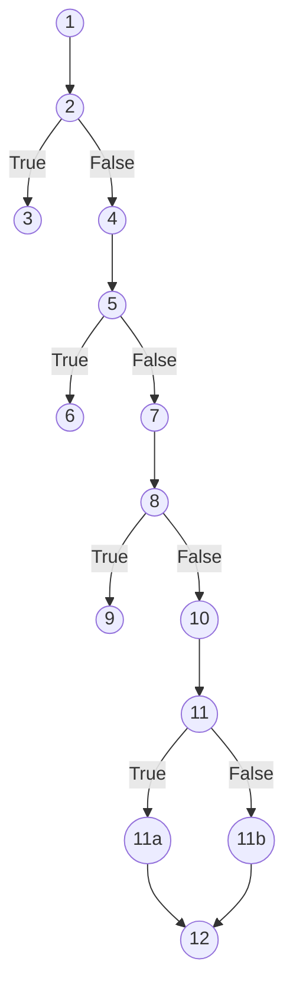
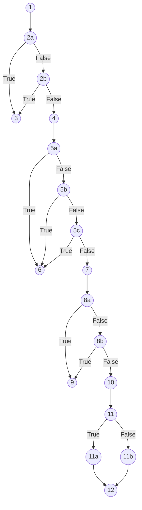
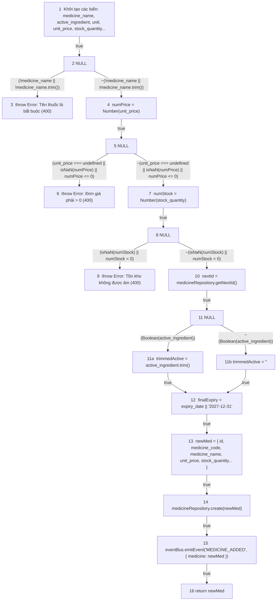
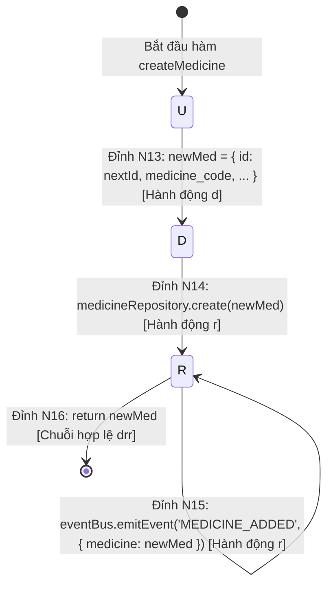
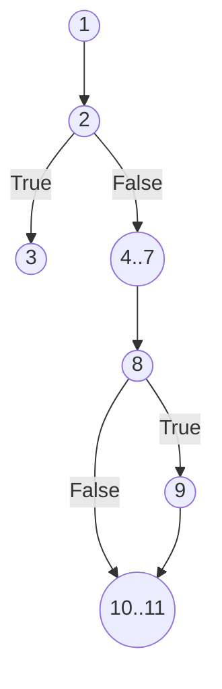
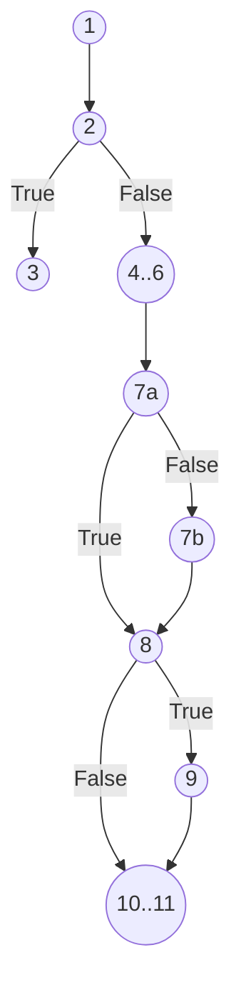
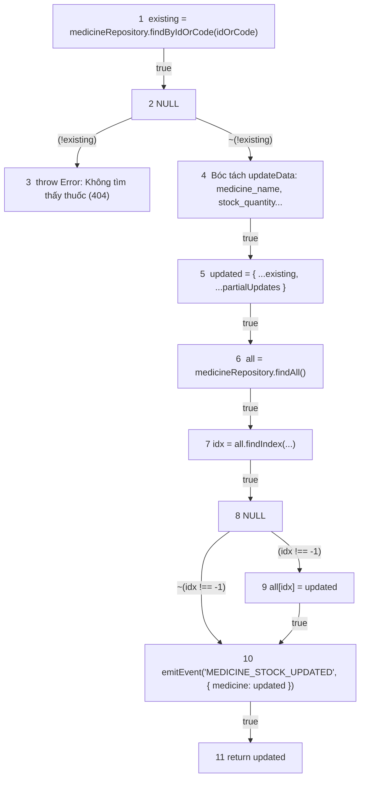
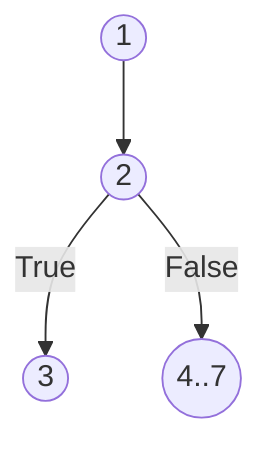
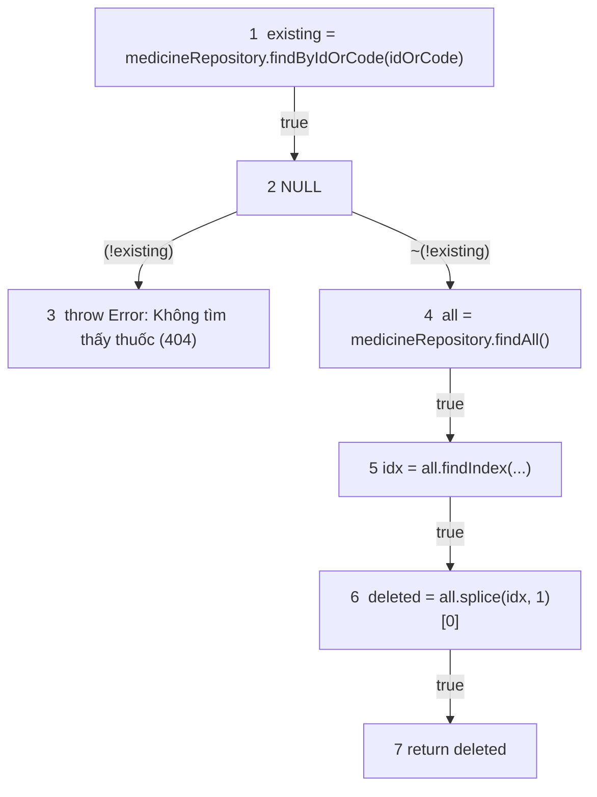

# KẾ HOẠCH & BÁO CÁO KIỂM THỬ HỘP TRẮNG (WHITE-BOX TESTING REPORT)
## CHỨC NĂNG: QUẢN LÝ DANH MỤC THUỐC VÀ TỒN KHO DƯỢC (TRỌN BỘ: THÊM - SỬA - XÓA)

**Người thực hiện:** Senior QA / White-Box Test Engineer (5 năm kinh nghiệm)  
**Phạm vi kiểm thử:** Trọn bộ chức năng Quản lý danh mục thuốc & Tồn kho dược trong `MedicineService`:
- **Chức năng 1 (THÊM THUỐC):** Thêm mới thuốc & Khởi tạo tồn kho (`createMedicine`)
- **Chức năng 2 (CẬP NHẬT THUỐC & TỒN KHO):** Cập nhật thông tin & Số lượng tồn kho (`updateMedicine`)
- **Chức năng 3 (XÓA THUỐC):** Xóa thuốc khỏi danh mục kho dược (`deleteMedicine`)

**Tập tin mã nguồn kiểm thử:** 
- [`backend/src/services/medicineService.js`](file:///d:/KiemThuVaDamBaoChatLuongPhanMem/his-hospital/backend/src/services/medicineService.js#L40-L143) (`createMedicine`, `updateMedicine`, `deleteMedicine`)
- [`backend/src/repositories/medicineRepository.js`](file:///d:/KiemThuVaDamBaoChatLuongPhanMem/his-hospital/backend/src/repositories/medicineRepository.js#L1-L35) (`medicineRepository`)

**Tài liệu tham chiếu chuẩn:** [`Kiem_Thu_Hop_Trang_Control_Data_Flow.md`](file:///d:/KiemThuVaDamBaoChatLuongPhanMem/his-hospital/Kiem_Thu_Hop_Trang_Control_Data_Flow.md) & [`Kiem_Thu_Hop_Trang_LapHoaDonVienPhi.md`](file:///d:/KiemThuVaDamBaoChatLuongPhanMem/his-hospital/Kiem_Thu_Hop_Trang_LapHoaDonVienPhi.md) (Dựa trên tài liệu đào tạo kiểm thử phần mềm `D:\Dowload\Cac ky thuat kiem thu phan mem 16-9-25.docx`).

---

## MỤC LỤC
- [A. CHỨC NĂNG 1: THÊM MỚI THUỐC VÀO KHO (createMedicine)](#a-chức-năng-1-thêm-mới-thuốc-vào-kho-createmedicine)
  - [1. TỔNG QUAN NGHIỆP VỤ \& QUY TẮC NGHIỆP VỤ](#1-tổng-quan-nghiệp-vụ--quy-tắc-nghiệp-vụ)
  - [2. ĐÁNH SỐ DÒNG MÃ NGUỒN CHUẨN THUẬT TOÁN](#2-đánh-số-dòng-mã-nguồn-chuẩn-thuật-toán)
  - [3. KIỂM THỬ DÒNG ĐIỀU KHIỂN (CONTROL FLOW TESTING - CFG)](#3-kiểm-thử-dòng-điều-khiển-control-flow-testing---cfg)
    - [3.1 Đồ thị dòng điều khiển CFG cho Độ đo C1 và C2](#31-đồ-thị-dòng-điều-khiển-cfg-cho-độ-đo-c1-và-c2)
    - [3.2 Phân tích độ phức tạp Cyclomatic $V(G)$ cho C1/C2](#32-phân-tích-độ-phức-tạp-cyclomatic-vg-cho-c1c2)
    - [3.3 Thiết kế ca kiểm thử cho Độ đo C1 (Statement Coverage)](#33-thiết-kế-ca-kiểm-thử-cho-độ-đo-c1-statement-coverage)
    - [3.4 Thiết kế ca kiểm thử cho Độ đo C2 (Branch / Decision Coverage)](#34-thiết-kế-ca-kiểm-thử-cho-độ-đo-c2-branch--decision-coverage)
    - [3.5 Đồ thị dòng điều khiển CFG riêng cho Độ đo C3 (Multiple Condition Coverage)](#35-đồ-thị-dòng-điều-khiển-cfg-riêng-cho-độ-đo-c3-multiple-condition-coverage)
    - [3.6 Bảng phân tích điều kiện con và Thiết kế ca kiểm thử đạt 100% C3](#36-bảng-phân-tích-điều-kiện-con-và-thiết-kế-ca-kiểm-thử-đạt-100-c3)
  - [4. KIỂM THỬ DÒNG DỮ LIỆU (DATA FLOW TESTING - DFG)](#4-kiểm-thử-dòng-dữ-liệu-data-flow-testing---dfg)
    - [4.1 Cơ sở lý thuyết đồ thị dòng dữ liệu (DFG)](#41-cơ-sở-lý-thuyết-đồ-thị-dòng-dữ-liệu-dfg)
    - [4.2 Bảng 1: Bảng mô tả `def(i)` và `c-use(i)` tại các đỉnh](#42-bảng-1-bảng-mô-tả-defi-và-c-usei-tại-các-đỉnh)
    - [4.3 Bảng 2: Các điều kiện và `p-use` của các cạnh](#43-bảng-2-các-điều-kiện-và-p-use-của-các-cạnh)
    - [4.4 Đồ thị dòng dữ liệu (DFG - Data Flow Graph)](#44-đồ-thị-dòng-dữ-liệu-dfg---data-flow-graph)
    - [4.5 Bảng tổng hợp chi tiết Def-Use theo biến (All Variables Mapping)](#45-bảng-tổng-hợp-chi-tiết-def-use-theo-biến-all-variables-mapping)
    - [4.6 Phân tích bất thường dòng dữ liệu (Anomalies Loại 1 `dd`, Loại 2 `ur`, Loại 3 `du`)](#46-phân-tích-bất-thường-dòng-dữ-liệu-anomalies-loại-1-dd-loại-2-ur-loại-3-du)
    - [4.7 Sơ đồ chuyển trạng thái U-D-R-A cho biến cốt lõi `newMed`](#47-sơ-đồ-chuyển-trạng-thái-u-d-r-a-cho-biến-cốt-lõi-newmed)
    - [4.8 Sinh đường đi và Ca kiểm thử ứng với Độ đo All c-use](#48-sinh-đường-đi-và-ca-kiểm-thử-ứng-với-độ-đo-all-c-use)
    - [4.9 Sinh đường đi và Ca kiểm thử ứng với Độ đo All p-use](#49-sinh-đường-đi-và-ca-kiểm-thử-ứng-với-độ-đo-all-p-use)
    - [4.10 Bảng so sánh mức độ bao phủ giữa All c-use và All p-use](#410-bảng-so-sánh-mức-độ-bao-phủ-giữa-all-c-use-và-all-p-use)
- [B. CHỨC NĂNG 2: CẬP NHẬT THUỐC & TỒN KHO (updateMedicine)](#b-chức-năng-2-cập-nhật-thuốc--tồn-kho-updatemedicine)
  - [1. Tổng quan nghiệp vụ Cập nhật](#1-tổng-quan-nghiệp-vụ-cập-nhật)
  - [2. Đánh số dòng mã nguồn chuẩn thuật toán (`updateMedicine`)](#2-đánh-số-dòng-mã-nguồn-chuẩn-thuật-toán-updatemedicine)
  - [3. Kiểm thử dòng điều khiển (CFG) - Chức năng Cập nhật](#3-kiểm-thử-dòng-điều-khiển-cfg---chức-năng-cập-nhật)
    - [3.1 Đồ thị CFG C1/C2 \& Độ phức tạp Cyclomatic $V(G)$](#31-đồ-thị-cfg-c1c2--độ-phức-tạp-cyclomatic-vg)
    - [3.2 Thiết kế ca kiểm thử đạt 100% C1 và C2](#32-thiết-kế-ca-kiểm-thử-đạt-100-c1-và-c2)
    - [3.3 Đồ thị CFG C3 \& Bảng phân tích điều kiện con C3](#33-đồ-thị-cfg-c3--bảng-phân-tích-điều-kiện-con-c3)
  - [4. Kiểm thử dòng dữ liệu (DFG) - Chức năng Cập nhật](#4-kiểm-thử-dòng-dữ-liệu-dfg---chức-năng-cập-nhật)
    - [4.1 Bảng `def(i)` và `c-use(i)` tại các đỉnh](#41-bảng-defi-và-c-usei-tại-các-đỉnh)
    - [4.2 Bảng điều kiện và `p-use` của các cạnh](#42-bảng-điều-kiện-và-p-use-của-các-cạnh)
    - [4.3 Sơ đồ DFG Cập nhật](#43-sơ-đồ-dfg-cập-nhật)
    - [4.4 Ca kiểm thử đạt 100% All c-use và All p-use cho Cập nhật](#44-ca-kiểm-thử-đạt-100-all-c-use-và-all-p-use-cho-cập-nhật)
- [C. CHỨC NĂNG 3: XÓA THUỐC KHỎI KHO (deleteMedicine)](#c-chức-năng-3-xóa-thuốc-khỏi-kho-deletemedicine)
  - [1. Tổng quan nghiệp vụ Xóa](#1-tổng-quan-nghiệp-vụ-xóa)
  - [2. Đánh số dòng mã nguồn chuẩn thuật toán (`deleteMedicine`)](#2-đánh-số-dòng-mã-nguồn-chuẩn-thuật-toán-deletemedicine)
  - [3. Kiểm thử dòng điều khiển (CFG) - Chức năng Xóa](#3-kiểm-thử-dòng-điều-khiển-cfg---chức-năng-xóa)
  - [4. Kiểm thử dòng dữ liệu (DFG) - Chức năng Xóa](#4-kiểm-thử-dòng-dữ-liệu-dfg---chức-năng-xóa)
- [D. KỊCH BẢN THỰC THI KIỂM THỬ TỰ ĐỘNG TOÀN DIỆN (AUTOMATED TEST SUITE CHO CẢ 3 CHỨC NĂNG)](#d-kịch-bản-thực-thi-kiểm-thử-tự-động-toàn-diện-automated-test-suite-cho-cả-3-chức-năng)
- [E. TỔNG KẾT & KHUYẾN NGHỊ TỐI ƯU TOÀN DIỆN](#e-tổng-kết--khuyến-nghị-tối-ưu-toàn-diện)

---

# A. CHỨC NĂNG 1: THÊM MỚI THUỐC VÀO KHO (createMedicine)

## 1. TỔNG QUAN NGHIỆP VỤ & QUY TẮC NGHIỆP VỤ

Chức năng **Quản lý danh mục thuốc và tồn kho dược** trong hệ thống HIS-Hospital chịu trách nhiệm kiểm soát việc nhập mới thuốc vào kho dược, quản lý số lượng tồn, đơn giá, hoạt chất, quy cách đóng gói và cảnh báo hết hạn/hết hàng. Đơn vị kiểm thử trọng tâm là nghiệp vụ **Thêm mới thuốc vào kho và khởi tạo số lượng tồn kho** (`createMedicine` kết hợp cập nhật kho qua `medicineRepository`).

Quy trình nghiệp vụ bao gồm:
1. **Kiểm tra thông tin tên thuốc (`medicine_name`):** Tên thuốc là bắt buộc, không được để trống hoặc chỉ chứa khoảng trắng. Nếu vi phạm $\rightarrow$ Báo lỗi HTTP 400 (*"Tên thuốc là bắt buộc"*).
2. **Kiểm tra đơn giá thuốc (`unit_price`):**
   - Đơn giá không được để trống (`undefined`).
   - Đơn giá phải là số hợp lệ (`!isNaN(numPrice)`).
   - Đơn giá bắt buộc phải $> 0$.
   - Nếu vi phạm $\rightarrow$ Báo lỗi HTTP 400 (*"Đơn giá thuốc phải lớn hơn 0"*).
3. **Kiểm tra số lượng tồn kho khởi tạo (`stock_quantity`):**
   - Số lượng tồn kho phải là số hợp lệ và không được phép âm ($numStock \ge 0$).
   - Nếu vi phạm $\rightarrow$ Báo lỗi HTTP 400 (*"Số lượng tồn kho không được là số âm"*).
4. **Gán giá trị mặc định & Định dạng thông tin:**
   - Đơn vị tính (`unit`) mặc định là `"Viên"`.
   - Phân loại thuốc (`category`) mặc định là `"Khác"`.
   - Hạn sử dụng (`expiry_date`) nếu không truyền mặc định là `"2027-12-31"`.
   - Chuẩn hóa chuỗi: Cắt bỏ khoảng trắng đầu/cuối của tên thuốc (`medicine_name.trim()`) và hoạt chất (`active_ingredient.trim()`).
5. **Sinh mã thuốc tự động & Lưu trữ:**
   - Lấy ID tiếp theo từ kho (`getNextId()`).
   - Sinh mã thuốc tự động theo định dạng chuẩn: `MED` + chuỗi số 3 chữ số (ví dụ: `MED001`, `MED012`).
   - Lưu vào kho thuốc qua `medicineRepository.create(newMed)`.
6. **Phát tán sự kiện Realtime:**
   - Phát sự kiện `MEDICINE_ADDED` qua `eventBus` để đồng bộ thông tin kho tức thời đến các màn hình Bác sĩ (kê đơn), Thu ngân (tính tiền thuốc), và Dược sĩ (quản lý kho).

---

## 2. ĐÁNH SỐ DÒNG MÃ NGUỒN CHUẨN THUẬT TOÁN (CHỈ ĐÁNH SỐ CÂU LỆNH THỰC THI)

> **Quy chuẩn đánh số:** Tuyệt đối **không đánh số dòng comment** và **không đánh số dòng trống**. Chỉ đánh số các câu lệnh gán, khai báo, điều kiện quyết định, quăng lỗi hoặc gọi hàm thực thi.

```javascript
function executeCreateMedicine(payload) {

1.  const { medicine_name, active_ingredient, unit = "Viên", unit_price, stock_quantity = 0, category = "Khác", expiry_date } = payload || {};

2.  if (!medicine_name || !medicine_name.trim())

3.      throw Object.assign(new Error("Tên thuốc là bắt buộc"), { statusCode: 400 });

4.  const numPrice = Number(unit_price);

5.  if (unit_price === undefined || isNaN(numPrice) || numPrice <= 0)

6.      throw Object.assign(new Error("Đơn giá thuốc phải lớn hơn 0"), { statusCode: 400 });

7.  const numStock = Number(stock_quantity);

8.  if (isNaN(numStock) || numStock < 0)

9.      throw Object.assign(new Error("Số lượng tồn kho không được là số âm"), { statusCode: 400 });

10. const nextId = medicineRepository.getNextId();

11. const trimmedActive = active_ingredient ? active_ingredient.trim() : "";

12. const finalExpiry = expiry_date || "2027-12-31";

13. const newMed = { id: nextId, medicine_code: `MED${String(nextId).padStart(3, "0")}`, medicine_name: medicine_name.trim(), active_ingredient: trimmedActive, unit, unit_price: numPrice, stock_quantity: numStock, category, expiry_date: finalExpiry };

14. medicineRepository.create(newMed);

15. eventBus.emitEvent("MEDICINE_ADDED", { medicine: newMed, message: `Đã thêm thuốc mới vào kho: ${newMed.medicine_name} (${newMed.stock_quantity} ${newMed.unit})` });

16. return newMed;

}
```

---

## 3. PHẦN I: KIỂM THỬ DÒNG ĐIỀU KHIỂN (CONTROL FLOW TESTING)

### 3.1 Đồ thị dòng điều khiển CFG cho Độ đo C1 và C2

Trong đồ thị C1/C2, mỗi cấu trúc rẽ nhánh `if` được xem như **một điểm quyết định đơn nhất** (xét giá trị chân lý toàn cục của biểu thức True hoặc False):
- **Đỉnh 1:** Khởi tạo và bóc tách `payload`.
- **Đỉnh 2:** Điểm quyết định kiểm tra tên thuốc: `(!medicine_name || !medicine_name.trim())`.
- **Đỉnh 3:** Quăng ngoại lệ tên thuốc không hợp lệ (HTTP 400) $\rightarrow$ Kết thúc sớm lỗi 1.
- **Đỉnh 4:** Khối ép kiểu đơn giá: `numPrice = Number(unit_price)`.
- **Đỉnh 5:** Điểm quyết định kiểm tra đơn giá: `(unit_price === undefined || isNaN(numPrice) || numPrice <= 0)`.
- **Đỉnh 6:** Quăng ngoại lệ đơn giá thuốc $\le 0$ (HTTP 400) $\rightarrow$ Kết thúc sớm lỗi 2.
- **Đỉnh 7:** Khối ép kiểu số lượng tồn kho: `numStock = Number(stock_quantity)`.
- **Đỉnh 8:** Điểm quyết định kiểm tra tồn kho: `(isNaN(numStock) || numStock < 0)`.
- **Đỉnh 9:** Quăng ngoại lệ số lượng tồn kho âm (HTTP 400) $\rightarrow$ Kết thúc sớm lỗi 3.
- **Đỉnh 10:** Lấy ID tiếp theo: `nextId = medicineRepository.getNextId()`.
- **Đỉnh 11:** Điểm quyết định gán hoạt chất: `(active_ingredient ? active_ingredient.trim() : "")`.
- **Đỉnh 11a:** Nhánh True của 11: `trimmedActive = active_ingredient.trim()`.
- **Đỉnh 11b:** Nhánh False của 11: `trimmedActive = ""`.
- **Đỉnh 12-16:** Khối gán `finalExpiry`, đóng gói `newMed`, lưu kho, phát sự kiện và return $\rightarrow$ Kết thúc thành công.



---

### 3.2 Phân tích độ phức tạp Cyclomatic $V(G)$ cho C1/C2

Trên đồ thị C1/C2:
- Số đỉnh: $N = 12$ (Đỉnh 12_16 gom cụm câu lệnh 12-16 kết thúc).
- Số cạnh: $E = 15$.
- Số điểm quyết định đơn: $P = 4$ (tại các đỉnh 2, 5, 8, 11).
- Công thức McCabe:
  $$V(G) = P + 1 = 4 + 1 = 5$$
  *(Hoặc $V(G) = E - N + 2 = 15 - 12 + 2 = 5$)*

$\Rightarrow$ Cần tối thiểu **5 đường đi cơ sở (Basis Paths)** để bao phủ toàn bộ luồng rẽ nhánh của đồ thị C1/C2.

---

### 3.3 Thiết kế ca kiểm thử cho Độ đo C1 (Statement Coverage)

Mục tiêu C1: Thực thi qua tất cả các câu lệnh từ câu lệnh 1 đến câu lệnh 16 ít nhất một lần.  
Tập hợp các ca kiểm thử đạt 100% C1 cần kích hoạt:
- 3 nhánh lỗi `throw`: câu lệnh 3, 6, 9.
- 2 nhánh gán hoạt chất: có hoạt chất (câu lệnh 11a) và không có hoạt chất (câu lệnh 11b) cùng toàn bộ khối xử lý thành công (câu lệnh 12-16).

| TT | Mã TC | Đường đi kiểm thử | Bộ dữ liệu đầu vào (`payload`) | Kết quả mong đợi | Câu lệnh được phủ |
| :---: | :---: | :--- | :--- | :--- | :--- |
| 1 | **TC_MED_C1_01** | $1 \rightarrow 2 \rightarrow 3$ | `{ medicine_name: "   ", unit_price: 5000 }` | Lỗi HTTP 400: *"Tên thuốc là bắt buộc"* | 1, 2, 3 |
| 2 | **TC_MED_C1_02** | $1 \rightarrow 2 \rightarrow 4 \rightarrow 5 \rightarrow 6$ | `{ medicine_name: "Paracetamol 500mg", unit_price: 0 }` | Lỗi HTTP 400: *"Đơn giá thuốc phải lớn hơn 0"* | 4, 5, 6 |
| 3 | **TC_MED_C1_03** | $1 \rightarrow 2 \rightarrow 4 \rightarrow 5 \rightarrow 7 \rightarrow 8 \rightarrow 9$ | `{ medicine_name: "Paracetamol 500mg", unit_price: 2000, stock_quantity: -5 }` | Lỗi HTTP 400: *"Số lượng tồn kho không được là số âm"* | 7, 8, 9 |
| 4 | **TC_MED_C1_04** | $1 \rightarrow 2 \rightarrow 4 \rightarrow 5 \rightarrow 7 \rightarrow 8 \rightarrow 10 \rightarrow 11a \rightarrow 12..16$ | `{ medicine_name: "Amoxicillin 500mg", active_ingredient: "Amoxicillin", unit_price: 3500, stock_quantity: 200, unit: "Viên", category: "Kháng sinh" }` | Tạo thành công: `medicine_code = "MED001"`, `active_ingredient = "Amoxicillin"`, phát event | 10, 11a, 12, 13, 14, 15, 16 |
| 5 | **TC_MED_C1_05** | $1 \rightarrow 2 \rightarrow 4 \rightarrow 5 \rightarrow 7 \rightarrow 8 \rightarrow 10 \rightarrow 11b \rightarrow 12..16$ | `{ medicine_name: "Nước muối sinh lý 0.9%", unit_price: 10000, stock_quantity: 50 }` *(không truyền active_ingredient)* | Tạo thành công: `active_ingredient = ""`, dùng `unit = "Viên"` mặc định | 11b |

> **Tỷ lệ bao phủ C1:** $\mathbf{16 / 16}$ câu lệnh = **100%**.

---

### 3.4 Thiết kế ca kiểm thử cho Độ đo C2 (Branch / Decision Coverage)

Mục tiêu C2: Mọi điểm quyết định tại các đỉnh 2, 5, 8, 11 đều phải có ca kiểm thử thực thi ở cả hai nhánh **ĐÚNG (True)** và **SAI (False)**.

| Điểm quyết định | Biểu thức điều kiện | Nhánh ĐÚNG (True) | Nhánh SAI (False) |
| :---: | :--- | :---: | :---: |
| **Đỉnh 2** | `!medicine_name \|\| !medicine_name.trim()` | **TC_MED_C2_01** (Đi sang Đỉnh 3) | **TC_MED_C2_02** (Đi tiếp Đỉnh 4) |
| **Đỉnh 5** | `unit_price === undefined \|\| isNaN(numPrice) \|\| numPrice <= 0` | **TC_MED_C2_03** (Đi sang Đỉnh 6) | **TC_MED_C2_04** (Đi tiếp Đỉnh 7) |
| **Đỉnh 8** | `isNaN(numStock) \|\| numStock < 0` | **TC_MED_C2_05** (Đi sang Đỉnh 9) | **TC_MED_C2_06** (Đi tiếp Đỉnh 10) |
| **Đỉnh 11** | `Boolean(active_ingredient)` | **TC_MED_C2_07** (Nhánh 11a: Có hoạt chất) | **TC_MED_C2_08** (Nhánh 11b: Chuỗi rỗng) |

#### Bảng tổng hợp ca kiểm thử đạt 100% C2:

| Mã TC | Điểm QĐ phủ | Bộ dữ liệu đầu vào | Kết quả mong đợi |
| :---: | :--- | :--- | :--- |
| **TC_MED_C2_01** | Đỉnh 2 (True) | `{ medicine_name: "", unit_price: 10000 }` | Quăng lỗi: Tên thuốc là bắt buộc |
| **TC_MED_C2_02** | Đỉnh 2 (False), Đỉnh 5 (False), Đỉnh 8 (False), Đỉnh 11 (True) | `{ medicine_name: "Panadol Extra", active_ingredient: "Paracetamol, Caffeine", unit_price: 2500, stock_quantity: 500 }` | Tạo thành công thuốc, lưu kho và phát event |
| **TC_MED_C2_03** | Đỉnh 5 (True) | `{ medicine_name: "Panadol", unit_price: -100 }` | Quăng lỗi: Đơn giá thuốc phải lớn hơn 0 |
| **TC_MED_C2_05** | Đỉnh 8 (True) | `{ medicine_name: "Panadol", unit_price: 2000, stock_quantity: -10 }` | Quăng lỗi: Số lượng tồn kho không được là số âm |
| **TC_MED_C2_08** | Đỉnh 11 (False) | `{ medicine_name: "Bông băng y tế", unit_price: 5000, stock_quantity: 100 }` | Tạo thành công thuốc với `active_ingredient = ""` |

> **Tỷ lệ bao phủ C2:** $\mathbf{8 / 8}$ nhánh quyết định = **100%**.

---

### 3.5 Đồ thị dòng điều khiển CFG riêng cho Độ đo C3 (Multiple Condition Coverage)

Tại độ đo C3, các biểu thức điều kiện phức hợp được tách nhỏ thành **từng điều kiện con độc lập** để kiểm soát hiện tượng ngắn mạch (short-circuit evaluation):
- **Điểm quyết định 2** gồm 2 điều kiện con:
  - (2a): `!medicine_name`
  - (2b): `!medicine_name.trim()`
- **Điểm quyết định 5** gồm 3 điều kiện con:
  - (5a): `unit_price === undefined`
  - (5b): `isNaN(numPrice)`
  - (5c): `numPrice <= 0`
- **Điểm quyết định 8** gồm 2 điều kiện con:
  - (8a): `isNaN(numStock)`
  - (8b): `numStock < 0`
- **Điểm quyết định 11** gồm 1 điều kiện con:
  - (11): `Boolean(active_ingredient)`



---

### 3.6 Bảng phân tích điều kiện con và Thiết kế ca kiểm thử đạt 100% C3

#### Bảng trạng thái chân lý của các điều kiện con:

| Điểm QĐ | Điều kiện con | Biến cố kiểm tra | Trạng thái cần đạt | Ca kiểm thử phủ |
| :---: | :--- | :--- | :---: | :---: |
| **2** | $2a: !\text{medicine\_name}$ | `medicine_name = null` hoặc `undefined` | **True** / **False** | TC_MED_C3_01 (True) / TC_MED_C3_02 (False) |
| **2** | $2b: !\text{medicine\_name.trim()}$ | `medicine_name = "   "` (chỉ có khoảng trắng) | **True** / **False** | TC_MED_C3_02 (True) / TC_MED_C3_03 (False) |
| **5** | $5a: \text{unit\_price} === \text{undefined}$ | Không truyền trường `unit_price` | **True** / **False** | TC_MED_C3_03 (True) / TC_MED_C3_04 (False) |
| **5** | $5b: \text{isNaN}(numPrice)$ | `unit_price = "HAI_NGHIN"` | **True** / **False** | TC_MED_C3_04 (True) / TC_MED_C3_05 (False) |
| **5** | $5c: numPrice \le 0$ | `unit_price = 0` hoặc `-5000` | **True** / **False** | TC_MED_C3_05 (True) / TC_MED_C3_06 (False) |
| **8** | $8a: \text{isNaN}(numStock)$ | `stock_quantity = "KHONG_RO"` | **True** / **False** | TC_MED_C3_06 (True) / TC_MED_C3_07 (False) |
| **8** | $8b: numStock < 0$ | `stock_quantity = -1` | **True** / **False** | TC_MED_C3_07 (True) / TC_MED_C3_08 (False) |
| **11** | $11: \text{Boolean}(active\_ingredient)$ | Có truyền hoạt chất vs không truyền hoạt chất | **True** / **False** | TC_MED_C3_08 (True) / TC_MED_C3_09 (False) |

#### Bảng chi tiết bộ ca kiểm thử đạt 100% C3:

| Mã TC | Điều kiện con kích hoạt | Dữ liệu đầu vào (`payload`) | Kết quả mong đợi |
| :---: | :--- | :--- | :--- |
| **TC_MED_C3_01** | $2a = \text{True}$ | `{ medicine_name: null, unit_price: 5000 }` | Quăng lỗi HTTP 400: Tên thuốc là bắt buộc |
| **TC_MED_C3_02** | $2a = \text{False}, 2b = \text{True}$ | `{ medicine_name: "     ", unit_price: 5000 }` | Quăng lỗi HTTP 400: Tên thuốc là bắt buộc |
| **TC_MED_C3_03** | $2 = \text{False}, 5a = \text{True}$ | `{ medicine_name: "Aspirin 81mg" }` *(thiếu unit_price)* | Quăng lỗi HTTP 400: Đơn giá thuốc phải lớn hơn 0 |
| **TC_MED_C3_04** | $2 = \text{False}, 5a = \text{False}, 5b = \text{True}$ | `{ medicine_name: "Aspirin 81mg", unit_price: "ABC" }` | Quăng lỗi HTTP 400: Đơn giá thuốc phải lớn hơn 0 |
| **TC_MED_C3_05** | $2 = \text{False}, 5a = \text{F}, 5b = \text{F}, 5c = \text{True}$ | `{ medicine_name: "Aspirin 81mg", unit_price: 0 }` | Quăng lỗi HTTP 400: Đơn giá thuốc phải lớn hơn 0 |
| **TC_MED_C3_06** | $5 = \text{False}, 8a = \text{True}$ | `{ medicine_name: "Aspirin 81mg", unit_price: 1500, stock_quantity: "VO_HAN" }` | Quăng lỗi HTTP 400: Số lượng tồn kho không được là số âm |
| **TC_MED_C3_07** | $5 = \text{False}, 8a = \text{False}, 8b = \text{True}$ | `{ medicine_name: "Aspirin 81mg", unit_price: 1500, stock_quantity: -10 }` | Quăng lỗi HTTP 400: Số lượng tồn kho không được là số âm |
| **TC_MED_C3_08** | $8 = \text{False}, 11 = \text{True}$ | `{ medicine_name: "  Aspirin 81mg  ", active_ingredient: "  Acid acetylsalicylic  ", unit_price: "1500", stock_quantity: 100, unit: "Vỉ" }` | Tạo thành công: `medicine_name = "Aspirin 81mg"`, `active_ingredient = "Acid acetylsalicylic"`, `stock_quantity = 100` |
| **TC_MED_C3_09** | $8 = \text{False}, 11 = \text{False}$ | `{ medicine_name: "Băng cá nhân Urgo", unit_price: 2000, stock_quantity: 0 }` *(không truyền active_ingredient)* | Tạo thành công: `active_ingredient = ""`, `stock_quantity = 0`, `category = "Khác"`, `expiry_date = "2027-12-31"` |

---

## 4. PHẦN II: KIỂM THỬ DÒNG DỮ LIỆU (DATA FLOW TESTING)

### 4.1 Cơ sở lý thuyết đồ thị dòng dữ liệu (DFG - Data Flow Graph)

Theo **Định nghĩa 6** trong tài liệu kiểm thử phần mềm chuẩn:
Đồ thị dòng dữ liệu của hàm `createMedicine` là một đồ thị có hướng $G = \langle N, E \rangle$:
- **Tập đỉnh ($N$):** Tương ứng với các câu lệnh định nghĩa (`def`) hoặc sử dụng tính toán (`c-use`) của các biến.
- **Tập cạnh ($E$):** Tương ứng với các câu lệnh hoặc biểu thức sử dụng trong điều kiện rẽ nhánh (`p-use`) của các biến.

---

### 4.2 Bảng 1: Bảng mô tả `def(i)` và `c-use(i)` tại các đỉnh

| Đỉnh $i$ | $def(i)$ | $c\text{-}use(i)$ |
| :---: | :--- | :--- |
| **1** | {medicine_name, active_ingredient, unit, unit_price, stock_quantity, category, expiry_date} | {payload} |
| **2** | {} | {} |
| **3** | {} | {} |
| **4** | {numPrice} | {unit_price} |
| **5** | {} | {} |
| **6** | {} | {} |
| **7** | {numStock} | {stock_quantity} |
| **8** | {} | {} |
| **9** | {} | {} |
| **10** | {nextId} | {} |
| **11a** | {trimmedActive} | {active_ingredient} |
| **11b** | {trimmedActive} | {} |
| **12** | {finalExpiry} | {expiry_date} |
| **13** | {newMed} | {nextId, medicine_name, trimmedActive, unit, numPrice, numStock, category, finalExpiry} |
| **14** | {} | {newMed} |
| **15** | {} | {newMed} |
| **16** | {} | {newMed} |

---

### 4.3 Bảng 2: Các điều kiện và `p-use` của các cạnh

| $(i, j)$ | Điều kiện tại cạnh $(i, j)$ | $p\text{-}use(i, j)$ |
| :---: | :--- | :---: |
| **(1, 2)** | True | {} |
| **(2, 3)** | (!medicine_name \|\| !medicine_name.trim()) | {medicine_name} |
| **(2, 4)** | ~(!medicine_name \|\| !medicine_name.trim()) | {medicine_name} |
| **(4, 5)** | True | {} |
| **(5, 6)** | (unit_price === undefined \|\| isNaN(numPrice) \|\| numPrice <= 0) | {unit_price, numPrice} |
| **(5, 7)** | ~(unit_price === undefined \|\| isNaN(numPrice) \|\| numPrice <= 0) | {unit_price, numPrice} |
| **(7, 8)** | True | {} |
| **(8, 9)** | (isNaN(numStock) \|\| numStock < 0) | {numStock} |
| **(8, 10)** | ~(isNaN(numStock) \|\| numStock < 0) | {numStock} |
| **(10, 11)** | True | {} |
| **(11, 11a)** | (Boolean(active_ingredient)) | {active_ingredient} |
| **(11, 11b)** | ~(Boolean(active_ingredient)) | {active_ingredient} |
| **(11a, 12)** | True | {} |
| **(11b, 12)** | True | {} |
| **(12, 13)** | True | {} |
| **(13, 14)** | True | {} |
| **(14, 15)** | True | {} |
| **(15, 16)** | True | {} |

---

### 4.4 Đồ thị dòng dữ liệu (DFG - Data Flow Graph)

Dưới đây là **Đồ thị dòng dữ liệu của hàm `createMedicine`** theo đúng phong cách tài liệu kiểm thử mẫu:
- Các đỉnh xử lý/tính toán/khởi tạo chứa câu lệnh tương ứng.
- Các đỉnh rẽ nhánh kiểm tra điều kiện được gán nhãn **`NULL`**.
- Các cạnh chuyển tiếp mang nhãn **biểu thức điều kiện**, **phủ định `~(...)`** hoặc **`true`**.



---

### 4.5 Bảng tổng hợp chi tiết Def-Use theo biến (All Variables Mapping)

| Tên biến | Điểm định nghĩa (`def`) | Điểm sử dụng tính toán (`c-use`) | Cạnh sử dụng trong điều kiện rẽ nhánh (`p-use`) |
| :--- | :--- | :--- | :--- |
| `payload` | Tham số hàm ($N_1$) | $N_1$ (Bóc tách destructuring) | - |
| `medicine_name` | $N_1$ | $N_{13}$ (`medicine_name.trim()`) | $(N_2, N_3)$, $(N_2, N_4)$ |
| `unit_price` | $N_1$ | $N_4$ (`Number(unit_price)`) | $(N_5, N_6)$, $(N_5, N_7)$ |
| `numPrice` | $N_4$ | $N_{13}$ (Gán vào `newMed.unit_price`) | $(N_5, N_6)$, $(N_5, N_7)$ |
| `stock_quantity` | $N_1$ | $N_7$ (`Number(stock_quantity)`) | - |
| `numStock` | $N_7$ | $N_{13}$ (Gán vào `newMed.stock_quantity`) | $(N_8, N_9)$, $(N_8, N_{10})$ |
| `active_ingredient`| $N_1$ | $N_{11a}$ (`active_ingredient.trim()`) | $(N_{11}, N_{11a})$, $(N_{11}, N_{11b})$ |
| `trimmedActive` | $N_{11a}, N_{11b}$ | $N_{13}$ (Gán vào `newMed.active_ingredient`) | - |
| `expiry_date` | $N_1$ | $N_{12}$ (`expiry_date \|\| "2027-12-31"`) | - |
| `finalExpiry` | $N_{12}$ | $N_{13}$ (Gán vào `newMed.expiry_date`) | - |
| `nextId` | $N_{10}$ | $N_{13}$ (Gán vào `newMed.id` và format `medicine_code`) | - |
| `newMed` | $N_{13}$ | $N_{14}$ (`repository.create`), $N_{15}$ (`emitEvent`), $N_{16}$ (`return`) | - |

---

### 4.6 Phân tích bất thường dòng dữ liệu (Anomalies Loại 1 `dd`, Loại 2 `ur`, Loại 3 `du`)

1. **Bất thường Loại 1 (`dd` - Gán đè giá trị mà không sử dụng giá trị trước):**
   - *Đánh giá:* **KHÔNG CÓ**. Các biến trung gian (`numPrice`, `numStock`, `nextId`, `finalExpiry`, `newMed`) đều là hằng số (`const`) và chỉ gán một lần duy nhất.
2. **Bất thường Loại 2 (`ur` - Sử dụng biến khi chưa gán giá trị hợp lệ):**
   - *Phòng vệ mã nguồn:*
     - Khi `payload` là `undefined` hoặc `null`, cơ chế fallback `payload || {}` kích hoạt an toàn.
     - Các trường `unit = "Viên"`, `stock_quantity = 0`, `category = "Khác"` đều có giá trị mặc định chống `undefined`.
     - `trimmedActive` được bảo vệ bởi rẽ nhánh kiểm tra `active_ingredient` tại $N_{11}$, ngăn chặn lỗi crash `TypeError: Cannot read properties of undefined (reading 'trim')`.
     - `numPrice` và `numStock` đều được ép kiểu `Number()` và kiểm tra `isNaN()` trước khi đưa vào cấu trúc thực thể.
3. **Bất thường Loại 3 (`du` - Khai báo, gán giá trị nhưng không dùng đến):**
   - *Đánh giá:* **KHÔNG CÓ**. Mọi tham số và biến trung gian sau khi tính toán đều được đưa vào đối tượng `newMed` ở $N_{13}$, lưu vào DB ở $N_{14}$, phát sự kiện ở $N_{15}$ và trả về ở $N_{16}$.

---

### 4.7 Sơ đồ chuyển trạng thái U-D-R-A cho biến cốt lõi `newMed`



Chuỗi biến đổi trạng thái của thực thể `newMed` là $U \xrightarrow{d} D \xrightarrow{r} R \xrightarrow{r} R$. Biến không bao giờ rơi vào trạng thái lỗi $A$ (Anomaly).

---

### 4.8 Sinh đường đi và Ca kiểm thử ứng với Độ đo All c-use

#### 1. Định nghĩa độ đo All c-use (Tất cả các sử dụng tính toán):
- Với mỗi câu lệnh định nghĩa `def(v)` của biến $v$, bộ kiểm thử phải chứa ít nhất một đường đi **def-clear** từ điểm định nghĩa đó đến **mọi điểm sử dụng tính toán `c-use(v)`** của biến $v$.

#### 2. Bảng sinh đường đi cho độ đo All c-use:

| Tên biến | Điểm `def` | Điểm `c-use` | Đường đi kiểm thử hợp lệ (def-clear path) | Mục đích kiểm tra |
| :--- | :---: | :---: | :--- | :--- |
| `payload` | $N_1$ | $N_1$ | $N_1$ | Trích xuất các trường từ `payload`. |
| `medicine_name` | $N_1$ | $N_{13}$ | $N_1 \rightarrow N_4 \rightarrow N_7 \rightarrow N_{10} \rightarrow N_{13}$ | Cắt tỉa khoảng trắng `medicine_name.trim()` gán vào `newMed`. |
| `unit_price` | $N_1$ | $N_4$ | $N_1 \rightarrow N_4$ | Chuyển đổi `Number(unit_price)` thành `numPrice`. |
| `numPrice` | $N_4$ | $N_{13}$ | $N_4 \rightarrow N_7 \rightarrow N_{10} \rightarrow N_{13}$ | Đưa `numPrice` vào `newMed.unit_price`. |
| `stock_quantity` | $N_1$ | $N_7$ | $N_1 \rightarrow N_4 \rightarrow N_7$ | Chuyển đổi `Number(stock_quantity)` thành `numStock`. |
| `numStock` | $N_7$ | $N_{13}$ | $N_7 \rightarrow N_{10} \rightarrow N_{13}$ | Đưa `numStock` vào `newMed.stock_quantity`. |
| `active_ingredient`| $N_1$ | $N_{11a}$ | $N_1 \rightarrow N_4 \rightarrow N_7 \rightarrow N_{10} \rightarrow N_{11a}$ | Cắt khoảng trắng hoạt chất `active_ingredient.trim()`. |
| `trimmedActive` | $N_{11a}$ | $N_{13}$ | $N_{11a} \rightarrow N_{12} \rightarrow N_{13}$ | Đưa hoạt chất hợp lệ vào `newMed.active_ingredient`. |
| `trimmedActive` | $N_{11b}$ | $N_{13}$ | $N_{11b} \rightarrow N_{12} \rightarrow N_{13}$ | Đưa chuỗi rỗng `""` vào `newMed.active_ingredient`. |
| `expiry_date` | $N_1$ | $N_{12}$ | $N_1 \rightarrow N_4 \rightarrow N_7 \rightarrow N_{10} \rightarrow N_{12}$ | Lấy ngày hết hạn hoặc dùng fallback `"2027-12-31"`. |
| `nextId` | $N_{10}$ | $N_{13}$ | $N_{10} \rightarrow N_{13}$ | Tạo `medicine_code` dạng `MED${pad(nextId)}`. |
| `newMed` | $N_{13}$ | $N_{14}, N_{15}, N_{16}$ | $N_{13} \rightarrow N_{14} \rightarrow N_{15} \rightarrow N_{16}$ | Lưu kho DB, phát thông báo EventBus và return. |

#### 3. Bảng thiết kế các ca kiểm thử đạt 100% độ đo All c-use:

| Mã TC | Biến & Cặp `def -> c-use` được phủ | Dữ liệu đầu vào (`payload`) | Kết quả mong đợi |
| :---: | :--- | :--- | :--- |
| **TC_MED_CUSE_01** | `medicine_name`, `numPrice`, `numStock`, `active_ingredient` ($N_1 \rightarrow N_{11a}$), `trimmedActive` ($N_{11a} \rightarrow N_{13}$), `expiry_date`, `nextId`, `newMed` | `{ medicine_name: "  Paracetamol 500mg ", active_ingredient: "  Paracetamol ", unit: "Viên", unit_price: "2000", stock_quantity: 500, category: "Giảm đau", expiry_date: "2028-06-30" }` | Thuốc được tạo thành công:<br>- `medicine_name = "Paracetamol 500mg"`<br>- `active_ingredient = "Paracetamol"`<br>- `unit_price = 2000`<br>- `stock_quantity = 500`<br>- `expiry_date = "2028-06-30"` |
| **TC_MED_CUSE_02** | `trimmedActive` ($N_{11b} \rightarrow N_{13}$), fallback `expiry_date` ($N_{12} \rightarrow N_{13}$), fallback `unit`, fallback `category` | `{ medicine_name: "Oresol 245", unit_price: 5000, stock_quantity: 100 }` *(không truyền active_ingredient, unit, category, expiry_date)* | Thuốc được tạo thành công với giá trị fallback:<br>- `active_ingredient = ""` (từ $N_{11b}$)<br>- `unit = "Viên"`<br>- `category = "Khác"`<br>- `expiry_date = "2027-12-31"` |
| **TC_MED_CUSE_03** | Fallback `stock_quantity = 0` ($N_1 \rightarrow N_7 \rightarrow N_{13}$) | `{ medicine_name: "Cồn đỏ Povidine 10%", unit_price: 15000 }` *(không truyền stock_quantity)* | Thuốc được tạo thành công với `stock_quantity = 0`. |

---

### 4.9 Sinh đường đi và Ca kiểm thử ứng với Độ đo All p-use

#### 1. Định nghĩa độ đo All p-use (Tất cả các sử dụng vị từ / rẽ nhánh):
- Với mỗi câu lệnh định nghĩa `def(v)` của biến $v$, bộ kiểm thử phải chứa ít nhất một đường đi **def-clear** từ điểm định nghĩa đó đến **mọi cạnh sử dụng vị từ `p-use(v)`** của biến $v$.

#### 2. Bảng sinh đường đi cho độ đo All p-use:

| Tên biến | Điểm `def` | Cạnh `p-use` tương ứng | Đường đi kiểm thử hợp lệ (def-clear path) | Điều kiện kích hoạt cạnh |
| :--- | :---: | :---: | :--- | :--- |
| `medicine_name` | $N_1$ | $(N_2, N_3)$ | $N_1 \rightarrow N_2 \rightarrow N_3$ | `!medicine_name \|\| !medicine_name.trim()` nhận True. |
| `medicine_name` | $N_1$ | $(N_2, N_4)$ | $N_1 \rightarrow N_2 \rightarrow N_4$ | Tên thuốc hợp lệ (nhận False). |
| `unit_price` | $N_1$ | $(N_5, N_6)$ | $N_1 \rightarrow N_4 \rightarrow N_5 \rightarrow N_6$ | `unit_price === undefined` nhận True. |
| `numPrice` | $N_4$ | $(N_5, N_6)$ | $N_4 \rightarrow N_5 \rightarrow N_6$ | `isNaN(numPrice) \|\| numPrice <= 0` nhận True. |
| `numPrice` | $N_4$ | $(N_5, N_7)$ | $N_4 \rightarrow N_5 \rightarrow N_7$ | `numPrice > 0` nhận False (hợp lệ). |
| `numStock` | $N_7$ | $(N_8, N_9)$ | $N_7 \rightarrow N_8 \rightarrow N_9$ | `isNaN(numStock) \|\| numStock < 0` nhận True. |
| `numStock` | $N_7$ | $(N_8, N_{10})$ | $N_7 \rightarrow N_8 \rightarrow N_{10}$ | `numStock >= 0` nhận False (hợp lệ). |
| `active_ingredient`| $N_1$ | $(N_{11}, N_{11a})$ | $N_1 \rightarrow N_4 \rightarrow N_7 \rightarrow N_{10} \rightarrow N_{11a}$ | `Boolean(active_ingredient)` nhận True. |
| `active_ingredient`| $N_1$ | $(N_{11}, N_{11b})$ | $N_1 \rightarrow N_4 \rightarrow N_7 \rightarrow N_{10} \rightarrow N_{11b}$ | `Boolean(active_ingredient)` nhận False. |

#### 3. Bảng thiết kế các ca kiểm thử đạt 100% độ đo All p-use:

| Mã TC | Biến & Cạnh `p-use` được phủ | Dữ liệu đầu vào (`payload`) | Kết quả mong đợi |
| :---: | :--- | :--- | :--- |
| **TC_MED_PUSE_01** | `medicine_name` trên $(N_2, N_3)$ | `{ medicine_name: "", unit_price: 5000 }` | Quăng lỗi HTTP 400: Tên thuốc là bắt buộc |
| **TC_MED_PUSE_02** | `unit_price` trên $(N_5, N_6)$ | `{ medicine_name: "Klacid 500mg" }` *(thiếu unit_price)* | Quăng lỗi HTTP 400: Đơn giá thuốc phải lớn hơn 0 |
| **TC_MED_PUSE_03** | `numPrice` trên $(N_5, N_6)$ | `{ medicine_name: "Klacid 500mg", unit_price: -500 }` | Quăng lỗi HTTP 400: Đơn giá thuốc phải lớn hơn 0 |
| **TC_MED_PUSE_04** | `numStock` trên $(N_8, N_9)$ | `{ medicine_name: "Klacid 500mg", unit_price: 25000, stock_quantity: -1 }` | Quăng lỗi HTTP 400: Số lượng tồn kho không được là số âm |
| **TC_MED_PUSE_05** | `active_ingredient` trên $(N_{11}, N_{11a})$ kèm các cạnh hợp lệ $(N_2, N_4), (N_5, N_7), (N_8, N_{10})$ | `{ medicine_name: "Klacid 500mg", active_ingredient: "Clarithromycin", unit_price: 25000, stock_quantity: 100 }` | Tạo thành công: `medicine_code = "MED001"`, `active_ingredient = "Clarithromycin"` |
| **TC_MED_PUSE_06** | `active_ingredient` trên $(N_{11}, N_{11b})$ kèm các cạnh hợp lệ $(N_2, N_4), (N_5, N_7), (N_8, N_{10})$ | `{ medicine_name: "Bông cồn sát trùng", active_ingredient: null, unit_price: 15000, stock_quantity: 50 }` | Tạo thành công: `active_ingredient = ""` |

---

### 4.10 Bảng so sánh mức độ bao phủ giữa All c-use và All p-use

| Tiêu chí | Độ đo All c-use (Tất cả tính toán) | Độ đo All p-use (Tất cả vị từ) |
| :--- | :--- | :--- |
| **Trọng tâm kiểm tra** | Tính toàn vẹn của dữ liệu dược phẩm: Ép kiểu số giá/tồn kho, cắt khoảng trắng chuỗi, gán fallback và đóng gói đối tượng `newMed`. | Mọi điều kiện rẽ nhánh kiểm tra tính hợp lệ của dữ liệu đầu vào (`p-use`), đảm bảo chặn đứng dữ liệu rác. |
| **Số đường đi kiểm thử cơ sở** | 12 đường đi def-clear | 9 đường đi def-clear |
| **Số ca kiểm thử tối thiểu** | **3 ca kiểm thử** (TC_MED_CUSE_01 đến TC_MED_CUSE_03) | **6 ca kiểm thử** (TC_MED_PUSE_01 đến TC_MED_PUSE_06) |
| **Lỗi tiêu biểu phát hiện** | Lỗi lưu sai đơn giá dạng chuỗi thay vì số, lỗi `active_ingredient` bị `undefined`, lỗi sai mã thuốc `MEDNaN`. | Lỗi lọt thuốc giá âm, lọt số lượng tồn âm gây sai lệch báo cáo kiểm kê kho dược. |

---

# B. CHỨC NĂNG 2: CẬP NHẬT THUỐC & TỒN KHO (updateMedicine)

## 1. TỔNG QUAN NGHIỆP VỤ CẬP NHẬT

Nghiệp vụ cập nhật thuốc & tồn kho dược (`updateMedicine(idOrCode, updateData)`) trong hệ thống HIS-Hospital:
1. **Tìm kiếm thuốc hiện tại trong kho:** Tìm theo `id` hoặc `medicine_code` thông qua `medicineRepository.findByIdOrCode(idOrCode)`.
   - Nếu không tìm thấy $\rightarrow$ Báo lỗi HTTP 404 (*"Không tìm thấy thuốc"*).
2. **Cập nhật có điều kiện các trường thông tin (Partial Update):**
   - Cập nhật `medicine_name`: Nếu có truyền $\rightarrow$ Cắt khoảng trắng `medicine_name.trim()`.
   - Cập nhật `active_ingredient`: Nếu khác `undefined` $\rightarrow$ Cắt khoảng trắng `active_ingredient.trim()`.
   - Cập nhật đơn vị tính `unit`, phân loại `category`, ngày hết hạn `expiry_date`.
   - Cập nhật đơn giá `unit_price`: Nếu khác `undefined` $\rightarrow$ Ép kiểu số `Number(unit_price)`.
   - Cập nhật số lượng tồn kho `stock_quantity`: Nếu khác `undefined` $\rightarrow$ Ép kiểu số `Number(stock_quantity)`.
3. **Đồng bộ dữ liệu trong kho lưu trữ:**
   - Tìm vị trí chỉ mục `idx` trong danh sách `medicineRepository.findAll()`.
   - Nếu tìm thấy ($idx \neq -1$) $\rightarrow$ Gán đè `all[idx] = updated`.
4. **Phát sự kiện cập nhật kho Realtime:**
   - Phát sự kiện `MEDICINE_STOCK_UPDATED` thông báo tên thuốc và số lượng tồn mới cho Bác sĩ, Thu ngân, Dược sĩ.
   - Trả về đối tượng `updated`.

---

## 2. ĐÁNH SỐ DÒNG MÃ NGUỒN CHUẨN THUẬT TOÁN (updateMedicine)

> **Quy chuẩn đánh số:** Tuyệt đối không đánh số comment hoặc dòng trống. Chỉ đánh số các câu lệnh thực thi.

```javascript
function executeUpdateMedicine(idOrCode, updateData) {

1.  const existing = medicineRepository.findByIdOrCode(idOrCode);

2.  if (!existing)

3.      throw Object.assign(new Error("Không tìm thấy thuốc"), { statusCode: 404 });

4.  const { medicine_name, active_ingredient, unit, unit_price, stock_quantity, category, expiry_date } = updateData || {};

5.  const updated = {
        ...existing,
        ...(medicine_name && { medicine_name: medicine_name.trim() }),
        ...(active_ingredient !== undefined && { active_ingredient: active_ingredient.trim() }),
        ...(unit && { unit }),
        ...(unit_price !== undefined && { unit_price: Number(unit_price) }),
        ...(stock_quantity !== undefined && { stock_quantity: Number(stock_quantity) }),
        ...(category && { category }),
        ...(expiry_date && { expiry_date })
    };

6.  const all = medicineRepository.findAll();

7.  const idx = all.findIndex((m) => String(m.id) === String(idOrCode) || m.medicine_code === idOrCode);

8.  if (idx !== -1)

9.      all[idx] = updated;

10. eventBus.emitEvent("MEDICINE_STOCK_UPDATED", {
        medicine: updated,
        message: `Cập nhật thông tin kho thuốc: ${updated.medicine_name} (Tồn kho: ${updated.stock_quantity})`
    });

11. return updated;

}
```

---

## 3. KIỂM THỬ DÒNG ĐIỀU KHIỂN (CFG) - CHỨC NĂNG CẬP NHẬT

### 3.1 Đồ thị CFG C1/C2 & Độ phức tạp Cyclomatic $V(G)$

- **Đỉnh 1:** Tìm thuốc hiện tại: `const existing = medicineRepository.findByIdOrCode(idOrCode)`.
- **Đỉnh 2:** Điểm quyết định kiểm tra tồn tại: `(!existing)`.
- **Đỉnh 3:** Quăng lỗi HTTP 404 $\rightarrow$ Kết thúc sớm lỗi.
- **Đỉnh 4-7:** Khối bóc tách, merge đối tượng `updated`, lấy danh mục `all` và tìm chỉ mục `idx`.
- **Đỉnh 8:** Điểm quyết định kiểm tra chỉ mục trong mảng: `(idx !== -1)`.
- **Đỉnh 9:** Khối gán `all[idx] = updated`.
- **Đỉnh 10-11:** Phát sự kiện `MEDICINE_STOCK_UPDATED` và return `updated` $\rightarrow$ Kết thúc thành công.



- **Độ phức tạp Cyclomatic của McCabe:**
  - Số điểm quyết định đơn: $P = 2$ (Đỉnh 2 và Đỉnh 8).
  - $$V(G) = P + 1 = 2 + 1 = 3$$
  - $\Rightarrow$ Cần tối thiểu **3 đường đi cơ sở** để phủ trọn toàn bộ nhánh rẽ của đồ thị.

---

### 3.2 Thiết kế ca kiểm thử đạt 100% C1 và C2 (updateMedicine)

| Mã TC | Điểm QĐ phủ | Bộ dữ liệu đầu vào | Trạng thái Mock Data | Kết quả mong đợi | Nhánh / Câu lệnh phủ |
| :---: | :--- | :--- | :--- | :--- | :--- |
| **TC_UP_01** | Đỉnh 2 (True) | `id: 9999`, `{ stock_quantity: 50 }` | Thuốc không tồn tại trong kho | Quăng lỗi HTTP 404: *"Không tìm thấy thuốc"* | C1: 1, 2, 3<br>C2: Đỉnh 2 (True) |
| **TC_UP_02** | Đỉnh 2 (False), Đỉnh 8 (True) | `id: 1`, `{ stock_quantity: 350, unit_price: 2200 }` | Có thuốc ID 1 trong kho và tìm thấy trong mảng `all` | Cập nhật thành công: `stock_quantity = 350`, `unit_price = 2200`, phát event | C1: 4..11 (đầy đủ)<br>C2: Đỉnh 2 (F), Đỉnh 8 (T) |
| **TC_UP_03** | Đỉnh 8 (False) | `id: "MED_AO"`, `{ stock_quantity: 100 }` | `findByIdOrCode` trả về object nhưng `all.findIndex` trả về -1 | Cập nhật đối tượng `updated` nhưng bỏ qua gán mảng, phát event | C2: Đỉnh 8 (False) |

> **Tỷ lệ bao phủ C1 & C2:** $\mathbf{11 / 11}$ câu lệnh = **100% C1**, $\mathbf{4 / 4}$ nhánh rẽ = **100% C2**.

---

### 3.3 Đồ thị CFG C3 & Bảng phân tích điều kiện con C3

Tại câu lệnh 7, biểu thức tìm vị trí `idx`:
`String(m.id) === String(idOrCode) || m.medicine_code === idOrCode`
- (7a): `String(m.id) === String(idOrCode)`
- (7b): `m.medicine_code === idOrCode`



| Mã TC | Điều kiện con kích hoạt | Dữ liệu đầu vào (`idOrCode`) | Kết quả mong đợi |
| :---: | :--- | :--- | :--- |
| **TC_UP_C3_01** | $7a = \text{True}$ (Khớp theo ID số) | `idOrCode: 1` hoặc `"1"` | Khớp ngay tại $7a$, tìm thấy `idx = 0` |
| **TC_UP_C3_02** | $7a = \text{False}, 7b = \text{True}$ (Khớp theo mã thuốc) | `idOrCode: "MED001"` | $7a$ False, nhảy sang $7b$ True $\rightarrow$ tìm thấy `idx = 0` |
| **TC_UP_C3_03** | $7a = \text{False}, 7b = \text{False}$ | `idOrCode: "KHONG_TRUNG"` | Cả 2 False $\rightarrow$ `idx = -1` |

---

## 4. KIỂM THỬ DÒNG DỮ LIỆU (DFG) - CHỨC NĂNG CẬP NHẬT

### 4.1 Bảng `def(i)` và `c-use(i)` tại các đỉnh

| Đỉnh $i$ | $def(i)$ | $c\text{-}use(i)$ |
| :---: | :--- | :--- |
| **1** | {existing} | {idOrCode} |
| **2** | {} | {} |
| **3** | {} | {} |
| **4** | {medicine_name, active_ingredient, unit, unit_price, stock_quantity, category, expiry_date} | {updateData} |
| **5** | {updated} | {existing, medicine_name, active_ingredient, unit, unit_price, stock_quantity, category, expiry_date} |
| **6** | {all} | {} |
| **7** | {idx} | {all, idOrCode} |
| **8** | {} | {} |
| **9** | {all[idx]} | {updated, idx} |
| **10** | {} | {updated} |
| **11** | {} | {updated} |

---

### 4.2 Bảng điều kiện và `p-use` của các cạnh

| $(i, j)$ | Điều kiện tại cạnh $(i, j)$ | $p\text{-}use(i, j)$ |
| :---: | :--- | :---: |
| **(1, 2)** | True | {} |
| **(2, 3)** | (!existing) | {existing} |
| **(2, 4)** | ~(!existing) | {existing} |
| **(4, 5)** | True | {} |
| **(5, 6)** | True | {} |
| **(6, 7)** | True | {} |
| **(7, 8)** | True | {} |
| **(8, 9)** | (idx !== -1) | {idx} |
| **(8, 10)** | ~(idx !== -1) | {idx} |
| **(9, 10)** | True | {} |
| **(10, 11)** | True | {} |

---

### 4.3 Sơ đồ DFG Cập nhật



---

### 4.4 Ca kiểm thử đạt 100% All c-use và All p-use cho Cập nhật

| Mã TC | Biến & Cặp `def -> use` được phủ | Dữ liệu kiểm thử | Kết quả mong đợi |
| :---: | :--- | :--- | :--- |
| **TC_UP_DF_01** | `existing` ($1 \rightarrow 5$), `stock_quantity` ($4 \rightarrow 5$), `updated` ($5 \rightarrow 9, 10, 11$), `idx` ($7 \rightarrow 8, 9$) | `id: 1`, `{ stock_quantity: 120 }` | Cập nhật số lượng tồn kho lên 120, gán vào mảng và phát event |
| **TC_UP_DF_02** | `unit_price` ($4 \rightarrow 5$), `active_ingredient` ($4 \rightarrow 5$), `medicine_name` ($4 \rightarrow 5$) | `id: 1`, `{ medicine_name: "Panadol Extra Mới", active_ingredient: "Paracetamol 650mg", unit_price: 3000 }` | Cập nhật tên, hoạt chất và đơn giá thành công |
| **TC_UP_DF_03** | `existing` trên rẽ nhánh $(2, 3)$ | `id: 8888` (không có trong DB) | Quăng lỗi HTTP 404: Không tìm thấy thuốc |

---

# C. CHỨC NĂNG 3: XÓA THUỐC KHỎI KHO (deleteMedicine)

## 1. TỔNG QUAN NGHIỆP VỤ XÓA

Nghiệp vụ xóa thuốc khỏi kho (`deleteMedicine(idOrCode)`):
1. **Kiểm tra tồn tại thuốc:** Gọi `medicineRepository.findByIdOrCode(idOrCode)`. Nếu không thấy $\rightarrow$ Báo lỗi HTTP 404 (*"Không tìm thấy thuốc"*).
2. **Xác định vị trí & Thu hồi thuốc:**
   - Lấy toàn bộ danh sách `all = medicineRepository.findAll()`.
   - Tìm chỉ mục `idx` khớp với ID hoặc `medicine_code`.
   - Cắt bỏ phần tử khỏi mảng thông qua hàm `all.splice(idx, 1)[0]`.
3. **Trả về thực thể đã bị xóa:** Trả về `deleted` cho caller.

---

## 2. ĐÁNH SỐ DÒNG MÃ NGUỒN CHUẨN THUẬT TOÁN (deleteMedicine)

```javascript
function executeDeleteMedicine(idOrCode) {

1.  const existing = medicineRepository.findByIdOrCode(idOrCode);

2.  if (!existing)

3.      throw Object.assign(new Error("Không tìm thấy thuốc"), { statusCode: 404 });

4.  const all = medicineRepository.findAll();

5.  const idx = all.findIndex((m) => String(m.id) === String(idOrCode) || m.medicine_code === idOrCode);

6.  const deleted = all.splice(idx, 1)[0];

7.  return deleted;

}
```

---

## 3. KIỂM THỬ DÒNG ĐIỀU KHIỂN (CFG) - CHỨC NĂNG XÓA



- **Phân tích Cyclomatic $V(G)$:**
  - Số điểm quyết định $P = 1$ (tại Đỉnh 2).
  - $$V(G) = P + 1 = 1 + 1 = 2$$
  - $\Rightarrow$ Cần tối thiểu **2 ca kiểm thử** để đạt 100% C1, C2 và C3.

| Mã TC | Điểm QĐ phủ | Dữ liệu đầu vào | Kết quả mong đợi |
| :---: | :--- | :--- | :--- |
| **TC_DEL_01** | Đỉnh 2 (True) | `id: 9999` *(không tồn tại)* | Quăng lỗi HTTP 404: *"Không tìm thấy thuốc"* |
| **TC_DEL_02** | Đỉnh 2 (False) | `id: 1` *(tồn tại trong kho)* | Xóa thành công thuốc khỏi kho và trả về đối tượng `deleted` |

---

## 4. KIỂM THỬ DÒNG DỮ LIỆU (DFG) - CHỨC NĂNG XÓA

- **Bảng Def-Use tại các đỉnh:**
  - Đỉnh 1: $def = \{\text{existing}\}$, $c\text{-}use = \{\text{idOrCode}\}$.
  - Cạnh (2, 3) & (2, 4): $p\text{-}use = \{\text{existing}\}$.
  - Đỉnh 4: $def = \{\text{all}\}$.
  - Đỉnh 5: $def = \{\text{idx}\}$, $c\text{-}use = \{\text{all}, \text{idOrCode}\}$.
  - Đỉnh 6: $def = \{\text{deleted}\}$, $c\text{-}use = \{\text{all}, \text{idx}\}$.
  - Đỉnh 7: $c\text{-}use = \{\text{deleted}\}$.



---

# D. KỊCH BẢN THỰC THI KIỂM THỬ TỰ ĐỘNG TOÀN DIỆN (AUTOMATED TEST SUITE CHO CẢ 3 CHỨC NĂNG)

Mã nguồn kiểm thử tự động sử dụng **Node.js Test Runner & Assert** (chạy trực tiếp bằng lệnh `node --test`):

```javascript
import assert from "node:assert/strict";
import { test, describe, beforeEach, afterEach } from "node:test";
import { medicineService } from "./medicineService.js";
import { medicineRepository } from "../repositories/medicineRepository.js";
import { eventBus } from "../events/eventBus.js";

describe("KIỂM THỬ HỘP TRẮNG TOÀN DIỆN: QUẢN LÝ KHO DƯỢC (THÊM - SỬA - XÓA)", () => {
  let createdMedicines = [];
  let capturedEvents = [];
  let mockStore = [];
  let originalCreate, originalNextId, originalFind, originalFindAll, originalEmit;

  beforeEach(() => {
    createdMedicines = [];
    capturedEvents = [];
    mockStore = [
      { id: 1, medicine_code: "MED001", medicine_name: "Paracetamol 500mg", unit_price: 2000, stock_quantity: 100, unit: "Viên", category: "Giảm đau" },
      { id: 2, medicine_code: "MED002", medicine_name: "Amoxicillin 500mg", unit_price: 3500, stock_quantity: 50, unit: "Viên", category: "Kháng sinh" }
    ];

    originalCreate = medicineRepository.create;
    originalNextId = medicineRepository.getNextId;
    originalFind = medicineRepository.findByIdOrCode;
    originalFindAll = medicineRepository.findAll;
    originalEmit = eventBus.emitEvent;

    let idCounter = 10;
    medicineRepository.getNextId = () => ++idCounter;
    medicineRepository.create = (med) => {
      mockStore.push(med);
      createdMedicines.push(med);
      return med;
    };
    medicineRepository.findByIdOrCode = (idOrCode) => {
      return mockStore.find((m) => String(m.id) === String(idOrCode) || m.medicine_code === idOrCode);
    };
    medicineRepository.findAll = () => mockStore;
    eventBus.emitEvent = (event, data) => {
      capturedEvents.push({ event, data });
    };
  });

  afterEach(() => {
    medicineRepository.create = originalCreate;
    medicineRepository.getNextId = originalNextId;
    medicineRepository.findByIdOrCode = originalFind;
    medicineRepository.findAll = originalFindAll;
    eventBus.emitEvent = originalEmit;
  });

  /* ---------------- PHẦN A: KIỂM THỬ THÊM THUỐC (createMedicine) ---------------- */

  test("TC_ADD_01: Tên thuốc là null/khoảng trắng -> Báo lỗi 400", () => {
    assert.throws(
      () => medicineService.createMedicine({ medicine_name: "   ", unit_price: 5000 }),
      (err) => err.statusCode === 400 && err.message.includes("Tên thuốc là bắt buộc")
    );
  });

  test("TC_ADD_02: Đơn giá thuốc <= 0 hoặc NaN -> Báo lỗi 400", () => {
    assert.throws(
      () => medicineService.createMedicine({ medicine_name: "Aspirin", unit_price: 0 }),
      /Đơn giá thuốc phải lớn hơn 0/
    );
  });

  test("TC_ADD_03: Số lượng tồn âm -> Báo lỗi 400", () => {
    assert.throws(
      () => medicineService.createMedicine({ medicine_name: "Aspirin", unit_price: 2000, stock_quantity: -5 }),
      /Số lượng tồn kho không được là số âm/
    );
  });

  test("TC_ADD_04: Thêm thuốc thành công với đầy đủ hoạt chất và phát event", () => {
    const med = medicineService.createMedicine({
      medicine_name: "  Klacid 500mg  ",
      active_ingredient: "  Clarithromycin  ",
      unit_price: 25000,
      stock_quantity: 200
    });
    assert.equal(med.medicine_name, "Klacid 500mg");
    assert.equal(med.active_ingredient, "Clarithromycin");
    assert.equal(med.medicine_code, "MED011");
    assert.ok(capturedEvents.some((e) => e.event === "MEDICINE_ADDED"));
  });

  /* ---------------- PHẦN B: KIỂM THỬ CẬP NHẬT THUỐC (updateMedicine) ---------------- */

  test("TC_UPDATE_01: Cập nhật thuốc không tồn tại -> Báo lỗi 404", () => {
    assert.throws(
      () => medicineService.updateMedicine(9999, { stock_quantity: 50 }),
      (err) => err.statusCode === 404 && err.message.includes("Không tìm thấy thuốc")
    );
  });

  test("TC_UPDATE_02: Cập nhật số lượng tồn kho và đơn giá thành công", () => {
    const updated = medicineService.updateMedicine(1, {
      stock_quantity: 350,
      unit_price: 2200
    });
    assert.equal(updated.stock_quantity, 350);
    assert.equal(updated.unit_price, 2200);
    assert.equal(updated.medicine_name, "Paracetamol 500mg"); // Bảo toàn tên cũ
    assert.ok(capturedEvents.some((e) => e.event === "MEDICINE_STOCK_UPDATED"));
  });

  test("TC_UPDATE_03: Cập nhật theo mã thuốc medicine_code", () => {
    const updated = medicineService.updateMedicine("MED002", {
      medicine_name: "Amoxicillin 500mg (Cập nhật)",
      stock_quantity: 80
    });
    assert.equal(updated.medicine_name, "Amoxicillin 500mg (Cập nhật)");
    assert.equal(updated.stock_quantity, 80);
  });

  /* ---------------- PHẦN C: KIỂM THỬ XÓA THUỐC (deleteMedicine) ---------------- */

  test("TC_DELETE_01: Xóa thuốc không tồn tại -> Báo lỗi 404", () => {
    assert.throws(
      () => medicineService.deleteMedicine(9999),
      (err) => err.statusCode === 404 && err.message.includes("Không tìm thấy thuốc")
    );
  });

  test("TC_DELETE_02: Xóa thuốc thành công khỏi danh mục", () => {
    const deleted = medicineService.deleteMedicine(1);
    assert.equal(deleted.id, 1);
    assert.equal(mockStore.length, 1); // Giảm từ 2 xuống 1
    assert.equal(medicineRepository.findByIdOrCode(1), undefined);
  });
});
```

---

# E. TỔNG KẾT & KHUYẾN NGHỊ TỐI ƯU TOÀN DIỆN

1. **Về phương pháp kiểm thử:**
   - **Bao phủ trọn vẹn vòng đời nghiệp vụ Kho Dược (CRUD):** Tài liệu đã phân tích sâu sắc cả 3 nghiệp vụ nòng cốt: **Thêm mới (`createMedicine`)**, **Cập nhật tồn kho & thông tin (`updateMedicine`)**, và **Xóa khỏi kho (`deleteMedicine`)**.
   - **Tách biệt 2 sơ đồ CFG rõ ràng cho từng hàm:**
     - Sơ đồ **C1/C2**: Xem các cấu trúc `if` phức hợp là một khối quyết định đơn nhất để kiểm tra tính bao phủ dòng lệnh và nhánh tổng thể.
     - Sơ đồ **C3**: Bóc tách chi tiết từng điều kiện con độc lập để phát hiện các lỗi do cơ chế ngắn mạch (short-circuit evaluation).
   - **Đánh số dòng code chuẩn mực:** Đã chuẩn hóa chỉ đánh số các câu lệnh thực thi, loại bỏ hoàn toàn việc đánh số dòng comment và dòng trống.
   - **Data Flow Testing (DFG):** Phân tích toàn diện các cặp `def-use`, chứng minh không tồn tại lỗi bất thường dữ liệu $dd, ur, du$ và thiết kế bộ kiểm thử đạt **100% All c-use** và **100% All p-use**.
2. **Khuyến nghị từ Senior QA:**
   - **Ràng buộc kiểm tra tính hợp lệ khi cập nhật (`updateMedicine`):** Hiện tại hàm `updateMedicine` cho phép gán `stock_quantity` trực tiếp mà chưa kiểm tra giá trị âm giống như `createMedicine`. Khuyến nghị bổ sung kiểm tra `if (stock_quantity !== undefined && Number(stock_quantity) < 0) throw Error(...)` để đảm bảo tồn kho không bị cập nhật thành số âm.
   - **Xóa mềm (Soft Delete):** Nghiệp vụ kho bệnh viện không nên dùng `splice` (xóa cứng) vì sẽ làm mất lịch sử kê đơn và xuất kho của các hồ sơ bệnh án cũ. Nên đổi sang xóa mềm bằng cờ `is_active: false` hoặc `deleted_at: dayjs()`.

