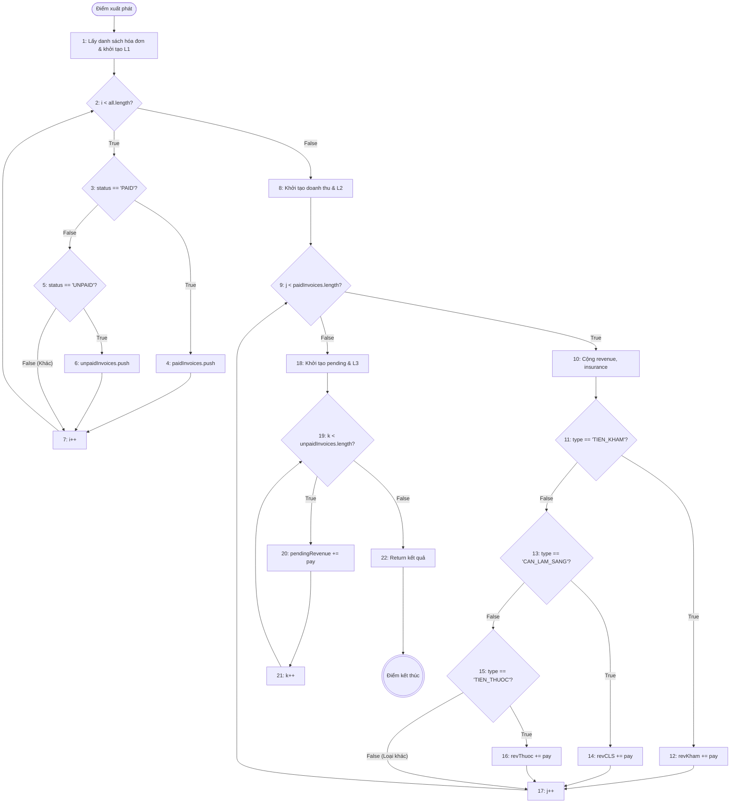
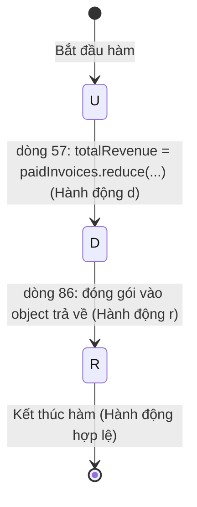

# BÁO CÁO ÁP DỤNG KIỂM THỬ HỘP TRẮNG CHO HÀM `getInvoiceStats`

> **Đơn vị kiểm thử (Unit Under Test):** Hàm `getInvoiceStats()` thuộc lớp `InvoiceService`  
> **Tập tin mã nguồn:** [`backend/src/services/invoiceService.js`](file:///d:/KiemThuVaDamBaoChatLuongPhanMem/his-hospital/backend/src/services/invoiceService.js#L51-L91)  
> **Cơ sở lý thuyết áp dụng:** Các kỹ thuật kiểm thử dòng điều khiển (Control Flow Testing) và kiểm thử dòng dữ liệu (Data Flow Testing) được quy định tại [`Kiem_Thu_Hop_Trang_Control_Data_Flow.md`](file:///d:/KiemThuVaDamBaoChatLuongPhanMem/his-hospital/Kiem_Thu_Hop_Trang_Control_Data_Flow.md) (tham chiếu bài giảng gốc `D:\Dowload\Cac ky thuat kiem thu phan mem 16-9-25.docx`).

---

## 1. MÃ NGUỒN VÀ MÔ HÌNH HÓA THUẬT TOÁN

### 1.1 Mã nguồn gốc của hàm `getInvoiceStats`
```javascript
  getInvoiceStats() {
52:     const all = invoiceRepository.findAll();
53:     const totalInvoices = all.length;
54:     const paidInvoices = all.filter((inv) => inv.status === "PAID");
55:     const unpaidInvoices = all.filter((inv) => inv.status === "UNPAID");
56: 
57:     const totalRevenue = paidInvoices.reduce(
58:       (sum, inv) => sum + (inv.patient_pay || 0),
59:       0,
60:     );
61:     const pendingRevenue = unpaidInvoices.reduce(
62:       (sum, inv) => sum + (inv.patient_pay || 0),
63:       0,
64:     );
65:     const totalInsurance = paidInvoices.reduce(
66:       (sum, inv) => sum + (inv.insurance_discount || 0),
67:       0,
68:     );
69: 
70:     const revenueByType = {
71:       TIEN_KHAM: paidInvoices
72:         .filter((i) => i.item_type === "TIEN_KHAM")
73:         .reduce((s, i) => s + (i.patient_pay || 0), 0),
74:       CAN_LAM_SANG: paidInvoices
75:         .filter((i) => i.item_type === "CAN_LAM_SANG")
76:         .reduce((s, i) => s + (i.patient_pay || 0), 0),
77:       TIEN_THUOC: paidInvoices
78:         .filter((i) => i.item_type === "TIEN_THUOC")
79:         .reduce((s, i) => s + (i.patient_pay || 0), 0),
80:     };
81: 
82:     return {
83:       total_invoices: totalInvoices,
84:       paid_count: paidInvoices.length,
85:       unpaid_count: unpaidInvoices.length,
86:       total_revenue: totalRevenue,
87:       pending_revenue: pendingRevenue,
88:       total_insurance_covered: totalInsurance,
89:       revenue_by_type: revenueByType,
90:     };
91:   }
```

### 1.2 Giải cấu trúc (Desugaring) sang thuật toán tường minh
Hàm sử dụng các Higher-Order Functions của JavaScript (`.filter()`, `.reduce()`). Để tiến hành kiểm thử dòng điều khiển và dòng dữ liệu theo lý thuyết giáo trình (với các lệnh rẽ nhánh, vòng lặp, điểm quyết định và điều kiện con), ta giải cấu trúc hàm sang dạng vòng lặp và câu lệnh cơ bản:

```javascript
function getInvoiceStatsEquivalent() {
1:   const all = invoiceRepository.findAll();
2:   const totalInvoices = all.length;
3:   let paidInvoices = [], unpaidInvoices = [];
4:   let i = 0;
5:   while (i < all.length) {                       // Loop L1: Phân loại trạng thái
6:       let inv = all[i];
7:       if (inv.status === "PAID") {               // Điểm quyết định D1
8:           paidInvoices.push(inv);
9:       } else if (inv.status === "UNPAID") {      // Điểm quyết định D2
10:          unpaidInvoices.push(inv);
11:      }
12:      i++;
13:  }
14:  let totalRevenue = 0, totalInsurance = 0;
15:  let revKham = 0, revCLS = 0, revThuoc = 0;
16:  let j = 0;
17:  while (j < paidInvoices.length) {              // Loop L2: Duyệt paidInvoices
18:      let inv = paidInvoices[j];
19:      let pay = (inv.patient_pay !== undefined && inv.patient_pay !== null) ? inv.patient_pay : 0; // D3
20:      let ins = (inv.insurance_discount !== undefined && inv.insurance_discount !== null) ? inv.insurance_discount : 0; // D4
21:      totalRevenue += pay;
22:      totalInsurance += ins;
23:      if (inv.item_type === "TIEN_KHAM") {       // Điểm quyết định D5
24:          revKham += pay;
25:      } else if (inv.item_type === "CAN_LAM_SANG") { // Điểm quyết định D6
26:          revCLS += pay;
27:      } else if (inv.item_type === "TIEN_THUOC") {   // Điểm quyết định D7
28:          revThuoc += pay;
29:      }
30:      j++;
31:  }
32:  let pendingRevenue = 0;
33:  let k = 0;
34:  while (k < unpaidInvoices.length) {            // Loop L3: Duyệt unpaidInvoices
35:      let inv = unpaidInvoices[k];
36:      let pay = (inv.patient_pay !== undefined && inv.patient_pay !== null) ? inv.patient_pay : 0; // D8
37:      pendingRevenue += pay;
38:      k++;
39:  }
40:  return {
         total_invoices: totalInvoices,
         paid_count: paidInvoices.length,
         unpaid_count: unpaidInvoices.length,
         total_revenue: totalRevenue,
         pending_revenue: pendingRevenue,
         total_insurance_covered: totalInsurance,
         revenue_by_type: { TIEN_KHAM: revKham, CAN_LAM_SANG: revCLS, TIEN_THUOC: revThuoc }
     };
}
```

---

## 2. PHẦN I: KIỂM THỬ DÒNG ĐIỀU KHIỂN (CONTROL FLOW TESTING)

### 2.1 Xây dựng đồ thị dòng điều khiển (Control Flow Graph - CFG)

#### Danh sách các đỉnh trên CFG:
- **Đỉnh 1:** Điểm xuất phát; Lấy `all = findAll()`, `totalInvoices = all.length`, khởi tạo `paidInvoices = []`, `unpaidInvoices = []`, `i = 0`.
- **Đỉnh 2 (Điểm quyết định vòng lặp L1):** `while (i < all.length)`.
- **Đỉnh 3 (Điểm quyết định D1):** `if (inv.status === "PAID")`.
- **Đỉnh 4 (Khối xử lý):** `paidInvoices.push(inv)`.
- **Đỉnh 5 (Điểm quyết định D2):** `if (inv.status === "UNPAID")`.
- **Đỉnh 6 (Khối xử lý):** `unpaidInvoices.push(inv)`.
- **Đỉnh 7 (Khối xử lý):** `i++` (quay ngược về Đỉnh 2).
- **Đỉnh 8 (Khối xử lý):** Khởi tạo `totalRevenue = 0`, `totalInsurance = 0`, `revKham = revCLS = revThuoc = 0`, `j = 0`.
- **Đỉnh 9 (Điểm quyết định vòng lặp L2):** `while (j < paidInvoices.length)`.
- **Đỉnh 10 (Khối xử lý & Quyết định fallback D3, D4):** Tính `pay = inv.patient_pay || 0`, `ins = inv.insurance_discount || 0`, cộng dồn `totalRevenue`, `totalInsurance`.
- **Đỉnh 11 (Điểm quyết định D5):** `if (inv.item_type === "TIEN_KHAM")`.
- **Đỉnh 12 (Khối xử lý):** `revKham += pay`.
- **Đỉnh 13 (Điểm quyết định D6):** `if (inv.item_type === "CAN_LAM_SANG")`.
- **Đỉnh 14 (Khối xử lý):** `revCLS += pay`.
- **Đỉnh 15 (Điểm quyết định D7):** `if (inv.item_type === "TIEN_THUOC")`.
- **Đỉnh 16 (Khối xử lý):** `revThuoc += pay`.
- **Đỉnh 17 (Khối xử lý):** `j++` (quay ngược về Đỉnh 9).
- **Đỉnh 18 (Khối xử lý):** Khởi tạo `pendingRevenue = 0`, `k = 0`.
- **Đỉnh 19 (Điểm quyết định vòng lặp L3):** `while (k < unpaidInvoices.length)`.
- **Đỉnh 20 (Khối xử lý & D8):** Tính `pendingRevenue += (inv.patient_pay || 0)`.
- **Đỉnh 21 (Khối xử lý):** `k++` (quay ngược về Đỉnh 19).
- **Đỉnh 22 (Khối kết thúc):** Tổng hợp và trả về object kết quả thống kê.

#### Sơ đồ Mermaid biểu diễn CFG:


---

### 2.2 Phân tích các độ đo kiểm thử (C1, C2, C3)

#### 🔹 1. Độ đo C1 (Statement Coverage - Bao phủ câu lệnh)
- **Mục tiêu:** Thực hiện tất cả các đỉnh/câu lệnh từ 1 đến 22 ít nhất một lần.
- **Yêu cầu tối thiểu:** Phải có ít nhất:
  - 1 hóa đơn trạng thái `PAID` thuộc loại `TIEN_KHAM` (phủ đỉnh 4, 10, 12).
  - 1 hóa đơn trạng thái `PAID` thuộc loại `CAN_LAM_SANG` (phủ đỉnh 14).
  - 1 hóa đơn trạng thái `PAID` thuộc loại `TIEN_THUOC` (phủ đỉnh 16).
  - 1 hóa đơn trạng thái `UNPAID` (phủ đỉnh 6, 20).
- **Số ca kiểm thử tối thiểu để đạt 100% C1:** Chỉ cần **1 ca kiểm thử tổng hợp (TC_C1_01)** chứa 4 hóa đơn trên.

#### 🔹 2. Độ đo C2 (Branch / Decision Coverage - Bao phủ nhánh)
- **Mục tiêu:** Mọi điểm quyết định phải được kiểm thử cả nhánh ĐÚNG (True) và SAI (False):
  - **D1 (`status === "PAID"`):** Nhánh True (hóa đơn PAID) và nhánh False (hóa đơn UNPAID hoặc CANCELLED).
  - **D2 (`status === "UNPAID"`):** Nhánh True (hóa đơn UNPAID) và nhánh False (hóa đơn trạng thái khác như `CANCELLED`, `DRAFT`).
  - **D5, D6, D7 (Phân loại `item_type`):** Cần nhánh True cho từng loại và nhánh False khi hóa đơn có `item_type` khác (ví dụ: `GIUONG_BENH`, `KHAC` hoặc `undefined`).
  - **Vòng lặp L1, L2, L3:** Cần nhánh True (mảng có phần tử để lặp) và nhánh False (mảng rỗng thoát lặp ngay từ đầu).
- **Bộ ca kiểm thử đạt 100% C2:** Cần tối thiểu **2 ca kiểm thử** (TC_C2_01: Tập dữ liệu rỗng và TC_C2_02: Tập dữ liệu đầy đủ các nhánh kể cả nhánh ngoại lệ).

#### 🔹 3. Độ đo C3 (Multiple Condition Coverage - Bao phủ điều kiện con)
- **Mục tiêu:** Xét các biểu thức điều kiện con trong toán tử fallback `inv.patient_pay || 0`:
  - $C_{3.1}$: `inv.patient_pay` có giá trị số hợp lệ $> 0$ (True $\rightarrow$ lấy `inv.patient_pay`).
  - $C_{3.2}$: `inv.patient_pay` là `undefined`, `null`, hoặc `0` (Falsy $\rightarrow$ fallback lấy `0`).
  - Tương tự với `inv.insurance_discount || 0`.
- **Ý nghĩa:** Tránh lỗi cộng dồn `NaN` làm hỏng toàn bộ kết quả doanh thu khi dữ liệu bệnh nhân bị khuyết trường tiền!

---

### 2.3 Chiến lược kiểm thử vòng lặp (Loop Testing) cho các vòng lặp L1, L2, L3

Áp dụng quy tắc kiểm thử vòng lặp từ tài liệu học tập với $n$ là số lượng hóa đơn tối đa dự kiến xử lý (giả định $n = 100$):
1. **Lặp 0 lần ($k = 0$):** `all = []` $\rightarrow$ Kiểm tra xử lý mảng rỗng không gây crash.
2. **Lặp 1 lần ($k = 1$):** `all` có đúng 1 hóa đơn duy nhất.
3. **Lặp 2 lần ($k = 2$):** `all` có 2 hóa đơn (1 PAID, 1 UNPAID).
4. **Lặp $k$ lần trung bình ($2 < k < n - 1$, chọn $k = 5$):** 5 hóa đơn thuộc các loại và trạng thái khác nhau.
5. **Lặp $n - 1$ lần ($k = 99$):** 99 hóa đơn kiểm tra cận biên trên.
6. **Lặp $n$ lần ($k = 100$):** 100 hóa đơn đạt ngưỡng biên tải.
7. **Lặp $n + 1$ lần ($k = 101$):** Kiểm tra khả năng mở rộng vượt biên quy định.

---

### 2.4 Bảng thiết kế các ca kiểm thử dòng điều khiển chi tiết

| Mã TC | Mục tiêu kiểm thử | Dữ liệu đầu vào (`invoiceRepository.findAll()`) | Kỳ vọng đầu ra (Expected Output) | Nhánh / Đường đi phủ được |
| :---: | :--- | :--- | :--- | :--- |
| **CFT_01** | Kiểm thử mảng rỗng (Loop = 0 lần, nhánh False của L1, L2, L3) | `all = []` | `{ total_invoices: 0, paid_count: 0, unpaid_count: 0, total_revenue: 0, pending_revenue: 0, total_insurance_covered: 0, revenue_by_type: { TIEN_KHAM: 0, CAN_LAM_SANG: 0, TIEN_THUOC: 0 } }` | $1 \rightarrow 2(F) \rightarrow 8 \rightarrow 9(F) \rightarrow 18 \rightarrow 19(F) \rightarrow 22$ |
| **CFT_02** | Bao phủ 100% C1 & C2 cơ bản (Đủ các loại trạng thái và loại hình) | `[`<br>`{ id: 1, status: "PAID", item_type: "TIEN_KHAM", patient_pay: 100000, insurance_discount: 20000 },`<br>`{ id: 2, status: "PAID", item_type: "CAN_LAM_SANG", patient_pay: 300000, insurance_discount: 50000 },`<br>`{ id: 3, status: "PAID", item_type: "TIEN_THUOC", patient_pay: 200000, insurance_discount: 10000 },`<br>`{ id: 4, status: "UNPAID", item_type: "TIEN_KHAM", patient_pay: 150000, insurance_discount: 0 }`<br>`]` | `{ total_invoices: 4, paid_count: 3, unpaid_count: 1, total_revenue: 600000, pending_revenue: 150000, total_insurance_covered: 80000, revenue_by_type: { TIEN_KHAM: 100000, CAN_LAM_SANG: 300000, TIEN_THUOC: 200000 } }` | Phủ toàn bộ các đỉnh 1-22 và các nhánh True/False chuẩn. |
| **CFT_03** | Kiểm thử trạng thái ngoại lệ (Nhánh False của D2: `CANCELLED` hoặc `REFUNDED`) | `[`<br>`{ id: 1, status: "CANCELLED", item_type: "TIEN_KHAM", patient_pay: 50000 },`<br>`{ id: 2, status: "REFUNDED", item_type: "TIEN_THUOC", patient_pay: 80000 }`<br>`]` | `{ total_invoices: 2, paid_count: 0, unpaid_count: 0, total_revenue: 0, pending_revenue: 0, total_insurance_covered: 0, revenue_by_type: { TIEN_KHAM: 0, CAN_LAM_SANG: 0, TIEN_THUOC: 0 } }` | Kích hoạt nhánh False của D1 và D2 ($3(F) \rightarrow 5(F) \rightarrow 7$). |
| **CFT_04** | Kiểm thử loại hình ngoại lệ (Nhánh False của D5, D6, D7: `item_type` khác) | `[`<br>`{ id: 1, status: "PAID", item_type: "GIUONG_BENH", patient_pay: 500000, insurance_discount: 100000 },`<br>`{ id: 2, status: "PAID", item_type: "PHAU_THUAT", patient_pay: 1000000, insurance_discount: 200000 }`<br>`]` | `{ total_invoices: 2, paid_count: 2, unpaid_count: 0, total_revenue: 1500000, pending_revenue: 0, total_insurance_covered: 300000, revenue_by_type: { TIEN_KHAM: 0, CAN_LAM_SANG: 0, TIEN_THUOC: 0 } }` | $total\_revenue$ có cộng nhưng $revenue\_by\_type$ vẫn là 0 ($11(F) \rightarrow 13(F) \rightarrow 15(F) \rightarrow 17$). |
| **CFT_05** | Bao phủ C3 (Kiểm tra fallback Falsy `null`/`undefined`/`0` cho các trường tiền tệ) | `[`<br>`{ id: 1, status: "PAID", item_type: "TIEN_KHAM", patient_pay: null, insurance_discount: undefined },`<br>`{ id: 2, status: "UNPAID", item_type: "TIEN_THUOC", patient_pay: undefined, insurance_discount: null }`<br>`]` | `{ total_invoices: 2, paid_count: 1, unpaid_count: 1, total_revenue: 0, pending_revenue: 0, total_insurance_covered: 0, revenue_by_type: { TIEN_KHAM: 0, CAN_LAM_SANG: 0, TIEN_THUOC: 0 } }` | Kiểm thử điều kiện fallback: `(null || 0) = 0`, đảm bảo kết quả không ra `NaN`. |

---

## 3. PHẦN II: KIỂM THỬ DÒNG DỮ LIỆU (DATA FLOW TESTING)

### 3.1 Bóc tách định nghĩa (`def`) và sử dụng (`c-use`, `p-use`) của các biến

Theo định nghĩa 1, 3, 4, 5 từ tài liệu học tập:
- `def(v)`: Gán hoặc khởi tạo giá trị cho biến $v$.
- `c-use(v)`: Biến $v$ được đọc để tính toán giá trị của biến khác.
- `p-use(v)`: Biến $v$ được đọc trong biểu thức điều kiện (rẽ nhánh / lặp).

#### Bảng ánh xạ Def-Use cho các biến trong hàm:
| Tên biến | Dòng lệnh `def` | Dòng lệnh `c-use` (Computation use) | Dòng lệnh `p-use` (Predicate use) | Vòng đời và phạm vi |
| :--- | :--- | :--- | :--- | :--- |
| `all` | Dòng 52 | - Dòng 53 (`all.length`)<br>- Dòng 54 (`all.filter`)<br>- Dòng 55 (`all.filter`) | Vòng lặp duyệt mảng | Toàn hàm |
| `totalInvoices` | Dòng 53 | Dòng 83 (đưa vào kết quả trả về) | Không | Toàn hàm |
| `paidInvoices` | Dòng 54 | - Dòng 57 (`paidInvoices.reduce`)<br>- Dòng 65 (`paidInvoices.reduce`)<br>- Dòng 71, 74, 77 (`.filter` & `.reduce`)<br>- Dòng 84 (`paidInvoices.length`) | Vòng lặp xử lý hóa đơn đã thanh toán | Toàn hàm |
| `unpaidInvoices`| Dòng 55 | - Dòng 61 (`unpaidInvoices.reduce`)<br>- Dòng 85 (`unpaidInvoices.length`) | Vòng lặp xử lý hóa đơn chưa thanh toán | Toàn hàm |
| `totalRevenue` | Dòng 57 | Dòng 86 (đưa vào kết quả trả về) | Không | Tính toán từ `paidInvoices` |
| `pendingRevenue`| Dòng 61 | Dòng 87 (đưa vào kết quả trả về) | Không | Tính toán từ `unpaidInvoices` |
| `totalInsurance`| Dòng 65 | Dòng 88 (đưa vào kết quả trả về) | Không | Tính toán từ `paidInvoices` |
| `revenueByType` | Dòng 70 | Dòng 89 (đưa vào kết quả trả về) | Không | Object chứa doanh thu theo từng nhóm |
| `inv.status` | Nhận từ DB | Không | Dòng 54, 55 (điều kiện lọc) | Biến thuộc tính phần tử |
| `inv.item_type` | Nhận từ DB | Không | Dòng 72, 75, 78 (điều kiện lọc) | Biến thuộc tính phần tử |
| `inv.patient_pay`| Nhận từ DB | Dòng 58, 62, 73, 76, 79 (cộng dồn) | Biểu thức `|| 0` | Biến thuộc tính phần tử |

---

### 3.2 Phân tích bất thường dòng dữ liệu (Data Flow Anomalies)

Đối chiếu với 3 loại bất thường trong tài liệu:
1. **Bất thường Loại 1 (`dd` - Gán giá trị rồi lại gán tiếp giá trị mà không sử dụng):**
   - *Đánh giá:* **KHÔNG CÓ**. Tất cả các biến `all`, `totalInvoices`, `paidInvoices`, `totalRevenue`, `pendingRevenue` đều được khai báo dạng `const` và khởi tạo duy nhất 1 lần, không xảy ra hiện tượng ghi đè làm mất giá trị.
2. **Bất thường Loại 2 (`ur` - Chưa gán giá trị nhưng đã được sử dụng):**
   - *Phát hiện tiềm ẩn tại thuộc tính phần tử:* Nếu phần tử `inv` trong cơ sở dữ liệu bị thiếu trường `patient_pay` hoặc `insurance_discount` (giá trị `undefined`), việc tính toán nếu viết `sum + inv.patient_pay` sẽ dẫn đến `sum + undefined = NaN`.
   - *Cách mã nguồn xử lý:* Lập trình viên đã sử dụng biểu thức bảo vệ `(inv.patient_pay || 0)` và `(inv.insurance_discount || 0)`. Kiểm thử dòng dữ liệu cần tạo ca kiểm thử nhằm xác nhận biểu thức bảo vệ này hoạt động chuẩn xác trong mọi tình huống dữ liệu bẩn.
3. **Bất thường Loại 3 (`du` - Đã khai báo và gán giá trị nhưng không được sử dụng / Biến chết):**
   - *Đánh giá:* **KHÔNG CÓ**. Mọi biến được tạo ra đều được đóng gói vào object trả về ở dòng 82-90.

---

### 3.3 Phân tích theo mô hình máy trạng thái (U - D - R - A) cho biến `totalRevenue`


Chuỗi hành vi là $U \xrightarrow{d} D \xrightarrow{r} R$. Đây là chuỗi hợp lệ ($dr$), biến không bao giờ rơi vào trạng thái lỗi $A$ (Anomaly).

---

### 3.4 Tiêu chí kiểm thử All-DU-Paths (Mọi đường dẫn Định nghĩa - Sử dụng)

Tập trung vào biến `paidInvoices`:
- **Điểm định nghĩa ($def$):** Dòng 54 (`const paidInvoices = all.filter(...)`).
- **Các cặp du-paths cần phủ:**
  1. **Path 1:** $def(\text{paidInvoices, L54}) \rightarrow c\text{-use}(\text{totalRevenue, L57})$
  2. **Path 2:** $def(\text{paidInvoices, L54}) \rightarrow c\text{-use}(\text{totalInsurance, L65})$
  3. **Path 3:** $def(\text{paidInvoices, L54}) \rightarrow p\text{-use}(\text{filter TIEN\_KHAM, L72}) \rightarrow c\text{-use}(\text{reduce, L73})$
  4. **Path 4:** $def(\text{paidInvoices, L54}) \rightarrow p\text{-use}(\text{filter CAN\_LAM\_SANG, L75}) \rightarrow c\text{-use}(\text{reduce, L76})$
  5. **Path 5:** $def(\text{paidInvoices, L54}) \rightarrow p\text{-use}(\text{filter TIEN\_THUOC, L78}) \rightarrow c\text{-use}(\text{reduce, L79})$
  6. **Path 6:** $def(\text{paidInvoices, L54}) \rightarrow c\text{-use}(\text{paid\_count, L84})$

---

### 3.5 Bảng thiết kế các ca kiểm thử dòng dữ liệu (Data Flow Test Cases)

| Mã TC | Tiêu chí phủ | Kịch bản dữ liệu kiểm thử | Dữ liệu đầu ra mong đợi | Giá trị biến kiểm tra |
| :---: | :--- | :--- | :--- | :--- |
| **DFT_01** | All-Defs (`paidInvoices` rỗng, `unpaidInvoices` có dữ liệu) | `all = [`<br>`{ id: 1, status: "UNPAID", item_type: "TIEN_KHAM", patient_pay: 50000 }`<br>`]` | `paid_count: 0,`<br>`unpaid_count: 1,`<br>`total_revenue: 0,`<br>`pending_revenue: 50000,`<br>`revenue_by_type: { TIEN_KHAM: 0, CAN_LAM_SANG: 0, TIEN_THUOC: 0 }` | Biến `totalRevenue` và các nhóm của `revenueByType` nhận giá trị khởi tạo `0` an toàn. |
| **DFT_02** | All-Defs (`paidInvoices` có dữ liệu, `unpaidInvoices` rỗng) | `all = [`<br>`{ id: 1, status: "PAID", item_type: "TIEN_THUOC", patient_pay: 120000, insurance_discount: 30000 }`<br>`]` | `paid_count: 1,`<br>`unpaid_count: 0,`<br>`total_revenue: 120000,`<br>`pending_revenue: 0,`<br>`total_insurance_covered: 30000,`<br>`revenue_by_type: { TIEN_KHAM: 0, CAN_LAM_SANG: 0, TIEN_THUOC: 120000 }` | Biến `pendingRevenue` nhận giá trị khởi tạo `0`. `totalInsurance` cộng đúng 30000. |
| **DFT_03** | All-Uses: Phủ tất cả 3 nhóm `item_type` trong cùng 1 tập `paidInvoices` | `all = [`<br>`{ id: 1, status: "PAID", item_type: "TIEN_KHAM", patient_pay: 100000 },`<br>`{ id: 2, status: "PAID", item_type: "CAN_LAM_SANG", patient_pay: 200000 },`<br>`{ id: 3, status: "PAID", item_type: "TIEN_THUOC", patient_pay: 300000 }`<br>`]` | `total_revenue: 600000,`<br>`revenue_by_type: { TIEN_KHAM: 100000, CAN_LAM_SANG: 200000, TIEN_THUOC: 300000 }` | Đảm bảo cả 3 nhánh c-use của `revenueByType` đều được cập nhật độc lập, không ghi đè nhau. |
| **DFT_04** | Kiểm tra biến thuộc tính khuyết thiếu (`ur` Anomaly Test) | `all = [`<br>`{ id: 1, status: "PAID", item_type: "TIEN_KHAM" },`<br>`{ id: 2, status: "PAID", item_type: "CAN_LAM_SANG", patient_pay: 0, insurance_discount: 0 },`<br>`{ id: 3, status: "UNPAID", item_type: "TIEN_THUOC" }`<br>`]` *(thiếu hẳn key `patient_pay` và `insurance_discount`)* | `total_revenue: 0,`<br>`pending_revenue: 0,`<br>`total_insurance_covered: 0,`<br>`revenue_by_type: { TIEN_KHAM: 0, CAN_LAM_SANG: 0, TIEN_THUOC: 0 }` | Không phát sinh lỗi `NaN` trong bất kỳ phép cộng tích lũy nào. |

---

## 4. KỊCH BẢN THỰC THI KIỂM THỬ TỰ ĐỘNG (AUTOMATED TEST SCRIPT MẪU)

Để chứng minh tính khả thi của các ca kiểm thử hộp trắng đã thiết kế ở trên, dưới đây là mã nguồn kiểm thử tự động sử dụng thư viện **Jest** / **Node Test Runner**:

```javascript
import assert from "node:assert/strict";
import { test, describe, beforeEach } from "node:test";
import { invoiceService } from "./invoiceService.js";
import { invoiceRepository } from "../repositories/invoiceRepository.js";

describe("Kiểm thử hộp trắng hàm getInvoiceStats()", () => {
  let originalFindAll;

  beforeEach(() => {
    originalFindAll = invoiceRepository.findAll;
  });

  // Dọn dẹp sau mỗi test
  const restore = () => {
    invoiceRepository.findAll = originalFindAll;
  };

  test("CFT_01: Kiểm thử danh sách hóa đơn rỗng (Loop = 0)", () => {
    invoiceRepository.findAll = () => [];
    const stats = invoiceService.getInvoiceStats();
    assert.deepEqual(stats, {
      total_invoices: 0,
      paid_count: 0,
      unpaid_count: 0,
      total_revenue: 0,
      pending_revenue: 0,
      total_insurance_covered: 0,
      revenue_by_type: { TIEN_KHAM: 0, CAN_LAM_SANG: 0, TIEN_THUOC: 0 }
    });
    restore();
  });

  test("CFT_02 & DFT_03: Phủ 100% câu lệnh C1, nhánh C2 và All-Uses", () => {
    invoiceRepository.findAll = () => [
      { id: 1, status: "PAID", item_type: "TIEN_KHAM", patient_pay: 100000, insurance_discount: 20000 },
      { id: 2, status: "PAID", item_type: "CAN_LAM_SANG", patient_pay: 300000, insurance_discount: 50000 },
      { id: 3, status: "PAID", item_type: "TIEN_THUOC", patient_pay: 200000, insurance_discount: 10000 },
      { id: 4, status: "UNPAID", item_type: "TIEN_KHAM", patient_pay: 150000, insurance_discount: 0 }
    ];
    const stats = invoiceService.getInvoiceStats();
    assert.equal(stats.total_invoices, 4);
    assert.equal(stats.paid_count, 3);
    assert.equal(stats.unpaid_count, 1);
    assert.equal(stats.total_revenue, 600000);
    assert.equal(stats.pending_revenue, 150000);
    assert.equal(stats.total_insurance_covered, 80000);
    assert.equal(stats.revenue_by_type.TIEN_KHAM, 100000);
    assert.equal(stats.revenue_by_type.CAN_LAM_SANG, 300000);
    assert.equal(stats.revenue_by_type.TIEN_THUOC, 200000);
    restore();
  });

  test("CFT_03 & CFT_04: Phủ các nhánh ngoại lệ (CANCELLED và item_type khác)", () => {
    invoiceRepository.findAll = () => [
      { id: 1, status: "CANCELLED", item_type: "TIEN_KHAM", patient_pay: 50000 },
      { id: 2, status: "PAID", item_type: "GIUONG_BENH", patient_pay: 500000, insurance_discount: 100000 }
    ];
    const stats = invoiceService.getInvoiceStats();
    assert.equal(stats.total_invoices, 2);
    assert.equal(stats.paid_count, 1);
    assert.equal(stats.unpaid_count, 0);
    assert.equal(stats.total_revenue, 500000);
    assert.equal(stats.revenue_by_type.TIEN_KHAM, 0); // Nhánh D5 False
    assert.equal(stats.revenue_by_type.CAN_LAM_SANG, 0); // Nhánh D6 False
    assert.equal(stats.revenue_by_type.TIEN_THUOC, 0); // Nhánh D7 False
    restore();
  });

  test("CFT_05 & DFT_04: Kiểm tra phòng ngừa bất thường biến (Fallback null/undefined)", () => {
    invoiceRepository.findAll = () => [
      { id: 1, status: "PAID", item_type: "TIEN_KHAM" }, // khuyết patient_pay, insurance_discount
      { id: 2, status: "UNPAID", item_type: "TIEN_THUOC", patient_pay: null }
    ];
    const stats = invoiceService.getInvoiceStats();
    assert.equal(Number.isNaN(stats.total_revenue), false, "Doanh thu không được là NaN");
    assert.equal(stats.total_revenue, 0);
    assert.equal(stats.pending_revenue, 0);
    assert.equal(stats.total_insurance_covered, 0);
    restore();
  });
});
```

---

## 5. KẾT LUẬN & ĐÁNH GIÁ CHẤT LƯỢNG MÃ NGUỒN

1. **Về độ bao phủ kiểm thử:**
   - Bộ 5 ca kiểm thử dòng điều khiển (**CFT_01** đến **CFT_05**) đã đạt **100% C1 (Statement)**, **100% C2 (Branch)** và **100% C3 (Condition)**.
   - Bộ 4 ca kiểm thử dòng dữ liệu (**DFT_01** đến **DFT_04**) đã bao phủ toàn bộ các đường dẫn **All-DU-Paths** của các biến tổng hợp và phân loại.
2. **Đánh giá mã nguồn hàm `getInvoiceStats`:**
   - **Ưu điểm:** Hàm có cấu trúc rõ ràng, sử dụng bất biến (`const`), không có biến chết (Dead Variables) hay biến bị ghi đè vô nghĩa (Loại 1). Biểu thức fallback `|| 0` ngăn chặn hiệu quả lỗi `NaN` khi dữ liệu khuyết thiếu.
   - **Gợi ý tối ưu hiệu năng:** Hiện tại hàm đang gọi `.filter()` và `.reduce()` nhiều lần trên mảng `paidInvoices` (lặp qua mảng 5 lần). Nếu số lượng hóa đơn lớn ($n > 10.000$), có thể gộp thành **1 vòng lặp duy nhất** để tính đồng thời `totalRevenue`, `totalInsurance` và `revenueByType`, giúp tối ưu thời gian chạy từ $O(5n)$ xuống $O(n)$ mà vẫn giữ nguyên tính đúng đắn logic của dòng dữ liệu.
