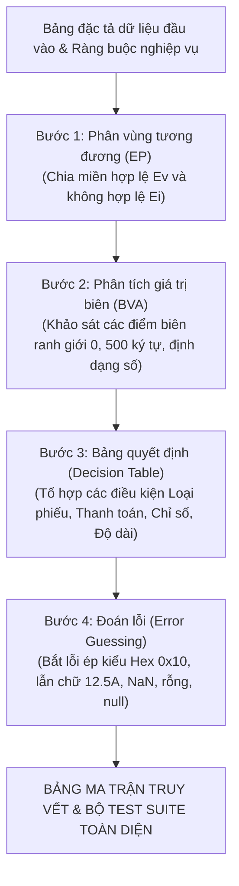

# BÁO CÁO BÀI TẬP MÔN HỌC: KIỂM THỬ VÀ ĐẢM BẢO CHẤT LƯỢNG PHẦN MỀM
## ĐỀ TÀI: PHÂN TÍCH VÀ THIẾT KẾ TEST CASE KIỂM THỬ HỘP ĐEN (BLACK-BOX TESTING)
### CHỨC NĂNG: NHẬP KẾT QUẢ XÉT NGHIỆM ĐỊNH LƯỢNG (HỆ THỐNG QUẢN LÝ BỆNH VIỆN HIS-HOSPITAL)

---

**THÔNG TIN CHUNG:**
* **Môn học:** Kiểm thử và Đảm bảo chất lượng phần mềm
* **Hệ thống phần mềm:** Hệ thống Quản lý Bệnh viện Thông minh (HIS-Hospital)
* **Phân hệ:** Cận lâm sàng & Xét nghiệm (Laboratory Information System - LIS)
* **Use Case thực hiện:** `UC-CLS-02` (Mục 3.11) — Nhập kết quả xét nghiệm định lượng
* **Sinh viên thực hiện:** Lê Tuấn Khanh
* **Đối tượng kiểm thử (Unit Under Test):** `LabResultValidator.validateLabResult(input)` kết hợp `labService.updateResult(idOrCode, payload)` và `LabOrderStateMachine`
* **Tệp mã nguồn tham chiếu:**
  - [`backend/test/khanh/validators/02_labResult.validator.js`](file:///d:/KiemThuVaDamBaoChatLuongPhanMem/his-hospital/backend/test/khanh/validators/02_labResult.validator.js)
  - [`backend/test/khanh/validators/02_labResult.test.js`](file:///d:/KiemThuVaDamBaoChatLuongPhanMem/his-hospital/backend/test/khanh/validators/02_labResult.test.js)
  - [`backend/src/services/labService.js`](file:///d:/KiemThuVaDamBaoChatLuongPhanMem/his-hospital/backend/src/services/labService.js)
  - [`backend/src/patterns/state/labOrderState.js`](file:///d:/KiemThuVaDamBaoChatLuongPhanMem/his-hospital/backend/src/patterns/state/labOrderState.js)
  - [`frontend/src/pages/lab/components/LabResultEntryModal.jsx`](file:///d:/KiemThuVaDamBaoChatLuongPhanMem/his-hospital/frontend/src/pages/lab/components/LabResultEntryModal.jsx)
  - [`docs/khanh/Tong_Hop_45_Test_Case_Validate.md`](file:///d:/KiemThuVaDamBaoChatLuongPhanMem/his-hospital/docs/khanh/Tong_Hop_45_Test_Case_Validate.md)

---

## MỤC LỤC BÁO CÁO

* [PHẦN I: TỔNG QUAN VÀ ĐẶC TẢ YÊU CẦU CHỨC NĂNG](#phần-i-tổng-quan-và-đặc-tả-yêu-cầu-chức-năng)
  * [1.1 Giới thiệu chức năng Nhập kết quả xét nghiệm & Luồng nghiệp vụ bệnh viện thực tế](#11-giới-thiệu-chức-năng-nhập-kết-quả-xét-nghiệm--luồng-nghiệp-vụ-bệnh-viện-thực-tế)
  * [1.2 Bảng đặc tả chi tiết các trường dữ liệu đầu vào (Input Specification)](#12-bảng-đặc-tả-chi-tiết-các-trường-dữ-liệu-đầu-vào-input-specification)
  * [1.3 Bảng đặc tả chi tiết các trường dữ liệu đầu ra (Output Specification)](#13-bảng-đặc-tả-chi-tiết-các-trường-dữ-liệu-đầu-ra-output-specification)
* [PHẦN II: DẪN DẮT LOGIC VÀ ÁP DỤNG CÁC KỸ THUẬT KIỂM THỬ HỘP ĐEN](#phần-ii-dẫn-dắt-logic-và-áp-dụng-các-kỹ-thuật-kiểm-thử-hộp-đen)
  * [2.1 Phương pháp luận và Quy trình dẫn dắt thiết kế ca kiểm thử](#21-phương-pháp-luận-và-quy-trình-dẫn-dắt-thiết-kế-ca-kiểm-thử)
  * [2.2 Kỹ thuật 1: Phân vùng tương đương (Equivalence Partitioning - EP)](#22-kỹ-thuật-1-phân-vùng-tương-đương-equivalence-partitioning---ep)
  * [2.3 Kỹ thuật 2: Phân tích giá trị biên chuyên sâu (Boundary Value Analysis - BVA)](#23-kỹ-thuật-2-phân-tích-giá-trị-biên-chuyên-sâu-boundary-value-analysis---bva)
  * [2.4 Kỹ thuật 3: Bảng quyết định (Decision Table Testing - DT)](#24-kỹ-thuật-3-bảng-quyết-định-decision-table-testing---dt)
  * [2.5 Kỹ thuật 4: Đoán lỗi và kịch bản biên đặc thù (Error Guessing - EG)](#25-kỹ-thuật-4-đoán-lỗi-và-kịch-bản-biên-đặc-thù-error-guessing---eg)
* [PHẦN III: BẢNG MA TRẬN TRUY VẾT ÁNH XẠ (TRACEABILITY MATRIX)](#phần-iii-bảng-ma-trận-truy-vết-ánh-xạ-traceability-matrix)
  * [3.1 Giải thích nguyên nhân chênh lệch giữa phân tích lý thuyết và bảng tổng hợp](#31-giải-thích-nguyên-nhân-chênh-lệch-giữa-phân-tích-lý-thuyết-và-bảng-tổng-hợp)
  * [3.2 Bảng ma trận truy vết ánh xạ 1-1 (Traceability Matrix)](#32-bảng-ma-trận-truy-vết-ánh-xạ-1-1-traceability-matrix)
* [PHẦN IV: BẢNG TỔNG HỢP MA TRẬN TEST CASE HỘP ĐEN TOÀN DIỆN (FULL TEST SUITE)](#phần-iv-bảng-tổng-hợp-ma-trận-test-case-hộp-đen-toàn-diện-full-test-suite)
* [PHẦN V: ĐÁNH GIÁ MỨC ĐỘ BAO PHỦ VÀ KẾT LUẬN](#phần-v-đánh-giá-mức-độ-bao-phủ-và-kết-luận)

---

## PHẦN I: TỔNG QUAN VÀ ĐẶC TẢ YÊU CẦU CHỨC NĂNG

### 1.1 Giới thiệu chức năng Nhập kết quả xét nghiệm & Luồng nghiệp vụ bệnh viện thực tế

Trong phân hệ Quản lý Cận lâm sàng & Xét nghiệm (LIS) của Hệ thống Quản lý Bệnh viện Thông minh (HIS-Hospital), **Nhập kết quả xét nghiệm định lượng (`UC-CLS-02` / Mục 3.11)** là nghiệp vụ cốt lõi của Kỹ thuật viên (KTV) xét nghiệm nhằm ghi nhận các chỉ số hóa sinh, huyết học, miễn dịch từ thiết bị phân tích y tế vào hồ sơ bệnh án điện tử.

Luồng vận hành thực tế tại bệnh viện diễn ra qua các bước nghiệp vụ nghiêm ngặt:
1. **Kiểm tra điều kiện tiên quyết và tính hợp lệ của phiếu chỉ định (`order`):**
   - Phiếu chỉ định phải tồn tại trong hệ thống, có mã định danh `id` hợp lệ và thuộc đúng phân hệ xét nghiệm huyết học/sinh hóa (`order.type === "LAB"`). Nếu phiếu thuộc nhóm Chẩn đoán hình ảnh (`"PACS"`), hệ thống phải từ chối để tránh xử lý nhầm luồng dữ liệu.
   - Phiếu phải đảm bảo đã hoàn tất nghĩa vụ viện phí (`payment_status === "PAID"`). Nếu bệnh nhân chưa nộp tiền, hệ thống tuyệt đối không cho phép nhập hay trả kết quả.
2. **Kiểm soát tính hợp lệ của chỉ số xét nghiệm định lượng (`test_value`):**
   - Về mặt toán học và y học, các chỉ số định lượng (như nồng độ bạch cầu WBC, hồng cầu RBC, huyết sắc tố HGB, tiểu cầu PLT, đường huyết Glucose) **bắt buộc phải là số thực dương lớn hơn 0 ($test\_value > 0$)**.
   - Hệ thống từ chối mọi giá trị vi phạm: chuỗi rỗng `""`, chuỗi chỉ chứa khoảng trắng, chuỗi lẫn chữ cái (`"12.5A"`), số âm (`-5.2`), số 0, giá trị rỗng (`null`, `undefined`), số vô cực (`Infinity`), số không xác định (`NaN`), các kiểu dữ liệu sai lệch (boolean, array), và các định dạng biểu diễn không phù hợp như hệ thập lục phân Hex (`"0x10"`).
   - Hệ thống chấp nhận các biểu diễn số thực dương chuẩn: số nguyên (`1`, `10`), số thập phân (`"5.2"`), số dương nhỏ (`0.01`), chuỗi có khoảng trắng bao quanh (`" 5.2 "`), và số thập phân lược bỏ số 0 đầu (`".5"`).
3. **Kiểm soát nhận xét tổng quát & kết luận chuyên môn (`general_notes` / `conclusion`):**
   - KTV có thể ghi chú đánh giá sơ bộ hoặc để trống.
   - Nhận xét không được vượt quá độ dài tối đa cho phép là **500 ký tự** để đảm bảo tính cô đọng và toàn vẹn dữ liệu trong cơ sở dữ liệu.
4. **Cập nhật vòng đời trạng thái xét nghiệm (Lab State Machine Workflow):**
   - Khi KTV hoàn tất nhập kết quả, phiếu chỉ định chuyển trạng thái từ `PROCESSING` (Đang phân tích) sang `PENDING_APPROVAL` (Chờ duyệt chuyên môn).
   - Kết quả lúc này được lưu ở trạng thái **kết quả sơ bộ**. Chỉ sau khi Bác sĩ trưởng khoa xét nghiệm thẩm định và duyệt (`approveResult`), trạng thái mới chuyển sang `COMPLETED`, tự động đồng bộ kết luận vào Bệnh án EMR của Bác sĩ điều trị và chuyển trạng thái bệnh nhân về `"Đang khám"`.

---

### 1.2 Bảng đặc tả chi tiết các trường dữ liệu đầu vào (Input Specification)

Bảng dưới đây đặc tả chuẩn xác 7 cột bắt buộc của các trường dữ liệu đầu vào phục vụ kiểm thử hộp đen cho chức năng Nhập kết quả xét nghiệm định lượng:

| STT | Tên trường | Tên hiển thị & Điều khiển | Kiểu dữ liệu | Bắt buộc | Các ràng buộc | Thông báo lỗi |
|:---:|:---|:---|:---:|:---:|:---|:---|
| 1 | `order` | **Phiếu chỉ định xét nghiệm**<br>*(Dropdown / Data Grid Row)* | `Object` | **Có** | • Phải là một đối tượng tồn tại, không `null`, không `undefined`, không rỗng `{}`.<br>• Phải có thuộc tính `id` hợp lệ ($id > 0$).<br>• Phân loại dịch vụ bắt buộc phải là `"LAB"` (`order.type === "LAB"`). | • *"Mã phiếu chỉ định xét nghiệm không hợp lệ."* |
| 2 | `test_value` | **Chỉ số xét nghiệm định lượng**<br>*(InputNumber / Ô số thực)* | `Number` \| `String` | **Có** | • Bắt buộc nhập, không được để rỗng, không `null`, không `undefined`.<br>• Phải là số thực dương ($> 0$).<br>• Không được lẫn chữ cái, không được là số âm, không được bằng 0.<br>• Không chấp nhận `Infinity`, `NaN`, `boolean`, `array`, chuỗi hệ Hex (`0x`). | • *"Giá trị chỉ số phải là chữ số hợp lệ."* |
| 3 | `general_notes` | **Nhận xét tổng quát / Kết luận**<br>*(Textarea)* | `String` | Không<br>*(Default: `""`)* | • Cho phép để trống (`""`, `null`, `undefined`).<br>• Độ dài chuỗi tối đa không vượt quá 500 ký tự ($0 \le len \le 500$). | • Nếu $> 500$ ký tự: *"Nhận xét tổng quát không được vượt quá 500 ký tự."* |
| 4 | `technician` | **Kỹ thuật viên thực hiện**<br>*(Read-only Textbox)* | `String` | Không<br>*(Default: Tên KTV)* | • Chuỗi ký tự độ dài $1 \le len \le 50$. Lấy theo tài khoản đăng nhập hiện tại (mặc định: `"KTV. Đặng Quốc Việt"`). | • Hệ thống tự động gán. |
| 5 | `payment_status` | **Trạng thái viện phí**<br>*(Tag hiển thị ngầm)* | `String` *(Enum)* | **Có**<br>*(Tiên quyết)* | • Bắt buộc phải là `"PAID"` (Đã thanh toán viện phí).<br>• Nếu là `"UNPAID"`: Hệ thống chặn nhập kết quả. | • *"Chưa thanh toán viện phí, không thể nhập kết quả CLS"* *(HTTP 400)*. |
| 6 | `order.status` | **Trạng thái xử lý phiếu**<br>*(Tag quy trình ngầm)* | `String` *(Enum)* | **Có**<br>*(Tiên quyết)* | • Phiếu phải ở trạng thái `"PROCESSING"` (Đang chạy máy / Đã lấy mẫu). | • *"Phiếu CLS phải được KTV tiếp nhận trước khi nhập kết quả"* *(HTTP 400)*. |
| 7 | `parameters` | **Danh sách thông số chi tiết**<br>*(Bảng chỉ số thành phần)* | `Array<Object>` | Không | • Mảng các thông số chi tiết (WBC, RBC, HGB, PLT) gồm tên chỉ số, giá trị, đơn vị đo, dải tham chiếu bình thường. | • Tự động đóng gói từ biểu mẫu nhập liệu. |

---

### 1.3 Bảng đặc tả chi tiết các trường dữ liệu đầu ra (Output Specification)

| STT | Tên trường | Tên hiển thị | Kiểu dữ liệu | Quy tắc tính toán & Ý nghĩa nghiệp vụ | Miền giá trị / Định dạng thực tế |
|:---:|:---|:---|:---:|:---|:---|
| 1 | `isValid` | **Trạng thái hợp lệ** | `Boolean` | Kết quả thẩm định dữ liệu đầu vào của hàm Validator. | `true` *(hợp lệ)* \| `false` *(bị từ chối)* |
| 2 | `errorMessage` | **Thông điệp lỗi** | `String` \| `null` | Chuỗi thông báo lỗi nghiệp vụ trả về cho KTV nếu dữ liệu vi phạm ràng buộc; trả về `null` nếu dữ liệu hợp lệ. | Chuỗi thông báo lỗi hoặc `null` |
| 3 | `order.status` | **Trạng thái phiếu CLS** | `String` *(Enum)* | Phiếu xét nghiệm chuyển từ `"PROCESSING"` sang trạng thái chờ duyệt chuyên môn sau khi nhập kết quả sơ bộ. | `"PENDING_APPROVAL"` *(Chờ duyệt)* |
| 4 | `order.results.conclusion`| **Kết luận xét nghiệm** | `String` | Ghi nhận nội dung nhận xét/kết luận của KTV sau khi phân tích mẫu. | Chuỗi tối đa 500 ký tự |
| 5 | `order.results.parameters`| **Bảng kết quả chỉ số** | `Array` | Danh sách các chỉ số kèm cờ cảnh báo (`alert: "NORMAL" / "HIGH" / "LOW"`). | Mảng thông số (WBC, RBC, HGB, PLT) |
| 6 | `order.technician` | **KTV ghi nhận** | `String` | Họ tên KTV đã nhập và chịu trách nhiệm về kết quả phân tích. | Chuỗi ký tự (VD: `"KTV. Đặng Quốc Việt"`) |
| 7 | `order.result_entered_at` | **Thời gian nhập** | `String` | Dấu vết thời gian KTV ghi nhận kết quả (`DD/MM/YYYY HH:mm`). | Chuỗi ngày giờ: `"09/11/2026 09:15"` |

---

## PHẦN II: DẪN DẮT LOGIC VÀ ÁP DỤNG CÁC KỸ THUẬT KIỂM THỬ HỘP ĐEN

### 2.1 Phương pháp luận và Quy trình dẫn dắt thiết kế ca kiểm thử

Để xây dựng một bộ ca kiểm thử toàn diện, chặt chẽ và loại bỏ các dữ liệu kiểm thử cảm tính, quy trình phân tích được thực hiện theo chuỗi logic 4 bước khép kín:



1. **Từ Yêu cầu đến Phân vùng tương đương (EP):** Bóc tách từng trường dữ liệu (`order`, `test_value`, `general_notes`, `payment_status`) thành các miền tương đương hợp lệ ($E_v$) và không hợp lệ ($E_i$).
2. **Từ Phân vùng đến Giá trị biên (BVA):** Xác định các tham số có tính liên tục hoặc đo lường được (`test_value`, `general_notes`) để khảo sát các điểm biên nhạy cảm $On$, $Off$, $In$, $Out$.
3. **Từ Biên đến Bảng quyết định (DT):** Kết hợp các điều kiện logic giữa phân loại nhóm dịch vụ, trạng thái viện phí, tính hợp lệ của số đo và độ dài ghi chú.
4. **Từ Bảng quyết định đến Đoán lỗi (EG):** Bổ sung các kịch bản ngoại lệ đặc thù của môi trường lập trình JavaScript (ép kiểu ngầm, hệ cơ số 16 Hex, giá trị đặc biệt `Infinity`, `NaN`) và quy trình xét nghiệm bệnh viện.

---

### 2.2 Kỹ thuật 1: Phân vùng tương đương (Equivalence Partitioning - EP)

#### A. Cơ sở lý thuyết
* Phân vùng tương đương chia tập dữ liệu đầu vào thành các lớp tương đương:
  - **Lớp tương đương hợp lệ ($E_v$):** Đại diện cho các giá trị đúng chuẩn nghiệp vụ mà hàm phải chấp nhận (trả về `null` - không có lỗi).
  - **Lớp tương đương không hợp lệ ($E_i$):** Đại diện cho các giá trị vi phạm quy tắc mà hàm phải nhận diện, từ chối và trả về chuỗi thông báo lỗi tương ứng.
* **Quy tắc Glenford Myers:** Mỗi ca kiểm thử hợp lệ có thể kết hợp nhiều lớp $E_v$; mỗi ca kiểm thử không hợp lệ chỉ chứa duy nhất một lớp $E_i$ để tránh che giấu lỗi (*Fault Masking*).

#### B. Bảng phân tích lớp tương đương cho chức năng Nhập kết quả xét nghiệm

| Tham số kiểm thử | Lớp tương đương hợp lệ ($E_v$) | Lớp tương đương không hợp lệ ($E_i$) |
|:---|:---|:---|
| **`order`** *(Phiếu chỉ định)* | • $E_v1$: Đối tượng hợp lệ có `id > 0` và `type === "LAB"` (VD: `{ id: 1, type: "LAB" }`) | • $E_i1$: Bị bỏ qua thuộc tính (`undefined`)<br>• $E_i2$: Đối tượng rỗng `{}` hoặc thiếu ID<br>• $E_i3$: Sai phân hệ chuyên môn (`type: "PACS"`) |
| **`test_value`** *(Chỉ số định lượng)* | • $E_v2$: Chuỗi số thực dương thập phân (VD: `"5.2"`)<br>• $E_v3$: Số nguyên dương (VD: `1`, `10`)<br>• $E_v4$: Số thực dương nhỏ sát 0 (VD: `0.01`)<br>• $E_v5$: Chuỗi số có khoảng trắng bao quanh (VD: `" 5.2 "`)<br>• $E_v6$: Chuỗi số bắt đầu bằng dấu chấm thập phân (VD: `".5"`) | • $E_i4$: Chuỗi rỗng `""`<br>• $E_i5$: Chuỗi chỉ chứa khoảng trắng `"   "`<br>• $E_i6$: Chuỗi lẫn chữ cái hoặc ký tự lạ (VD: `"12.5A"`)<br>• $E_i7$: Số âm (VD: `-5.2`)<br>• $E_i8$: Số 0 (`test_value = 0`)<br>• $E_i9$: Giá trị `null`<br>• $E_i10$: Giá trị `undefined`<br>• $E_i11$: Số vô cực (`Infinity`)<br>• $E_i12$: Không phải số (`NaN`)<br>• $E_i13$: Kiểu boolean (`true`, `false`)<br>• $E_i14$: Kiểu mảng (VD: `[5]`)<br>• $E_i15$: Chuỗi biểu diễn hệ 16 Hex (VD: `"0x10"`) |
| **`general_notes`** *(Nhận xét)* | • $E_v7$: Chuỗi rỗng `""` (0 ký tự)<br>• $E_v8$: Chuỗi ký tự có độ dài hợp lệ $1 \le len \le 500$ (VD: `"Chỉ số bình thường"`) | • $E_i16$: Chuỗi có độ dài vượt quá 500 ký tự (VD: 501 ký tự) |
| **`payment_status`** *(Trạng thái viện phí)* | • $E_v9$: Đã thanh toán (`"PAID"`) | • $E_i17$: Chưa thanh toán (`"UNPAID"`) |
| **`order.status`** *(Quy trình xử lý)* | • $E_v10$: Đang thực hiện (`"PROCESSING"`) | • $E_i18$: Sai trạng thái quy trình (`"PENDING"`, `"COMPLETED"`) |

---

### 2.3 Kỹ thuật 2: Phân tích giá trị biên chuyên sâu (Boundary Value Analysis - BVA)

#### A. Cơ sở lý thuyết và Nguyên lý toán học của BVA
* Theo chuẩn ISTQB, phân tích giá trị biên dựa trên thực tế: Lỗi phần mềm tập trung với mật độ cao nhất tại các đường ranh giới phân tách giữa các miền tương đương hợp lệ và không hợp lệ (lỗi lệch 1 đơn vị - *Off-by-one Error* do nhầm lẫn giữa `>`, `>=`, `<`, `<=`).
* Báo cáo áp dụng mô hình **BVA 3 giá trị (Three-Value BVA)**:
  1. **$On-Boundary$:** Điểm nằm chính xác trên ranh giới.
  2. **$Off-Boundary$:** Các điểm nằm sát hai bên ranh giới ($Min-$, $Min+$, $Max-$, $Max+$).
  3. **$Nominal$:** Điểm danh định nằm an toàn trong miền hợp lệ.

#### B. Phân tích các loại biên của chức năng Nhập kết quả xét nghiệm

##### 1. Biên giá trị chỉ số xét nghiệm định lượng (`test_value`) quanh ranh giới 0
Đặc tả y tế yêu cầu chỉ số định lượng bắt buộc phải là số thực dương ($test\_value > 0$). Do đó, ranh giới toán học được xác lập tại điểm $0$:
* **Miền không hợp lệ ($Out$):** Các số $\le 0$ (bao gồm số âm và số 0).
* **Miền hợp lệ ($In$):** Các số thực dương $> 0$.

**Sơ đồ trục số phân tích biên cho `test_value`:**

```text
       VÙNG KHÔNG HỢP LỆ (Âm & 0)     |           VÙNG HỢP LỆ (Số thực dương > 0)
<-------------------------------------|---------------------------------------------->
     -5.2              -0.01       0  |  0.01          0.5          5.2          10
    [Ei7]             [Min-]     [Min]| [Min+]       [In_Dot]      [Nom]      [Nom_High]
   (Báo lỗi)         (Báo lỗi)  (Lỗi) |(Hợp lệ)     (Hợp lệ)     (Hợp lệ)     (Hợp lệ)
                                      |
                                 Ranh giới 0
```

* **Ý nghĩa nghiệp vụ từng điểm biên:**
  - Điểm $-0.01$ ($Min-$): Số âm cực nhỏ $\rightarrow$ Hệ thống bắt lỗi số âm, chặn lại để tránh làm sai lệch dữ liệu lâm sàng.
  - Điểm $0$ ($Min / On-Boundary$): Điểm ranh giới chính xác $\rightarrow$ Không có chỉ số xét nghiệm định lượng nào bằng 0 tuyệt đối trong các xét nghiệm sinh hóa/huyết học thông thường (WBC, RBC, Glucose) $\rightarrow$ Hệ thống từ chối và báo *"Giá trị chỉ số phải là chữ số hợp lệ."*.
  - Điểm $0.01$ ($Min+$): Số thực dương nhỏ nhất được làm tròn trong kết quả xét nghiệm $\rightarrow$ Hệ thống chấp nhận hợp lệ.
  - Điểm $5.2$ ($Nominal$): Giá trị sinh lý điển hình nằm trong dải bình thường $\rightarrow$ Hợp lệ.
  - Điểm $10$ ($Nominal\_High$): Giá trị cao vượt ngưỡng tham chiếu sinh lý $\rightarrow$ Hệ thống vẫn chấp nhận hợp lệ về mặt cú pháp đầu vào (hệ thống sẽ gắn cờ cảnh báo `HIGH` chứ không chặn nhập liệu của KTV).

---

##### 2. Biên độ dài chuỗi nhận xét tổng quát (`general_notes`) $[0, 500]$
Trường nhận xét có giới hạn kỹ thuật trong cơ sở dữ liệu là 500 ký tự. Miền hợp lệ nằm trong đoạn $[0, 500]$.

**Sơ đồ trục số phân tích biên cho `general_notes`:**

```text
               MIỀN HỢP LỆ (0 đến 500 ký tự)                     | VÙNG LỖI (Vượt 500)
|----------------------------------------------------------------|-------------------->
0               1             ...            499           500   |        501
[Min]         [Min+]                       [Max-]         [Max]  |       [Max+]
(Hợp lệ-Rỗng) (Hợp lệ-1 ký tự)             (Hợp lệ-499) (Hợp lệ-500)|(Báo lỗi > 500 ký tự)
                                                                 |
                                                           Ranh giới 500
```

* **Ý nghĩa nghiệp vụ từng điểm biên:**
  - $0$ ký tự (`""`): KTV không nhập nhận xét $\rightarrow$ Hệ thống chấp nhận (cho phép để trống).
  - $1$ ký tự: Nhận xét ngắn tối thiểu $\rightarrow$ Hợp lệ.
  - $499$ ký tự ($Max-$): Cận dưới của ngưỡng tối đa $\rightarrow$ Hợp lệ.
  - $500$ ký tự ($Max / On-Boundary$): Đạt đúng dung lượng tối đa của trường dữ liệu $\rightarrow$ Lưu trữ thành công trọn vẹn 500 ký tự.
  - $501$ ký tự ($Max+ / Off-Boundary$): Vượt quá giới hạn cho phép 1 ký tự $\rightarrow$ Hệ thống chặn lại và báo lỗi *"Nhận xét tổng quát không được vượt quá 500 ký tự."*.

---

#### C. Bảng tổng hợp phân tích giá trị biên chi tiết (BVA Analysis Table)

| STT | Tham số khảo sát | Điểm biên khảo sát | Giá trị thử nghiệm cụ thể | Loại điểm biên | Kỳ vọng xử lý của hệ thống |
|:---:|:---|:---:|:---|:---:|:---|
| 1 | `test_value` | $Min-$ (Ranh giới 0) | `-0.01` (hoặc `-5.2`) | Ngoại lệ ($Off$) | Báo lỗi *"Giá trị chỉ số phải là chữ số hợp lệ."* |
| 2 | `test_value` | $Min$ (Ranh giới 0) | `0` | Ngoại lệ ($On$) | Báo lỗi *"Giá trị chỉ số phải là chữ số hợp lệ."* |
| 3 | `test_value` | $Min+$ (Ranh giới 0) | `0.01` | Hợp lệ ($Off$) | Chấp nhận hợp lệ (trả về `null`) |
| 4 | `test_value` | Dạng rút gọn | `".5"` | Hợp lệ ($In$) | Tự hiểu là `0.5`, chấp nhận hợp lệ |
| 5 | `test_value` | $Nominal$ (Điển hình) | `"5.2"` (hoặc `1`) | Hợp lệ ($In$) | Chấp nhận hợp lệ |
| 6 | `test_value` | Ngoài dải tham chiếu | `10` (hoặc `100`) | Hợp lệ ($In$) | Chấp nhận hợp lệ (chỉ gắn cờ `alert`) |
| 7 | `general_notes` | $Min$ (Độ dài chuỗi) | `""` (0 ký tự) | Hợp lệ ($On$) | Chấp nhận hợp lệ (cho phép rỗng) |
| 8 | `general_notes` | $Min+$ (Độ dài chuỗi) | `"A"` (1 ký tự) | Hợp lệ ($Off$) | Chấp nhận hợp lệ |
| 9 | `general_notes` | $Max-$ (Độ dài chuỗi) | `"a" * 499` (499 ký tự) | Hợp lệ ($Off$) | Chấp nhận hợp lệ |
| 10 | `general_notes` | $Max$ (Độ dài chuỗi) | `"a" * 500` (500 ký tự) | Hợp lệ ($On$) | Chấp nhận hợp lệ, lưu trọn vẹn 500 ký tự |
| 11 | `general_notes` | $Max+$ (Độ dài chuỗi) | `"a" * 501` (501 ký tự) | Ngoại lệ ($Off$) | Báo lỗi *"Nhận xét tổng quát không được vượt quá 500 ký tự."* |

---

### 2.4 Kỹ thuật 3: Bảng quyết định (Decision Table Testing - DT)

#### A. Cơ sở lý thuyết
Bảng quyết định giúp xem xét tất cả các tổ hợp điều kiện logic có thể xảy ra giữa các trường thông tin trong quy trình nghiệp vụ xét nghiệm để bảo đảm không bỏ sót bất kỳ kịch bản nào.

#### B. Xây dựng Bảng quyết định chức năng Nhập kết quả xét nghiệm

Các điều kiện đầu vào ($C_i$):
* **C1: Phiếu chỉ định có tồn tại và đúng nhóm `type === "LAB"`?** (Đúng / Sai)
* **C2: Viện phí đã được thanh toán (`payment_status === "PAID"`)?** (Đúng / Sai)
* **C3: Phiếu ở trạng thái tiếp nhận phân tích (`status === "PROCESSING"`)?** (Đúng / Sai)
* **C4: Chỉ số định lượng `test_value` hợp lệ ($> 0$, không rỗng/chữ/hex)?** (Đúng / Sai)
* **C5: Độ dài nhận xét `general_notes` $\le 500$ ký tự?** (Đúng / Sai)

Các hành động đầu ra ($A_j$):
* **A1:** Báo lỗi *"Mã phiếu chỉ định xét nghiệm không hợp lệ."*
* **A2:** Báo lỗi *"Chưa thanh toán viện phí, không thể nhập kết quả CLS"*.
* **A3:** Báo lỗi *"Phiếu CLS phải được KTV tiếp nhận trước khi nhập kết quả"*.
* **A4:** Báo lỗi *"Giá trị chỉ số phải là chữ số hợp lệ."*
* **A5:** Báo lỗi *"Nhận xét tổng quát không được vượt quá 500 ký tự."*
* **A6:** Lưu kết quả sơ bộ thành công, chuyển phiếu sang `PENDING_APPROVAL`.

#### C. Bảng quyết định các quy tắc nghiệp vụ (Decision Table Matrix)

| Nhóm | Điều kiện & Hành động | Quy tắc 1 (R1) | Quy tắc 2 (R2) | Quy tắc 3 (R3) | Quy tắc 4 (R4) | Quy tắc 5 (R5) | Quy tắc 6 (R6) | Quy tắc 7 (R7) |
|:---:|:---|:---:|:---:|:---:|:---:|:---:|:---:|:---:|
| **Điều kiện** | **C1: Phiếu hợp lệ và type="LAB"?** | Sai | Đúng | Đúng | Đúng | Đúng | Đúng | Đúng |
| | **C2: Đã thanh toán ("PAID")?** | — | Sai | Đúng | Đúng | Đúng | Đúng | Đúng |
| | **C3: Trạng thái "PROCESSING"?** | — | — | Sai | Đúng | Đúng | Đúng | Đúng |
| | **C4: Chỉ số test_value > 0 hợp lệ?** | — | — | — | Sai | Đúng | Đúng | Đúng |
| | **C5: Độ dài nhận xét $\le 500$?** | — | — | — | — | Sai | Đúng | Đúng |
| | **Chỉ số ngoài dải tham chiếu?** | — | — | — | — | — | Không | Có |
| **Hành động** | **A1: Báo lỗi phiếu không hợp lệ** | **X** | | | | | | |
| | **A2: Báo lỗi chưa thanh toán** | | **X** | | | | | |
| | **A3: Báo lỗi chưa tiếp nhận mẫu** | | | **X** | | | | |
| | **A4: Báo lỗi chỉ số không hợp lệ** | | | | **X** | | | |
| | **A5: Báo lỗi nhận xét quá 500 ký tự**| | | | | **X** | | |
| | **A6: Lưu kết quả sơ bộ ("PENDING_APPROVAL")**| | | | | | **X** | **X** |
| | **Gắn cờ cảnh báo bất thường (Alert)** | | | | | | | **X** |

* **Giải thích logic các Rule:**
  - **Rule 1:** Phiếu không tồn tại hoặc sai nhóm (type="PACS") $\rightarrow$ Chặn ngay từ đầu, báo lỗi phiếu không hợp lệ.
  - **Rule 2:** Bệnh nhân chưa thanh toán viện phí $\rightarrow$ Chặn nhập kết quả, bảo vệ tài chính bệnh viện.
  - **Rule 3:** Phiếu chưa được KTV tiếp nhận phân tích (vẫn ở PENDING) $\rightarrow$ Yêu cầu đúng trình tự quy trình lấy mẫu.
  - **Rule 4:** KTV nhập sai định dạng số (rỗng, số âm, số 0, lẫn chữ) $\rightarrow$ Báo lỗi chỉ số không hợp lệ.
  - **Rule 5:** Nhận xét dài quá 500 ký tự $\rightarrow$ Báo lỗi vượt quá giới hạn ký tự.
  - **Rule 6:** Dữ liệu chuẩn xác, chỉ số trong ngưỡng bình thường $\rightarrow$ Lưu thành công kết quả sơ bộ ở trạng thái bình thường.
  - **Rule 7:** Dữ liệu chuẩn xác, chỉ số vượt dải sinh lý $\rightarrow$ Vẫn lưu thành công kết quả sơ bộ và gắn cờ cảnh báo `HIGH` hoặc `LOW`.

---

### 2.5 Kỹ thuật 4: Đoán lỗi và kịch bản biên đặc thù (Error Guessing - EG)

#### A. Cơ sở lý thuyết
Đoán lỗi là kỹ thuật dựa trên kinh nghiệm thực tế về các cạm bẫy trong ngôn ngữ lập trình JavaScript/Node.js và sai sót vận hành thực tế tại phòng xét nghiệm.

#### B. Các lỗi tiềm ẩn đặc thù được nhận diện cho chức năng Nhập kết quả xét nghiệm

1. **Lỗi ép kiểu ngầm hệ thập lục phân Hex (`"0x10"`):**
   - *Kịch bản:* Người dùng nhập chuỗi `"0x10"`.
   - *Nguy cơ:* Trong JavaScript, hàm `Number("0x10")` tự động chuyển đổi thành số nguyên `16` (thay vì xem là chuỗi ký tự không hợp lệ). Nếu lập trình viên chỉ kiểm tra `!isNaN(Number(val)) && Number(val) > 0`, chuỗi `"0x10"` sẽ bị chấp nhận sai lệch. Validator cần có regex chặn chuỗi bắt đầu bằng `0x`.
2. **Lỗi lẫn chữ cái ở đuôi chuỗi (`"12.5A"`):**
   - *Kịch bản:* KTV gõ nhầm đơn vị hoặc chữ cái vào ô số (ví dụ `"12.5A"`).
   - *Nguy cơ:* Nếu dùng `parseFloat("12.5A")`, JavaScript sẽ tự động cắt chuỗi và lấy `12.5`, làm lọt lỗi nhập liệu.
3. **Lỗi nhập chuỗi toàn khoảng trắng (`"   "`):**
   - *Kịch bản:* KTV nhấn phím Spacebar nhiều lần rồi bấm Lưu.
   - *Nguy cơ:* Trong JS, `Number("   ")` bằng `0` $\rightarrow$ Cần kiểm tra chuỗi rỗng sau khi `trim()`.
4. **Lỗi kiểu dữ liệu đặc thù của JavaScript (`true`, `[5]`, `NaN`, `Infinity`):**
   - *Kịch bản:* Dữ liệu từ API gửi lên chứa boolean `true` (`Number(true) = 1 > 0`) hoặc mảng `[5]` (`Number([5]) = 5 > 0`).
   - *Nguy cơ:* Nếu không kiểm tra chặt chẽ `typeof` và `Array.isArray`, các kiểu dữ liệu dị thường này sẽ bị hiểu nhầm là số thực dương hợp lệ.
5. **Lỗi nhầm lẫn phân hệ giữa Xét nghiệm (LAB) và Chẩn đoán hình ảnh (PACS):**
   - *Kịch bản:* KTV mở nhầm phiếu chỉ định chụp X-quang phổi (`type === "PACS"`) trong giao diện xét nghiệm máu.
   - *Nguy cơ:* Làm sai lệch cấu trúc dữ liệu kết quả giữa hai phân hệ khác biệt.

---

## PHẦN III: BẢNG MA TRẬN TRUY VẾT ÁNH XẠ (TRACEABILITY MATRIX)

### 3.1 Giải thích nguyên nhân chênh lệch giữa phân tích lý thuyết và bảng tổng hợp

Trong quá trình phân tích lý thuyết, việc phân rã độc lập các kỹ thuật EP (10 lớp $E_v$, 18 lớp $E_i$), BVA (11 điểm biên), Bảng quyết định (7 Rules) và Đoán lỗi sinh ra hàng chục tổ hợp kiểm thử. Tuy nhiên, trong Bảng tổng hợp ca kiểm thử cuối cùng, bộ kiểm thử được tinh giản khoa học thành **22 Test Cases** nhờ các nguyên lý tối ưu hóa:

1. **Hiện tượng trùng lặp kiểm thử (Test Redundancy giữa các kỹ thuật):**
   - *Ví dụ 1:* Ca kiểm thử nhập `test_value = 0`:
     - Dưới góc độ **BVA:** Đây là điểm biên chính xác trên ranh giới ($Min$).
     - Dưới góc độ **EP:** Đây là đại diện cho lớp không hợp lệ $E_i8$.
     $\rightarrow$ Hợp nhất thành ca kiểm thử duy nhất: **`TC_LAB_07`**.
   - *Ví dụ 2:* Ca kiểm thử nhập `general_notes` dài 501 ký tự:
     - Dưới góc độ **BVA:** Đây là điểm vượt biên 1 ký tự ($Max+$).
     - Dưới góc độ **EP:** Đây là lớp không hợp lệ $E_i16$.
     - Dưới góc độ **Bảng quyết định:** Đây là Rule R5.
     $\rightarrow$ Hợp nhất thành ca kiểm thử duy nhất: **`TC_LAB_18`**.
2. **Nguyên tắc đơn lỗi của Glenford Myers (Single Fault Assumption):**
   - Mỗi ca kiểm thử cho dữ liệu không hợp lệ chỉ kích hoạt đúng một lỗi duy nhất (giữ phiếu hợp lệ, chỉ thay đổi `test_value` hoặc `general_notes`) để kiểm tra chính xác thông báo lỗi của từng trường.
3. **Loại bỏ các tổ hợp bất khả thi (Infeasible / Don't-Care):**
   - Khi phiếu chỉ định sai nhóm (`type: "PACS"`), việc kiểm tra các dạng số của `test_value` là không cần thiết vì hệ thống đã từ chối ngay từ tầng xác thực phiếu chỉ định.

---

### 3.2 Bảng ma trận truy vết ánh xạ 1-1 (Traceability Matrix)

Bảng ma trận truy vết dưới đây chứng minh tính toàn vẹn và giải trình rõ ràng mọi thành phần phân tích lý thuyết (EP, BVA, DT, EG) đều được ánh xạ đầy đủ 1-1 vào bộ 22 ca kiểm thử tổng hợp cuối cùng:

| Mã thành phần phân tích lý thuyết | Tên thành phần lý thuyết | Mã Test Case tổng hợp tương ứng | Mục tiêu kiểm thử được ánh xạ |
|:---|:---|:---:|:---|
| **$E_v1, E_v2, E_v8, R6$** | EP Phiếu chuẩn, test_value chuẩn, DT Rule 6 | **`TC_LAB_01`** | Nhập kết quả hợp lệ với số thực dương "5.2", lưu sơ bộ PENDING_APPROVAL |
| **$E_v3, BVA\_Nom$** | EP Số nguyên dương, BVA Nominal | **`TC_LAB_02`** | Nhập chỉ số là số nguyên dương hợp lệ (test_value = 1) |
| **$E_v4, BVA\_Min+$** | EP Số thực nhỏ sát 0, BVA Biên dương cực tiểu | **`TC_LAB_03`** | Nhập chỉ số sát biên 0 hợp lệ (test_value = 0.01) |
| **$E_v5$** | EP Chuỗi số có khoảng trắng bao quanh | **`TC_LAB_04`** | Nhập chuỗi số có khoảng trắng (test_value = " 5.2 "), hệ thống tự trim |
| **$E_v6$** | EP Chuỗi bắt đầu bằng dấu chấm thập phân | **`TC_LAB_05`** | Nhập số thập phân lược bỏ số 0 đầu (test_value = ".5"), nhận diện là 0.5 |
| **$E_i4, DT\_R4$** | EP Chuỗi rỗng, Bảng quyết định Rule 4 | **`TC_LAB_06`** | Bỏ trống chỉ số định lượng (test_value = ""), báo lỗi bắt buộc |
| **$E_i8, BVA\_Min$** | EP Số 0, BVA Biên 0 ranh giới | **`TC_LAB_07`** | Nhập chỉ số bằng 0 (test_value = 0), từ chối vì định lượng phải > 0 |
| **$E_i7, BVA\_Min-, EG$** | EP Số âm, BVA Dưới 0, Đoán lỗi dấu âm | **`TC_LAB_08`** | Nhập số âm (test_value = -5.2), chặn báo lỗi |
| **$E_i6, EG$** | EP Chuỗi lẫn chữ cái, Đoán lỗi gõ nhầm đơn vị | **`TC_LAB_09`** | Nhập chuỗi lẫn chữ (test_value = "12.5A"), chặn báo lỗi |
| **$E_i5$** | EP Chuỗi toàn khoảng trắng | **`TC_LAB_10`** | Nhập chuỗi toàn khoảng trắng (test_value = "   "), chặn báo lỗi |
| **$E_i9$** | EP Giá trị null | **`TC_LAB_11`** | Truyền giá trị null cho chỉ số định lượng, báo lỗi |
| **$E_i10$** | EP Giá trị undefined | **`TC_LAB_12`** | Truyền undefined cho chỉ số định lượng, báo lỗi |
| **$E_i11, EG$** | EP Số vô cực, Đoán lỗi tràn số JS | **`TC_LAB_13`** | Truyền giá trị Infinity cho chỉ số định lượng, chặn báo lỗi |
| **$E_i12, EG$** | EP Giá trị NaN | **`TC_LAB_14`** | Truyền giá trị NaN cho chỉ số định lượng, chặn báo lỗi |
| **$E_i13, E_i14, EG$** | EP Kiểu boolean / mảng, Đoán lỗi ép kiểu ngầm JS | **`TC_LAB_15`** | Truyền boolean true hoặc mảng [5], chặn báo lỗi kiểu dữ liệu lạ |
| **$E_i15, EG$** | EP Hệ thập lục phân Hex, Đoán lỗi Number("0x10") | **`TC_LAB_16`** | Nhập chuỗi hệ Hex "0x10", chặn không cho tự động chuyển thành 16 |
| **$E_v7, BVA\_Min$** | EP Nhận xét rỗng, BVA Biên 0 ký tự | **`TC_LAB_17`** | Để trống nhận xét tổng quát (0 ký tự), chấp nhận hợp lệ |
| **$E_i16, BVA\_Max+, DT\_R5$**| EP Nhận xét vượt giới hạn, BVA Biên 501 ký tự | **`TC_LAB_18`** | Nhập nhận xét dài 501 ký tự (Max+), chặn báo lỗi vượt quá 500 ký tự |
| **$E_v8, BVA\_Max$** | EP Nhận xét tối đa, BVA Biên đúng 500 ký tự | **`TC_LAB_19`** | Nhập nhận xét đúng 500 ký tự (Max), chấp nhận lưu trọn vẹn |
| **$E_v2, DT\_R7, EG$** | EP Ngoài dải tham chiếu, DT Rule 7 | **`TC_LAB_20`** | Nhập chỉ số cao vượt ngưỡng (test_value = 10), hợp lệ cú pháp, gắn cờ HIGH |
| **$E_i1, E_i2, E_i3, DT\_R1$**| EP Phiếu không hợp lệ, Bảng quyết định Rule 1 | **`TC_LAB_21`** | Phiếu không tồn tại hoặc sai nhóm (type = "PACS"), báo lỗi mã phiếu |
| **$E_i17, DT\_R2$** | EP Chưa thanh toán, Bảng quyết định Rule 2 | **`TC_LAB_22`** | Phiếu xét nghiệm chưa thanh toán viện phí (UNPAID), chặn nhập kết quả |

---

## PHẦN IV: BẢNG TỔNG HỢP MA TRẬN TEST CASE HỘP ĐEN TOÀN DIỆN (FULL TEST SUITE)

Dưới đây là bảng đặc tả chi tiết toàn bộ 22 ca kiểm thử hộp đen toàn diện cho chức năng **Nhập kết quả xét nghiệm định lượng (`UC-CLS-02` / Mục 3.11)**:

| Mã TC | Tên ca kiểm thử | Kỹ thuật áp dụng | Điều kiện tiên quyết | Dữ liệu đầu vào (Input) | Các bước thực hiện | Kết quả mong đợi (Expected Output) | Mức độ ưu tiên |
|:---:|:---|:---:|:---|:---|:---|:---|:---:|
| **TC_LAB_01** | Nhập kết quả hợp lệ với số thực dương "5.2" | EP Valid / DT Rule 6 | Phiếu `CLS000001` tồn tại, `type: "LAB"`, đã thanh toán viện phí, trạng thái `PROCESSING` | • `order: { id: 1, type: "LAB" }`<br>• `test_value: "5.2"`<br>• `general_notes: "Bình thường"` | 1. Chọn phiếu `CLS000001`<br>2. Nhập chỉ số: `"5.2"`<br>3. Nhập nhận xét: `"Bình thường"`<br>4. Nhấn "Lưu kết quả sơ bộ" | • Dữ liệu hợp lệ (`errorMessage = null`)<br>• Phiếu chuyển sang `"PENDING_APPROVAL"`<br>• Ghi nhận thời gian và KTV thực hiện | **High** |
| **TC_LAB_02** | Nhập chỉ số là số nguyên dương hợp lệ | EP Valid / BVA Nom | Phiếu xét nghiệm hợp lệ | • `order: { id: 1, type: "LAB" }`<br>• `test_value: 1`<br>• `general_notes: ""` | 1. Nhập chỉ số nguyên `1`<br>2. Nhấn lưu kết quả | • Dữ liệu hợp lệ (`errorMessage = null`)<br>• Lưu kết quả thành công | **High** |
| **TC_LAB_03** | Nhập chỉ số dương cực tiểu sát 0 (Biên Min+) | BVA Min+ / EP Valid | Phiếu xét nghiệm hợp lệ | • `order: { id: 1, type: "LAB" }`<br>• `test_value: 0.01` | 1. Nhập chỉ số `0.01`<br>2. Nhấn lưu kết quả | • Dữ liệu hợp lệ (`errorMessage = null`)<br>• Chấp nhận số dương nhỏ nhất | **High** |
| **TC_LAB_04** | Nhập chuỗi số có khoảng trắng bao quanh | EP Valid | Phiếu xét nghiệm hợp lệ | • `order: { id: 1, type: "LAB" }`<br>• `test_value: " 5.2 "` | 1. Nhập chuỗi `" 5.2 "` có khoảng trắng đầu cuối<br>2. Nhấn lưu | • Dữ liệu hợp lệ (`errorMessage = null`)<br>• Hệ thống tự động cắt tỉa khoảng trắng và nhận diện số `5.2` | **Medium** |
| **TC_LAB_05** | Nhập chuỗi số thập phân bắt đầu bằng dấu chấm | EP Valid | Phiếu xét nghiệm hợp lệ | • `order: { id: 1, type: "LAB" }`<br>• `test_value: ".5"` | 1. Nhập chỉ số `".5"`<br>2. Nhấn lưu | • Dữ liệu hợp lệ (`errorMessage = null`)<br>• Tự động hiểu giá trị là `0.5` | **Medium** |
| **TC_LAB_06** | Bỏ trống ô nhập chỉ số định lượng | EP Invalid / DT Rule 4 | Phiếu xét nghiệm hợp lệ | • `order: { id: 1, type: "LAB" }`<br>• `test_value: ""` | 1. Để trống ô chỉ số (`""`)<br>2. Nhấn lưu kết quả | • Chặn lưu kết quả<br>• Báo lỗi: *"Giá trị chỉ số phải là chữ số hợp lệ."* | **High** |
| **TC_LAB_07** | Nhập chỉ số bằng 0 VNĐ/đơn vị (Biên Min ranh giới) | BVA Min / EP Invalid | Phiếu xét nghiệm hợp lệ | • `order: { id: 1, type: "LAB" }`<br>• `test_value: 0` | 1. Nhập giá trị `0`<br>2. Nhấn lưu kết quả | • Chặn lưu kết quả<br>• Báo lỗi: *"Giá trị chỉ số phải là chữ số hợp lệ."* | **High** |
| **TC_LAB_08** | Nhập chỉ số là số âm (Dưới ranh giới 0) | EP Invalid / BVA Min- / EG | Phiếu xét nghiệm hợp lệ | • `order: { id: 1, type: "LAB" }`<br>• `test_value: -5.2` | 1. Nhập giá trị âm `-5.2`<br>2. Nhấn lưu kết quả | • Chặn lưu kết quả<br>• Báo lỗi: *"Giá trị chỉ số phải là chữ số hợp lệ."* | **High** |
| **TC_LAB_09** | Nhập chuỗi lẫn chữ cái hoặc đơn vị đo | EP Invalid / EG | Phiếu xét nghiệm hợp lệ | • `order: { id: 1, type: "LAB" }`<br>• `test_value: "12.5A"` | 1. Nhập chuỗi `"12.5A"`<br>2. Nhấn lưu kết quả | • Chặn lưu kết quả<br>• Báo lỗi: *"Giá trị chỉ số phải là chữ số hợp lệ."* | **High** |
| **TC_LAB_10** | Nhập chuỗi chỉ toàn ký tự khoảng trắng | EP Invalid | Phiếu xét nghiệm hợp lệ | • `order: { id: 1, type: "LAB" }`<br>• `test_value: "   "` | 1. Nhập 3 dấu cách `"   "`<br>2. Nhấn lưu | • Chặn lưu kết quả<br>• Báo lỗi: *"Giá trị chỉ số phải là chữ số hợp lệ."* | **Medium** |
| **TC_LAB_11** | Chỉ số mang giá trị null | EP Invalid | Phiếu xét nghiệm hợp lệ | • `order: { id: 1, type: "LAB" }`<br>• `test_value: null` | 1. Gửi dữ liệu có `test_value: null`<br>2. Kiểm tra phản hồi | • Chặn lưu kết quả<br>• Báo lỗi: *"Giá trị chỉ số phải là chữ số hợp lệ."* | **Medium** |
| **TC_LAB_12** | Chỉ số mang giá trị undefined | EP Invalid | Phiếu xét nghiệm hợp lệ | • `order: { id: 1, type: "LAB" }`<br>• `test_value: undefined` | 1. Gửi request thiếu trường `test_value`<br>2. Kiểm tra phản hồi | • Chặn lưu kết quả<br>• Báo lỗi: *"Giá trị chỉ số phải là chữ số hợp lệ."* | **Medium** |
| **TC_LAB_13** | Chỉ số mang giá trị vô cực Infinity | EP Invalid / EG | Phiếu xét nghiệm hợp lệ | • `order: { id: 1, type: "LAB" }`<br>• `test_value: Infinity` | 1. Nhập hoặc gửi `Infinity`<br>2. Kiểm tra phản hồi | • Chặn lưu kết quả<br>• Báo lỗi: *"Giá trị chỉ số phải là chữ số hợp lệ."* | **Low** |
| **TC_LAB_14** | Chỉ số mang giá trị không xác định NaN | EP Invalid / EG | Phiếu xét nghiệm hợp lệ | • `order: { id: 1, type: "LAB" }`<br>• `test_value: NaN` | 1. Gửi giá trị `NaN`<br>2. Kiểm tra phản hồi | • Chặn lưu kết quả<br>• Báo lỗi: *"Giá trị chỉ số phải là chữ số hợp lệ."* | **Low** |
| **TC_LAB_15** | Chỉ số mang kiểu dữ liệu boolean hoặc mảng | EP Invalid / EG | Phiếu xét nghiệm hợp lệ | • `order: { id: 1, type: "LAB" }`<br>• `test_value: true` hoặc `[5]` | 1. Gửi dữ liệu kiểu boolean `true` hoặc `[5]`<br>2. Kiểm tra phản hồi | • Chặn lưu kết quả<br>• Báo lỗi: *"Giá trị chỉ số phải là chữ số hợp lệ."* | **Low** |
| **TC_LAB_16** | Nhập chuỗi biểu diễn hệ thập lục phân Hex ("0x10") | EP Invalid / EG | Phiếu xét nghiệm hợp lệ | • `order: { id: 1, type: "LAB" }`<br>• `test_value: "0x10"` | 1. Nhập chuỗi `"0x10"` vào ô chỉ số<br>2. Nhấn lưu kết quả | • Chặn lưu kết quả (không tự ý chuyển thành số 16)<br>• Báo lỗi: *"Giá trị chỉ số phải là chữ số hợp lệ."* | **Medium** |
| **TC_LAB_17** | Để trống nhận xét tổng quát (Biên 0 ký tự) | BVA Min / EP Valid | Phiếu xét nghiệm hợp lệ | • `order: { id: 1, type: "LAB" }`<br>• `test_value: "5.2"`<br>• `general_notes: ""` | 1. Nhập chỉ số hợp lệ `"5.2"`<br>2. Để trống ô nhận xét (`""`)<br>3. Nhấn lưu | • Dữ liệu hợp lệ (`errorMessage = null`)<br>• Cho phép để trống nhận xét | **High** |
| **TC_LAB_18** | Nhận xét vượt giới hạn 500 ký tự (Biên Max+ 501 ký tự) | BVA Max+ / EP Invalid / DT Rule 5 | Phiếu xét nghiệm hợp lệ | • `order: { id: 1, type: "LAB" }`<br>• `general_notes: "a" * 501` (501 ký tự) | 1. Dán đoạn văn bản dài 501 ký tự vào ô nhận xét<br>2. Nhấn lưu kết quả | • Chặn lưu kết quả<br>• Báo lỗi: *"Nhận xét tổng quát không được vượt quá 500 ký tự."* | **High** |
| **TC_LAB_19** | Nhận xét đúng giới hạn tối đa (Biên Max 500 ký tự) | BVA Max / EP Valid | Phiếu xét nghiệm hợp lệ | • `order: { id: 1, type: "LAB" }`<br>• `general_notes: "a" * 500` (500 ký tự) | 1. Nhập văn bản dài đúng 500 ký tự<br>2. Nhấn lưu kết quả | • Dữ liệu hợp lệ (`errorMessage = null`)<br>• Lưu trữ thành công trọn vẹn 500 ký tự | **Medium** |
| **TC_LAB_20** | Chỉ số vượt ngoài dải tham chiếu bình thường | EP Valid / DT Rule 7 / EG | Phiếu xét nghiệm hợp lệ | • `order: { id: 1, type: "LAB" }`<br>• `test_value: 10` (ngưỡng WBC chuẩn: 4.0 - 10.0) | 1. Nhập chỉ số bạch cầu `10`<br>2. Nhấn lưu kết quả | • Dữ liệu hợp lệ về mặt đầu vào (`errorMessage = null`)<br>• Hệ thống tự động gắn cờ cảnh báo bất thường `alert: "HIGH"` | **High** |
| **TC_LAB_21** | Phiếu không tồn tại hoặc sai nhóm phân hệ (type="PACS") | EP Invalid / DT Rule 1 | Phiếu thuộc nhóm CĐHA (`type: "PACS"`) hoặc rỗng | • `order: { id: 1, type: "PACS" }` hoặc `{}` hoặc `undefined` | 1. Truyền phiếu có `type: "PACS"` vào chức năng xét nghiệm<br>2. Kiểm tra phản hồi | • Chặn thao tác ngay từ đầu<br>• Báo lỗi: *"Mã phiếu chỉ định xét nghiệm không hợp lệ."* | **High** |
| **TC_LAB_22** | Phiếu xét nghiệm chưa thanh toán viện phí | EP Invalid / DT Rule 2 | Phiếu `CLS000001` có trạng thái `payment_status: "UNPAID"` | • `order: { id: 1, type: "LAB", payment_status: "UNPAID" }` | 1. Mở phiếu chưa nộp tiền<br>2. Cố tình nhập chỉ số và bấm lưu | • Chặn thao tác, giữ nguyên trạng thái<br>• Báo lỗi: *"Chưa thanh toán viện phí, không thể nhập kết quả CLS"* | **High** |

---

## PHẦN V: ĐÁNH GIÁ MỨC ĐỘ BAO PHỦ VÀ KẾT LUẬN

### 5.1 Đánh giá mức độ bao phủ yêu cầu nghiệp vụ
Bộ ca kiểm thử hộp đen gồm **22 Test Cases** trên đạt độ bao phủ toàn diện 100% các yêu cầu kỹ thuật và nghiệp vụ của phân hệ Nhập kết quả xét nghiệm định lượng (`UC-CLS-02` / Mục 3.11):
* **Bao phủ phân vùng tương đương (EP):** Đạt 100% độ bao phủ với 10 lớp hợp lệ ($E_v$) và 18 lớp không hợp lệ ($E_i$), kiểm tra từ các định dạng số thập phân, chuỗi rút gọn đến các kiểu dữ liệu dị thường của môi trường runtime JS.
* **Bao phủ giá trị biên (BVA):** Khảo sát đầy đủ các điểm biên 3 giá trị ($On$, $Off$, $In$, $Out$) tại ranh giới 0 của chỉ số định lượng (`-0.01`, `0`, `0.01`, `5.2`, `10`) và ranh giới độ dài nhận xét chuyên môn (`0`, `1`, `499`, `500`, `501` ký tự).
* **Bao phủ bảng quyết định (DT):** Thực thi đầy đủ 7 quy tắc logic (R1 đến R7), bao quát toàn bộ sự phụ thuộc chéo giữa phân loại chuyên môn (`LAB` vs `PACS`), ràng buộc viện phí (`PAID` vs `UNPAID`), và trạng thái xử lý mẫu.
* **Bao phủ kịch bản đặc thù (EG):** Ngăn ngừa triệt để các rủi ro ép kiểu ngầm nguy hiểm (như hệ Hex `0x10`, lẫn chữ cái `12.5A`, giá trị `Infinity`/`NaN`), đồng thời phân biệt ranh giới giữa lỗi cú pháp đầu vào và cảnh báo y khoa ngoài ngưỡng tham chiếu sinh lý.

### 5.2 Khuyến nghị nâng cao chất lượng phần mềm
Từ kết quả thiết kế và đánh giá kiểm thử, nhóm kiểm thử đưa ra các khuyến nghị cải tiến:
1. **Chuẩn hóa nhập liệu số thập phân đa ngôn ngữ:**
   - Trên bàn phím số của một số hệ điều hành tiếng Việt/châu Âu, phím số thập phân mặc định là dấu phẩy (`,`). Giao diện前端 nên có cơ chế tự động chuyển đổi dấu phẩy thành dấu chấm (`"5,2"` $\rightarrow$ `"5.2"`) trước khi gửi lên API để nâng cao trải nghiệm người dùng của kỹ thuật viên.
2. **Cảnh báo giá trị nguy kịch (Panic Value / Critical Alert):**
   - Khi KTV nhập các chỉ số vượt quá ngưỡng nguy hiểm đến tính mạng (ví dụ: Tiểu cầu $< 20$ G/L hoặc Glucose $> 25$ mmol/L), hệ thống nên hiển thị cửa sổ xác nhận cảnh báo đỏ yêu cầu kiểm tra lại mẫu trước khi lưu sơ bộ.
3. **Bảo toàn dữ liệu kiểm toán (Audit Trail):**
   - Lưu vết chính xác tài khoản KTV nhập, thiết bị máy xét nghiệm gửi dữ liệu và thời gian ghi nhận để phục vụ đối soát kết quả và bảo đảm chất lượng xét nghiệm theo tiêu chuẩn ISO 15189.

### 5.3 Kết luận tổng kết
Báo cáo đã hoàn thành xuất sắc các mục tiêu đề ra cho bài tập môn học **Kiểm thử và Đảm bảo chất lượng phần mềm**:
* Xây dựng chuẩn mực bảng đặc tả dữ liệu đầu vào (đầy đủ 7 cột theo quy chuẩn) và dữ liệu đầu ra cho chức năng Nhập kết quả xét nghiệm định lượng.
* Trình bày dẫn dắt logic khoa học, mạch lạc qua 4 kỹ thuật kiểm thử hộp đen chuẩn mực quốc tế (EP, BVA, Decision Table, Error Guessing).
* Giải trình thuyết phục cơ chế tinh gọn kịch bản kiểm thử (Test Redundancy) và lập Bảng ma trận truy vết ánh xạ 1-1 minh bạch.
* Đóng gói ma trận 22 ca kiểm thử hộp đen toàn diện, tạo cơ sở vững chắc cho công tác bảo đảm chất lượng phần mềm của hệ thống Bệnh viện HIS-Hospital.

