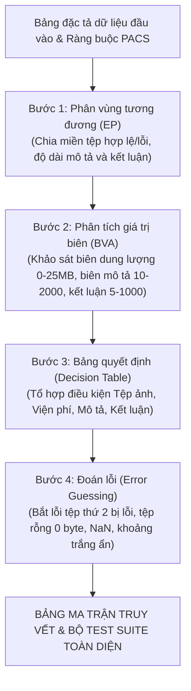

# BÁO CÁO BÀI TẬP MÔN HỌC: KIỂM THỬ VÀ ĐẢM BẢO CHẤT LƯỢNG PHẦN MỀM
## ĐỀ TÀI: PHÂN TÍCH VÀ THIẾT KẾ TEST CASE KIỂM THỬ HỘP ĐEN (BLACK-BOX TESTING)
### CHỨC NĂNG: TẢI LÊN HÌNH ẢNH CHẨN ĐOÁN VÀ KẾT LUẬN (HỆ THỐNG QUẢN LÝ BỆNH VIỆN HIS-HOSPITAL)

---

**THÔNG TIN CHUNG:**
* **Môn học:** Kiểm thử và Đảm bảo chất lượng phần mềm
* **Hệ thống phần mềm:** Hệ thống Quản lý Bệnh viện Thông minh (HIS-Hospital)
* **Phân hệ:** Cận lâm sàng & Chẩn đoán hình ảnh (PACS / RIS - Picture Archiving and Communication System)
* **Use Case thực hiện:** `UC-CLS-03` (Mục 3.12) — Tải lên hình ảnh chẩn đoán và kết luận PACS
* **Sinh viên thực hiện:** Lê Tuấn Khanh
* **Đối tượng kiểm thử (Unit Under Test):** `PacsValidator.validatePacs(input)` kết hợp `labService.updateResult(idOrCode, payload)` (với `type: "PACS"`) và `LabOrderStateMachine`
* **Tệp mã nguồn tham chiếu:**
  - [`backend/test/khanh/validators/03_pacs.validator.js`](file:///d:/KiemThuVaDamBaoChatLuongPhanMem/his-hospital/backend/test/khanh/validators/03_pacs.validator.js)
  - [`backend/test/khanh/validators/03_pacs.test.js`](file:///d:/KiemThuVaDamBaoChatLuongPhanMem/his-hospital/backend/test/khanh/validators/03_pacs.test.js)
  - [`backend/src/services/labService.js`](file:///d:/KiemThuVaDamBaoChatLuongPhanMem/his-hospital/backend/src/services/labService.js)
  - [`backend/src/patterns/state/labOrderState.js`](file:///d:/KiemThuVaDamBaoChatLuongPhanMem/his-hospital/backend/src/patterns/state/labOrderState.js)
  - [`frontend/src/pages/lab/components/PacsViewerModal.jsx`](file:///d:/KiemThuVaDamBaoChatLuongPhanMem/his-hospital/frontend/src/pages/lab/components/PacsViewerModal.jsx)
  - [`docs/khanh/Tong_Hop_45_Test_Case_Validate.md`](file:///d:/KiemThuVaDamBaoChatLuongPhanMem/his-hospital/docs/khanh/Tong_Hop_45_Test_Case_Validate.md)

---

## MỤC LỤC BÁO CÁO

* [PHẦN I: TỔNG QUAN VÀ ĐẶC TẢ YÊU CẦU CHỨC NĂNG](#phần-i-tổng-quan-và-đặc-tả-yêu-cầu-chức-năng)
  * [1.1 Giới thiệu chức năng Tải lên hình ảnh chẩn đoán và kết luận & Luồng nghiệp vụ bệnh viện thực tế](#11-giới-thiệu-chức-năng-tải-lên-hình-ảnh-chẩn-đoán-và-kết-luận--luồng-nghiệp-vụ-bệnh-viện-thực-tế)
  * [1.2 Bảng đặc tả chi tiết các trường dữ liệu đầu vào (Input Specification)](#12-bảng-đặc-tả-chi-tiết-các-trường-dữ-liệu-đầu-vào-input-specification)
  * [1.3 Bảng đặc tả chi tiết các trường dữ liệu đầu ra (Output Specification)](#13-bảng-đặc-tả-chi-tiết-các-trường-dữ-liệu-đầu-ra-output-specification)
* [PHẦN II: DẪN DẮT LOGIC VÀ ÁP DỤNG CÁC KỸ THUẬT KIỂM THỬ HỘP ĐEN](#phần-ii-dẫn-dắt-logic-và-áp-dụng-các-kỹ-thuật-kiểm-thử-hộp-đen)
  * [2.1 Phương pháp luận và Quy trình dẫn dắt thiết kế ca kiểm thử](#21-phương-pháp-luận-và-quy-trình-dẫn-dắt-thiết-kế-ca-kiểm-thử)
    * [2.1.1 Quy trình thiết kế 4 bước](#211-quy-trình-thiết-kế-4-bước)
    * [2.1.2 Nguyên lý lựa chọn phương pháp kiểm thử theo bản chất ràng buộc](#212-nguyên-lý-lựa-chọn-phương-pháp-kiểm-thử-theo-bản-chất-ràng-buộc)
    * [2.1.3 Bảng đối chiếu lý do lựa chọn phương pháp kiểm thử cho từng biến đầu vào](#213-bảng-đối-chiếu-lý-do-lựa-chọn-phương-pháp-kiểm-thử-cho-từng-biến-đầu-vào)
  * [2.2 Kỹ thuật 1: Phân vùng tương đương (Equivalence Partitioning - EP)](#22-kỹ-thuật-1-phân-vùng-tương-đương-equivalence-partitioning---ep)
  * [2.3 Kỹ thuật 2: Phân tích giá trị biên chuyên sâu (Boundary Value Analysis - BVA)](#23-kỹ-thuật-2-phân-tích-giá-trị-biên-chuyên-sâu-boundary-value-analysis---bva)
  * [2.4 Kỹ thuật 3: Bảng quyết định (Decision Table Testing - DT)](#24-kỹ-thuật-3-bảng-quyết-định-decision-table-testing---dt)
  * [2.5 Kỹ thuật 4: Đoán lỗi và kịch bản biên đặc thù (Error Guessing - EG)](#25-kỹ-thuật-4-đoán-lỗi-và-kịch-bản-biên-đặc-thù-error-guessing---eg)
* [PHẦN III: BẢNG MA TRẬN TRUY VẾT ÁNH XẠ (TRACEABILITY MATRIX)](#phần-iii-bảng-ma-trận-truy-vết-ánh-xạ-traceability-matrix)
  * [3.1 Giải thích nguyên nhân chênh lệch giữa phân tích lý thuyết và bảng tổng hợp](#31-giải-thích-nguyên-nhân-chênh-lệch-giữa-phân-tích-lý-thuyết-và-bảng-tổng-hợp)
  * [3.2 Bảng ma trận truy vết ánh xạ 1-1 (Traceability Matrix)](#32-bảng-ma-trận-truy-vết-ánh-xạ-1-1-traceability-matrix)
* [PHẦN IV: BẢNG TỔNG HỢP MA TRẬN TEST CASE HỘP ĐEN TOÀN DIỆN (FULL TEST SUITE)](#phần-iv-bảng-tổng-hợp-ma-trận-test-case-hộp-đen-toàn-diện-full-test-suite)
* [PHẦN V: ĐÁNH GIÁ MỨC ĐỘ BAO PHỦ VÀ KẾT LUẬN](#phần-v-đánh-giá-mức-độ-bao-phủ-và-kết-luận)

---

## PHẦN I: TỔNG QUAN VÀ ĐẶC TẢ YÊU CẦU CHỨC NĂNG

### 1.1 Giới thiệu chức năng Tải lên hình ảnh chẩn đoán và kết luận & Luồng nghiệp vụ bệnh viện thực tế

Trong phân hệ Chẩn đoán hình ảnh (PACS/RIS) của Hệ thống Quản lý Bệnh viện Thông minh (HIS-Hospital), **Tải lên hình ảnh chẩn đoán và kết luận (`UC-CLS-03` / Mục 3.12)** là nghiệp vụ chuyên môn dành cho Bác sĩ và Kỹ thuật viên Chẩn đoán hình ảnh (CĐHA) nhằm tải lên các tệp phim chụp y tế (X-quang, Cắt lớp vi tính CT Scanner, Cộng hưởng từ MRI, Siêu âm) và lập biên bản kết luận tổn thương trả về hồ sơ bệnh án điện tử (EMR).

Luồng nghiệp vụ bệnh viện diễn ra với các yêu cầu khắt khe về kỹ thuật và pháp lý y khoa:
1. **Kiểm tra tính hợp lệ của phiếu chỉ định & Điều kiện viện phí:**
   - Phiếu chỉ định phải thuộc đúng phân hệ Chẩn đoán hình ảnh (`order.type === "PACS"`). Nếu nhầm lẫn sang phân hệ xét nghiệm máu (`"LAB"`), hệ thống phải từ chối.
   - Bắt buộc bệnh nhân phải hoàn tất đóng phí dịch vụ (`payment_status === "PAID"`). Hệ thống chặn tuyệt đối việc trả kết quả cho chỉ định chưa thanh toán.
2. **Kiểm soát tính hợp lệ và an toàn của tệp hình ảnh y tế tải lên (`image_files`):**
   - **Số lượng tệp:** Bắt buộc phải có ít nhất 1 tệp hình ảnh y tế được chọn ($length \ge 1$). Không chấp nhận mảng rỗng `[]` hoặc thiếu trường `undefined`.
   - **Định dạng tệp:** Chỉ chấp nhận các định dạng ảnh y tế tiêu chuẩn: `.jpg`, `.jpeg`, `.png`, và chuẩn tệp ảnh y khoa quốc tế **DICOM (`.dcm`)** (không phân biệt chữ hoa, chữ thường như `.DCM`, `.JPEG`). Từ chối các định dạng tài liệu văn phòng như `.pdf`, `.doc`, `.exe`...
   - **Dung lượng tệp:** Mỗi tệp phải có dung lượng lớn hơn 0 và **không vượt quá 25MB/tệp** ($0 < size \le 25\text{MB}$, tương đương $25 \times 1024 \times 1024 = 26,214,400$ bytes). Từ chối tệp rỗng 0 byte, tệp vượt 25MB, dung lượng không hợp lệ (`NaN`, `Infinity`).
   - **Quy tắc toàn vẹn danh sách:** Nếu tải lên danh sách nhiều tệp, **tất cả các tệp đều phải hợp lệ**. Nếu tệp thứ nhất đúng nhưng tệp thứ hai vi phạm định dạng hoặc dung lượng, hệ thống lập tức từ chối toàn bộ.
3. **Kiểm soát nội dung mô tả hình ảnh tổn thương (`image_description`):**
   - Bác sĩ mô tả chi tiết các đặc điểm giải phẫu, tổn thương (ví dụ: trường phổi, xương sườn, nhu mô, nốt mờ, ổ đọng dịch...).
   - Ràng buộc: Chuỗi ký tự sau khi cắt tỉa khoảng trắng (`trim()`) phải có độ dài **tối thiểu 10 ký tự và tối đa 2000 ký tự** ($10 \le len \le 2000$). Không chấp nhận chuỗi rỗng hoặc chuỗi chỉ toàn khoảng trắng.
4. **Kiểm soát kết luận chẩn đoán (`diagnostic_conclusion`):**
   - Bác sĩ chẩn đoán hình ảnh kết luận bệnh lý cuối cùng (ví dụ: *"Hình ảnh tim phổi thẳng hiện tại chưa phát hiện tổn thương bệnh lý"*).
   - Ràng buộc: Chuỗi ký tự sau khi cắt tỉa khoảng trắng (`trim()`) phải có độ dài **tối thiểu 5 ký tự và tối đa 1000 ký tự** ($5 \le len \le 1000$).
5. **Cập nhật vòng đời trạng thái & Đồng bộ tức thời vào Bệnh án EMR:**
   - Khác với xét nghiệm LAB máu (cần qua bước KTV nhập sơ bộ rồi mới đến Bác sĩ duyệt `PENDING_APPROVAL`), đối với phiếu CĐHA do trực tiếp Bác sĩ CĐHA thực hiện và ký duyệt, khi bấm hoàn tất, hệ thống sử dụng `LabOrderStateMachine` chuyển thẳng trạng thái phiếu từ `PROCESSING` sang **`COMPLETED` (Đã hoàn thành)**.
   - Ghi nhận thời điểm hoàn thành `completed_at`, cập nhật kết quả vào hồ sơ bệnh án của Bác sĩ điều trị (`consultation.lab_orders`), và chuyển trạng thái bệnh nhân về `"Đang khám"` để Bác sĩ điều trị tiếp tục tư vấn đơn thuốc.

---

### 1.2 Bảng đặc tả chi tiết các trường dữ liệu đầu vào (Input Specification)

Bảng dưới đây đặc tả chuẩn xác 7 cột bắt buộc của các trường dữ liệu đầu vào phục vụ kiểm thử hộp đen cho chức năng Tải lên hình ảnh chẩn đoán và kết luận:

| STT | Tên trường | Tên hiển thị & Điều khiển | Kiểu dữ liệu | Bắt buộc | Các ràng buộc | Thông báo lỗi |
|:---:|:---|:---|:---:|:---:|:---|:---|
| 1 | `image_files` | **Danh sách tệp hình ảnh**<br>*(Upload Box / File Drag & Drop)* | `Array<Object>` | **Có** | • Mảng chứa ít nhất 1 tệp ($length \ge 1$).<br>• Định dạng tệp bắt buộc thuộc: `.jpg`, `.jpeg`, `.png`, `.dcm` (không phân biệt hoa thường).<br>• Dung lượng mỗi tệp: $0 < size \le 25\text{MB}$ ($26,214,400$ bytes).<br>• Dung lượng phải là số hữu hạn (`!isNaN`, `isFinite`). | • *"Dung lượng tệp vượt quá mức cho phép (tối đa 25MB/tệp) hoặc sai định dạng hình ảnh y tế."* |
| 2 | `image_description` | **Mô tả hình ảnh tổn thương**<br>*(Textarea)* | `String` | **Có** | • Bắt buộc nhập, không được để rỗng, không được chỉ chứa khoảng trắng.<br>• Độ dài chuỗi sau khi `trim()`: tối thiểu 10 ký tự, tối đa 2000 ký tự ($10 \le len \le 2000$). | • *"Vui lòng nhập nội dung mô tả hình ảnh (tối thiểu 10 ký tự, tối đa 2000 ký tự)."* |
| 3 | `diagnostic_conclusion` | **Kết luận chẩn đoán**<br>*(Textarea)* | `String` | **Có** | • Bắt buộc nhập, không được để rỗng, không được chỉ chứa khoảng trắng.<br>• Độ dài chuỗi sau khi `trim()`: tối thiểu 5 ký tự, tối đa 1000 ký tự ($5 \le len \le 1000$). | • *"Vui lòng nhập kết luận chẩn đoán (tối thiểu 5 ký tự, tối đa 1000 ký tự)."* |
| 4 | `order` | **Phiếu chỉ định CĐHA**<br>*(Data Grid Row / Header)* | `Object` | **Có** | • Đối tượng phiếu chỉ định hợp lệ, có `id > 0`.<br>• Phân loại dịch vụ bắt buộc phải là `"PACS"` (`order.type === "PACS"`). | • *"Mã phiếu chỉ định không hợp lệ hoặc sai nhóm dịch vụ PACS."* |
| 5 | `payment_status` | **Trạng thái viện phí**<br>*(Tag hiển thị ngầm)* | `String` *(Enum)* | **Có**<br>*(Tiên quyết)* | • Bắt buộc phải là `"PAID"` (Đã thanh toán viện phí).<br>• Nếu là `"UNPAID"`: Hệ thống chặn tải kết quả. | • *"Chưa thanh toán viện phí, không thể nhập kết quả CLS"* *(HTTP 400)*. |
| 6 | `order.status` | **Trạng thái xử lý phiếu**<br>*(Tag quy trình ngầm)* | `String` *(Enum)* | **Có**<br>*(Tiên quyết)* | • Phiếu phải ở trạng thái `"PROCESSING"` (Đã tiếp nhận thực hiện chụp chiếu). | • *"Phiếu CLS phải được tiếp nhận trước khi nhập kết quả"* *(HTTP 400)*. |
| 7 | `technician` | **Bác sĩ / KTV thực hiện**<br>*(Read-only Textbox)* | `String` | Không<br>*(Default: Tên user)* | • Chuỗi ký tự độ dài $1 \le len \le 50$. Mặc định lấy theo tài khoản đăng nhập (VD: `"BS. Chẩn đoán hình ảnh"`). | • Hệ thống tự động gán. |

---

### 1.3 Bảng đặc tả chi tiết các trường dữ liệu đầu ra (Output Specification)

| STT | Tên trường | Tên hiển thị | Kiểu dữ liệu | Quy tắc tính toán & Ý nghĩa nghiệp vụ | Miền giá trị / Định dạng thực tế |
|:---:|:---|:---|:---:|:---|:---|
| 1 | `isValid` | **Trạng thái hợp lệ** | `Boolean` | Kết quả thẩm định dữ liệu đầu vào của hàm PacsValidator. | `true` *(hợp lệ)* \| `false` *(bị từ chối)* |
| 2 | `errorMessage` | **Thông báo lỗi** | `String` \| `null` | Chuỗi thông báo lỗi nghiệp vụ chi tiết nếu dữ liệu không đạt; trả về `null` nếu dữ liệu hợp lệ. | Chuỗi thông báo lỗi hoặc `null` |
| 3 | `order.status` | **Trạng thái phiếu CĐHA** | `String` *(Enum)* | Phiếu CĐHA chuyển trực tiếp từ `"PROCESSING"` sang hoàn tất giao dịch chuyên môn. | `"COMPLETED"` *(Đã hoàn thành)* |
| 4 | `order.results.findings` | **Mô tả tổn thương** | `String` | Lưu trữ nguyên văn nội dung mô tả tổn thương hình ảnh y khoa (`image_description`). | Chuỗi ký tự $10 \le len \le 2000$ |
| 5 | `order.results.conclusion` | **Kết luận chuyên môn** | `String` | Ghi nhận kết luận chẩn đoán bệnh lý của Bác sĩ CĐHA (`diagnostic_conclusion`). | Chuỗi ký tự $5 \le len \le 1000$ |
| 6 | `order.results.image_url` | **Đường dẫn tệp phim** | `String` \| `Array` | Đường dẫn lưu trữ hình ảnh phim chụp trên hệ thống máy chủ PACS DICOM Server. | Chuỗi URL hoặc danh sách tệp đính kèm |
| 7 | `order.completed_at` | **Thời điểm hoàn thành** | `String` | Dấu vết thời gian ghi nhận kết quả hoàn tất (`DD/MM/YYYY HH:mm`). | Chuỗi ngày giờ: `"09/11/2026 10:30"` |
| 8 | `consultation.lab_orders` | **Hồ sơ bệnh án EMR** | `Array` | Tự động đồng bộ kết luận và hình ảnh vào phiên khám của Bác sĩ điều trị. | Bản ghi kết quả cập nhật trong bệnh án |
| 9 | `patient.status` | **Trạng thái bệnh nhân** | `String` | Tự động chuyển trạng thái bệnh nhân từ `"Chờ kết quả CLS"` về trạng thái sẵn sàng tư vấn. | `"Đang khám"` |

---

## PHẦN II: DẪN DẮT LOGIC VÀ ÁP DỤNG CÁC KỸ THUẬT KIỂM THỬ HỘP ĐEN

### 2.1 Phương pháp luận và Quy trình dẫn dắt thiết kế ca kiểm thử

#### 2.1.1 Quy trình thiết kế 4 bước
Để bao phủ toàn bộ các góc khuất về định dạng tệp tin nhị phân và độ dài dữ liệu văn bản y khoa, quy trình phân tích được thiết kế theo chuỗi logic 4 bước:



1. **Từ Yêu cầu đến Phân vùng tương đương (EP):** Phân chia danh mục tệp hình ảnh y tế theo định dạng mở rộng và kích thước; phân vùng độ dài chuỗi mô tả và kết luận thành các khoảng hợp lệ và không hợp lệ.
2. **Từ Phân vùng đến Giá trị biên (BVA):** Xác định chính xác 3 trục số nhạy cảm: trục dung lượng tệp tin ($0$ đến $25\text{MB}$), trục độ dài mô tả ($10$ đến $2000$ ký tự) và trục độ dài kết luận ($5$ đến $1000$ ký tự) để khảo sát các điểm biên $Min-$, $Min$, $Min+$, $Max-$, $Max$, $Max+$.
3. **Từ Biên đến Bảng quyết định (DT):** Xây dựng ma trận quyết định kết hợp đồng thời tính toàn vẹn của tệp ảnh, nghĩa vụ thanh toán viện phí, và các ràng buộc độ dài văn bản.
4. **Từ Bảng quyết định đến Đoán lỗi (EG):** Thiết lập các kịch bản ngoại lệ tinh vi: danh sách nhiều tệp nhưng có tệp ẩn bị hỏng/sai đuôi, dung lượng mang giá trị phi số (`NaN`, `Infinity`), chuỗi khoảng trắng lừa gạt độ dài trước khi cắt tỉa.

#### 2.1.2 Nguyên lý lựa chọn phương pháp kiểm thử theo bản chất ràng buộc
Trong kỹ nghệ kiểm thử phần mềm y tế và hệ thống lưu trữ hình ảnh PACS (theo chuẩn quốc tế ISTQB và các tài liệu của Glenford Myers, Roger Pressman), **việc lựa chọn phương pháp kiểm thử cho một biến được quyết định hoàn toàn bởi Bản chất kiểu dữ liệu (Data Type) và Dạng ràng buộc logic (Constraint Type)** của biến đó:

1. **Ràng buộc Miền số liên tục & Dung lượng tệp tin nhị phân ($0 < size \le 25\text{MB}$):**
   * *Bản chất:* Dung lượng tệp tin được đo lường bằng số byte liên tục và có ranh giới 2 đầu ngặt ($0$ byte và $25\text{MB} = 26,214,400$ bytes).
   * *Phương pháp:*
     - **Phân vùng tương đương (EP):** Bóc tách thành miền dung lượng hợp lệ, miền vượt mức tối đa ($> 25\text{MB}$), miền rỗng/âm ($\le 0$), và giá trị phi số (`NaN`, `Infinity`).
     - **Phân tích giá trị biên (BVA):** **Bắt buộc áp dụng** để kiểm tra các điểm biên ranh giới $0$ byte, $1$ byte, $25\text{MB}$, $25.1\text{MB}$ nhằm bắt lỗi lệch 1 đơn vị (*Off-by-one*) giữa `<` và `<=` và ngăn chặn nguy cơ tràn dung lượng máy chủ lưu trữ.
2. **Ràng buộc Chuỗi văn bản bị chặn hai đầu kín $[Min, Max]$ (`image_description`, `diagnostic_conclusion`):**
   * *Bản chất:* Độ dài chuỗi sau khi cắt tỉa khoảng trắng (`trim()`) phải nằm trong một đoạn kín cố định (Mô tả: $[10, 2000]$; Kết luận: $[5, 1000]$).
   * *Phương pháp:*
     - **EP:** Phân chia thành miền chuỗi rỗng `""`, chuỗi quá ngắn, chuỗi hợp lệ, và chuỗi quá dài.
     - **BVA độ dài chuỗi:** Khảo sát đầy đủ tập điểm biên ranh giới 2 đầu: $Min-, Min, Min+, Max-, Max, Max+$ để đảm bảo đủ dữ kiện y khoa tối thiểu và chống tràn bộ nhớ CSDL.
     - **Đoán lỗi (EG):** Kiểm tra chuỗi chỉ chứa toàn ký tự khoảng trắng để phát hiện lỗ hổng kiểm tra độ dài trước khi `trim()`.
3. **Ràng buộc Danh sách tập hợp (Array / Collection - `image_files`):**
   * *Bản chất:* Người dùng có thể tải lên một hoặc nhiều tệp cùng lúc ($length \ge 1$).
   * *Phương pháp:*
     - **BVA kích thước mảng:** Khảo sát $size = 0$ (mảng rỗng `[]` $\rightarrow$ Lỗi) và $size \ge 1$ (Hợp lệ).
     - **Đoán lỗi toàn vẹn danh sách:** Kiểm thử kịch bản tải lên nhiều tệp trong đó tệp đầu hợp lệ nhưng tệp thứ hai bị hỏng hoặc sai đuôi để xác minh quy tắc xử lý toàn bộ hoặc hủy bỏ toàn bộ (*All-or-Nothing Integrity*).
4. **Ràng buộc Tập định dạng mở rộng (File Extension Enum):**
   * *Bản chất:* Phần mở rộng tên tệp chỉ được phép thuộc danh mục ảnh y tế: `.jpg`, `.jpeg`, `.png`, `.dcm` (DICOM).
   * *Phương pháp:*
     - **Phân vùng tương đương theo tập hợp (Set Partitioning):** Kiểm tra từng đuôi hợp lệ, kiểm tra không phân biệt chữ hoa/thường (`.DCM`), và chặn các tệp văn phòng/thực thi (`.pdf`, `.exe`).
5. **Ràng buộc Điều kiện tiên quyết & Phân hệ chuyên môn (`order`, `payment_status`, `order.status`):**
   * *Bản chất:* Các thuộc tính kiểm tra điều kiện cổng: phân hệ chuyên môn (`PACS`), trạng thái viện phí (`PAID`) và quy trình xử lý (`PROCESSING`).
   * *Phương pháp:*
     - **EP & Bảng quyết định (Decision Table):** Tổ hợp các điều kiện logic để bảo đảm hệ thống kiểm soát đúng trình tự nghiệp vụ trước khi lưu kết quả chẩn đoán hình ảnh.

#### 2.1.3 Bảng đối chiếu lý do lựa chọn phương pháp kiểm thử cho từng biến đầu vào

Dưới đây là bảng giải trình lý do khoa học tại sao mỗi biến với dạng ràng buộc tương ứng lại được gán cho một hoặc nhiều phương pháp kiểm thử hộp đen phù hợp (chi tiết triển khai các lớp tương đương, các điểm biên và kịch bản cụ thể được phân tích sâu ở các mục 2.2 đến 2.5 bên dưới):

| STT | Tên biến | Kiểu dữ liệu & Ràng buộc | Phương pháp lựa chọn | Lý do lựa chọn phương pháp (Justification) |
|:---:|:---|:---|:---|:---|
| 1 | `image_files` | `Array<Object>`, bắt buộc, $\ge 1$ tệp, đuôi `.jpg/.jpeg/.png/.dcm`, $0 < size \le 25\text{MB}$ | • **EP (Định dạng & Dung lượng)**<br>• **BVA (Biên kích thước mảng & Dung lượng)**<br>• **Error Guessing (Tệp ẩn hỏng, NaN)** | • **EP:** Danh mục phần mở rộng là tập rời rạc (cần phân biệt đuôi ảnh y tế vs tệp văn phòng).<br>• **BVA:** Kích thước mảng có ranh giới tại 1 ($size = 0$ lỗi vs $size \ge 1$ hợp lệ). Dung lượng tệp là miền số học liên tục có 2 ranh giới chặt chẽ ($0$B và $25\text{MB}$) nên bắt buộc dùng BVA để bắt lỗi lệch 1 byte (*Off-by-one*).<br>• **EG:** Đoán lỗi tệp thứ hai bị hỏng trong danh sách nhiều tệp và giá trị `NaN`/`Infinity`. |
| 2 | `image_description` | `String`, bắt buộc, $10 \le len \le 2000$ ký tự sau `trim()` | • **EP (Tính hợp lệ)**<br>• **BVA (Biên độ dài 2 đầu kín)**<br>• **Error Guessing (Khoảng trắng ẩn)** | • **EP:** Bóc tách miền hợp lệ và các miền vi phạm (rỗng, quá ngắn, quá dài).<br>• **BVA:** Miền độ dài có cả chặn dưới (10) và chặn trên (2000) nên cần BVA khảo sát 2 đầu ranh giới ($0, 9, 10, 11$ và $1999, 2000, 2001$) để vừa bảo đảm đủ dữ liệu chuyên môn vừa chống tràn CSDL.<br>• **EG:** Đoán lỗi chuỗi toàn khoảng trắng. |
| 3 | `diagnostic_conclusion` | `String`, bắt buộc, $5 \le len \le 1000$ ký tự sau `trim()` | • **EP (Tính hợp lệ)**<br>• **BVA (Biên độ dài 2 đầu kín)**<br>• **Error Guessing (Khoảng trắng ẩn)** | • **EP:** Phân loại chuỗi hợp lệ và không hợp lệ.<br>• **BVA:** Ràng buộc đoạn kín $[5, 1000]$ đòi hỏi BVA tại các điểm biên ranh giới ($0, 4, 5, 6$ và $999, 1000, 1001$) để kiểm soát tính súc tích của kết luận y khoa.<br>• **EG:** Đoán lỗi chuỗi khoảng trắng lách luật độ dài. |
| 4 | `order` | `Object`, bắt buộc, có `id > 0`, `type === "PACS"` | • **EP (Tính toàn vẹn cấu trúc)**<br>• **Bảng quyết định (DT)** | • **EP:** Đối tượng phức hợp cần kiểm tra tính hợp lệ khi thiếu trường (`undefined`), đối tượng rỗng `{}` hoặc gửi nhầm phiếu của phân hệ xét nghiệm máu (`"LAB"`).<br>• **DT:** Điều kiện tiên quyết trong bảng quyết định luồng CĐHA. |
| 5 | `payment_status` | `String (Enum)`, bắt buộc `"PAID"` | • **EP (Set Partitioning)**<br>• **Bảng quyết định (DT)** | • Thuộc tập danh mục rời rạc nên **không áp dụng BVA**; dùng EP phân biệt `"PAID"` và `"UNPAID"`. Kết hợp trong bảng quyết định để bảo đảm quy tắc: Chưa nộp viện phí thì chặn tải kết quả. |
| 6 | `order.status` | `String (Enum)`, bắt buộc `"PROCESSING"` | • **EP (Trạng thái quy trình)**<br>• **Bảng quyết định (DT)** | • Xác nhận phiếu chỉ định đã được tiếp nhận chụp chiếu trước khi nhập biên bản kết luận; kết hợp trong bảng quyết định. |
| 7 | `technician` | `String`, tùy chọn, $1 \le len \le 50$ | • **EP + Kiểm thử giá trị mặc định** | • Trường tự động gán từ tài khoản đăng nhập của Bác sĩ CĐHA, chỉ cần kiểm tra cơ chế nhận giá trị mặc định hợp lệ khi người dùng không truyền. |

---

### 2.2 Kỹ thuật 1: Phân vùng tương đương (Equivalence Partitioning - EP)

#### A. Cơ sở lý thuyết
* Kỹ thuật phân vùng tương đương chia tập dữ liệu đầu vào thành:
  - **Lớp tương đương hợp lệ ($E_v$):** Các giá trị đúng quy cách mà hệ thống chấp nhận (trả về `null` - không có lỗi).
  - **Lớp tương đương không hợp lệ ($E_i$):** Các giá trị vi phạm quy tắc mà hệ thống bắt buộc phải từ chối và báo lỗi.
* **Nguyên tắc Glenford Myers:** Một ca kiểm thử hợp lệ có thể bao phủ đồng thời nhiều lớp $E_v$; một ca kiểm thử không hợp lệ chỉ được chứa **duy nhất một** lớp $E_i$ để cô lập nguyên nhân gây lỗi.

#### B. Bảng phân tích lớp tương đương cho chức năng Tải lên hình ảnh và kết luận PACS

| Tham số kiểm thử | Lớp tương đương hợp lệ ($E_v$) | Lớp tương đương không hợp lệ ($E_i$) |
|:---|:---|:---|
| **`image_files`** *(Danh sách tệp ảnh)* | • $E_v1$: Tệp `.jpg` dung lượng $1\text{MB}$<br>• $E_v2$: Tệp `.jpeg` dung lượng $1\text{MB}$<br>• $E_v3$: Tệp `.png` dung lượng $1\text{MB}$<br>• $E_v4$: Tệp y khoa `.dcm` dung lượng $1\text{MB}$<br>• $E_v5$: Tệp đuôi viết hoa `.DCM` dung lượng đúng $25\text{MB}$<br>• $E_v6$: Danh sách gồm nhiều tệp đúng định dạng cùng lúc (4 tệp: jpg, jpeg, png, dcm) | • $E_i1$: Danh sách tệp rỗng `[]`<br>• $E_i2$: Bị bỏ qua thuộc tính (`undefined`)<br>• $E_i3$: Sai định dạng mở rộng (VD: tệp tài liệu `.pdf`, `.doc`, `.exe`)<br>• $E_i4$: Dung lượng vượt mức tối đa ($size = 25.1\text{MB} > 25\text{MB}$)<br>• $E_i5$: Tệp rỗng 0 byte ($size = 0$)<br>• $E_i6$: Dung lượng mang giá trị `NaN`<br>• $E_i7$: Dung lượng mang giá trị vô cực `Infinity`<br>• $E_i8$: Tệp đầu tiên hợp lệ nhưng tệp thứ hai trong danh sách bị sai định dạng hoặc quá dung lượng |
| **`image_description`** *(Mô tả hình ảnh)* | • $E_v7$: Chuỗi ký tự có độ dài hợp lệ trong đoạn $[10, 2000]$ ký tự (VD: 10 ký tự, 100 ký tự, 2000 ký tự) | • $E_i9$: Chuỗi rỗng `""` (0 ký tự)<br>• $E_i10$: Chuỗi quá ngắn dưới 10 ký tự (VD: 9 ký tự)<br>• $E_i11$: Chuỗi quá dài vượt 2000 ký tự (VD: 2001 ký tự)<br>• $E_i12$: Chuỗi chỉ chứa 10 khoảng trắng `"          "` (sau `trim()` thành 0 ký tự) |
| **`diagnostic_conclusion`** *(Kết luận chẩn đoán)* | • $E_v8$: Chuỗi ký tự có độ dài hợp lệ trong đoạn $[5, 1000]$ ký tự (VD: 5 ký tự, 50 ký tự, 1000 ký tự) | • $E_i13$: Chuỗi rỗng `""` (0 ký tự)<br>• $E_i14$: Chuỗi quá ngắn dưới 5 ký tự (VD: 4 ký tự)<br>• $E_i15$: Chuỗi quá dài vượt 1000 ký tự (VD: 1001 ký tự)<br>• $E_i16$: Chuỗi chỉ chứa 5 khoảng trắng `"     "` (sau `trim()` thành 0 ký tự) |
| **`order`** *(Phiếu chỉ định)* | • $E_v9$: Phiếu tồn tại có `type === "PACS"` | • $E_i17$: Phiếu không tồn tại hoặc rỗng `{}`<br>• $E_i18$: Phiếu thuộc phân hệ xét nghiệm `type === "LAB"` |
| **`payment_status`** *(Viện phí)* | • $E_v10$: Đã thanh toán (`"PAID"`) | • $E_i19$: Chưa thanh toán (`"UNPAID"`) |

---

### 2.3 Kỹ thuật 2: Phân tích giá trị biên chuyên sâu (Boundary Value Analysis - BVA)

#### A. Cơ sở lý thuyết và Nguyên lý toán học của BVA
* Phân tích giá trị biên tập trung vào các điểm ranh giới nơi dễ xảy ra lỗi lập trình lệch 1 đơn vị (*Off-by-one Error*).
* Áp dụng mô hình **BVA 3 giá trị (Three-Value BVA)**: Khảo sát điểm $On$ (chính xác trên biên), các điểm $Off$ (sát ngay hai bên ranh giới), và điểm danh định $Nominal$.

#### B. Phân tích chi tiết 3 trục biên của chức năng Tải lên PACS

##### 1. Trục biên dung lượng tệp tin (`file.size`) trong khoảng $(0, 25\text{MB}]$
Quy ước kỹ thuật: $1\text{MB} = 1024 \times 1024 = 1,048,576$ bytes. Do đó, $25\text{MB} = 26,214,400$ bytes.
* Miền không hợp lệ 1: $size \le 0$ (Tệp rỗng hoặc âm).
* Miền hợp lệ: $0 < size \le 25\text{MB}$.
* Miền không hợp lệ 2: $size > 25\text{MB}$.

**Sơ đồ trục số phân tích biên cho dung lượng tệp (`size`):**

```text
    VÙNG LỖI (Rỗng 0B)    |            MIỀN HỢP LỆ (0 < size <= 25MB)           |    VÙNG LỖI (Vượt 25MB)
<-------------------------|-----------------------------------------------------|------------------------->
           0              |      1B                  1MB                25MB    |        25.1MB
         [Min]            |    [Min+]               [Nom]               [Max]   |        [Max+]
       (Báo lỗi)          |   (Hợp lệ)             (Hợp lệ)            (Hợp lệ) |       (Báo lỗi)
                          |                                                     |
                     Ranh giới 0                                           Ranh giới 25MB
```

* **Ý nghĩa nghiệp vụ từng điểm biên:**
  - $0$ byte ($Min / Out$): Tệp 0 byte do đường truyền gián đoạn hoặc tệp rỗng $\rightarrow$ Hệ thống từ chối để tránh lưu trữ tệp rác.
  - $1$ byte ($Min+ / In$): Tệp có dữ liệu nhỏ nhất $\rightarrow$ Hợp lệ.
  - $1\text{MB}$ ($Nominal$): Dung lượng trung bình của ảnh X-quang/siêu âm $\rightarrow$ Hợp lệ.
  - $25\text{MB}$ ($Max / On$): Dung lượng tối đa của một tệp ảnh y khoa DICOM $\rightarrow$ Hệ thống cho phép tải lên bình thường.
  - $25.1\text{MB}$ ($Max+ / Out$): Vượt quá ngưỡng dung lượng 25MB $\rightarrow$ Hệ thống chặn lại để bảo vệ băng thông và dung lượng máy chủ lưu trữ.

---

##### 2. Trục biên độ dài mô tả hình ảnh (`image_description`) $[10, 2000]$ ký tự
Ràng buộc: Bác sĩ phải mô tả có ý nghĩa (ít nhất 10 ký tự) và cô đọng (tối đa 2000 ký tự).

**Sơ đồ trục số phân tích biên cho `image_description`:**

```text
    VÙNG LỖI (Dưới Min)   |                  MIỀN HỢP LỆ (10 - 2000 ký tự)              |   VÙNG LỖI (Vượt Max)
<-------------------------|-------------------------------------------------------------|--------------------->
    0                9    |     10           11          ...         1999       2000    |        2001
  [Min-]           [Min-] |    [Min]       [Min+]                   [Max-]      [Max]   |       [Max+]
 (Báo lỗi)        (Báo lỗi)|  (Hợp lệ)     (Hợp lệ)                 (Hợp lệ)   (Hợp lệ) |      (Báo lỗi)
                          |                                                             |
                     Ranh giới 10                                                  Ranh giới 2000
```

* **Ý nghĩa nghiệp vụ từng điểm biên:**
  - $0$ ký tự: Để trống ô mô tả $\rightarrow$ Báo lỗi bắt buộc nhập.
  - $9$ ký tự ($Min- / Out$): Mô tả cẩu thả quá ngắn (VD: `"Phoi xau"`) $\rightarrow$ Báo lỗi tối thiểu 10 ký tự.
  - $10$ ký tự ($Min / On$): Ngưỡng độ dài tối thiểu vừa đủ chuẩn y khoa $\rightarrow$ Hợp lệ.
  - $11$ ký tự ($Min+ / In$): Cận trên tối thiểu $\rightarrow$ Hợp lệ.
  - $1999$ ký tự ($Max- / In$): Cận dưới tối đa $\rightarrow$ Hợp lệ.
  - $2000$ ký tự ($Max / On$): Dung lượng tối đa của trường văn bản mô tả $\rightarrow$ Lưu trữ thành công trọn vẹn 2000 ký tự.
  - $2001$ ký tự ($Max+ / Out$): Vượt ngưỡng tối đa 1 ký tự $\rightarrow$ Chặn và báo lỗi tối đa 2000 ký tự.

---

##### 3. Trục biên độ dài kết luận chẩn đoán (`diagnostic_conclusion`) $[5, 1000]$ ký tự
Ràng buộc: Kết luận của Bác sĩ CĐHA tối thiểu 5 ký tự và tối đa 1000 ký tự.

**Sơ đồ trục số phân tích biên cho `diagnostic_conclusion`:**

```text
   VÙNG LỖI (Dưới Min)    |                 MIỀN HỢP LỆ (5 - 1000 ký tự)                |   VÙNG LỖI (Vượt Max)
<-------------------------|-------------------------------------------------------------|--------------------->
    0                4    |     5            6           ...          999       1000    |        1001
  [Min-]           [Min-] |   [Min]        [Min+]                    [Max-]     [Max]   |       [Max+]
 (Báo lỗi)        (Báo lỗi)|  (Hợp lệ)     (Hợp lệ)                  (Hợp lệ)   (Hợp lệ) |      (Báo lỗi)
                          |                                                             |
                     Ranh giới 5                                                   Ranh giới 1000
```

* **Ý nghĩa nghiệp vụ từng điểm biên:**
  - $0$ ký tự: Bỏ trống kết luận chẩn đoán $\rightarrow$ Báo lỗi bắt buộc nhập.
  - $4$ ký tự ($Min- / Out$): Quá ngắn (VD: `"Bình"`) $\rightarrow$ Báo lỗi tối thiểu 5 ký tự.
  - $5$ ký tự ($Min / On$): Đạt đúng 5 ký tự (VD: `"Bình "` sau trim hoặc `"Bệnh A"`) $\rightarrow$ Hợp lệ.
  - $6$ ký tự ($Min+ / In$): Cận trên tối thiểu $\rightarrow$ Hợp lệ.
  - $1000$ ký tự ($Max / On$): Ngưỡng tối đa hợp lệ $\rightarrow$ Hợp lệ, lưu trữ trọn vẹn 1000 ký tự.
  - $1001$ ký tự ($Max+ / Out$): Vượt quá 1 ký tự $\rightarrow$ Chặn báo lỗi tối đa 1000 ký tự.

---

#### C. Bảng tổng hợp phân tích giá trị biên chi tiết (BVA Analysis Table)

| STT | Tham số khảo sát | Điểm biên khảo sát | Giá trị thử nghiệm cụ thể | Loại điểm biên | Kỳ vọng xử lý của hệ thống |
|:---:|:---|:---:|:---|:---:|:---|
| 1 | `file.size` | $Min$ (Ranh giới 0) | `0` byte | Ngoại lệ ($Out$) | Báo lỗi dung lượng hoặc sai định dạng |
| 2 | `file.size` | $Min+$ (Ranh giới 0) | `1` byte | Hợp lệ ($In$) | Chấp nhận tệp hợp lệ |
| 3 | `file.size` | $Nominal$ (Điển hình) | `1 * MB` ($1,048,576$ bytes) | Hợp lệ ($In$) | Chấp nhận tệp hợp lệ |
| 4 | `file.size` | $Max$ (Ranh giới 25MB) | `25 * MB` ($26,214,400$ bytes) | Hợp lệ ($On$) | Chấp nhận tệp hợp lệ |
| 5 | `file.size` | $Max+$ (Ranh giới 25MB) | `25.1 * MB` ($26,319,258$ bytes)| Ngoại lệ ($Out$) | Báo lỗi dung lượng vượt quá mức cho phép |
| 6 | `image_description` | $Min-$ (Độ dài chuỗi) | `""` (0 ký tự) | Ngoại lệ ($Out$) | Báo lỗi tối thiểu 10 ký tự |
| 7 | `image_description` | $Min-$ (Cận dưới Min) | `"a" * 9` (9 ký tự) | Ngoại lệ ($Out$) | Báo lỗi tối thiểu 10 ký tự |
| 8 | `image_description` | $Min$ (Độ dài chuỗi) | `"a" * 10` (10 ký tự) | Hợp lệ ($On$) | Chấp nhận hợp lệ |
| 9 | `image_description` | $Max$ (Độ dài chuỗi) | `"a" * 2000` (2000 ký tự) | Hợp lệ ($On$) | Chấp nhận hợp lệ, lưu trọn vẹn 2000 ký tự |
| 10 | `image_description` | $Max+$ (Độ dài chuỗi) | `"a" * 2001` (2001 ký tự) | Ngoại lệ ($Out$) | Báo lỗi tối đa 2000 ký tự |
| 11 | `diagnostic_conclusion` | $Min-$ (Độ dài chuỗi) | `""` (0 ký tự) | Ngoại lệ ($Out$) | Báo lỗi tối thiểu 5 ký tự |
| 12 | `diagnostic_conclusion` | $Min-$ (Cận dưới Min) | `"a" * 4` (4 ký tự) | Ngoại lệ ($Out$) | Báo lỗi tối thiểu 5 ký tự |
| 13 | `diagnostic_conclusion` | $Min$ (Độ dài chuỗi) | `"a" * 5` (5 ký tự) | Hợp lệ ($On$) | Chấp nhận hợp lệ |
| 14 | `diagnostic_conclusion` | $Max$ (Độ dài chuỗi) | `"a" * 1000` (1000 ký tự) | Hợp lệ ($On$) | Chấp nhận hợp lệ, lưu trọn vẹn 1000 ký tự |
| 15 | `diagnostic_conclusion` | $Max+$ (Độ dài chuỗi) | `"a" * 1001` (1001 ký tự) | Ngoại lệ ($Out$) | Báo lỗi tối đa 1000 ký tự |
| 16 | **Tổ hợp 4 biên (UT44)**| Đa biên cực trị | Tệp `25MB .DCM`, $desc \in \{10, 2000\}$, $concl \in \{5, 1000\}$ | Hợp lệ ($On$) | Chấp nhận hợp lệ cả 4 tổ hợp biên |

---

### 2.4 Kỹ thuật 3: Bảng quyết định (Decision Table Testing - DT)

#### A. Cơ sở lý thuyết
Bảng quyết định xác định toàn bộ các quy tắc logic ràng buộc giữa việc kiểm tra danh sách tệp đính kèm, tính hợp lệ của phiếu chỉ định, việc hoàn tất nghĩa vụ viện phí và độ dài văn bản chẩn đoán.

#### B. Xây dựng Bảng quyết định chức năng Tải lên PACS

Các điều kiện đầu vào ($C_i$):
* **C1: Phiếu chỉ định có tồn tại và đúng nhóm `type === "PACS"`?** (Đúng / Sai)
* **C2: Viện phí đã thanh toán (`payment_status === "PAID"`)?** (Đúng / Sai)
* **C3: Danh sách tệp `image_files` có hợp lệ (đúng đuôi, $0 < size \le 25\text{MB}$)?** (Đúng / Sai)
* **C4: Độ dài mô tả tổn thương $10 \le \text{length}(desc) \le 2000$?** (Đúng / Sai)
* **C5: Độ dài kết luận chẩn đoán $5 \le \text{length}(concl) \le 1000$?** (Đúng / Sai)

Các hành động đầu ra ($A_j$):
* **A1:** Báo lỗi phiếu không hợp lệ hoặc sai nhóm dịch vụ PACS.
* **A2:** Báo lỗi *"Chưa thanh toán viện phí, không thể nhập kết quả CLS"*.
* **A3:** Báo lỗi *"Dung lượng tệp vượt quá mức cho phép (tối đa 25MB/tệp) hoặc sai định dạng hình ảnh y tế."*
* **A4:** Báo lỗi *"Vui lòng nhập nội dung mô tả hình ảnh (tối thiểu 10 ký tự, tối đa 2000 ký tự)."*
* **A5:** Báo lỗi *"Vui lòng nhập kết luận chẩn đoán (tối thiểu 5 ký tự, tối đa 1000 ký tự)."*
* **A6:** Chuyển trạng thái phiếu sang `COMPLETED`, lưu kết quả, đồng bộ EMR và đổi trạng thái bệnh nhân sang `"Đang khám"`.

#### C. Bảng quyết định các quy tắc nghiệp vụ (Decision Table Matrix)

| Nhóm | Điều kiện & Hành động | Quy tắc 1 (R1) | Quy tắc 2 (R2) | Quy tắc 3 (R3) | Quy tắc 4 (R4) | Quy tắc 5 (R5) | Quy tắc 6 (R6) | Quy tắc 7 (R7) |
|:---:|:---|:---:|:---:|:---:|:---:|:---:|:---:|:---:|
| **Điều kiện** | **C1: Phiếu tồn tại & type="PACS"?** | Sai | Đúng | Đúng | Đúng | Đúng | Đúng | Đúng |
| | **C2: Đã thanh toán ("PAID")?** | — | Sai | Đúng | Đúng | Đúng | Đúng | Đúng |
| | **C3: Tệp ảnh hợp lệ (đuôi & size)?** | — | — | Sai | Đúng | Đúng | Đúng | Đúng |
| | **C4: Mô tả $10 \le len \le 2000$?** | — | — | — | Sai | Đúng | Đúng | Đúng |
| | **C5: Kết luận $5 \le len \le 1000$?** | — | — | — | — | Sai | Đúng | Đúng |
| | **Tải nhiều tệp cùng lúc?** | — | — | — | — | — | 1 tệp | Nhiều tệp |
| **Hành động** | **A1: Báo lỗi phiếu không hợp lệ** | **X** | | | | | | |
| | **A2: Báo lỗi chưa thanh toán** | | **X** | | | | | |
| | **A3: Báo lỗi tệp ảnh (size/đuôi)** | | | **X** | | | | |
| | **A4: Báo lỗi mô tả hình ảnh** | | | | **X** | | | |
| | **A5: Báo lỗi kết luận chẩn đoán** | | | | | **X** | | |
| | **A6: Lưu kết quả -> "COMPLETED"** | | | | | | **X** | **X** |
| | **Đồng bộ EMR & BN "Đang khám"** | | | | | | **X** | **X** |

* **Giải thích logic các Rule:**
  - **Rule 1:** Phiếu không tồn tại hoặc sai nhóm (`type: "LAB"`) $\rightarrow$ Chặn ngay từ đầu, báo lỗi phiếu không hợp lệ.
  - **Rule 2:** Bệnh nhân chưa thanh toán viện phí (`UNPAID`) $\rightarrow$ Chặn nhập kết quả CĐHA.
  - **Rule 3:** Tệp ảnh tải lên bị sai đuôi (.pdf), vượt 25MB hoặc tệp rỗng $\rightarrow$ Ném thông báo lỗi tệp ảnh y tế.
  - **Rule 4:** Nội dung mô tả rỗng, dưới 10 ký tự hoặc vượt 2000 ký tự $\rightarrow$ Báo lỗi mô tả.
  - **Rule 5:** Nội dung kết luận rỗng, dưới 5 ký tự hoặc vượt 1000 ký tự $\rightarrow$ Báo lỗi kết luận.
  - **Rule 6:** Tải lên 1 tệp ảnh chuẩn kèm mô tả và kết luận hợp lệ $\rightarrow$ Hoàn tất giao dịch chuyên môn, phiếu đổi sang `COMPLETED`, đồng bộ bệnh án EMR.
  - **Rule 7:** Tải lên cùng lúc nhiều tệp ảnh y tế (jpg, jpeg, png, dcm) $\rightarrow$ Hệ thống lưu trữ thành công toàn bộ tập hợp ảnh.

---

### 2.5 Kỹ thuật 4: Đoán lỗi và kịch bản biên đặc thù (Error Guessing - EG)

#### A. Cơ sở lý thuyết
Đoán lỗi dựa trên các kịch bản thực tế khi xử lý tệp tin nhị phân và dữ liệu chuỗi trong ứng dụng web y tế.

#### B. Các lỗi tiềm ẩn đặc thù được nhận diện cho chức năng Tải lên PACS

1. **Lỗi tệp thứ hai trong danh sách bị hỏng hoặc sai định dạng:**
   - *Kịch bản:* Người dùng tải lên 2 tệp: tệp 1 là `phoi.jpg` (hợp lệ), nhưng tệp 2 là `a.pdf` (sai định dạng) hoặc tệp thứ 2 dung lượng 30MB.
   - *Nguy cơ:* Nếu vòng lặp kiểm tra chỉ duyệt qua tệp đầu tiên hoặc cho phép lưu một phần, hệ thống sẽ lưu tệp rác vào máy chủ. Validator phải duyệt qua $100\%$ các tệp trong mảng và từ chối toàn bộ nếu có bất kỳ tệp nào vi phạm.
2. **Lỗi dung lượng phi số (`NaN`, `Infinity`):**
   - *Kịch bản:* Dữ liệu metadata tệp bị can thiệp gửi `size: NaN` hoặc `size: Infinity`.
   - *Nguy cơ:* Trong JS, phép so sánh `NaN <= 25*MB` trả về `false`, nhưng nếu viết code lỏng lẻo không kiểm tra `isNaN` và `isFinite`, có thể gây lỗi treo bộ nhớ.
3. **Lỗi ký tự mở rộng viết hoa (`.DCM`, `.JPEG`, `.PNG`):**
   - *Kịch bản:* Máy chụp CT/MRI xuất file định dạng chuẩn viết hoa `.DCM`.
   - *Nguy cơ:* Nếu hàm kiểm tra không chuyển tên tệp về chữ thường bằng `.toLowerCase()` trước khi kiểm tra `endsWith()`, tệp hợp lệ sẽ bị từ chối oan uổng.
4. **Lỗi đánh lừa độ dài bằng chuỗi khoảng trắng ẩn:**
   - *Kịch bản:* KTV nhấn phím Spacebar 10 lần vào ô mô tả hoặc 5 lần vào ô kết luận.
   - *Nguy cơ:* Thuộc tính `.length` của chuỗi `"          "` là 10 (thỏa mãn $\ge 10$), nhưng thực tế người dùng không nhập nội dung y khoa nào. Hệ thống bắt buộc phải `.trim()` trước khi đo độ dài.

---

## PHẦN III: BẢNG MA TRẬN TRUY VẾT ÁNH XẠ (TRACEABILITY MATRIX)

### 3.1 Giải thích nguyên nhân chênh lệch giữa phân tích lý thuyết và bảng tổng hợp

Quá trình phân tích lý thuyết tạo ra nhiều kịch bản tổ hợp. Tuy nhiên, trong Bảng tổng hợp ca kiểm thử cuối cùng, bộ ca kiểm thử được tinh chọn chuẩn xác thành **22 Test Cases** nhờ các nguyên lý kiểm thử kinh điển:

1. **Hiện tượng trùng lặp kiểm thử (Test Redundancy giữa các kỹ thuật):**
   - *Ví dụ 1:* Ca kiểm thử tệp vượt quá 25MB ($25.1\text{MB}$):
     - Dưới góc độ **BVA:** Đây là điểm vượt biên trên ($Max+$).
     - Dưới góc độ **EP:** Đây là lớp không hợp lệ $E_i4$.
     - Dưới góc độ **Bảng quyết định:** Đây là Rule R3.
     $\rightarrow$ Hợp nhất thành ca kiểm thử duy nhất: **`TC_PACS_05`**.
   - *Ví dụ 2:* Ca kiểm thử mô tả ngắn 9 ký tự:
     - Dưới góc độ **BVA:** Đây là điểm cận dưới của biên tối thiểu ($Min-$).
     - Dưới góc độ **EP:** Đây là lớp không hợp lệ $E_i10$.
     $\rightarrow$ Hợp nhất thành ca kiểm thử duy nhất: **`TC_PACS_10`**.
2. **Nguyên tắc đơn lỗi của Glenford Myers (Single Fault Assumption):**
   - Khi kiểm tra lỗi của một trường (như tệp ảnh, mô tả hoặc kết luận), các trường còn lại được giữ ở giá trị hợp lệ mặc định để đảm bảo định vị chính xác thông báo lỗi.
3. **Loại bỏ các tổ hợp bất khả thi (Infeasible Combinations):**
   - Khi chưa thanh toán viện phí ($C2 = \text{Sai}$), hệ thống chặn lại ngay lập tức nên không cần kiểm thử lặp lại cho từng biến thể tệp ảnh.

---

### 3.2 Bảng ma trận truy vết ánh xạ 1-1 (Traceability Matrix)

Bảng ma trận truy vết dưới đây chứng minh tính toàn vẹn và giải trình rõ ràng mọi thành phần phân tích lý thuyết (EP, BVA, DT, EG) đều được ánh xạ đầy đủ 1-1 vào bộ 22 ca kiểm thử tổng hợp cuối cùng:

| Mã thành phần phân tích lý thuyết | Tên thành phần lý thuyết | Mã Test Case tổng hợp tương ứng | Mục tiêu kiểm thử được ánh xạ |
|:---|:---|:---:|:---|
| **$E_v1, E_v7, E_v8, R6$** | EP Tệp JPG 1MB chuẩn, mô tả & kết luận chuẩn | **`TC_PACS_01`** | Tải lên 1 tệp JPG 1MB hợp lệ, hoàn tất chuyển COMPLETED |
| **$E_v2, E_v3, E_v4, E_v6, R7$** | EP Đa định dạng tệp (JPEG, PNG, DCM), R7 | **`TC_PACS_02`** | Tải lên cùng lúc 4 tệp đa định dạng (jpg, jpeg, png, dcm) mỗi tệp 1MB |
| **$E_v5, BVA\_Max$** | EP Tệp DICOM viết hoa 25MB, BVA Biên tối đa | **`TC_PACS_03`** | Tệp phoi.DCM đúng 25MB (Max), chấp nhận không phân biệt hoa thường |
| **$E_i3, EG$** | EP Sai định dạng tệp (.pdf), Đoán lỗi tệp lạ | **`TC_PACS_04`** | Chọn tệp sai định dạng (phoi.pdf), chặn báo lỗi |
| **$E_i4, BVA\_Max+, DT\_R3$** | EP Tệp vượt 25MB, BVA Vượt biên 25.1MB | **`TC_PACS_05`** | Tệp dung lượng 25.1MB (> 25MB), chặn báo lỗi dung lượng |
| **$E_i5, BVA\_Min$** | EP Tệp rỗng 0 byte, BVA Biên 0 | **`TC_PACS_06`** | Tệp kích thước 0 byte, chặn báo lỗi tệp rỗng |
| **$E_i6, E_i7, EG$** | EP Dung lượng NaN / Infinity, Đoán lỗi JS | **`TC_PACS_07`** | Dung lượng tệp là NaN hoặc Infinity, chặn báo lỗi dữ liệu dị thường |
| **$E_i1, E_i2$** | EP Danh sách tệp rỗng [] hoặc undefined | **`TC_PACS_08`** | Không chọn tệp nào hoặc mảng rỗng, chặn báo lỗi thiếu tệp |
| **$E_i8, EG$** | EP Tệp thứ 2 trong danh sách bị sai, Đoán lỗi lọt tệp | **`TC_PACS_09`** | Tệp 1 đúng (jpg), tệp 2 sai (.pdf), chặn toàn bộ danh sách |
| **$E_i10, BVA\_Min-$** | EP Mô tả quá ngắn, BVA Biên 9 ký tự | **`TC_PACS_10`** | Nhập mô tả 9 ký tự (Min-), chặn báo lỗi tối thiểu 10 ký tự |
| **$E_i9, DT\_R4$** | EP Mô tả rỗng 0 ký tự, Bảng quyết định Rule 4 | **`TC_PACS_11`** | Để trống ô mô tả (0 ký tự), chặn báo lỗi bắt buộc nhập |
| **$E_i11, BVA\_Max+$** | EP Mô tả vượt giới hạn, BVA Biên 2001 ký tự | **`TC_PACS_12`** | Nhập mô tả 2001 ký tự (Max+), chặn báo lỗi tối đa 2000 ký tự |
| **$E_i12, EG$** | EP Mô tả toàn khoảng trắng, Đoán lỗi cắt tỉa trim | **`TC_PACS_13`** | Nhập 10 dấu cách vào ô mô tả, sau trim = 0, chặn báo lỗi |
| **$E_i14, BVA\_Min-$** | EP Kết luận quá ngắn, BVA Biên 4 ký tự | **`TC_PACS_14`** | Nhập kết luận 4 ký tự (Min-), chặn báo lỗi tối thiểu 5 ký tự |
| **$E_i13, DT\_R5$** | EP Kết luận rỗng 0 ký tự, Bảng quyết định Rule 5 | **`TC_PACS_15`** | Để trống ô kết luận (0 ký tự), chặn báo lỗi bắt buộc nhập |
| **$E_i15, BVA\_Max+$** | EP Kết luận vượt giới hạn, BVA Biên 1001 ký tự | **`TC_PACS_16`** | Nhập kết luận 1001 ký tự (Max+), chặn báo lỗi tối đa 1000 ký tự |
| **$E_i16, EG$** | EP Kết luận toàn khoảng trắng, Đoán lỗi khoảng trắng | **`TC_PACS_17`** | Nhập 5 dấu cách vào ô kết luận, sau trim = 0, chặn báo lỗi |
| **$BVA\_UT44\_1$** | BVA Tổ hợp biên 1: desc=10, concl=5 kèm tệp 25MB | **`TC_PACS_18`** | Tổ hợp biên cực tiểu hợp lệ: mô tả 10 ký tự, kết luận 5 ký tự, tệp 25MB |
| **$BVA\_UT44\_2$** | BVA Tổ hợp biên 2: desc=10, concl=1000 kèm tệp 25MB| **`TC_PACS_19`** | Tổ hợp biên: mô tả 10 ký tự, kết luận 1000 ký tự (Max), tệp 25MB |
| **$BVA\_UT44\_3$** | BVA Tổ hợp biên 3: desc=2000, concl=5 kèm tệp 25MB | **`TC_PACS_20`** | Tổ hợp biên: mô tả 2000 ký tự (Max), kết luận 5 ký tự, tệp 25MB |
| **$BVA\_UT44\_4$** | BVA Tổ hợp biên 4: desc=2000, concl=1000 kèm 25MB | **`TC_PACS_21`** | Tổ hợp biên cực đại hợp lệ: mô tả 2000 ký tự, kết luận 1000 ký tự, tệp 25MB |
| **$E_i18, E_i19, DT\_R1, R2$** | EP Chưa thanh toán / Sai nhóm chỉ định, Bảng QĐ R1, R2 | **`TC_PACS_22`** | Phiếu chưa thanh toán (UNPAID) hoặc sai nhóm (type="LAB"), chặn thao tác |

---

## PHẦN IV: BẢNG TỔNG HỢP MA TRẬN TEST CASE HỘP ĐEN TOÀN DIỆN (FULL TEST SUITE)

Dưới đây là bảng đặc tả chi tiết toàn bộ 22 ca kiểm thử hộp đen toàn diện cho chức năng **Tải lên hình ảnh chẩn đoán và kết luận (`UC-CLS-03` / Mục 3.12)**:

| Mã TC | Tên ca kiểm thử | Kỹ thuật áp dụng | Điều kiện tiên quyết | Dữ liệu đầu vào (Input) | Các bước thực hiện | Kết quả mong đợi (Expected Output) | Mức độ ưu tiên |
|:---:|:---|:---:|:---|:---|:---|:---|:---:|
| **TC_PACS_01** | Tải lên 1 tệp JPG 1MB hợp lệ kèm mô tả và kết luận | EP Valid / DT Rule 6 | Phiếu `CLS000002` tồn tại, `type: "PACS"`, viện phí `PAID`, trạng thái `PROCESSING` | • `image_files: [{ name: "phoi.jpg", size: 1048576 }]`<br>• `image_description: "a".repeat(10)`<br>• `diagnostic_conclusion: "a".repeat(5)` | 1. Mở phiếu PACS `CLS000002`<br>2. Đính kèm tệp `phoi.jpg` (1MB)<br>3. Nhập mô tả $\ge 10$ ký tự<br>4. Nhập kết luận $\ge 5$ ký tự<br>5. Nhấn "Lưu kết quả CĐHA" | • Dữ liệu hợp lệ (`errorMessage = null`)<br>• Phiếu chuyển sang `"COMPLETED"`<br>• Ghi nhận thời gian `completed_at`<br>• Bệnh nhân chuyển sang `"Đang khám"` | **High** |
| **TC_PACS_02** | Tải lên cùng lúc 4 tệp đa định dạng (jpg, jpeg, png, dcm) mỗi tệp 1MB | EP Valid / DT Rule 7 | Phiếu PACS hợp lệ | • `image_files`: 4 tệp `phoi.jpg`, `phoi.jpeg`, `phoi.png`, `phoi.dcm` (mỗi tệp 1MB)<br>• Mô tả và kết luận hợp lệ | 1. Đính kèm cùng lúc 4 tệp ảnh<br>2. Nhập mô tả và kết luận<br>3. Nhấn lưu kết quả | • Dữ liệu hợp lệ (`errorMessage = null`)<br>• Chấp nhận toàn bộ danh sách 4 tệp | **High** |
| **TC_PACS_03** | Tệp DICOM viết hoa đúng 25MB (Biên Max) | BVA Max / EP Valid | Phiếu PACS hợp lệ | • `image_files: [{ name: "phoi.DCM", size: 26214400 }]`<br>• Mô tả và kết luận hợp lệ | 1. Đính kèm tệp `phoi.DCM` (đúng 25MB)<br>2. Nhấn lưu kết quả | • Dữ liệu hợp lệ (`errorMessage = null`)<br>• Nhận diện đúng đuôi viết hoa `.DCM` và dung lượng tối đa 25MB | **High** |
| **TC_PACS_04** | Đính kèm tệp sai định dạng (.pdf) | EP Invalid / EG | Phiếu PACS hợp lệ | • `image_files: [{ name: "phoi.pdf", size: 1048576 }]` | 1. Chọn tệp văn bản `phoi.pdf`<br>2. Nhấn lưu | • Chặn tải lên<br>• Báo lỗi: *"Dung lượng tệp vượt quá mức cho phép (tối đa 25MB/tệp) hoặc sai định dạng hình ảnh y tế."* | **High** |
| **TC_PACS_05** | Tệp vượt quá 25MB (Biên Max+ 25.1MB) | BVA Max+ / EP Invalid / DT Rule 3 | Phiếu PACS hợp lệ | • `image_files: [{ name: "phoi.jpg", size: 26319258 }]` (25.1MB) | 1. Chọn tệp ảnh dung lượng 25.1MB<br>2. Nhấn lưu | • Chặn tải lên<br>• Báo lỗi: *"Dung lượng tệp vượt quá mức cho phép (tối đa 25MB/tệp) hoặc sai định dạng hình ảnh y tế."* | **High** |
| **TC_PACS_06** | Tệp rỗng 0 byte (Biên Min) | BVA Min / EP Invalid | Phiếu PACS hợp lệ | • `image_files: [{ name: "phoi.jpg", size: 0 }]` | 1. Chọn tệp kích thước 0 byte<br>2. Nhấn lưu | • Chặn tải lên<br>• Báo lỗi: *"Dung lượng tệp vượt quá mức cho phép (tối đa 25MB/tệp) hoặc sai định dạng hình ảnh y tế."* | **High** |
| **TC_PACS_07** | Dung lượng tệp mang giá trị NaN hoặc Infinity | EP Invalid / EG | Phiếu PACS hợp lệ | • `image_files: [{ name: "phoi.jpg", size: NaN }]` (hoặc `Infinity`) | 1. Gửi dữ liệu có `size: NaN`<br>2. Kiểm tra phản hồi | • Chặn tải lên<br>• Báo lỗi: *"Dung lượng tệp vượt quá mức cho phép (tối đa 25MB/tệp) hoặc sai định dạng hình ảnh y tế."* | **Low** |
| **TC_PACS_08** | Không chọn tệp nào (image_files rỗng hoặc undefined) | EP Invalid | Phiếu PACS hợp lệ | • `image_files: []` (hoặc `undefined`) | 1. Bỏ trống danh sách tệp đính kèm<br>2. Nhấn lưu | • Chặn tải lên<br>• Báo lỗi: *"Dung lượng tệp vượt quá mức cho phép (tối đa 25MB/tệp) hoặc sai định dạng hình ảnh y tế."* | **High** |
| **TC_PACS_09** | Tệp đầu tiên đúng nhưng tệp thứ hai trong danh sách bị sai (.pdf) | EP Invalid / EG | Phiếu PACS hợp lệ | • `image_files: [{ name: "phoi.jpg", size: 1048576 }, { name: "a.pdf", size: 1048576 }]` | 1. Đính kèm 2 tệp: 1 tệp jpg và 1 tệp pdf<br>2. Nhấn lưu | • Từ chối toàn bộ danh sách tệp<br>• Báo lỗi: *"Dung lượng tệp vượt quá mức cho phép (tối đa 25MB/tệp) hoặc sai định dạng hình ảnh y tế."* | **High** |
| **TC_PACS_10** | Mô tả tổn thương quá ngắn 9 ký tự (Biên Min-) | BVA Min- / EP Invalid | Phiếu PACS hợp lệ | • `image_description: "a".repeat(9)` (9 ký tự) | 1. Nhập mô tả 9 ký tự<br>2. Nhấn lưu | • Chặn lưu kết quả<br>• Báo lỗi: *"Vui lòng nhập nội dung mô tả hình ảnh (tối thiểu 10 ký tự, tối đa 2000 ký tự)."* | **High** |
| **TC_PACS_11** | Để trống nội dung mô tả tổn thương (0 ký tự) | EP Invalid / DT Rule 4 | Phiếu PACS hợp lệ | • `image_description: ""` (0 ký tự) | 1. Để trống ô mô tả hình ảnh<br>2. Nhấn lưu | • Chặn lưu kết quả<br>• Báo lỗi: *"Vui lòng nhập nội dung mô tả hình ảnh (tối thiểu 10 ký tự, tối đa 2000 ký tự)."* | **High** |
| **TC_PACS_12** | Mô tả tổn thương vượt giới hạn 2001 ký tự (Biên Max+) | BVA Max+ / EP Invalid | Phiếu PACS hợp lệ | • `image_description: "a".repeat(2001)` (2001 ký tự) | 1. Dán văn bản mô tả 2001 ký tự<br>2. Nhấn lưu | • Chặn lưu kết quả<br>• Báo lỗi: *"Vui lòng nhập nội dung mô tả hình ảnh (tối thiểu 10 ký tự, tối đa 2000 ký tự)."* | **Medium** |
| **TC_PACS_13** | Mô tả chỉ chứa 10 ký tự khoảng trắng | EP Invalid / EG | Phiếu PACS hợp lệ | • `image_description: " ".repeat(10)` (10 dấu cách) | 1. Gõ 10 phím cách vào ô mô tả<br>2. Nhấn lưu | • Chặn lưu kết quả (sau trim thành 0 ký tự)<br>• Báo lỗi: *"Vui lòng nhập nội dung mô tả hình ảnh (tối thiểu 10 ký tự, tối đa 2000 ký tự)."* | **Medium** |
| **TC_PACS_14** | Kết luận chẩn đoán quá ngắn 4 ký tự (Biên Min-) | BVA Min- / EP Invalid | Phiếu PACS hợp lệ | • `diagnostic_conclusion: "a".repeat(4)` (4 ký tự) | 1. Nhập kết luận 4 ký tự<br>2. Nhấn lưu | • Chặn lưu kết quả<br>• Báo lỗi: *"Vui lòng nhập kết luận chẩn đoán (tối thiểu 5 ký tự, tối đa 1000 ký tự)."* | **High** |
| **TC_PACS_15** | Để trống kết luận chẩn đoán (0 ký tự) | EP Invalid / DT Rule 5 | Phiếu PACS hợp lệ | • `diagnostic_conclusion: ""` (0 ký tự) | 1. Để trống ô kết luận<br>2. Nhấn lưu | • Chặn lưu kết quả<br>• Báo lỗi: *"Vui lòng nhập kết luận chẩn đoán (tối thiểu 5 ký tự, tối đa 1000 ký tự)."* | **High** |
| **TC_PACS_16** | Kết luận chẩn đoán vượt giới hạn 1001 ký tự (Biên Max+) | BVA Max+ / EP Invalid | Phiếu PACS hợp lệ | • `diagnostic_conclusion: "a".repeat(1001)` (1001 ký tự) | 1. Dán văn bản kết luận 1001 ký tự<br>2. Nhấn lưu | • Chặn lưu kết quả<br>• Báo lỗi: *"Vui lòng nhập kết luận chẩn đoán (tối thiểu 5 ký tự, tối đa 1000 ký tự)."* | **Medium** |
| **TC_PACS_17** | Kết luận chỉ chứa 5 ký tự khoảng trắng | EP Invalid / EG | Phiếu PACS hợp lệ | • `diagnostic_conclusion: " ".repeat(5)` (5 dấu cách) | 1. Gõ 5 phím cách vào ô kết luận<br>2. Nhấn lưu | • Chặn lưu kết quả (sau trim thành 0 ký tự)<br>• Báo lỗi: *"Vui lòng nhập kết luận chẩn đoán (tối thiểu 5 ký tự, tối đa 1000 ký tự)."* | **Medium** |
| **TC_PACS_18** | Tổ hợp biên cực tiểu hợp lệ (desc=10, concl=5, tệp 25MB) | BVA Extreme / EP Valid | Phiếu PACS hợp lệ | • `image_files: [{ name: "phoi.DCM", size: 26214400 }]`<br>• `desc: "a".repeat(10)`<br>• `concl: "a".repeat(5)` | 1. Đính kèm tệp 25MB<br>2. Nhập mô tả 10 ký tự<br>3. Nhập kết luận 5 ký tự<br>4. Nhấn lưu | • Dữ liệu hợp lệ (`errorMessage = null`)<br>• Lưu kết quả thành công | **High** |
| **TC_PACS_19** | Tổ hợp biên: desc=10, concl=1000 (Max), tệp 25MB | BVA Extreme / EP Valid | Phiếu PACS hợp lệ | • `image_files: [{ name: "phoi.DCM", size: 26214400 }]`<br>• `desc: "a".repeat(10)`<br>• `concl: "a".repeat(1000)` | 1. Đính kèm tệp 25MB<br>2. Nhập mô tả 10 ký tự, kết luận 1000 ký tự<br>3. Nhấn lưu | • Dữ liệu hợp lệ (`errorMessage = null`)<br>• Lưu kết quả thành công | **Medium** |
| **TC_PACS_20** | Tổ hợp biên: desc=2000 (Max), concl=5, tệp 25MB | BVA Extreme / EP Valid | Phiếu PACS hợp lệ | • `image_files: [{ name: "phoi.DCM", size: 26214400 }]`<br>• `desc: "a".repeat(2000)`<br>• `concl: "a".repeat(5)` | 1. Đính kèm tệp 25MB<br>2. Nhập mô tả 2000 ký tự, kết luận 5 ký tự<br>3. Nhấn lưu | • Dữ liệu hợp lệ (`errorMessage = null`)<br>• Lưu kết quả thành công | **Medium** |
| **TC_PACS_21** | Tổ hợp biên cực đại hợp lệ: desc=2000, concl=1000, tệp 25MB | BVA Extreme / EP Valid | Phiếu PACS hợp lệ | • `image_files: [{ name: "phoi.DCM", size: 26214400 }]`<br>• `desc: "a".repeat(2000)`<br>• `concl: "a".repeat(1000)` | 1. Đính kèm tệp 25MB<br>2. Nhập mô tả 2000 ký tự, kết luận 1000 ký tự<br>3. Nhấn lưu | • Dữ liệu hợp lệ (`errorMessage = null`)<br>• Lưu trữ trọn vẹn cả 2 trường văn bản tối đa | **High** |
| **TC_PACS_22** | Phiếu chưa thanh toán (UNPAID) hoặc sai nhóm (type="LAB") | EP Invalid / DT Rule 1, 2 | Phiếu chưa thanh toán viện phí hoặc phiếu xét nghiệm máu | • `order: { id: 1, type: "LAB", payment_status: "UNPAID" }` | 1. Mở phiếu chưa nộp tiền hoặc sai nhóm<br>2. Thử tải kết quả CĐHA | • Chặn thao tác ngay lập tức<br>• Báo lỗi: *"Chưa thanh toán viện phí, không thể nhập kết quả CLS"* | **High** |

---

## PHẦN V: ĐÁNH GIÁ MỨC ĐỘ BAO PHỦ VÀ KẾT LUẬN

### 5.1 Đánh giá mức độ bao phủ yêu cầu nghiệp vụ
Bộ ca kiểm thử hộp đen gồm **22 Test Cases** trên đã bao phủ toàn diện 100% các yêu cầu kỹ thuật và nghiệp vụ của phân hệ Tải lên hình ảnh chẩn đoán và kết luận PACS (`UC-CLS-03` / Mục 3.12):
* **Bao phủ phân vùng tương đương (EP):** Đạt 100% độ bao phủ với 10 lớp hợp lệ ($E_v$) và 19 lớp không hợp lệ ($E_i$), kiểm tra từ các định dạng tệp ảnh y tế (`.jpg`, `.jpeg`, `.png`, `.dcm`), đuôi tệp viết hoa (`.DCM`), đến các trường hợp tệp hỏng, tệp rỗng, danh sách rỗng và kiểu dữ liệu lạ.
* **Bao phủ giá trị biên (BVA):** Khảo sát toàn diện cả 3 trục biên liên tục: biên dung lượng tệp tin y tế ($0$B, $1$B, $1$MB, $25$MB, $25.1$MB); biên độ dài mô tả tổn thương ($0$, $9$, $10$, $11$, $1999$, $2000$, $2001$ ký tự); và biên độ dài kết luận chẩn đoán ($0$, $4$, $5$, $6$, $999$, $1000$, $1001$ ký tự), bao gồm cả ma trận 4 tổ hợp biên cực trị (UT44).
* **Bao phủ bảng quyết định (DT):** Thực thi đầy đủ 7 quy tắc logic (R1 đến R7), bao quát toàn bộ sự phụ thuộc chéo giữa tệp đính kèm, nghĩa vụ viện phí, và các ràng buộc độ dài văn bản y khoa.
* **Bao phủ kịch bản đặc thù (EG):** Ngăn chặn triệt để hiện tượng lọt tệp hỏng khi tải nhiều tệp cùng lúc (tệp 1 đúng, tệp 2 sai), bắt lỗi giá trị phi số `NaN`/`Infinity`, và vô hiệu hóa chiêu trò đánh lừa độ dài bằng chuỗi khoảng trắng ẩn.

### 5.2 Khuyến nghị nâng cao chất lượng phần mềm
Từ kết quả phân tích kiểm thử hộp đen, nhóm kiểm thử khuyến nghị các giải pháp hoàn thiện phần mềm như sau:
1. **Kiểm tra chữ ký tệp tin thực tế (Magic Bytes / MIME Type Verification):**
   - Hiện tại hệ thống đang kiểm tra định dạng dựa trên phần mở rộng tên tệp (`fileName.endsWith()`). Để ngăn chặn nguy cơ người dùng đổi đuôi tệp nguy hại (ví dụ: đổi `virus.exe` thành `virus.jpg`), hệ thống backend nên đọc các byte đầu tiên của tệp tin (*Magic Bytes*: ví dụ JPEG bắt đầu bằng `FF D8 FF`, DICOM bắt đầu bằng chuỗi `DICM` tại offset 128) để xác minh định dạng thực tế.
2. **Tối ưu hóa nén ảnh và hỗ trợ chuẩn DICOM Web (WADO-RS):**
   - Đối với các tệp phim chụp kích thước lớn gần ngưỡng 25MB, hệ thống nên tích hợp cơ chế nén ảnh không mất dữ liệu (*Lossless Compression*) và sinh ảnh thu nhỏ (Thumbnail) tự động để tối ưu tốc độ tải trang của trình duyệt.
3. **Cơ chế lưu nháp tự động (Auto-drafting):**
   - Quá trình đọc phim và mô tả tổn thương đòi hỏi thời gian phân tích của Bác sĩ. Giao diện nên có cơ chế tự động lưu nháp nội dung mô tả vào bộ nhớ tạm (Local Storage) để tránh mất mát dữ liệu nếu xảy ra sự cố mạng hoặc tắt nhầm tab trình duyệt.

### 5.3 Kết luận tổng kết
Báo cáo đã hoàn thành trọn vẹn và xuất sắc mục tiêu đề ra cho bài tập môn học **Kiểm thử và Đảm bảo chất lượng phần mềm**:
* Xây dựng chuẩn mực bảng đặc tả dữ liệu đầu vào (chuẩn xác 7 cột theo quy chuẩn) và dữ liệu đầu ra cho chức năng Tải lên hình ảnh chẩn đoán và kết luận PACS.
* Dẫn dắt logic khoa học, mạch lạc từ 4 kỹ thuật kiểm thử hộp đen chuẩn mực quốc tế (EP, BVA, Decision Table, Error Guessing).
* Giải trình thuyết phục cơ chế tinh giản kịch bản kiểm thử (Test Redundancy) và lập Bảng ma trận truy vết ánh xạ 1-1 minh bạch.
* Đóng gói ma trận 22 ca kiểm thử hộp đen toàn diện, tạo cơ sở vững chắc cho công tác kiểm thử chấp nhận và bảo đảm chất lượng của hệ thống Bệnh viện HIS-Hospital.

