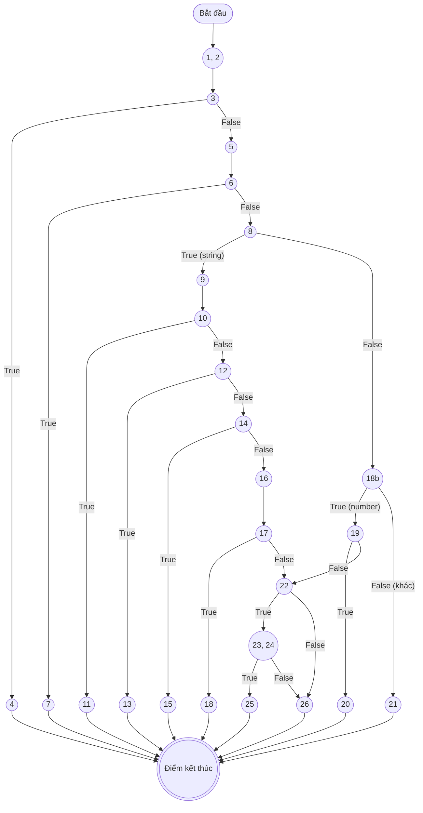
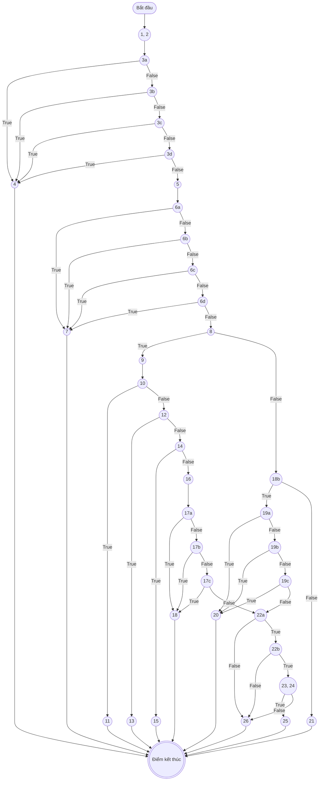
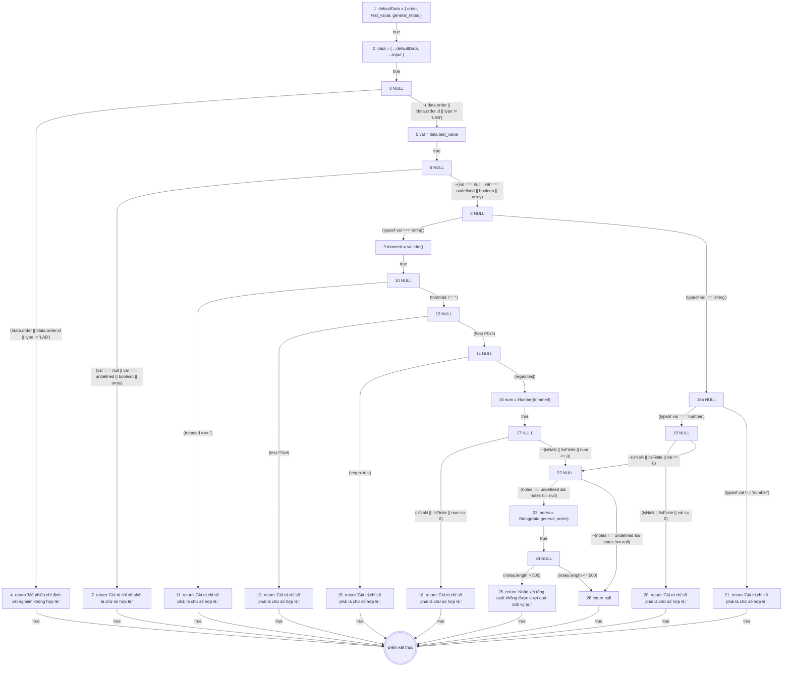
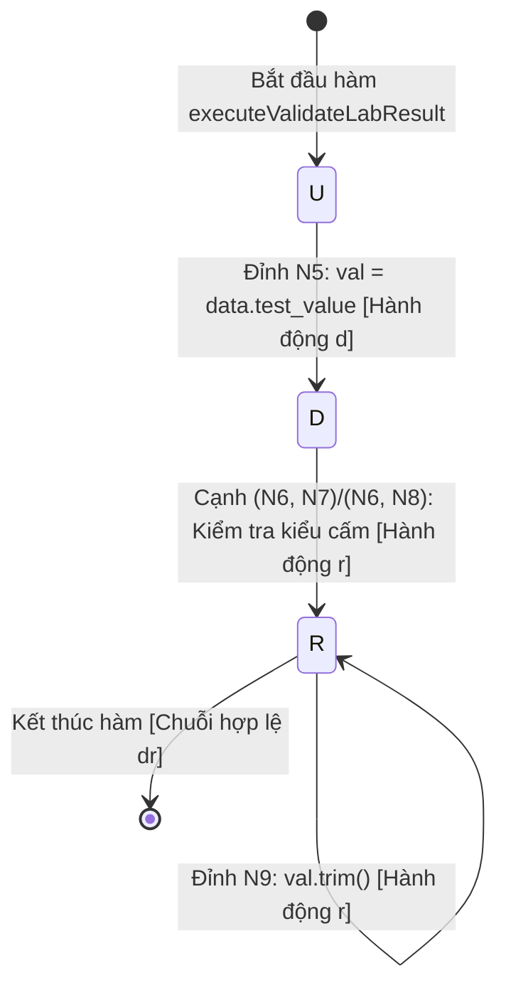

# KẾ HOẠCH & BÁO CÁO KIỂM THỬ HỘP TRẮNG (WHITE-BOX TESTING REPORT)
## CHỨC NĂNG: NHẬP KẾT QUẢ XÉT NGHIỆM ĐỊNH LƯỢNG (HỆ THỐNG HIS-HOSPITAL)

**Người thực hiện:** Lê Tuấn Khanh — Senior QA / White-Box Test Engineer  
**Phạm vi kiểm thử:** Chức năng Thẩm định & Cập nhật Kết quả xét nghiệm định lượng (`LabResultValidator.validateLabResult` kết hợp quy tắc vòng đời `LabOrderStateMachine`)  
**Tập tin mã nguồn kiểm thử:** 
- [`backend/test/khanh/validators/02_labResult.validator.js`](file:///d:/KiemThuVaDamBaoChatLuongPhanMem/his-hospital/backend/test/khanh/validators/02_labResult.validator.js) (`LabResultValidator.validateLabResult`)
- [`backend/src/services/labService.js`](file:///d:/KiemThuVaDamBaoChatLuongPhanMem/his-hospital/backend/src/services/labService.js) (`updateResult`)
- [`backend/src/patterns/state/labOrderState.js`](file:///d:/KiemThuVaDamBaoChatLuongPhanMem/his-hospital/backend/src/patterns/state/labOrderState.js) (`LabOrderStateMachine`)

**Tài liệu tham chiếu chuẩn:** 
- [`docs/vuong/Kiem_Thu_Hop_Trang_LapHoaDonVienPhi.md`](file:///d:/KiemThuVaDamBaoChatLuongPhanMem/his-hospital/docs/vuong/Kiem_Thu_Hop_Trang_LapHoaDonVienPhi.md) (Mẫu chuẩn mực Kiểm thử Hộp trắng Hệ thống HIS-Hospital)
- [`docs/khanh/Kiem_Thu_Hop_Den_NhapKetQuaXetNghiem.md`](file:///d:/KiemThuVaDamBaoChatLuongPhanMem/his-hospital/docs/khanh/Kiem_Thu_Hop_Den_NhapKetQuaXetNghiem.md) (Đặc tả Kiểm thử Hộp đen ca `UC-CLS-02`)
- Tài liệu đào tạo Kỹ thuật kiểm thử phần mềm (Đại học Bách Khoa / ĐHQG Hà Nội).

---

## MỤC LỤC
- [1. TỔNG QUAN NGHIỆP VỤ & QUY TẮC NGHIỆP VỤ](#1-tổng-quan-nghiệp-vụ--quy-tắc-nghiệp-vụ)
- [2. ĐÁNH SỐ DÒNG MÃ NGUỒN CHUẨN THUẬT TOÁN (CHỈ ĐÁNH SỐ CÂU LỆNH THỰC THI)](#2-đánh-số-dòng-mã-nguồn-chuẩn-thuật-toán-chỉ-đánh-số-câu-lệnh-thực-thi)
- [3. PHẦN I: KIỂM THỬ DÒNG ĐIỀU KHIỂN (CONTROL FLOW TESTING)](#3-phần-i-kiểm-thử-dòng-điều-khiển-control-flow-testing)
  - [3.1 Đồ thị dòng điều khiển CFG cho Độ đo C1 và C2](#31-đồ-thị-dòng-điều-khiển-cfg-cho-độ-đo-c1-và-c2)
  - [3.2 Phân tích độ phức tạp Cyclomatic $V(G)$ cho C1/C2](#32-phân-tích-độ-phức-tạp-cyclomatic-vg-cho-c1c2)
  - [3.3 Thiết kế ca kiểm thử cho Độ đo C1 (Statement Coverage)](#33-thiết-kế-ca-kiểm-thử-cho-độ-đo-c1-statement-coverage)
  - [3.4 Thiết kế ca kiểm thử cho Độ đo C2 (Branch / Decision Coverage)](#34-thiết-kế-ca-kiểm-thử-cho-độ-đo-c2-branch--decision-coverage)
  - [3.5 Đồ thị dòng điều khiển CFG riêng cho Độ đo C3 (Multiple Condition Coverage)](#35-đồ-thị-dòng-điều-khiển-cfg-riêng-cho-độ-đo-c3-multiple-condition-coverage)
  - [3.6 Bảng phân tích điều kiện con và Thiết kế ca kiểm thử đạt 100% C3](#36-bảng-phân-tích-điều-kiện-con-và-thiết-kế-ca-kiểm-thử-đạt-100-c3)
- [4. PHẦN II: KIỂM THỬ DÒNG DỮ LIỆU (DATA FLOW TESTING)](#4-phần-ii-kiểm-thử-dòng-dữ-liệu-data-flow-testing)
  - [4.1 Cơ sở lý thuyết đồ thị dòng dữ liệu (DFG - Data Flow Graph)](#41-cơ-sở-lý-thuyết-đồ-thị-dòng-dữ-liệu-dfg---data-flow-graph)
  - [4.2 Bảng 1: Bảng mô tả `def(i)` và `c-use(i)` tại các đỉnh](#42-bảng-1-bảng-mô-tả-defi-và-c-usei-tại-các-đỉnh)
  - [4.3 Bảng 2: Các điều kiện và `p-use` của các cạnh](#43-bảng-2-các-điều-kiện-và-p-use-của-các-cạnh)
  - [4.4 Đồ thị dòng dữ liệu (DFG - Data Flow Graph)](#44-đồ-thị-dòng-dữ-liệu-dfg---data-flow-graph)
  - [4.5 Bảng tổng hợp chi tiết Def-Use theo biến (All Variables Mapping)](#45-bảng-tổng-hợp-chi-tiết-def-use-theo-biến-all-variables-mapping)
  - [4.6 Phân tích bất thường dòng dữ liệu (Anomalies Loại 1 `dd`, Loại 2 `ur`, Loại 3 `du`)](#46-phân-tích-bất-thường-dòng-dữ-liệu-anomalies-loại-1-dd-loại-2-ur-loại-3-du)
  - [4.7 Sơ đồ chuyển trạng thái U-D-R-A cho biến cốt lõi `val`](#47-sơ-đồ-chuyển-trạng-thái-u-d-r-a-cho-biến-cốt-lõi-val)
  - [4.8 Sinh đường đi và Ca kiểm thử ứng với Độ đo All c-use](#48-sinh-đường-đi-và-ca-kiểm-thử-ứng-với-độ-đo-all-c-use)
  - [4.9 Sinh đường đi và Ca kiểm thử ứng với Độ đo All p-use](#49-sinh-đường-đi-và-ca-kiểm-thử-ứng-với-độ-đo-all-p-use)
  - [4.10 Bảng so sánh mức độ bao phủ giữa All c-use và All p-use](#410-bảng-so-sánh-mức-độ-bao-phủ-giữa-all-c-use-và-all-p-use)
- [5. TỔNG KẾT & KHUYẾN NGHỊ TỐI ƯU](#5-tổng-kết--khuyến-nghị-tối-ưu)

---

## 1. TỔNG QUAN NGHIỆP VỤ & QUY TẮC NGHIỆP VỤ

Chức năng **Nhập kết quả xét nghiệm định lượng (`UC-CLS-02` / Mục 3.11)** trong phân hệ LIS của Hệ thống HIS-Hospital tiếp nhận các chỉ số xét nghiệm huyết học, sinh hóa (WBC, RBC, Glucose,...) từ Kỹ thuật viên (KTV) xét nghiệm và tiến hành thẩm định dữ liệu đầu vào trước khi chuyển trạng thái phiếu chỉ định.

Quy trình nghiệp vụ bao gồm:
1. **Kiểm tra thông tin phiếu chỉ định (`order`):** Phiếu bắt buộc phải tồn tại, là đối tượng hợp lệ có thuộc tính `id` dương và phân loại chuyên môn bắt buộc phải là `"LAB"` (`order.type === "LAB"`). Nếu vi phạm $\rightarrow$ Báo lỗi *"Mã phiếu chỉ định xét nghiệm không hợp lệ."*.
2. **Kiểm tra kiểu dữ liệu và giá trị của chỉ số định lượng (`test_value`):**
   - Từ chối các giá trị dị thường: `null`, `undefined`, kiểu `boolean`, kiểu mảng `Array`.
   - Nếu là chuỗi ký tự (`string`): Tiến hành cắt tỉa khoảng trắng (`trim()`). Từ chối chuỗi rỗng `""`, chuỗi hệ thập lục phân Hex (`/^0x/i`), chuỗi lẫn ký tự chữ hoặc không khớp định dạng số thực dương (`/^(?:\d+(?:\.\d+)?|\.\d+)$/`). Chuyển đổi thành số (`Number`) và kiểm tra tính hữu hạn (`isFinite`) cùng điều kiện dương ngặt ($num > 0$).
   - Nếu là kiểu số (`number`): Kiểm tra không phải `NaN`, là số hữu hạn (`isFinite`) và bắt buộc phải lớn hơn 0 ($val > 0$). Giá trị bằng 0 và số âm đều bị từ chối.
   - Nếu thuộc các kiểu dữ liệu khác $\rightarrow$ Báo lỗi *"Giá trị chỉ số phải là chữ số hợp lệ."*.
3. **Kiểm tra độ dài nhận xét tổng quát (`general_notes`):**
   - Nếu có truyền nhận xét (khác `undefined` và `null`), độ dài chuỗi tối đa không được vượt quá **500 ký tự** ($len \le 500$). Nếu vượt quá $\rightarrow$ Báo lỗi *"Nhận xét tổng quát không được vượt quá 500 ký tự."*.
4. **Xác nhận tính hợp lệ & Chuyển đổi trạng thái:**
   - Trả về `null` (không có lỗi) nếu tất cả các điều kiện thỏa mãn.
   - Khi hợp lệ, phiếu xét nghiệm chuyển trạng thái từ `PROCESSING` sang `PENDING_APPROVAL` (Chờ duyệt chuyên môn) theo `LabOrderStateMachine`.

---

## 2. ĐÁNH SỐ DÒNG MÃ NGUỒN CHUẨN THUẬT TOÁN (CHỈ ĐÁNH SỐ CÂU LỆNH THỰC THI)

> **Quy chuẩn đánh số:** Tuyệt đối **không đánh số dòng comment** và **không đánh số dòng trống**. Chỉ đánh số các câu lệnh gán, khai báo, điều kiện quyết định, quăng lỗi hoặc gọi hàm thực thi.

```javascript
function executeValidateLabResult(input = {}) {

1.  const defaultData = { order: { id: 1, type: "LAB" }, test_value: "5.2", general_notes: "" };

2.  const data = { ...defaultData, ...input };

3.  if (!data.order || typeof data.order !== "object" || !data.order.id || data.order.type !== "LAB")

4.      return "Mã phiếu chỉ định xét nghiệm không hợp lệ.";

5.  const val = data.test_value;

6.  if (val === null || val === undefined || typeof val === "boolean" || Array.isArray(val))

7.      return "Giá trị chỉ số phải là chữ số hợp lệ.";

8.  if (typeof val === "string") {

9.      const trimmed = val.trim();

10.     if (trimmed === "")

11.         return "Giá trị chỉ số phải là chữ số hợp lệ.";

12.     if (/^0x/i.test(trimmed))

13.         return "Giá trị chỉ số phải là chữ số hợp lệ.";

14.     if (!/^(?:\d+(?:\.\d+)?|\.\d+)$/.test(trimmed))

15.         return "Giá trị chỉ số phải là chữ số hợp lệ.";

16.     const num = Number(trimmed);

17.     if (isNaN(num) || !isFinite(num) || num <= 0)

18.         return "Giá trị chỉ số phải là chữ số hợp lệ.";

    } else if (typeof val === "number") {

19.     if (isNaN(val) || !isFinite(val) || val <= 0)

20.         return "Giá trị chỉ số phải là chữ số hợp lệ.";

    } else {

21.     return "Giá trị chỉ số phải là chữ số hợp lệ.";

    }

22. if (data.general_notes !== undefined && data.general_notes !== null) {

23.     const notes = String(data.general_notes);

24.     if (notes.length > 500)

25.         return "Nhận xét tổng quát không được vượt quá 500 ký tự.";

    }

26. return null;

}
```

---

## 3. PHẦN I: KIỂM THỬ DÒNG ĐIỀU KHIỂN (CONTROL FLOW TESTING)

### 3.1 Đồ thị dòng điều khiển CFG cho Độ đo C1 và C2

Trong đồ thị C1/C2, mỗi cấu trúc rẽ nhánh `if` được xem như **một điểm quyết định đơn nhất** (xét giá trị chân lý toàn cục của biểu thức True hoặc False):
- **Đỉnh 1-2:** Khởi tạo dữ liệu mặc định và gộp tham số `data = { ...defaultData, ...input }`.
- **Đỉnh 3:** Điểm quyết định kiểm tra phiếu `order` hợp lệ.
- **Đỉnh 4:** Trả về lỗi phiếu không hợp lệ $\rightarrow$ Kết thúc sớm lỗi 1.
- **Đỉnh 5:** Bóc tách gán `val = data.test_value`.
- **Đỉnh 6:** Điểm quyết định kiểm tra `val` thuộc các kiểu bị cấm (`null`, `undefined`, `boolean`, `array`).
- **Đỉnh 7:** Trả về lỗi chỉ số không hợp lệ $\rightarrow$ Kết thúc sớm lỗi 2.
- **Đỉnh 8:** Điểm quyết định kiểm tra `typeof val === "string"`.
- **Đỉnh 9:** Khối thực thi `trimmed = val.trim()`.
- **Đỉnh 10:** Điểm quyết định kiểm tra chuỗi rỗng `trimmed === ""`.
- **Đỉnh 11:** Trả về lỗi chuỗi rỗng $\rightarrow$ Kết thúc sớm lỗi 3.
- **Đỉnh 12:** Điểm quyết định kiểm tra hệ Hex `/^0x/i.test(trimmed)`.
- **Đỉnh 13:** Trả về lỗi hệ Hex $\rightarrow$ Kết thúc sớm lỗi 4.
- **Đỉnh 14:** Điểm quyết định kiểm tra regex số thực dương `!regex.test(trimmed)`.
- **Đỉnh 15:** Trả về lỗi sai định dạng số $\rightarrow$ Kết thúc sớm lỗi 5.
- **Đỉnh 16:** Ép kiểu `num = Number(trimmed)`.
- **Đỉnh 17:** Điểm quyết định kiểm tra giá trị số chuỗi `(isNaN(num) || !isFinite(num) || num <= 0)`.
- **Đỉnh 18:** Trả về lỗi số chuỗi $\le 0$ hoặc vô cực $\rightarrow$ Kết thúc sớm lỗi 6.
- **Đỉnh 18b:** Điểm quyết định kiểm tra nhánh `else if (typeof val === "number")`.
- **Đỉnh 19:** Điểm quyết định kiểm tra số thực `(isNaN(val) || !isFinite(val) || val <= 0)`.
- **Đỉnh 20:** Trả về lỗi số $\le 0$ $\rightarrow$ Kết thúc sớm lỗi 7.
- **Đỉnh 21:** Nhánh `else` (kiểu dữ liệu khác như `function`, `symbol`, `object`) $\rightarrow$ Kết thúc sớm lỗi 8.
- **Đỉnh 22:** Điểm quyết định kiểm tra có truyền nhận xét `(data.general_notes !== undefined && data.general_notes !== null)`.
- **Đỉnh 23:** Chuyển đổi `notes = String(data.general_notes)`.
- **Đỉnh 24:** Điểm quyết định kiểm tra độ dài nhận xét `(notes.length > 500)`.
- **Đỉnh 25:** Trả về lỗi nhận xét vượt 500 ký tự $\rightarrow$ Kết thúc sớm lỗi 9.
- **Đỉnh 26:** Trả về `null` (Dữ liệu hợp lệ) $\rightarrow$ Kết thúc thành công.
- **Đỉnh Exit (Kết thúc):** Điểm hội tụ kết thúc hàm.



---

### 3.2 Phân tích độ phức tạp Cyclomatic $V(G)$ cho C1/C2

Trên đồ thị C1/C2:
- Số điểm quyết định rẽ nhánh gồm 10 điểm:
  $$P \in \{3, 6, 8, 10, 12, 14, 17, 18b, 19, 22, 24\}$$
  *(Lưu ý: Đỉnh 8 và 18b là cấu trúc phân nhánh `if-else if-else` tương đương 2 điểm quyết định)*.
  Tổng số điểm quyết định: $P = 10$.
- Áp dụng các công thức McCabe:
  - **Công thức 1 (Theo số điểm quyết định):**
    $$V(G) = P + 1 = 10 + 1 = 11$$
  - **Công thức 2 (Theo số cạnh và số đỉnh):**
    Đồ thị gồm $N = 21$ đỉnh (tính cả Start và End) và $E = 30$ cạnh:
    $$V(G) = E - N + 2P_{c} = 30 - 21 + 2(1) = 11$$
  - **Công thức 3 (Theo số miền đóng):**
    Đồ thị có 10 miền đóng diện tích $\Rightarrow R + 1 = 10 + 1 = 11$.

$\Rightarrow$ Cần tối thiểu **11 đường đi cơ bản (Basis Path Set)** để bao phủ toàn bộ luồng rẽ nhánh của đồ thị C1/C2.

---

### 3.3 Thiết kế ca kiểm thử cho Độ đo C1 (Statement Coverage)

Mục tiêu C1: Thực thi qua tất cả các câu lệnh từ câu lệnh 1 đến 26 ít nhất một lần.  
Tập hợp các ca kiểm thử đạt 100% C1:

| TT | Mã TC | Đường đi kiểm thử | Bộ dữ liệu đầu vào (`input`) | Kết quả mong đợi | Câu lệnh được phủ |
| :---: | :---: | :--- | :--- | :--- | :--- |
| 1 | **TC_C1_01** | $1..2 \rightarrow 3 \rightarrow 4$ | `{ order: undefined }` | `"Mã phiếu chỉ định xét nghiệm không hợp lệ."` | 1, 2, 3, 4 |
| 2 | **TC_C1_02** | $1..2 \rightarrow 3 \rightarrow 5 \rightarrow 6 \rightarrow 7$ | `{ test_value: null }` | `"Giá trị chỉ số phải là chữ số hợp lệ."` | 5, 6, 7 |
| 3 | **TC_C1_03** | $1..2 \rightarrow 3 \rightarrow 5 \rightarrow 6 \rightarrow 8 \rightarrow 9 \rightarrow 10 \rightarrow 11$ | `{ test_value: "   " }` | `"Giá trị chỉ số phải là chữ số hợp lệ."` | 8, 9, 10, 11 |
| 4 | **TC_C1_04** | $1..2 \rightarrow 3 \rightarrow 5 \rightarrow 6 \rightarrow 8 \rightarrow 9 \rightarrow 10 \rightarrow 12 \rightarrow 13$ | `{ test_value: "0x10" }` | `"Giá trị chỉ số phải là chữ số hợp lệ."` | 12, 13 |
| 5 | **TC_C1_05** | $1..2 \rightarrow 3 \rightarrow 5 \rightarrow 6 \rightarrow 8 \rightarrow 9..12 \rightarrow 14 \rightarrow 15$ | `{ test_value: "12.5A" }` | `"Giá trị chỉ số phải là chữ số hợp lệ."` | 14, 15 |
| 6 | **TC_C1_06** | $1..2 \rightarrow 3 \rightarrow 5 \rightarrow 6 \rightarrow 8 \rightarrow 9..14 \rightarrow 16 \rightarrow 17 \rightarrow 18$ | `{ test_value: "0" }` *(hoặc `"-5.2"`)* | `"Giá trị chỉ số phải là chữ số hợp lệ."` | 16, 17, 18 |
| 7 | **TC_C1_07** | $1..2 \rightarrow 3 \rightarrow 5 \rightarrow 6 \rightarrow 8 \rightarrow 18b \rightarrow 19 \rightarrow 20$ | `{ test_value: -5.2 }` *(dạng number)* | `"Giá trị chỉ số phải là chữ số hợp lệ."` | 18b, 19, 20 |
| 8 | **TC_C1_08** | $1..2 \rightarrow 3 \rightarrow 5 \rightarrow 6 \rightarrow 8 \rightarrow 18b \rightarrow 21$ | `{ test_value: {} }` *(object)* | `"Giá trị chỉ số phải là chữ số hợp lệ."` | 21 |
| 9 | **TC_C1_09** | $1..2 \rightarrow 3 \rightarrow 5 \rightarrow 6 \rightarrow 8..17 \rightarrow 22 \rightarrow 23 \rightarrow 24 \rightarrow 25$ | `{ test_value: "5.2", general_notes: "a".repeat(501) }` | `"Nhận xét tổng quát không được vượt quá 500 ký tự."` | 22, 23, 24, 25 |
| 10 | **TC_C1_10** | $1..2 \rightarrow 3 \rightarrow 5 \rightarrow 6 \rightarrow 8..17 \rightarrow 22 \rightarrow 26$ | `{ test_value: "5.2", general_notes: undefined }` | `null` (Hợp lệ) | 26 |
| 11 | **TC_C1_11** | $1..2 \rightarrow 3 \rightarrow 5 \rightarrow 6 \rightarrow 8 \rightarrow 18b \rightarrow 19 \rightarrow 22 \rightarrow 23 \rightarrow 24 \rightarrow 26$ | `{ test_value: 10, general_notes: "Chỉ số ổn định" }` | `null` (Hợp lệ dạng số) | 19 (False), 24 (False) |

> **Tỷ lệ bao phủ C1:** $\mathbf{26 / 26}$ câu lệnh thực thi = **100%**.

---

### 3.4 Thiết kế ca kiểm thử cho Độ đo C2 (Branch / Decision Coverage)

Mục tiêu C2: Mọi điểm quyết định tại các đỉnh 3, 6, 8, 10, 12, 14, 17, 18b, 19, 22, 24 đều phải có ca kiểm thử đi qua nhánh **ĐÚNG (True)** và nhánh **SAI (False)**.

| Điểm quyết định | Biểu thức điều kiện | Nhánh ĐÚNG (True) | Nhánh SAI (False) |
| :---: | :--- | :---: | :---: |
| **Đỉnh 3** | `!data.order \|\| typeof !== 'object' \|\| !order.id \|\| order.type !== 'LAB'` | **TC_C2_01** (Nhảy sang Đỉnh 4) | **TC_C2_02** (Đi tiếp Đỉnh 5) |
| **Đỉnh 6** | `val === null \|\| val === undefined \|\| typeof === 'boolean' \|\| Array.isArray`| **TC_C2_03** (Nhảy sang Đỉnh 7) | **TC_C2_04** (Đi tiếp Đỉnh 8) |
| **Đỉnh 8** | `typeof val === "string"` | **TC_C2_04** (Đi sang Đỉnh 9) | **TC_C2_05** (Đi sang Đỉnh 18b) |
| **Đỉnh 10** | `trimmed === ""` | **TC_C2_06** (Nhảy sang Đỉnh 11) | **TC_C2_07** (Đi tiếp Đỉnh 12) |
| **Đỉnh 12** | `/^0x/i.test(trimmed)` | **TC_C2_08** (Nhảy sang Đỉnh 13) | **TC_C2_09** (Đi tiếp Đỉnh 14) |
| **Đỉnh 14** | `!/^(?:\d+(?:\.\d+)?\|\.\d+)$/.test(trimmed)` | **TC_C2_10** (Nhảy sang Đỉnh 15) | **TC_C2_11** (Đi tiếp Đỉnh 16) |
| **Đỉnh 17** | `isNaN(num) \|\| !isFinite(num) \|\| num <= 0` | **TC_C2_12** (Nhảy sang Đỉnh 18) | **TC_C2_13** (Đi sang Đỉnh 22) |
| **Đỉnh 18b**| `typeof val === "number"` | **TC_C2_14** (Đi sang Đỉnh 19) | **TC_C2_15** (Đi sang Đỉnh 21) |
| **Đỉnh 19** | `isNaN(val) \|\| !isFinite(val) \|\| val <= 0` | **TC_C2_16** (Nhảy sang Đỉnh 20) | **TC_C2_17** (Đi sang Đỉnh 22) |
| **Đỉnh 22** | `data.general_notes !== undefined && data.general_notes !== null` | **TC_C2_18** (Đi tiếp Đỉnh 23) | **TC_C2_19** (Nhảy sang Đỉnh 26) |
| **Đỉnh 24** | `notes.length > 500` | **TC_C2_20** (Nhảy sang Đỉnh 25) | **TC_C2_21** (Đi tiếp Đỉnh 26) |

#### Bảng tổng hợp ca kiểm thử đạt 100% C2:

| Mã TC | Điểm QĐ & Nhánh bao phủ | Dữ liệu đầu vào (`input`) | Kết quả mong đợi |
| :---: | :--- | :--- | :--- |
| **TC_C2_01** | Đỉnh 3 (True) | `{ order: { id: 1, type: "PACS" } }` | Báo lỗi: Mã phiếu không hợp lệ |
| **TC_C2_03** | Đỉnh 3 (False), Đỉnh 6 (True) | `{ test_value: true }` | Báo lỗi: Giá trị chỉ số phải là chữ số |
| **TC_C2_06** | Đỉnh 6 (False), Đỉnh 8 (True), Đỉnh 10 (True) | `{ test_value: "" }` | Báo lỗi: Giá trị chỉ số phải là chữ số |
| **TC_C2_08** | Đỉnh 10 (False), Đỉnh 12 (True) | `{ test_value: "0x10" }` | Báo lỗi: Giá trị chỉ số phải là chữ số |
| **TC_C2_10** | Đỉnh 12 (False), Đỉnh 14 (True) | `{ test_value: "12.5A" }` | Báo lỗi: Giá trị chỉ số phải là chữ số |
| **TC_C2_12** | Đỉnh 14 (False), Đỉnh 17 (True) | `{ test_value: "0" }` | Báo lỗi: Giá trị chỉ số phải là chữ số |
| **TC_C2_15** | Đỉnh 8 (False), Đỉnh 18b (False) | `{ test_value: () => {} }` | Báo lỗi: Giá trị chỉ số phải là chữ số |
| **TC_C2_16** | Đỉnh 18b (True), Đỉnh 19 (True) | `{ test_value: -1 }` | Báo lỗi: Giá trị chỉ số phải là chữ số |
| **TC_C2_17** | Đỉnh 19 (False), Đỉnh 22 (False) | `{ test_value: 5.2, general_notes: null }` | Hợp lệ: `null` |
| **TC_C2_20** | Đỉnh 22 (True), Đỉnh 24 (True) | `{ test_value: 5.2, general_notes: "a".repeat(501) }` | Báo lỗi: Nhận xét vượt quá 500 ký tự |
| **TC_C2_21** | Đỉnh 22 (True), Đỉnh 24 (False) | `{ test_value: 5.2, general_notes: "a".repeat(500) }` | Hợp lệ: `null` |

> **Tỷ lệ bao phủ C2:** $\mathbf{22 / 22}$ nhánh rẽ = **100%**.

---

### 3.5 Đồ thị dòng điều khiển CFG riêng cho Độ đo C3 (Multiple Condition Coverage)

Tại độ đo C3, các biểu thức logic phức hợp chứa toán tử `||` và `&&` được bóc tách thành **từng đỉnh quyết định con độc lập** để kiểm soát tường minh hiện tượng ngắn mạch (short-circuit evaluation).
- **Điểm quyết định 3** gồm 4 điều kiện con:
  - $(3a): !\text{data.order}$
  - $(3b): \text{typeof data.order} \neq \text{"object"}$
  - $(3c): !\text{data.order.id}$
  - $(3d): \text{data.order.type} \neq \text{"LAB"}$
- **Điểm quyết định 6** gồm 4 điều kiện con:
  - $(6a): val === \text{null}$
  - $(6b): val === \text{undefined}$
  - $(6c): \text{typeof } val === \text{"boolean"}$
  - $(6d): \text{Array.isArray}(val)$
- **Điểm quyết định 17** gồm 3 điều kiện con:
  - $(17a): \text{isNaN}(num)$
  - $(17b): !\text{isFinite}(num)$
  - $(17c): num \le 0$
- **Điểm quyết định 22** gồm 2 điều kiện con liên kết `&&`:
  - $(22a): \text{data.general\_notes} \neq \text{undefined}$
  - $(22b): \text{data.general\_notes} \neq \text{null}$



---

### 3.6 Bảng phân tích điều kiện con và Thiết kế ca kiểm thử đạt 100% C3

#### Bảng trạng thái chân lý của các điều kiện con:

| Điểm QĐ | Điều kiện con | Biến cố kiểm tra | Trạng thái cần đạt | Ca kiểm thử phủ |
| :---: | :--- | :--- | :---: | :---: |
| **3** | $3a: !\text{data.order}$ | `order = undefined` | **True** / **False** | TC_C3_01 (True) / TC_C3_02 (False) |
| **3** | $3b: \text{typeof order} \neq \text{"object"}$ | `order = "string"` | **True** / **False** | TC_C3_02 (True) / TC_C3_03 (False) |
| **3** | $3c: !\text{order.id}$ | `order = { type: "LAB" }` | **True** / **False** | TC_C3_03 (True) / TC_C3_04 (False) |
| **3** | $3d: \text{order.type} \neq \text{"LAB"}$ | `order = { id: 1, type: "PACS" }` | **True** / **False** | TC_C3_04 (True) / TC_C3_05 (False) |
| **6** | $6a: val === \text{null}$ | `test_value = null` | **True** / **False** | TC_C3_05 (True) / TC_C3_06 (False) |
| **6** | $6b: val === \text{undefined}$ | `test_value = undefined` | **True** / **False** | TC_C3_06 (True) / TC_C3_07 (False) |
| **6** | $6c: \text{typeof } val === \text{"boolean"}$ | `test_value = true` | **True** / **False** | TC_C3_07 (True) / TC_C3_08 (False) |
| **6** | $6d: \text{Array.isArray}(val)$ | `test_value = [5]` | **True** / **False** | TC_C3_08 (True) / TC_C3_09 (False) |
| **10** | $10: trimmed === \text{""}$ | `test_value = "   "` | **True** / **False** | TC_C3_09 (True) / TC_C3_10 (False) |
| **12** | $12: /^0x/i.test(trimmed)$ | `test_value = "0x10"` | **True** / **False** | TC_C3_10 (True) / TC_C3_11 (False) |
| **14** | $14: !\text{regex.test}(trimmed)$ | `test_value = "12.5A"` | **True** / **False** | TC_C3_11 (True) / TC_C3_12 (False) |
| **17** | $17c: num \le 0$ | `test_value = "0"` | **True** / **False** | TC_C3_12 (True) / TC_C3_13 (False) |
| **19** | $19a: \text{isNaN}(val)$ | `test_value = NaN` | **True** / **False** | TC_C3_14 (True) / TC_C3_15 (False) |
| **19** | $19b: !\text{isFinite}(val)$ | `test_value = Infinity` | **True** / **False** | TC_C3_15 (True) / TC_C3_16 (False) |
| **19** | $19c: val \le 0$ | `test_value = -5.2` | **True** / **False** | TC_C3_16 (True) / TC_C3_17 (False) |
| **22** | $22a: notes \neq \text{undefined}$ | `general_notes = undefined` | **False** / **True** | TC_C3_18 (False) / TC_C3_17 (True) |
| **22** | $22b: notes \neq \text{null}$ | `general_notes = null` | **False** / **True** | TC_C3_19 (False) / TC_C3_17 (True) |
| **24** | $24: notes.length > 500$ | `general_notes = "a".repeat(501)` | **True** / **False** | TC_C3_20 (True) / TC_C3_17 (False) |

#### Bảng chi tiết bộ ca kiểm thử đạt 100% C3:

| Mã TC | Điều kiện con kích hoạt | Dữ liệu đầu vào (`input`) | Kết quả mong đợi |
| :---: | :--- | :--- | :--- |
| **TC_C3_01** | $3a = \text{True}$ | `{ order: undefined }` | Lỗi: Mã phiếu không hợp lệ |
| **TC_C3_02** | $3a = \text{F}, 3b = \text{True}$ | `{ order: "CLS001" }` | Lỗi: Mã phiếu không hợp lệ |
| **TC_C3_03** | $3a = \text{F}, 3b = \text{F}, 3c = \text{True}$ | `{ order: { type: "LAB" } }` | Lỗi: Mã phiếu không hợp lệ |
| **TC_C3_04** | $3a..3c = \text{F}, 3d = \text{True}$ | `{ order: { id: 1, type: "PACS" } }` | Lỗi: Mã phiếu không hợp lệ |
| **TC_C3_05** | $3 = \text{False}, 6a = \text{True}$ | `{ test_value: null }` | Lỗi: Giá trị chỉ số phải là chữ số |
| **TC_C3_06** | $3 = \text{False}, 6b = \text{True}$ | `{ test_value: undefined }` | Lỗi: Giá trị chỉ số phải là chữ số |
| **TC_C3_07** | $3 = \text{False}, 6c = \text{True}$ | `{ test_value: false }` | Lỗi: Giá trị chỉ số phải là chữ số |
| **TC_C3_08** | $3 = \text{False}, 6d = \text{True}$ | `{ test_value: [10] }` | Lỗi: Giá trị chỉ số phải là chữ số |
| **TC_C3_09** | $6 = \text{False}, 8 = \text{True}, 10 = \text{True}$ | `{ test_value: "   " }` | Lỗi: Giá trị chỉ số phải là chữ số |
| **TC_C3_10** | $10 = \text{False}, 12 = \text{True}$ | `{ test_value: "0x10" }` | Lỗi: Giá trị chỉ số phải là chữ số |
| **TC_C3_11** | $12 = \text{False}, 14 = \text{True}$ | `{ test_value: "12.5A" }` | Lỗi: Giá trị chỉ số phải là chữ số |
| **TC_C3_12** | $14 = \text{False}, 17c = \text{True}$ | `{ test_value: "0" }` | Lỗi: Giá trị chỉ số phải là chữ số |
| **TC_C3_13** | $17 = \text{False}, 22 = \text{True}, 24 = \text{False}$ | `{ test_value: "5.2", general_notes: "Bình thường" }` | Hợp lệ (`null`) |
| **TC_C3_14** | $8 = \text{False}, 18b = \text{True}, 19a = \text{True}$ | `{ test_value: NaN }` | Lỗi: Giá trị chỉ số phải là chữ số |
| **TC_C3_15** | $19a = \text{False}, 19b = \text{True}$ | `{ test_value: Infinity }` | Lỗi: Giá trị chỉ số phải là chữ số |
| **TC_C3_16** | $19b = \text{False}, 19c = \text{True}$ | `{ test_value: -5.2 }` | Lỗi: Giá trị chỉ số phải là chữ số |
| **TC_C3_17** | $19 = \text{False}, 22 = \text{True}, 24 = \text{False}$ | `{ test_value: 10, general_notes: "Ổn định" }` | Hợp lệ (`null`) |
| **TC_C3_18** | $22a = \text{False}$ | `{ test_value: "5.2", general_notes: undefined }` | Hợp lệ (`null`) |
| **TC_C3_19** | $22a = \text{True}, 22b = \text{False}$ | `{ test_value: "5.2", general_notes: null }` | Hợp lệ (`null`) |
| **TC_C3_20** | $22 = \text{True}, 24 = \text{True}$ | `{ test_value: "5.2", general_notes: "a".repeat(501) }` | Lỗi: Nhận xét vượt quá 500 ký tự |

---

## 4. PHẦN II: KIỂM THỬ DÒNG DỮ LIỆU (DATA FLOW TESTING)

### 4.1 Cơ sở lý thuyết đồ thị dòng dữ liệu (DFG - Data Flow Graph)

Theo chuẩn kiểm thử dòng dữ liệu:
- **Tập đỉnh ($N$):** Chứa các câu lệnh định nghĩa (`def`) hoặc sử dụng tính toán (`c-use`) của các biến.
- **Tập cạnh ($E$):** Chứa các biểu thức điều kiện quyết định rẽ nhánh (`p-use`) của các biến.

---

### 4.2 Bảng 1: Bảng mô tả `def(i)` và `c-use(i)` tại các đỉnh

| Đỉnh $i$ | $def(i)$ | $c\text{-}use(i)$ |
| :---: | :--- | :--- |
| **1** | {defaultData} | {} |
| **2** | {data} | {defaultData, input} |
| **3** | {} | {} |
| **4** | {} | {} *(Return Error)* |
| **5** | {val} | {data} |
| **6** | {} | {} |
| **7** | {} | {} *(Return Error)* |
| **8** | {} | {} |
| **9** | {trimmed} | {val} |
| **10** | {} | {} |
| **11** | {} | {} *(Return Error)* |
| **12** | {} | {} |
| **13** | {} | {} *(Return Error)* |
| **14** | {} | {} |
| **15** | {} | {} *(Return Error)* |
| **16** | {num} | {trimmed} |
| **17** | {} | {} |
| **18** | {} | {} *(Return Error)* |
| **18b** | {} | {} |
| **19** | {} | {} |
| **20** | {} | {} *(Return Error)* |
| **21** | {} | {} *(Return Error)* |
| **22** | {} | {} |
| **23** | {notes} | {data} |
| **24** | {} | {} |
| **25** | {} | {} *(Return Error)* |
| **26** | {} | {} *(Return null)* |

---

### 4.3 Bảng 2: Các điều kiện và `p-use` của các cạnh

| $(i, j)$ | Điều kiện tại cạnh $(i, j)$ | $p\text{-}use(i, j)$ |
| :---: | :--- | :---: |
| **(2, 3)** | True | {} |
| **(3, 4)** | (!data.order \|\| typeof != 'object' \|\| !data.order.id \|\| data.order.type != 'LAB') | {data} |
| **(3, 5)** | ~(!data.order \|\| typeof != 'object' \|\| !data.order.id \|\| data.order.type != 'LAB') | {data} |
| **(5, 6)** | True | {} |
| **(6, 7)** | (val === null \|\| val === undefined \|\| typeof === 'boolean' \|\| Array.isArray(val)) | {val} |
| **(6, 8)** | ~(val === null \|\| val === undefined \|\| typeof === 'boolean' \|\| Array.isArray(val)) | {val} |
| **(8, 9)** | (typeof val === "string") | {val} |
| **(8, 18b)** | (typeof val !== "string") | {val} |
| **(9, 10)** | True | {} |
| **(10, 11)**| (trimmed === "") | {trimmed} |
| **(10, 12)**| (trimmed !== "") | {trimmed} |
| **(12, 13)**| (/^0x/i.test(trimmed)) | {trimmed} |
| **(12, 14)**| (!/^0x/i.test(trimmed)) | {trimmed} |
| **(14, 15)**| (!regex.test(trimmed)) | {trimmed} |
| **(14, 16)**| (regex.test(trimmed)) | {trimmed} |
| **(16, 17)**| True | {} |
| **(17, 18)**| (isNaN(num) \|\| !isFinite(num) \|\| num <= 0) | {num} |
| **(17, 22)**| ~(isNaN(num) \|\| !isFinite(num) \|\| num <= 0) | {num} |
| **(18b, 19)**| (typeof val === "number") | {val} |
| **(18b, 21)**| (typeof val !== "number") | {val} |
| **(19, 20)**| (isNaN(val) \|\| !isFinite(val) \|\| val <= 0) | {val} |
| **(19, 22)**| ~(isNaN(val) \|\| !isFinite(val) \|\| val <= 0) | {val} |
| **(22, 23)**| (data.general_notes !== undefined && data.general_notes !== null) | {data} |
| **(22, 26)**| ~(data.general_notes !== undefined && data.general_notes !== null) | {data} |
| **(23, 24)**| True | {} |
| **(24, 25)**| (notes.length > 500) | {notes} |
| **(24, 26)**| (notes.length <= 500) | {notes} |

---

### 4.4 Đồ thị dòng dữ liệu (DFG - Data Flow Graph)



---

### 4.5 Bảng tổng hợp chi tiết Def-Use theo biến (All Variables Mapping)

| Tên biến | Điểm định nghĩa (`def`) | Điểm sử dụng tính toán (`c-use`) | Cạnh sử dụng trong điều kiện rẽ nhánh (`p-use`) |
| :--- | :--- | :--- | :--- |
| `input` | Tham số ($N_0$) | $N_2$ (`...input`) | - |
| `defaultData` | $N_1$ | $N_2$ (`...defaultData`) | - |
| `data` | $N_2$ | $N_5$ (`data.test_value`), $N_{23}$ (`data.general_notes`) | $(N_3, N_4)$, $(N_3, N_5)$, $(N_{22}, N_{23})$, $(N_{22}, N_{26})$ |
| `val` | $N_5$ | $N_9$ (`val.trim()`) | $(N_6, N_7)$, $(N_6, N_8)$, $(N_8, N_9)$, $(N_8, N_{18b})$, $(N_{18b}, N_{19})$, $(N_{18b}, N_{21})$, $(N_{19}, N_{20})$, $(N_{19}, N_{22})$ |
| `trimmed` | $N_9$ | $N_{16}$ (`Number(trimmed)`) | $(N_{10}, N_{11})$, $(N_{10}, N_{12})$, $(N_{12}, N_{13})$, $(N_{12}, N_{14})$, $(N_{14}, N_{15})$, $(N_{14}, N_{16})$ |
| `num` | $N_{16}$ | - | $(N_{17}, N_{18})$, $(N_{17}, N_{22})$ |
| `notes` | $N_{23}$ | - | $(N_{24}, N_{25})$, $(N_{24}, N_{26})$ |

---

### 4.6 Phân tích bất thường dòng dữ liệu (Anomalies Loại 1 `dd`, Loại 2 `ur`, Loại 3 `du`)

1. **Bất thường Loại 1 (`dd` - Định nghĩa lại giá trị liên tiếp):**
   - *Đánh giá:* **KHÔNG CÓ**. Tất cả các biến trung gian (`defaultData`, `data`, `val`, `trimmed`, `num`, `notes`) đều dùng từ khóa `const`, khởi tạo duy nhất một lần và không bị gán đè.
2. **Bất thường Loại 2 (`ur` - Sử dụng biến khi chưa định nghĩa):**
   - *Phân tích rủi ro:* Truy xuất `input.order` hoặc `data.order.id` khi `order` rỗng hoặc `undefined` có nguy cơ gây `TypeError: Cannot read properties of undefined`.
   - *Phòng vệ mã nguồn:* Đoạn mã đã áp dụng kỹ thuật phòng thủ kiểm tra theo thứ tự ngắn mạch: `!data.order || typeof data.order !== "object" || !data.order.id`. Nếu `data.order` không tồn tại, biểu thức dừng ngay lập tức, triệt tiêu hoàn toàn bất thường `ur`.
3. **Bất thường Loại 3 (`du` - Định nghĩa biến nhưng không sử dụng):**
   - *Đánh giá:* **KHÔNG CÓ**. Mọi biến được khai báo đều được sử dụng trong các phép tính toán hoặc trong biểu thức điều kiện rẽ nhánh.

---

### 4.7 Sơ đồ chuyển trạng thái U-D-R-A cho biến cốt lõi `val`



Chuỗi biến đổi trạng thái của biến `val` là chuỗi chuẩn mực $U \xrightarrow{d} D \xrightarrow{r} R$. Biến không bao giờ rơi vào trạng thái lỗi $A$ (Anomaly).

---

### 4.8 Sinh đường đi và Ca kiểm thử ứng với Độ đo All c-use

#### 1. Định nghĩa độ đo All c-use:
Với mỗi câu lệnh định nghĩa `def(v)` của biến $v$, bộ kiểm thử phải chứa ít nhất một đường đi **def-clear** từ điểm định nghĩa đó đến **mọi điểm sử dụng tính toán `c-use(v)`** của biến $v$.

#### 2. Bảng sinh đường đi cho độ đo All c-use:

| Tên biến | Điểm `def` | Điểm `c-use` | Đường đi kiểm thử hợp lệ (def-clear path) | Mục đích kiểm tra |
| :--- | :---: | :---: | :--- | :--- |
| `input` | $N_0$ | $N_2$ | $N_0 \rightarrow N_2$ | Gộp tham số đầu vào an toàn. |
| `defaultData`| $N_1$ | $N_2$ | $N_1 \rightarrow N_2$ | Gán giá trị mặc định cho các trường còn thiếu. |
| `data` | $N_2$ | $N_5$ | $N_2 \rightarrow N_3 \rightarrow N_5$ | Trích xuất trường `test_value` để thẩm định. |
| `data` | $N_2$ | $N_{23}$ | $N_2 \rightarrow N_3 \rightarrow N_5 \rightarrow N_8 \rightarrow N_{16} \rightarrow N_{22} \rightarrow N_{23}$ | Trích xuất trường `general_notes` để ép kiểu chuỗi. |
| `val` | $N_5$ | $N_9$ | $N_5 \rightarrow N_6 \rightarrow N_8 \rightarrow N_9$ | Thực hiện hàm `trim()` trên chuỗi `val`. |
| `trimmed` | $N_9$ | $N_{16}$ | $N_9 \rightarrow N_{10} \rightarrow N_{12} \rightarrow N_{14} \rightarrow N_{16}$ | Chuyển đổi `trimmed` thành số nguyên/thực qua hàm `Number()`. |

#### 3. Bảng thiết kế các ca kiểm thử đạt 100% độ đo All c-use:

| Mã TC | Biến & Cặp `def -> c-use` được phủ | Dữ liệu đầu vào (`input`) | Kết quả mong đợi |
| :---: | :--- | :--- | :--- |
| **TC_CUSE_01** | `input`, `defaultData`, `data` ($N_2 \rightarrow N_5, N_{23}$), `val` ($N_5 \rightarrow N_9$), `trimmed` ($N_9 \rightarrow N_{16}$) | `{ test_value: " 5.2 ", general_notes: "Bình thường" }` | `null` (Hợp lệ, phủ toàn bộ các bước tính toán chuỗi) |
| **TC_CUSE_02** | `data` ($N_2 \rightarrow N_5$), bỏ qua `c-use` tại $N_9$ và $N_{23}$ (nhánh số, không nhận xét) | `{ test_value: 10, general_notes: undefined }` | `null` (Hợp lệ dạng số) |

> **Tỷ lệ bao phủ All c-use:** $\mathbf{6 / 6}$ cặp def $\rightarrow$ c-use = **100%**.

---

### 4.9 Sinh đường đi và Ca kiểm thử ứng với Độ đo All p-use

#### 1. Định nghĩa độ đo All p-use:
Với mỗi câu lệnh định nghĩa `def(v)` của biến $v$, bộ kiểm thử phải chứa ít nhất một đường đi **def-clear** từ điểm định nghĩa đó đến **mọi cạnh sử dụng vị từ `p-use(v)`** của biến $v$.

#### 2. Bảng sinh đường đi cho độ đo All p-use:

| Tên biến | Điểm `def` | Cạnh `p-use` tương ứng | Đường đi kiểm thử hợp lệ (def-clear path) | Điều kiện kích hoạt cạnh |
| :--- | :---: | :---: | :--- | :--- |
| `data` | $N_2$ | $(N_3, N_4)$ | $N_2 \rightarrow N_3 \rightarrow N_4$ | Phiếu `order` không hợp lệ (True). |
| `data` | $N_2$ | $(N_3, N_5)$ | $N_2 \rightarrow N_3 \rightarrow N_5$ | Phiếu `order` hợp lệ (False). |
| `val` | $N_5$ | $(N_6, N_7)$ | $N_5 \rightarrow N_6 \rightarrow N_7$ | `val` là `null`/`undefined`/`boolean`/`array` (True). |
| `val` | $N_5$ | $(N_6, N_8)$ | $N_5 \rightarrow N_6 \rightarrow N_8$ | `val` hợp lệ kiểu chuỗi hoặc số (False). |
| `val` | $N_5$ | $(N_8, N_9)$ | $N_5 \rightarrow N_6 \rightarrow N_8 \rightarrow N_9$ | `typeof val === "string"` (True). |
| `val` | $N_5$ | $(N_8, N_{18b})$ | $N_5 \rightarrow N_6 \rightarrow N_8 \rightarrow N_{18b}$ | `typeof val !== "string"` (False). |
| `trimmed` | $N_9$ | $(N_{10}, N_{11})$ | $N_9 \rightarrow N_{10} \rightarrow N_{11}$ | Chuỗi rỗng `""` (True). |
| `trimmed` | $N_9$ | $(N_{10}, N_{12})$ | $N_9 \rightarrow N_{10} \rightarrow N_{12}$ | Chuỗi có ký tự (False). |
| `trimmed` | $N_9$ | $(N_{12}, N_{13})$ | $N_9 \rightarrow N_{10} \rightarrow N_{12} \rightarrow N_{13}$ | Hệ Hex `"0x10"` (True). |
| `trimmed` | $N_9$ | $(N_{12}, N_{14})$ | $N_9 \rightarrow N_{10} \rightarrow N_{12} \rightarrow N_{14}$ | Không phải hệ Hex (False). |
| `trimmed` | $N_9$ | $(N_{14}, N_{15})$ | $N_9 \rightarrow N_{10} \rightarrow N_{12} \rightarrow N_{14} \rightarrow N_{15}$ | Lẫn chữ `"12.5A"` (True). |
| `trimmed` | $N_9$ | $(N_{14}, N_{16})$ | $N_9 \rightarrow N_{10} \rightarrow N_{12} \rightarrow N_{14} \rightarrow N_{16}$ | Khớp định dạng số thực (False). |
| `num` | $N_{16}$ | $(N_{17}, N_{18})$ | $N_{16} \rightarrow N_{17} \rightarrow N_{18}$ | Số $\le 0$ (True). |
| `num` | $N_{16}$ | $(N_{17}, N_{22})$ | $N_{16} \rightarrow N_{17} \rightarrow N_{22}$ | Số dương $> 0$ (False). |
| `val` | $N_5$ | $(N_{18b}, N_{19})$ | $N_5 \rightarrow N_8 \rightarrow N_{18b} \rightarrow N_{19}$ | `typeof val === "number"` (True). |
| `val` | $N_5$ | $(N_{18b}, N_{21})$ | $N_5 \rightarrow N_8 \rightarrow N_{18b} \rightarrow N_{21}$ | Kiểu lạ không phải number (False). |
| `val` | $N_5$ | $(N_{19}, N_{20})$ | $N_5 \rightarrow N_{18b} \rightarrow N_{19} \rightarrow N_{20}$ | Số âm / 0 (True). |
| `val` | $N_5$ | $(N_{19}, N_{22})$ | $N_5 \rightarrow N_{18b} \rightarrow N_{19} \rightarrow N_{22}$ | Số thực dương $> 0$ (False). |
| `data` | $N_2$ | $(N_{22}, N_{23})$ | $N_2 \rightarrow N_{22} \rightarrow N_{23}$ | Có truyền `general_notes` (True). |
| `data` | $N_2$ | $(N_{22}, N_{26})$ | $N_2 \rightarrow N_{22} \rightarrow N_{26}$ | Không truyền `general_notes` (False). |
| `notes` | $N_{23}$ | $(N_{24}, N_{25})$ | $N_{23} \rightarrow N_{24} \rightarrow N_{25}$ | `notes.length > 500` (True). |
| `notes` | $N_{23}$ | $(N_{24}, N_{26})$ | $N_{23} \rightarrow N_{24} \rightarrow N_{26}$ | `notes.length <= 500` (False). |

#### 3. Bảng thiết kế các ca kiểm thử đạt 100% độ đo All p-use:

| Mã TC | Biến & Cạnh `p-use` được phủ | Dữ liệu đầu vào (`input`) | Kết quả mong đợi |
| :---: | :--- | :--- | :--- |
| **TC_PUSE_01** | `data` trên $(N_3, N_4)$ | `{ order: undefined }` | Lỗi: Mã phiếu không hợp lệ |
| **TC_PUSE_02** | `val` trên $(N_6, N_7)$ | `{ test_value: null }` | Lỗi: Giá trị chỉ số phải là chữ số |
| **TC_PUSE_03** | `trimmed` trên $(N_{10}, N_{11})$ | `{ test_value: "" }` | Lỗi: Giá trị chỉ số phải là chữ số |
| **TC_PUSE_04** | `trimmed` trên $(N_{12}, N_{13})$ | `{ test_value: "0x10" }` | Lỗi: Giá trị chỉ số phải là chữ số |
| **TC_PUSE_05** | `trimmed` trên $(N_{14}, N_{15})$ | `{ test_value: "12.5A" }` | Lỗi: Giá trị chỉ số phải là chữ số |
| **TC_PUSE_06** | `num` trên $(N_{17}, N_{18})$ | `{ test_value: "0" }` | Lỗi: Giá trị chỉ số phải là chữ số |
| **TC_PUSE_07** | `val` trên $(N_{18b}, N_{21})$ | `{ test_value: {} }` | Lỗi: Giá trị chỉ số phải là chữ số |
| **TC_PUSE_08** | `val` trên $(N_{19}, N_{20})$ | `{ test_value: -5.2 }` | Lỗi: Giá trị chỉ số phải là chữ số |
| **TC_PUSE_09** | `val` trên $(N_{19}, N_{22})$ & `data` trên $(N_{22}, N_{26})$ | `{ test_value: 10, general_notes: undefined }` | `null` (Hợp lệ) |
| **TC_PUSE_10** | `notes` trên $(N_{24}, N_{25})$ | `{ test_value: "5.2", general_notes: "a".repeat(501) }` | Lỗi: Nhận xét vượt quá 500 ký tự |
| **TC_PUSE_11** | `notes` trên $(N_{24}, N_{26})$ | `{ test_value: "5.2", general_notes: "a".repeat(500) }` | `null` (Hợp lệ) |

---

### 4.10 Bảng so sánh mức độ bao phủ giữa All c-use và All p-use

| Tiêu chí | Độ đo All c-use (Tất cả tính toán) | Độ đo All p-use (Tất cả vị từ) |
| :--- | :--- | :--- |
| **Trọng tâm kiểm tra** | Tính chính xác của các phép biến đổi dữ liệu, hàm `trim()`, ép kiểu `Number()` và gán giá trị mặc định. | Tất cả các nhánh rẽ điều kiện quyết định, kiểm tra kiểu dữ liệu, các biểu thức chính quy Regex và ngưỡng biên. |
| **Số đường đi kiểm thử cơ sở** | 6 đường đi def-clear | 22 đường đi def-clear |
| **Số ca kiểm thử tối thiểu** | **2 ca kiểm thử** (TC_CUSE_01 đến TC_CUSE_02) | **11 ca kiểm thử** (TC_PUSE_01 đến TC_PUSE_11) |
| **Lỗi tiêu biểu phát hiện** | Lỗi ép kiểu `NaN`, lỗi xử lý chuỗi rỗng khi `trim()`, lỗi tràn dung lượng bộ nhớ. | Lỗi sót nhánh ngoại lệ, lỗi lọt hệ Hex, lỗi lọt số âm hoặc số 0, lỗi ngắn mạch logic. |

---

## 5. TỔNG KẾT & KHUYẾN NGHỊ TỐI ƯU

1. **Về phương pháp kiểm thử hộp trắng:**
   - Đã áp dụng phân tách rõ ràng hai sơ đồ CFG:
     - Sơ đồ **C1/C2**: Xem các cụm điều kiện là điểm quyết định đơn nhất để bao phủ câu lệnh (100% C1) và nhánh rẽ (100% C2).
     - Sơ đồ **C3**: Bóc tách 18 điều kiện con nhằm kiểm soát hiện tượng ngắn mạch (short-circuit evaluation).
   - Đồ thị dòng dữ liệu (DFG) phân định rành mạch đỉnh tính toán `c-use` và cạnh điều kiện rẽ nhánh `p-use`, chứng minh không có bất thường dữ liệu loại `dd`, `ur`, `du`.
2. **Khuyến nghị từ Senior QA:**
   - Nên chuyển đổi tự động dấu phẩy thành dấu chấm (`"5,2"` $\rightarrow$ `"5.2"`) trước khi đưa vào biểu thức chính quy để hỗ trợ người dùng sử dụng bàn phím số chuẩn tiếng Việt/châu Âu.
   - Thêm cơ chế cảnh báo đỏ (*Critical Value Alert*) khi chỉ số vượt ngoài dải tham chiếu sinh lý bình thường trước khi chuyển sang bước duyệt chuyên môn.

