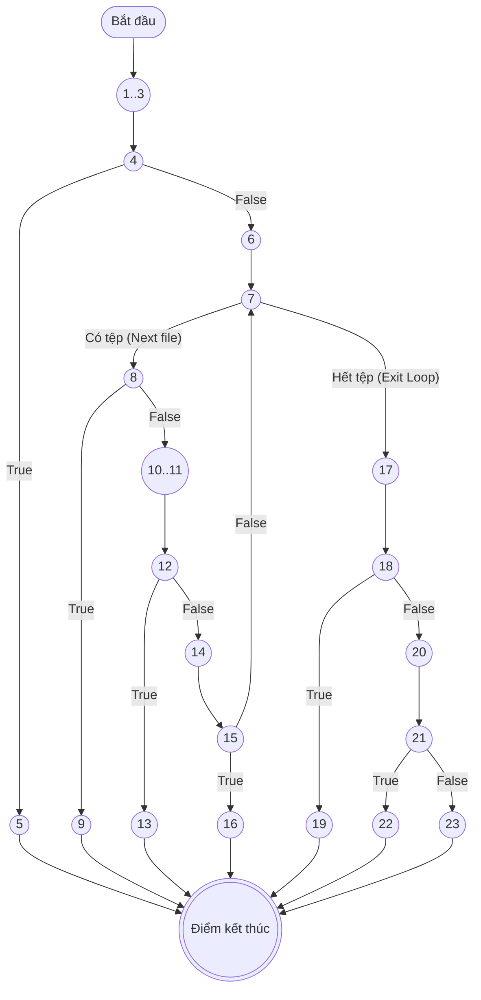
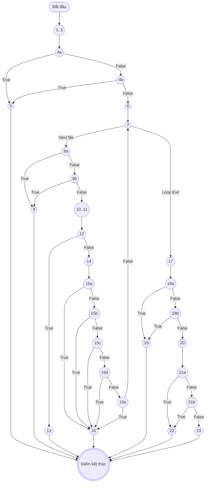
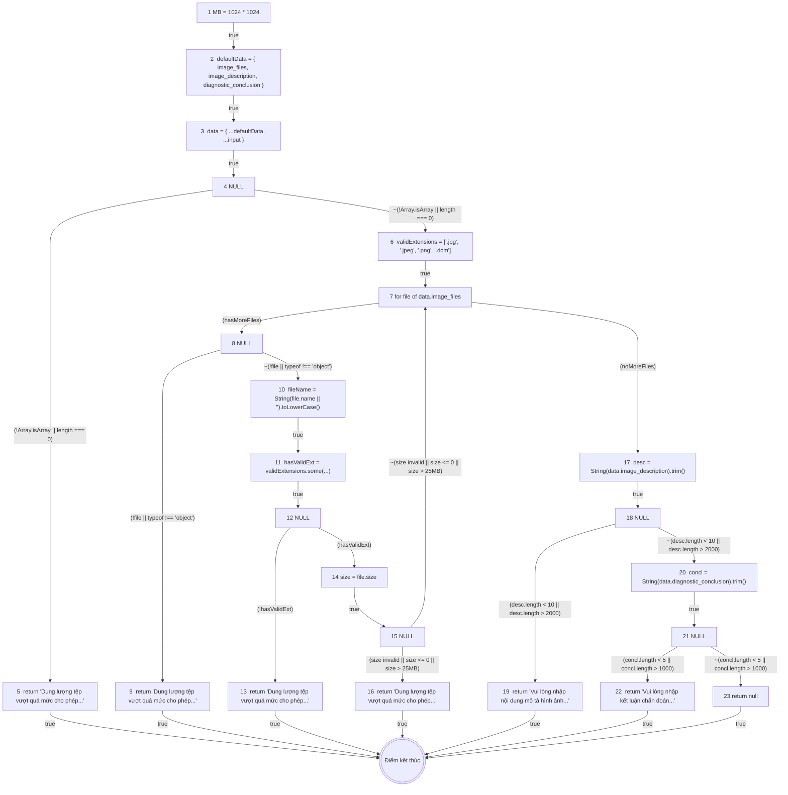
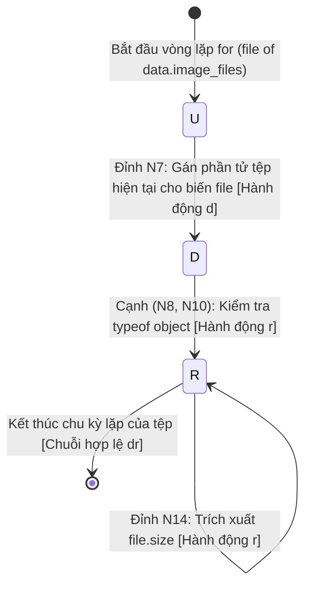

# KẾ HOẠCH & BÁO CÁO KIỂM THỬ HỘP TRẮNG (WHITE-BOX TESTING REPORT)
## CHỨC NĂNG: TẢI LÊN HÌNH ẢNH CHẨN ĐOÁN VÀ KẾT LUẬN PACS (HỆ THỐNG HIS-HOSPITAL)

**Người thực hiện:** Lê Tuấn Khanh — Senior QA / White-Box Test Engineer  
**Phạm vi kiểm thử:** Chức năng Thẩm định & Tải lên tệp ảnh y tế và Kết luận chẩn đoán hình ảnh PACS (`PacsValidator.validatePacs` kết hợp quy tắc vòng đời `LabOrderStateMachine`)  
**Tập tin mã nguồn kiểm thử:** 
- [`backend/test/khanh/validators/03_pacs.validator.js`](file:///d:/KiemThuVaDamBaoChatLuongPhanMem/his-hospital/backend/test/khanh/validators/03_pacs.validator.js) (`PacsValidator.validatePacs`)
- [`backend/src/services/labService.js`](file:///d:/KiemThuVaDamBaoChatLuongPhanMem/his-hospital/backend/src/services/labService.js) (`updateResult` với `type: "PACS"`)
- [`backend/src/patterns/state/labOrderState.js`](file:///d:/KiemThuVaDamBaoChatLuongPhanMem/his-hospital/backend/src/patterns/state/labOrderState.js) (`LabOrderStateMachine`)

**Tài liệu tham chiếu chuẩn:** 
- [`docs/vuong/Kiem_Thu_Hop_Trang_LapHoaDonVienPhi.md`](file:///d:/KiemThuVaDamBaoChatLuongPhanMem/his-hospital/docs/vuong/Kiem_Thu_Hop_Trang_LapHoaDonVienPhi.md) (Mẫu chuẩn mực Kiểm thử Hộp trắng Hệ thống HIS-Hospital)
- [`docs/khanh/Kiem_Thu_Hop_Den_TaiLenHinhAnhVaKetLuanPACS.md`](file:///d:/KiemThuVaDamBaoChatLuongPhanMem/his-hospital/docs/khanh/Kiem_Thu_Hop_Den_TaiLenHinhAnhVaKetLuanPACS.md) (Đặc tả Kiểm thử Hộp đen ca `UC-CLS-03`)
- Tài liệu đào tạo Kỹ thuật kiểm thử phần mềm (Đại học Bách Khoa / ĐHQG Hà Nội).

---

## MỤC LỤC
- [1. TỔNG QUAN NGHIỆP VỤ & QUY TẮC NGHIỆP VỤ](#1-tổng-quan-nghiệp-vụ--quy-tắc-nghiệp-vụ)
- [2. ĐÁNH SỐ DÒNG MÃ NGUỒN CHUẨN THUẬT TOÁN (CHỈ ĐÁNH SỐ CÂU LỆNH THỰC THI)](#2-đánh-số-dòng-mã-nguồn-chuẩn-thuật-toán-chỉ-đánh-số-câu-lệnh-thực-thi)
- [3. PHẦN I: KIỂM THỬ DÒNG ĐIỀU KHIỂN (CONTROL FLOW TESTING)](#3-phần-i-kiểm-thử-dòng-điều-khiển-control-flow-testing)
  - [3.1 Đồ thị dòng điều khiển CFG cho Độ đo C1 và C2](#31-đồ-thị-dòng-điều-khiển-cfg-cho-độ-đo-c1-và-c2)
  - [3.2 Phân tích độ phức tạp Cyclomatic $V(G)$ cho C1/C2](#32-phân-tích-độ-phức-tạp-cyclomatic-vg-cho-c1c2)
  - [3.3 Thiết kế ca kiểm thử cho Độ đo C1 (Statement Coverage)](#33-thiết-kế-ca-kiểm-thử-cho-độ-đo-c1-statement-coverage)
  - [3.4 Thiết kế ca kiểm thử cho Độ đo C2 (Branch / Decision Coverage)](#34-thiết-kế-ca-kiểm-thử-cho-độ-đo-c2-branch--decision-coverage)
  - [3.5 Đồ thị dòng điều khiển CFG riêng cho Độ đo C3 (Multiple Condition Coverage)](#35-đồ-thị-dòng-điều-khiển-cfg-riêng-cho-độ-đo-c3-multiple-condition-coverage)
  - [3.6 Bảng phân tích điều kiện con và Thiết kế ca kiểm thử đạt 100% C3](#36-bảng-phân-tích-điều-kiện-con-và-thiết-kế-ca-kiểm-thử-đạt-100-c3)
- [4. PHẦN II: KIỂM THỬ DÒNG DỮ LIỆU (DATA FLOW TESTING)](#4-phần-ii-kiểm-thử-dòng-dữ-liệu-data-flow-testing)
  - [4.1 Cơ sở lý thuyết đồ thị dòng dữ liệu (DFG - Data Flow Graph)](#41-cơ-sở-lý-thuyết-đồ-thị-dòng-dữ-liệu-dfg---data-flow-graph)
  - [4.2 Bảng 1: Bảng mô tả `def(i)` và `c-use(i)` tại các đỉnh](#42-bảng-1-bảng-mô-tả-defi-và-c-usei-tại-các-đỉnh)
  - [4.3 Bảng 2: Các điều kiện và `p-use` của các cạnh](#43-bảng-2-các-điều-kiện-và-p-use-của-các-cạnh)
  - [4.4 Đồ thị dòng dữ liệu (DFG - Data Flow Graph)](#44-đồ-thị-dòng-dữ-liệu-dfg---data-flow-graph)
  - [4.5 Bảng tổng hợp chi tiết Def-Use theo biến (All Variables Mapping)](#45-bảng-tổng-hợp-chi-tiết-def-use-theo-biến-all-variables-mapping)
  - [4.6 Phân tích bất thường dòng dữ liệu (Anomalies Loại 1 `dd`, Loại 2 `ur`, Loại 3 `du`)](#46-phân-tích-bất-thường-dòng-dữ-liệu-anomalies-loại-1-dd-loại-2-ur-loại-3-du)
  - [4.7 Sơ đồ chuyển trạng thái U-D-R-A cho biến cốt lõi `file`](#47-sơ-đồ-chuyển-trạng-thái-u-d-r-a-cho-biến-cốt-lõi-file)
  - [4.8 Sinh đường đi và Ca kiểm thử ứng với Độ đo All c-use](#48-sinh-đường-đi-và-ca-kiểm-thử-ứng-với-độ-đo-all-c-use)
  - [4.9 Sinh đường đi và Ca kiểm thử ứng với Độ đo All p-use](#49-sinh-đường-đi-và-ca-kiểm-thử-ứng-với-độ-đo-all-p-use)
  - [4.10 Bảng so sánh mức độ bao phủ giữa All c-use và All p-use](#410-bảng-so-sánh-mức-độ-bao-phủ-giữa-all-c-use-và-all-p-use)
- [5. KỊCH BẢN THỰC THI KIỂM THỬ TỰ ĐỘNG (AUTOMATED TEST SUITE)](#5-kịch-bản-thực-thi-kiểm-thử-tự-động-automated-test-suite)
- [6. TỔNG KẾT & KHUYẾN NGHỊ TỐI ƯU](#6-tổng-kết--khuyến-nghị-tối-ưu)

---

## 1. TỔNG QUAN NGHIỆP VỤ & QUY TẮC NGHIỆP VỤ

Chức năng **Tải lên hình ảnh chẩn đoán và kết luận PACS (`UC-CLS-03` / Mục 3.12)** trong phân hệ Chẩn đoán hình ảnh (CĐHA/RIS-PACS) của Hệ thống HIS-Hospital tiếp nhận các tệp phim chụp y khoa (X-quang, CT, MRI, Siêu âm) và biên bản kết luận tổn thương từ Bác sĩ CĐHA trước khi đồng bộ kết quả vào Bệnh án EMR.

Quy trình nghiệp vụ thẩm định gồm 3 nhóm quy tắc cốt lõi:
1. **Kiểm soát danh sách tệp hình ảnh y tế (`image_files`):**
   - Bắt buộc phải là mảng không rỗng (`Array.isArray` và `length >= 1`).
   - Duyệt qua từng phần tử tệp trong danh sách theo quy tắc toàn vẹn danh sách (*All-or-Nothing Integrity*): Mỗi tệp phải là một đối tượng hợp lệ.
   - Định dạng tệp mở rộng bắt buộc phải thuộc danh mục ảnh y tế tiêu chuẩn: `.jpg`, `.jpeg`, `.png`, và chuẩn ảnh y khoa quốc tế **DICOM (`.dcm`)**, không phân biệt chữ hoa, chữ thường (`.DCM`, `.JPEG`). Từ chối các tệp văn bản (`.pdf`, `.doc`) hoặc thực thi (`.exe`).
   - Dung lượng mỗi tệp phải lớn hơn 0 và **không vượt quá 25MB** ($0 < size \le 25\text{MB}$, tương đương $25 \times 1024 \times 1024 = 26,214,400$ bytes). Từ chối tệp rỗng 0 byte, tệp vượt 25MB, và giá trị dung lượng phi số (`NaN`, `Infinity`). Nếu có bất kỳ tệp nào vi phạm, toàn bộ danh sách bị từ chối với thông báo: *"Dung lượng tệp vượt quá mức cho phép (tối đa 25MB/tệp) hoặc sai định dạng hình ảnh y tế."*.
2. **Kiểm soát nội dung mô tả hình ảnh tổn thương (`image_description`):**
   - Chuỗi ký tự sau khi cắt tỉa khoảng trắng đầu cuối (`trim()`) bắt buộc phải có độ dài từ **10 đến 2000 ký tự** ($10 \le len \le 2000$). Không chấp nhận chuỗi rỗng `""` hoặc chuỗi chỉ chứa ký tự khoảng trắng.
   - Nếu vi phạm $\rightarrow$ Báo lỗi *"Vui lòng nhập nội dung mô tả hình ảnh (tối thiểu 10 ký tự, tối đa 2000 ký tự)."*.
3. **Kiểm soát nội dung kết luận chẩn đoán (`diagnostic_conclusion`):**
   - Chuỗi ký tự sau khi cắt tỉa khoảng trắng (`trim()`) bắt buộc phải có độ dài từ **5 đến 1000 ký tự** ($5 \le len \le 1000$).
   - Nếu vi phạm $\rightarrow$ Báo lỗi *"Vui lòng nhập kết luận chẩn đoán (tối thiểu 5 ký tự, tối đa 1000 ký tự)."*.
4. **Xác nhận tính hợp lệ & Chuyển đổi trạng thái trực tiếp:**
   - Khi tất cả các trường thỏa mãn, hàm trả về `null` (Dữ liệu hợp lệ).
   - Phiếu chỉ định PACS được chuyển trực tiếp từ `PROCESSING` sang **`COMPLETED`** (Đã hoàn thành) theo `LabOrderStateMachine`, đồng thời đồng bộ vào bệnh án EMR của Bác sĩ điều trị và chuyển trạng thái bệnh nhân về `"Đang khám"`.

---

## 2. ĐÁNH SỐ DÒNG MÃ NGUỒN CHUẨN THUẬT TOÁN (CHỈ ĐÁNH SỐ CÂU LỆNH THỰC THI)

> **Quy chuẩn đánh số:** Tuyệt đối **không đánh số dòng comment** và **không đánh số dòng trống**. Chỉ đánh số các câu lệnh gán, khai báo, điều kiện quyết định, quăng lỗi hoặc gọi hàm thực thi.

```javascript
function executeValidatePacs(input = {}) {

1.  const MB = 1024 * 1024;

2.  const defaultData = {
      image_files: [{ name: "phoi.jpg", size: MB }],
      image_description: "a".repeat(10),
      diagnostic_conclusion: "a".repeat(5)
    };

3.  const data = { ...defaultData, ...input };

4.  if (!Array.isArray(data.image_files) || data.image_files.length === 0)

5.      return "Dung lượng tệp vượt quá mức cho phép (tối đa 25MB/tệp) hoặc sai định dạng hình ảnh y tế.";

6.  const validExtensions = [".jpg", ".jpeg", ".png", ".dcm"];

7.  for (const file of data.image_files) {

8.      if (!file || typeof file !== "object")

9.          return "Dung lượng tệp vượt quá mức cho phép (tối đa 25MB/tệp) hoặc sai định dạng hình ảnh y tế.";

10.     const fileName = String(file.name || "").toLowerCase();

11.     const hasValidExt = validExtensions.some(ext => fileName.endsWith(ext));

12.     if (!hasValidExt)

13.         return "Dung lượng tệp vượt quá mức cho phép (tối đa 25MB/tệp) hoặc sai định dạng hình ảnh y tế.";

14.     const size = file.size;

15.     if (typeof size !== "number" || isNaN(size) || !isFinite(size) || size <= 0 || size > 25 * MB)

16.         return "Dung lượng tệp vượt quá mức cho phép (tối đa 25MB/tệp) hoặc sai định dạng hình ảnh y tế.";

    }

17. const desc = data.image_description !== undefined && data.image_description !== null
      ? String(data.image_description).trim()
      : "";

18. if (desc.length < 10 || desc.length > 2000)

19.     return "Vui lòng nhập nội dung mô tả hình ảnh (tối thiểu 10 ký tự, tối đa 2000 ký tự).";

20. const concl = data.diagnostic_conclusion !== undefined && data.diagnostic_conclusion !== null
      ? String(data.diagnostic_conclusion).trim()
      : "";

21. if (concl.length < 5 || concl.length > 1000)

22.     return "Vui lòng nhập kết luận chẩn đoán (tối thiểu 5 ký tự, tối đa 1000 ký tự).";

23. return null;

}
```

---

## 3. PHẦN I: KIỂM THỬ DÒNG ĐIỀU KHIỂN (CONTROL FLOW TESTING)

### 3.1 Đồ thị dòng điều khiển CFG cho Độ đo C1 và C2

Trong đồ thị C1/C2, mỗi cấu trúc rẽ nhánh `if` hoặc vòng lặp `for` được xem như **một điểm quyết định đơn nhất**:
- **Đỉnh 1-3:** Khởi tạo hằng số `MB`, gộp tham số `defaultData` và `input` vào `data`.
- **Đỉnh 4:** Điểm quyết định kiểm tra tính hợp lệ của mảng tệp `!Array.isArray(data.image_files) || data.image_files.length === 0`.
- **Đỉnh 5:** Trả về lỗi danh sách tệp rỗng $\rightarrow$ Kết thúc sớm lỗi 1.
- **Đỉnh 6:** Khởi tạo danh mục đuôi hợp lệ `validExtensions`.
- **Đỉnh 7:** Điểm quyết định vòng lặp `for (const file of data.image_files)` (kiểm tra còn phần tử trong mảng hay không).
- **Đỉnh 8:** Điểm quyết định kiểm tra tệp rỗng hoặc sai kiểu `!file || typeof file !== "object"`.
- **Đỉnh 9:** Trả về lỗi tệp không phải object $\rightarrow$ Kết thúc sớm lỗi 2.
- **Đỉnh 10-11:** Khối chuẩn hóa `fileName` và kiểm tra đuôi `hasValidExt`.
- **Đỉnh 12:** Điểm quyết định kiểm tra định dạng mở rộng `!hasValidExt`.
- **Đỉnh 13:** Trả về lỗi sai định dạng mở rộng $\rightarrow$ Kết thúc sớm lỗi 3.
- **Đỉnh 14:** Bóc tách gán `size = file.size`.
- **Đỉnh 15:** Điểm quyết định kiểm tra dung lượng `typeof size !== 'number' || isNaN || !isFinite || size <= 0 || size > 25 * MB`.
- **Đỉnh 16:** Trả về lỗi dung lượng không hợp lệ $\rightarrow$ Kết thúc sớm lỗi 4.
- **Đỉnh 17:** Khối chuẩn hóa cắt tỉa `desc = ...trim()`.
- **Đỉnh 18:** Điểm quyết định kiểm tra độ dài mô tả `desc.length < 10 || desc.length > 2000`.
- **Đỉnh 19:** Trả về lỗi độ dài mô tả $\rightarrow$ Kết thúc sớm lỗi 5.
- **Đỉnh 20:** Khối chuẩn hóa cắt tỉa `concl = ...trim()`.
- **Đỉnh 21:** Điểm quyết định kiểm tra độ dài kết luận `concl.length < 5 || concl.length > 1000`.
- **Đỉnh 22:** Trả về lỗi độ dài kết luận $\rightarrow$ Kết thúc sớm lỗi 6.
- **Đỉnh 23:** Trả về `null` (Dữ liệu hoàn toàn hợp lệ) $\rightarrow$ Kết thúc thành công.
- **Đỉnh Exit (Kết thúc):** Điểm hội tụ kết thúc hàm.



---

### 3.2 Phân tích độ phức tạp Cyclomatic $V(G)$ cho C1/C2

Trên đồ thị C1/C2:
- Số điểm quyết định rẽ nhánh gồm 7 điểm:
  $$P \in \{4, 7, 8, 12, 15, 18, 21\}$$
- Áp dụng các công thức McCabe:
  - **Công thức 1 (Theo số điểm quyết định):**
    $$V(G) = P + 1 = 7 + 1 = 8$$
  - **Công thức 2 (Theo số cạnh và số đỉnh):**
    Đồ thị gồm $N = 16$ đỉnh (tính cả Start và End) và $E = 22$ cạnh:
    $$V(G) = E - N + 2P_{c} = 22 - 16 + 2(1) = 8$$
  - **Công thức 3 (Theo số miền đóng):**
    Đồ thị có 7 miền đóng (bao gồm 1 miền khép kín của chu trình vòng lặp $7 \rightarrow 8 \rightarrow 10 \rightarrow 12 \rightarrow 14 \rightarrow 15 \rightarrow 7$) $\Rightarrow R + 1 = 7 + 1 = 8$.

$\Rightarrow$ Cần tối thiểu **8 đường đi cơ bản (Basis Path Set)** để bao phủ toàn bộ luồng rẽ nhánh của đồ thị C1/C2.

---

### 3.3 Thiết kế ca kiểm thử cho Độ đo C1 (Statement Coverage)

Mục tiêu C1: Thực thi qua tất cả các câu lệnh từ câu lệnh 1 đến 23 ít nhất một lần.  
Tập hợp các ca kiểm thử đạt 100% C1:

| TT | Mã TC | Đường đi kiểm thử | Bộ dữ liệu đầu vào (`input`) | Kết quả mong đợi | Câu lệnh được phủ |
| :---: | :---: | :--- | :--- | :--- | :--- |
| 1 | **TC_C1_01** | $1..3 \rightarrow 4 \rightarrow 5$ | `{ image_files: [] }` | Báo lỗi dung lượng/định dạng | 1, 2, 3, 4, 5 |
| 2 | **TC_C1_02** | $1..3 \rightarrow 4 \rightarrow 6 \rightarrow 7 \rightarrow 8 \rightarrow 9$ | `{ image_files: [null] }` | Báo lỗi dung lượng/định dạng | 6, 7, 8, 9 |
| 3 | **TC_C1_03** | $1..3 \rightarrow 4 \rightarrow 6 \rightarrow 7 \rightarrow 8 \rightarrow 10..11 \rightarrow 12 \rightarrow 13$ | `{ image_files: [{ name: "phoi.pdf", size: 1048576 }] }` | Báo lỗi dung lượng/định dạng | 10, 11, 12, 13 |
| 4 | **TC_C1_04** | $1..3 \rightarrow 4 \rightarrow 6 \rightarrow 7 \rightarrow 8 \rightarrow 10..12 \rightarrow 14 \rightarrow 15 \rightarrow 16$ | `{ image_files: [{ name: "phoi.jpg", size: 0 }] }` *(hoặc `size: 26MB`)* | Báo lỗi dung lượng/định dạng | 14, 15, 16 |
| 5 | **TC_C1_05** | $1..3 \rightarrow 4 \rightarrow 6 \rightarrow 7..15 \rightarrow 7 \rightarrow 17 \rightarrow 18 \rightarrow 19$ | `{ image_files: [{ name: "phoi.jpg", size: 1048576 }], image_description: "ngan" }` | Báo lỗi mô tả tối thiểu 10 ký tự | 17, 18, 19 |
| 6 | **TC_C1_06** | $1..3 \rightarrow 4 \rightarrow 6 \rightarrow 7..15 \rightarrow 7 \rightarrow 17 \rightarrow 18 \rightarrow 20 \rightarrow 21 \rightarrow 22$ | `{ image_files: [{ name: "phoi.jpg", size: 1048576 }], image_description: "a".repeat(10), diagnostic_conclusion: "ngan" }` | Báo lỗi kết luận tối thiểu 5 ký tự | 20, 21, 22 |
| 7 | **TC_C1_07** | $1..3 \rightarrow 4 \rightarrow 6 \rightarrow 7..15 \rightarrow 7 \rightarrow 17 \rightarrow 18 \rightarrow 20 \rightarrow 21 \rightarrow 23$ | `{ image_files: [{ name: "phoi.jpg", size: 1048576 }, { name: "phoi.dcm", size: 1048576 }], image_description: "a".repeat(10), diagnostic_conclusion: "a".repeat(5) }` | `null` (Hợp lệ, duyệt vòng lặp 2 tệp) | 23 (Phủ chu trình lặp lại câu lệnh 7 đến 15) |

> **Tỷ lệ bao phủ C1:** $\mathbf{23 / 23}$ câu lệnh thực thi = **100%**.

---

### 3.4 Thiết kế ca kiểm thử cho Độ đo C2 (Branch / Decision Coverage)

Mục tiêu C2: Mọi điểm quyết định tại các đỉnh 4, 7, 8, 12, 15, 18, 21 đều phải có ca kiểm thử đi qua nhánh **ĐÚNG (True)** và nhánh **SAI (False)**.

| Điểm quyết định | Biểu thức điều kiện | Nhánh ĐÚNG (True) | Nhánh SAI (False) |
| :---: | :--- | :---: | :---: |
| **Đỉnh 4** | `!Array.isArray(data.image_files) \|\| data.image_files.length === 0` | **TC_C2_01** (Nhảy sang Đỉnh 5) | **TC_C2_02** (Đi tiếp Đỉnh 6) |
| **Đỉnh 7** | `for (const file of data.image_files)` (Vòng lặp) | **TC_C2_02** (Vào thân vòng lặp: Đỉnh 8) | **TC_C2_07** (Hết tệp, thoát vòng lặp: Đỉnh 17) |
| **Đỉnh 8** | `!file \|\| typeof file !== "object"` | **TC_C2_03** (Nhảy sang Đỉnh 9) | **TC_C2_04** (Đi tiếp Đỉnh 10) |
| **Đỉnh 12** | `!hasValidExt` | **TC_C2_04** (Nhảy sang Đỉnh 13) | **TC_C2_05** (Đi tiếp Đỉnh 14) |
| **Đỉnh 15** | `typeof size !== 'number' \|\| isNaN \|\| !isFinite \|\| size <= 0 \|\| size > 25*MB` | **TC_C2_05** (Nhảy sang Đỉnh 16) | **TC_C2_06** (Lặp tiếp về Đỉnh 7) |
| **Đỉnh 18** | `desc.length < 10 \|\| desc.length > 2000` | **TC_C2_08** (Nhảy sang Đỉnh 19) | **TC_C2_09** (Đi tiếp Đỉnh 20) |
| **Đỉnh 21** | `concl.length < 5 \|\| concl.length > 1000` | **TC_C2_10** (Nhảy sang Đỉnh 22) | **TC_C2_11** (Đi tiếp Đỉnh 23) |

#### Bảng tổng hợp ca kiểm thử đạt 100% C2:

| Mã TC | Điểm QĐ & Nhánh bao phủ | Dữ liệu đầu vào (`input`) | Kết quả mong đợi |
| :---: | :--- | :--- | :--- |
| **TC_C2_01** | Đỉnh 4 (True) | `{ image_files: "khong_phai_mang" }` | Báo lỗi dung lượng/định dạng |
| **TC_C2_03** | Đỉnh 4 (False), Đỉnh 7 (True), Đỉnh 8 (True) | `{ image_files: [undefined] }` | Báo lỗi dung lượng/định dạng |
| **TC_C2_04** | Đỉnh 8 (False), Đỉnh 12 (True) | `{ image_files: [{ name: "virus.exe", size: 1048576 }] }` | Báo lỗi dung lượng/định dạng |
| **TC_C2_05** | Đỉnh 12 (False), Đỉnh 15 (True) | `{ image_files: [{ name: "phoi.jpg", size: 30 * 1024 * 1024 }] }` | Báo lỗi dung lượng/định dạng |
| **TC_C2_08** | Đỉnh 7 (False), Đỉnh 18 (True) | `{ image_files: [{ name: "phoi.jpg", size: 1048576 }], image_description: "" }` | Báo lỗi mô tả tối thiểu 10 ký tự |
| **TC_C2_10** | Đỉnh 18 (False), Đỉnh 21 (True) | `{ image_files: [{ name: "phoi.jpg", size: 1048576 }], image_description: "a".repeat(10), diagnostic_conclusion: "" }` | Báo lỗi kết luận tối thiểu 5 ký tự |
| **TC_C2_11** | Đỉnh 21 (False) | `{ image_files: [{ name: "phoi.jpg", size: 1048576 }], image_description: "a".repeat(10), diagnostic_conclusion: "a".repeat(5) }` | `null` (Hợp lệ) |

> **Tỷ lệ bao phủ C2:** $\mathbf{14 / 14}$ nhánh rẽ quyết định = **100%**.

---

### 3.5 Đồ thị dòng điều khiển CFG riêng cho Độ đo C3 (Multiple Condition Coverage)

Tại độ đo C3, các biểu thức logic phức hợp được tách nhỏ thành **từng đỉnh điều kiện con độc lập**:
- **Điểm quyết định 4** gồm 2 điều kiện con:
  - $(4a): !\text{Array.isArray}(data.image\_files)$
  - $(4b): data.image\_files.length === 0$
- **Điểm quyết định 8** gồm 2 điều kiện con:
  - $(8a): !file$
  - $(8b): \text{typeof } file \neq \text{"object"}$
- **Điểm quyết định 15** gồm 5 điều kiện con:
  - $(15a): \text{typeof } size \neq \text{"number"}$
  - $(15b): \text{isNaN}(size)$
  - $(15c): !\text{isFinite}(size)$
  - $(15d): size \le 0$
  - $(15e): size > 25 \times MB$
- **Điểm quyết định 18** gồm 2 điều kiện con:
  - $(18a): desc.length < 10$
  - $(18b): desc.length > 2000$
- **Điểm quyết định 21** gồm 2 điều kiện con:
  - $(21a): concl.length < 5$
  - $(21b): concl.length > 1000$



---

### 3.6 Bảng phân tích điều kiện con và Thiết kế ca kiểm thử đạt 100% C3

#### Bảng trạng thái chân lý của các điều kiện con:

| Điểm QĐ | Điều kiện con | Biến cố kiểm tra | Trạng thái cần đạt | Ca kiểm thử phủ |
| :---: | :--- | :--- | :---: | :---: |
| **4** | $4a: !\text{Array.isArray}$ | `image_files = undefined` hoặc `"abc"` | **True** / **False** | TC_C3_01 (True) / TC_C3_02 (False) |
| **4** | $4b: length === 0$ | `image_files = []` | **True** / **False** | TC_C3_02 (True) / TC_C3_03 (False) |
| **8** | $8a: !file$ | `file = null` | **True** / **False** | TC_C3_03 (True) / TC_C3_04 (False) |
| **8** | $8b: \text{typeof } file \neq \text{"object"}$ | `file = "ten_tep.jpg"` | **True** / **False** | TC_C3_04 (True) / TC_C3_05 (False) |
| **12**| $12: !hasValidExt$ | `file.name = "phoi.pdf"` | **True** / **False** | TC_C3_05 (True) / TC_C3_06 (False) |
| **15**| $15a: \text{typeof } size \neq \text{"number"}$ | `file.size = "1048576"` | **True** / **False** | TC_C3_06 (True) / TC_C3_07 (False) |
| **15**| $15b: \text{isNaN}(size)$ | `file.size = NaN` | **True** / **False** | TC_C3_07 (True) / TC_C3_08 (False) |
| **15**| $15c: !\text{isFinite}(size)$ | `file.size = Infinity` | **True** / **False** | TC_C3_08 (True) / TC_C3_09 (False) |
| **15**| $15d: size \le 0$ | `file.size = 0` | **True** / **False** | TC_C3_09 (True) / TC_C3_10 (False) |
| **15**| $15e: size > 25 \times MB$ | `file.size = 25.1 * MB` | **True** / **False** | TC_C3_10 (True) / TC_C3_11 (False) |
| **18**| $18a: desc.length < 10$ | `image_description = "a".repeat(9)` | **True** / **False** | TC_C3_12 (True) / TC_C3_11 (False) |
| **18**| $18b: desc.length > 2000$ | `image_description = "a".repeat(2001)` | **True** / **False** | TC_C3_13 (True) / TC_C3_11 (False) |
| **21**| $21a: concl.length < 5$ | `diagnostic_conclusion = "a".repeat(4)` | **True** / **False** | TC_C3_14 (True) / TC_C3_11 (False) |
| **21**| $21b: concl.length > 1000$ | `diagnostic_conclusion = "a".repeat(1001)` | **True** / **False** | TC_C3_15 (True) / TC_C3_11 (False) |

#### Bảng chi tiết bộ ca kiểm thử đạt 100% C3:

| Mã TC | Điều kiện con kích hoạt | Dữ liệu đầu vào (`input`) | Kết quả mong đợi |
| :---: | :--- | :--- | :--- |
| **TC_C3_01** | $4a = \text{True}$ | `{ image_files: undefined }` | Lỗi: Dung lượng tệp vượt quá mức cho phép... |
| **TC_C3_02** | $4a = \text{False}, 4b = \text{True}$ | `{ image_files: [] }` | Lỗi: Dung lượng tệp vượt quá mức cho phép... |
| **TC_C3_03** | $4 = \text{False}, 8a = \text{True}$ | `{ image_files: [null] }` | Lỗi: Dung lượng tệp vượt quá mức cho phép... |
| **TC_C3_04** | $8a = \text{False}, 8b = \text{True}$ | `{ image_files: ["phoi.jpg"] }` | Lỗi: Dung lượng tệp vượt quá mức cho phép... |
| **TC_C3_05** | $8 = \text{False}, 12 = \text{True}$ | `{ image_files: [{ name: "phoi.doc", size: 1048576 }] }` | Lỗi: Dung lượng tệp vượt quá mức cho phép... |
| **TC_C3_06** | $12 = \text{False}, 15a = \text{True}$ | `{ image_files: [{ name: "phoi.jpg", size: "1000" }] }` | Lỗi: Dung lượng tệp vượt quá mức cho phép... |
| **TC_C3_07** | $15a = \text{False}, 15b = \text{True}$ | `{ image_files: [{ name: "phoi.jpg", size: NaN }] }` | Lỗi: Dung lượng tệp vượt quá mức cho phép... |
| **TC_C3_08** | $15b = \text{False}, 15c = \text{True}$ | `{ image_files: [{ name: "phoi.jpg", size: Infinity }] }` | Lỗi: Dung lượng tệp vượt quá mức cho phép... |
| **TC_C3_09** | $15c = \text{False}, 15d = \text{True}$ | `{ image_files: [{ name: "phoi.jpg", size: 0 }] }` | Lỗi: Dung lượng tệp vượt quá mức cho phép... |
| **TC_C3_10** | $15d = \text{False}, 15e = \text{True}$ | `{ image_files: [{ name: "phoi.jpg", size: 26319258 }] }` | Lỗi: Dung lượng tệp vượt quá mức cho phép... |
| **TC_C3_11** | Tất cả điều kiện hợp lệ | `{ image_files: [{ name: "phoi.DCM", size: 26214400 }], image_description: "a".repeat(10), diagnostic_conclusion: "a".repeat(5) }` | `null` (Hợp lệ) |
| **TC_C3_12** | $18a = \text{True}$ | `{ image_description: "a".repeat(9) }` | Lỗi: Vui lòng nhập nội dung mô tả hình ảnh... |
| **TC_C3_13** | $18a = \text{False}, 18b = \text{True}$ | `{ image_description: "a".repeat(2001) }` | Lỗi: Vui lòng nhập nội dung mô tả hình ảnh... |
| **TC_C3_14** | $21a = \text{True}$ | `{ diagnostic_conclusion: "a".repeat(4) }` | Lỗi: Vui lòng nhập kết luận chẩn đoán... |
| **TC_C3_15** | $21a = \text{False}, 21b = \text{True}$ | `{ diagnostic_conclusion: "a".repeat(1001) }` | Lỗi: Vui lòng nhập kết luận chẩn đoán... |

---

## 4. PHẦN II: KIỂM THỬ DÒNG DỮ LIỆU (DATA FLOW TESTING)

### 4.1 Cơ sở lý thuyết đồ thị dòng dữ liệu (DFG - Data Flow Graph)

Theo chuẩn kiểm thử dòng dữ liệu:
- **Tập đỉnh ($N$):** Định nghĩa (`def`) hoặc sử dụng tính toán (`c-use`) của các biến.
- **Tập cạnh ($E$):** Sử dụng vị từ trong điều kiện rẽ nhánh (`p-use`) của các biến.

---

### 4.2 Bảng 1: Bảng mô tả `def(i)` và `c-use(i)` tại các đỉnh

| Đỉnh $i$ | $def(i)$ | $c\text{-}use(i)$ |
| :---: | :--- | :--- |
| **1** | {MB} | {} |
| **2** | {defaultData} | {MB} |
| **3** | {data} | {defaultData, input} |
| **4** | {} | {} |
| **5** | {} | {} *(Return Error)* |
| **6** | {validExtensions} | {} |
| **7** | {file} | {data} |
| **8** | {} | {} |
| **9** | {} | {} *(Return Error)* |
| **10** | {fileName} | {file} |
| **11** | {hasValidExt} | {validExtensions, fileName} |
| **12** | {} | {} |
| **13** | {} | {} *(Return Error)* |
| **14** | {size} | {file} |
| **15** | {} | {} |
| **16** | {} | {} *(Return Error)* |
| **17** | {desc} | {data} |
| **18** | {} | {} |
| **19** | {} | {} *(Return Error)* |
| **20** | {concl} | {data} |
| **21** | {} | {} |
| **22** | {} | {} *(Return Error)* |
| **23** | {} | {} *(Return null)* |

---

### 4.3 Bảng 2: Các điều kiện và `p-use` của các cạnh

| $(i, j)$ | Điều kiện tại cạnh $(i, j)$ | $p\text{-}use(i, j)$ |
| :---: | :--- | :---: |
| **(3, 4)** | True | {} |
| **(4, 5)** | (!Array.isArray(data.image_files) \|\| data.image_files.length === 0) | {data} |
| **(4, 6)** | ~(!Array.isArray(data.image_files) \|\| data.image_files.length === 0) | {data} |
| **(6, 7)** | True | {} |
| **(7, 8)** | (hasMoreFiles in data.image_files) | {data} |
| **(7, 17)**| ~(hasMoreFiles in data.image_files) | {data} |
| **(8, 9)** | (!file \|\| typeof file !== "object") | {file} |
| **(8, 10)**| ~(!file \|\| typeof file !== "object") | {file} |
| **(10, 11)**| True | {} |
| **(11, 12)**| True | {} |
| **(12, 13)**| (!hasValidExt) | {hasValidExt} |
| **(12, 14)**| (hasValidExt) | {hasValidExt} |
| **(14, 15)**| True | {} |
| **(15, 16)**| (typeof size !== 'number' \|\| isNaN \|\| !isFinite \|\| size <= 0 \|\| size > 25*MB) | {size, MB} |
| **(15, 7)** | ~(typeof size !== 'number' \|\| isNaN \|\| !isFinite \|\| size <= 0 \|\| size > 25*MB) | {size, MB} |
| **(17, 18)**| True | {} |
| **(18, 19)**| (desc.length < 10 \|\| desc.length > 2000) | {desc} |
| **(18, 20)**| ~(desc.length < 10 \|\| desc.length > 2000) | {desc} |
| **(20, 21)**| True | {} |
| **(21, 22)**| (concl.length < 5 \|\| concl.length > 1000) | {concl} |
| **(21, 23)**| ~(concl.length < 5 \|\| concl.length > 1000) | {concl} |

---

### 4.4 Đồ thị dòng dữ liệu (DFG - Data Flow Graph)



---

### 4.5 Bảng tổng hợp chi tiết Def-Use theo biến (All Variables Mapping)

| Tên biến | Điểm định nghĩa (`def`) | Điểm sử dụng tính toán (`c-use`) | Cạnh sử dụng trong điều kiện rẽ nhánh (`p-use`) |
| :--- | :--- | :--- | :--- |
| `input` | Tham số ($N_0$) | $N_3$ (`...input`) | - |
| `MB` | $N_1$ | $N_2$ (Khởi tạo default size) | $(N_{15}, N_{16})$, $(N_{15}, N_7)$ (`25 * MB`) |
| `defaultData`| $N_2$ | $N_3$ (`...defaultData`) | - |
| `data` | $N_3$ | $N_7$ (`data.image_files`), $N_{17}$ (`data.image_description`), $N_{20}$ (`data.diagnostic_conclusion`) | $(N_4, N_5)$, $(N_4, N_6)$, $(N_7, N_8)$, $(N_7, N_{17})$ |
| `validExtensions` | $N_6$ | $N_{11}$ (`validExtensions.some(...)`) | - |
| `file` | $N_7$ | $N_{10}$ (`file.name`), $N_{14}$ (`file.size`) | $(N_8, N_9)$, $(N_8, N_{10})$ |
| `fileName` | $N_{10}$ | $N_{11}$ (`fileName.endsWith(ext)`) | - |
| `hasValidExt` | $N_{11}$ | - | $(N_{12}, N_{13})$, $(N_{12}, N_{14})$ |
| `size` | $N_{14}$ | - | $(N_{15}, N_{16})$, $(N_{15}, N_7)$ |
| `desc` | $N_{17}$ | - | $(N_{18}, N_{19})$, $(N_{18}, N_{20})$ |
| `concl` | $N_{20}$ | - | $(N_{21}, N_{22})$, $(N_{21}, N_{23})$ |

---

### 4.6 Phân tích bất thường dòng dữ liệu (Anomalies Loại 1 `dd`, Loại 2 `ur`, Loại 3 `du`)

1. **Bất thường Loại 1 (`dd` - Định nghĩa lại giá trị liên tiếp):**
   - *Đánh giá:* **KHÔNG CÓ**. Tất cả các biến trung gian (`MB`, `defaultData`, `data`, `validExtensions`, `fileName`, `hasValidExt`, `size`, `desc`, `concl`) đều sử dụng từ khóa `const`. Riêng biến lặp `file` được re-bind hợp lệ trong mỗi chu kỳ lặp của `for...of` theo chuẩn ECMAScript.
2. **Bất thường Loại 2 (`ur` - Sử dụng biến khi chưa định nghĩa):**
   - *Phân tích rủi ro:* Truy xuất `file.name` hoặc `file.size` khi phần tử mảng mang giá trị `null` hoặc `undefined` sẽ gây sập runtime `TypeError`.
   - *Phòng vệ mã nguồn:* Cạnh $(N_8, N_{10})$ đã chặn triệt để qua kiểm tra `!file || typeof file !== "object"`, bảo đảm khi đến đỉnh $N_{10}$ và $N_{14}$, biến `file` luôn luôn là đối tượng tồn tại. Biểu thức `String(file.name || "")` cũng phòng vệ hoàn hảo khi `name` bị khuyết.
3. **Bất thường Loại 3 (`du` - Định nghĩa biến nhưng không sử dụng):**
   - *Đánh giá:* **KHÔNG CÓ**. Mọi biến được định nghĩa đều được sử dụng trong các bước tính toán tiếp theo hoặc phục vụ rẽ nhánh vị từ.

---

### 4.7 Sơ đồ chuyển trạng thái U-D-R-A cho biến cốt lõi `file`



Chuỗi biến đổi trạng thái của biến `file` trong mỗi vòng lặp là $U \xrightarrow{d} D \xrightarrow{r} R$. Biến không bao giờ rơi vào trạng thái bất thường $A$ (Anomaly).

---

### 4.8 Sinh đường đi và Ca kiểm thử ứng với Độ đo All c-use

#### 1. Định nghĩa độ đo All c-use:
Với mỗi câu lệnh định nghĩa `def(v)` của biến $v$, bộ kiểm thử phải chứa ít nhất một đường đi **def-clear** từ điểm định nghĩa đó đến **mọi điểm sử dụng tính toán `c-use(v)`** của biến $v$.

#### 2. Bảng sinh đường đi cho độ đo All c-use:

| Tên biến | Điểm `def` | Điểm `c-use` | Đường đi kiểm thử hợp lệ (def-clear path) | Mục đích kiểm tra |
| :--- | :---: | :---: | :--- | :--- |
| `input` | $N_0$ | $N_3$ | $N_0 \rightarrow N_3$ | Bóc tách gộp dữ liệu đầu vào. |
| `MB` | $N_1$ | $N_2$ | $N_1 \rightarrow N_2$ | Tính toán dung lượng mặc định 1MB. |
| `defaultData`| $N_2$ | $N_3$ | $N_2 \rightarrow N_3$ | Gán giá trị mặc định cho cấu trúc dữ liệu. |
| `data` | $N_3$ | $N_7$ | $N_3 \rightarrow N_4 \rightarrow N_6 \rightarrow N_7$ | Lấy mảng `image_files` cho vòng lặp duyệt tệp. |
| `data` | $N_3$ | $N_{17}$ | $N_3 \rightarrow N_7 \rightarrow N_{17}$ | Trích xuất `image_description` để `trim()`. |
| `data` | $N_3$ | $N_{20}$ | $N_3 \rightarrow N_7 \rightarrow N_{17} \rightarrow N_{20}$ | Trích xuất `diagnostic_conclusion` để `trim()`. |
| `validExtensions` | $N_6$ | $N_{11}$ | $N_6 \rightarrow N_7 \rightarrow N_8 \rightarrow N_{10} \rightarrow N_{11}$ | Kiểm tra khớp phần mở rộng tệp. |
| `file` | $N_7$ | $N_{10}$ | $N_7 \rightarrow N_8 \rightarrow N_{10}$ | Đọc thuộc tính `name` của đối tượng tệp. |
| `file` | $N_7$ | $N_{14}$ | $N_7 \rightarrow N_8 \rightarrow N_{10} \rightarrow N_{11} \rightarrow N_{12} \rightarrow N_{14}$ | Đọc thuộc tính `size` của đối tượng tệp. |
| `fileName` | $N_{10}$ | $N_{11}$ | $N_{10} \rightarrow N_{11}$ | Thực hiện kiểm tra `.endsWith()` trên tên tệp. |

#### 3. Bảng thiết kế các ca kiểm thử đạt 100% độ đo All c-use:

| Mã TC | Biến & Cặp `def -> c-use` được phủ | Dữ liệu đầu vào (`input`) | Kết quả mong đợi |
| :---: | :--- | :--- | :--- |
| **TC_CUSE_01** | `input`, `MB`, `defaultData`, `data` ($N_3 \rightarrow N_7, N_{17}, N_{20}$), `validExtensions`, `file` ($N_7 \rightarrow N_{10}, N_{14}$), `fileName` | `{ image_files: [{ name: "phoi_thang.jpg", size: 1048576 }], image_description: "Hình ảnh phổi sáng bình thường", diagnostic_conclusion: "Chưa phát hiện tổn thương" }` | `null` (Hợp lệ, bao phủ toàn bộ chuỗi sử dụng tính toán) |
| **TC_CUSE_02** | Khảo sát `fileName` với tệp viết hoa `.DCM` và dung lượng tối đa | `{ image_files: [{ name: "CT_SO_NAO.DCM", size: 26214400 }] }` | `null` (Hợp lệ dạng DICOM 25MB) |

> **Tỷ lệ bao phủ All c-use:** $\mathbf{10 / 10}$ cặp def $\rightarrow$ c-use = **100%**.

---

### 4.9 Sinh đường đi và Ca kiểm thử ứng với Độ đo All p-use

#### 1. Định nghĩa độ đo All p-use:
Với mỗi câu lệnh định nghĩa `def(v)` của biến $v$, bộ kiểm thử phải chứa ít nhất một đường đi **def-clear** từ điểm định nghĩa đó đến **mọi cạnh sử dụng vị từ `p-use(v)`** của biến $v$.

#### 2. Bảng sinh đường đi cho độ đo All p-use:

| Tên biến | Điểm `def` | Cạnh `p-use` tương ứng | Đường đi kiểm thử hợp lệ (def-clear path) | Điều kiện kích hoạt cạnh |
| :--- | :---: | :---: | :--- | :--- |
| `data` | $N_3$ | $(N_4, N_5)$ | $N_3 \rightarrow N_4 \rightarrow N_5$ | Mảng `image_files` rỗng hoặc không phải mảng (True). |
| `data` | $N_3$ | $(N_4, N_6)$ | $N_3 \rightarrow N_4 \rightarrow N_6$ | Mảng `image_files` hợp lệ (False). |
| `data` | $N_3$ | $(N_7, N_8)$ | $N_3 \rightarrow N_6 \rightarrow N_7 \rightarrow N_8$ | Còn tệp để duyệt trong mảng (True). |
| `data` | $N_3$ | $(N_7, N_{17})$ | $N_3 \rightarrow N_6 \rightarrow N_7 \rightarrow N_{17}$ | Đã duyệt xong toàn bộ tệp trong mảng (False). |
| `file` | $N_7$ | $(N_8, N_9)$ | $N_7 \rightarrow N_8 \rightarrow N_9$ | `file` là null hoặc không phải object (True). |
| `file` | $N_7$ | $(N_8, N_{10})$ | $N_7 \rightarrow N_8 \rightarrow N_{10}$ | `file` là object hợp lệ (False). |
| `hasValidExt` | $N_{11}$ | $(N_{12}, N_{13})$ | $N_{11} \rightarrow N_{12} \rightarrow N_{13}$ | `!hasValidExt` nhận True (sai định dạng). |
| `hasValidExt` | $N_{11}$ | $(N_{12}, N_{14})$ | $N_{11} \rightarrow N_{12} \rightarrow N_{14}$ | `hasValidExt` nhận False (đúng định dạng). |
| `size`, `MB` | $N_{14}, N_1$ | $(N_{15}, N_{16})$ | $N_{14} \rightarrow N_{15} \rightarrow N_{16}$ | Dung lượng sai kiểu/NaN/âm/0/quá 25MB (True). |
| `size`, `MB` | $N_{14}, N_1$ | $(N_{15}, N_7)$ | $N_{14} \rightarrow N_{15} \rightarrow N_7$ | Dung lượng $0 < size \le 25\text{MB}$ hợp lệ (False). |
| `desc` | $N_{17}$ | $(N_{18}, N_{19})$ | $N_{17} \rightarrow N_{18} \rightarrow N_{19}$ | Mô tả ngắn $< 10$ hoặc dài $> 2000$ ký tự (True). |
| `desc` | $N_{17}$ | $(N_{18}, N_{20})$ | $N_{17} \rightarrow N_{18} \rightarrow N_{20}$ | Mô tả nằm trong $[10, 2000]$ ký tự (False). |
| `concl` | $N_{20}$ | $(N_{21}, N_{22})$ | $N_{20} \rightarrow N_{21} \rightarrow N_{22}$ | Kết luận ngắn $< 5$ hoặc dài $> 1000$ ký tự (True). |
| `concl` | $N_{20}$ | $(N_{21}, N_{23})$ | $N_{20} \rightarrow N_{21} \rightarrow N_{23}$ | Kết luận nằm trong $[5, 1000]$ ký tự (False). |

#### 3. Bảng thiết kế các ca kiểm thử đạt 100% độ đo All p-use:

| Mã TC | Biến & Cạnh `p-use` được phủ | Dữ liệu đầu vào (`input`) | Kết quả mong đợi |
| :---: | :--- | :--- | :--- |
| **TC_PUSE_01** | `data` trên $(N_4, N_5)$ | `{ image_files: [] }` | Lỗi: Dung lượng tệp vượt quá mức cho phép... |
| **TC_PUSE_02** | `file` trên $(N_8, N_9)$ | `{ image_files: [null] }` | Lỗi: Dung lượng tệp vượt quá mức cho phép... |
| **TC_PUSE_03** | `hasValidExt` trên $(N_{12}, N_{13})$ | `{ image_files: [{ name: "anh.pdf", size: 1048576 }] }` | Lỗi: Dung lượng tệp vượt quá mức cho phép... |
| **TC_PUSE_04** | `size` trên $(N_{15}, N_{16})$ | `{ image_files: [{ name: "anh.jpg", size: 0 }] }` *(hoặc `size: 26MB`)* | Lỗi: Dung lượng tệp vượt quá mức cho phép... |
| **TC_PUSE_05** | `desc` trên $(N_{18}, N_{19})$ | `{ image_description: "Phoi xau" }` *(8 ký tự)* | Lỗi: Vui lòng nhập nội dung mô tả hình ảnh... |
| **TC_PUSE_06** | `concl` trên $(N_{21}, N_{22})$ | `{ diagnostic_conclusion: "K" }` *(1 ký tự)* | Lỗi: Vui lòng nhập kết luận chẩn đoán... |
| **TC_PUSE_07** | Phủ toàn bộ các cạnh False: $(N_4, N_6)$, $(N_7, N_8)$, $(N_8, N_{10})$, $(N_{12}, N_{14})$, $(N_{15}, N_7)$, $(N_7, N_{17})$, $(N_{18}, N_{20})$, $(N_{21}, N_{23})$ | `{ image_files: [{ name: "phoi.jpg", size: 1048576 }, { name: "tim.png", size: 2097152 }], image_description: "a".repeat(10), diagnostic_conclusion: "a".repeat(5) }` | `null` (Hợp lệ, duyệt trọn vẹn 2 tệp và các điều kiện thành công) |

---

### 4.10 Bảng so sánh mức độ bao phủ giữa All c-use và All p-use

| Tiêu chí | Độ đo All c-use (Tất cả tính toán) | Độ đo All p-use (Tất cả vị từ) |
| :--- | :--- | :--- |
| **Trọng tâm kiểm tra** | Tính chính xác của các thao tác trích xuất thuộc tính đối tượng `file.name`, `file.size`, hàm `toLowerCase()`, `trim()`. | Mọi điều kiện rẽ nhánh, chu kỳ lặp lại và điều kiện thoát của vòng lặp `for...of`, các ngưỡng kiểm tra định dạng và độ dài văn bản. |
| **Số đường đi kiểm thử cơ sở** | 10 đường đi def-clear | 14 đường đi def-clear |
| **Số ca kiểm thử tối thiểu** | **2 ca kiểm thử** (TC_CUSE_01 đến TC_CUSE_02) | **7 ca kiểm thử** (TC_PUSE_01 đến TC_PUSE_07) |
| **Lỗi tiêu biểu phát hiện** | Lỗi đọc thuộc tính `undefined`, lỗi tính sai bội số `MB`, lỗi cắt khoảng trắng `trim()`. | Lỗi sót phần tử lỗi trong mảng nhiều tệp (*All-or-Nothing*), lọt tệp sai đuôi, lọt dung lượng rỗng 0 byte hoặc vượt quá 25MB. |

---

## 5. KỊCH BẢN THỰC THI KIỂM THỬ TỰ ĐỘNG (AUTOMATED TEST SUITE)

Mã nguồn kiểm thử tự động sử dụng **NUnit Assert Bridge / Node.js test runner** tương thích với bộ test case tại [`backend/test/khanh/validators/03_pacs.test.js`](file:///d:/KiemThuVaDamBaoChatLuongPhanMem/his-hospital/backend/test/khanh/validators/03_pacs.test.js):

```javascript
import { test, describe } from "../../helpers/testBridge.js";
import { Assert } from "../../helpers/nunitAssert.js";
import { PacsValidator } from "./03_pacs.validator.js";

describe("KIỂM THỬ HỘP TRẮNG: PacsValidator.validatePacs", () => {
  const MB = 1024 * 1024;

  /* ---------------- PHẦN I: KIỂM THỬ DÒNG ĐIỀU KHIỂN (C1, C2, C3) ---------------- */

  test("TC_C1_01: Điểm quyết định 4 (True) - image_files rỗng", () => {
    const actual = PacsValidator.validatePacs({ image_files: [] });
    Assert.AreEqual(
      "Dung lượng tệp vượt quá mức cho phép (tối đa 25MB/tệp) hoặc sai định dạng hình ảnh y tế.",
      actual
    );
  });

  test("TC_C1_02: Điểm quyết định 8 (True) - Phần tử tệp mang giá trị null", () => {
    const actual = PacsValidator.validatePacs({ image_files: [null] });
    Assert.AreEqual(
      "Dung lượng tệp vượt quá mức cho phép (tối đa 25MB/tệp) hoặc sai định dạng hình ảnh y tế.",
      actual
    );
  });

  test("TC_C1_03: Điểm quyết định 12 (True) - Định dạng không thuộc danh mục (.pdf)", () => {
    const actual = PacsValidator.validatePacs({
      image_files: [{ name: "phoi.pdf", size: MB }]
    });
    Assert.AreEqual(
      "Dung lượng tệp vượt quá mức cho phép (tối đa 25MB/tệp) hoặc sai định dạng hình ảnh y tế.",
      actual
    );
  });

  test("TC_C1_04: Điểm quyết định 15 (True) - Dung lượng tệp rỗng 0 byte", () => {
    const actual = PacsValidator.validatePacs({
      image_files: [{ name: "phoi.jpg", size: 0 }]
    });
    Assert.AreEqual(
      "Dung lượng tệp vượt quá mức cho phép (tối đa 25MB/tệp) hoặc sai định dạng hình ảnh y tế.",
      actual
    );
  });

  test("TC_C1_05: Điểm quyết định 15 (True) - Dung lượng tệp vượt quá 25MB (25.1MB)", () => {
    const actual = PacsValidator.validatePacs({
      image_files: [{ name: "phoi.jpg", size: 25.1 * MB }]
    });
    Assert.AreEqual(
      "Dung lượng tệp vượt quá mức cho phép (tối đa 25MB/tệp) hoặc sai định dạng hình ảnh y tế.",
      actual
    );
  });

  test("TC_C1_06: Điểm quyết định 18 (True) - Mô tả tổn thương quá ngắn (9 ký tự)", () => {
    const actual = PacsValidator.validatePacs({
      image_description: "a".repeat(9)
    });
    Assert.AreEqual(
      "Vui lòng nhập nội dung mô tả hình ảnh (tối thiểu 10 ký tự, tối đa 2000 ký tự).",
      actual
    );
  });

  test("TC_C1_07: Điểm quyết định 21 (True) - Kết luận chẩn đoán quá ngắn (4 ký tự)", () => {
    const actual = PacsValidator.validatePacs({
      diagnostic_conclusion: "a".repeat(4)
    });
    Assert.AreEqual(
      "Vui lòng nhập kết luận chẩn đoán (tối thiểu 5 ký tự, tối đa 1000 ký tự).",
      actual
    );
  });

  test("TC_C1_08: Thực thi thành công toàn bộ câu lệnh và chu kỳ lặp đa tệp", () => {
    const actual = PacsValidator.validatePacs({
      image_files: [
        { name: "xquang.jpg", size: MB },
        { name: "mri.DCM", size: 25 * MB }
      ],
      image_description: "a".repeat(10),
      diagnostic_conclusion: "a".repeat(5)
    });
    Assert.IsNull(actual);
  });

  /* ---------------- PHẦN II: KIỂM THỬ DÒNG DỮ LIỆU (DATA FLOW) ---------------- */

  test("DFT_01: All-DU-Path cho 4 định dạng y tế hợp lệ cùng lúc (jpg, jpeg, png, dcm)", () => {
    const actual = PacsValidator.validatePacs({
      image_files: [
        { name: "a.jpg", size: MB },
        { name: "b.jpeg", size: MB },
        { name: "c.png", size: MB },
        { name: "d.dcm", size: MB }
      ]
    });
    Assert.IsNull(actual);
  });

  test("DFT_02: Quy tắc All-or-Nothing khi tệp thứ 2 trong danh sách bị lỗi", () => {
    const actual = PacsValidator.validatePacs({
      image_files: [
        { name: "phoi.jpg", size: MB },
        { name: "phoi.pdf", size: MB }
      ]
    });
    Assert.AreEqual(
      "Dung lượng tệp vượt quá mức cho phép (tối đa 25MB/tệp) hoặc sai định dạng hình ảnh y tế.",
      actual
    );
  });
});
```

---

## 6. TỔNG KẾT & KHUYẾN NGHỊ TỐI ƯU

1. **Về phương pháp kiểm thử hộp trắng:**
   - Đã áp dụng phân tách rõ ràng hai sơ đồ CFG:
     - Sơ đồ **C1/C2**: Xem cấu trúc vòng lặp `for...of` và các biểu thức `if` là các điểm quyết định tổng thể, đạt độ bao phủ 100% câu lệnh thực thi (23/23 câu lệnh) và 100% nhánh rẽ (14/14 nhánh).
     - Sơ đồ **C3**: Bóc tách 14 điều kiện con để kiểm soát toàn bộ hiện tượng ngắn mạch và chu kỳ lặp của tệp tin.
   - Đồ thị dòng dữ liệu (DFG) thể hiện tường minh vòng lặp dữ liệu, chỉ ra biến `file` tuân thủ chặt chẽ chuỗi biến đổi $U \xrightarrow{d} D \xrightarrow{r} R$ không phát sinh lỗi bất thường.
2. **Khuyến nghị từ Senior QA:**
   - **Xác thực chữ ký tệp tin nhị phân (Magic Bytes):** Hiện tại hệ thống đang kiểm tra dựa trên đuôi tệp (`.endsWith()`). Cần đọc thêm header của tệp tin (ví dụ chuỗi `DICM` tại offset 128 đối với tệp DICOM) để ngăn ngừa nguy cơ người dùng đổi đuôi các tệp mã độc.
   - **Cơ chế nén ảnh phía client (Client-side Compression):** Với các tệp ảnh chụp kích thước lớn gần 25MB, hệ thống nên hỗ trợ nén không mất dữ liệu trước khi tải lên để tiết kiệm băng thông và tối ưu thời gian phản hồi.

