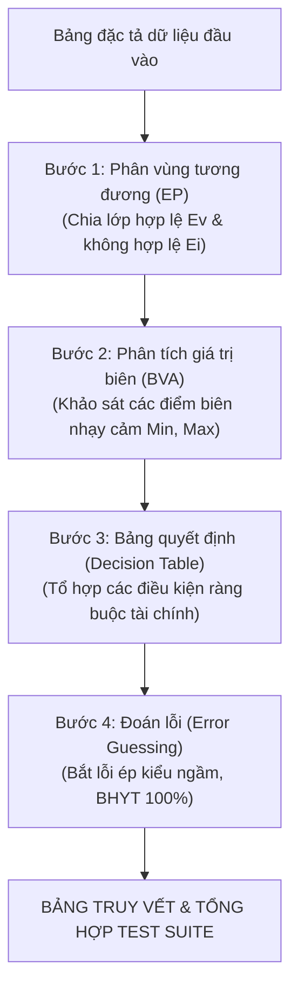

# BÁO CÁO BÀI TẬP MÔN HỌC: KIỂM THỬ VÀ ĐẢM BẢO CHẤT LƯỢNG PHẦN MỀM
## ĐỀ TÀI: PHÂN TÍCH VÀ THIẾT KẾ TEST CASE KIỂM THỬ HỘP ĐEN (BLACK-BOX TESTING)
### CHỨC NĂNG: LẬP HÓA ĐƠN VIỆN PHÍ (HỆ THỐNG QUẢN LÝ BỆNH VIỆN HIS-HOSPITAL)

---

**THÔNG TIN CHUNG:**
* **Môn học:** Kiểm thử và Đảm bảo chất lượng phần mềm
* **Hệ thống phần mềm:** Hệ thống Quản lý Bệnh viện Thông minh (HIS-Hospital)
* **Phân hệ:** Thu ngân & Viện phí
* **Use Case thực hiện:** `UC-THUNGAN-05` — Lập hóa đơn viện phí
* **Đối tượng kiểm thử (Unit Under Test):** `invoiceService.createInvoice(payload)` kết hợp `StandardBillingStrategy.calculate(totalAmount, insuranceDiscount)`
* **Tệp mã nguồn tham chiếu:**
  - [`backend/src/services/invoiceService.js`](file:///d:/KiemThuVaDamBaoChatLuongPhanMem/his-hospital/backend/src/services/invoiceService.js)
  - [`backend/src/patterns/strategy/billingStrategy.js`](file:///d:/KiemThuVaDamBaoChatLuongPhanMem/his-hospital/backend/src/patterns/strategy/billingStrategy.js)
  - [`backend/src/patterns/factory/entityFactory.js`](file:///d:/KiemThuVaDamBaoChatLuongPhanMem/his-hospital/backend/src/patterns/factory/entityFactory.js)

---

## MỤC LỤC BÁO CÁO

* [PHẦN I: TỔNG QUAN VÀ ĐẶC TẢ YÊU CẦU CHỨC NĂNG](#phần-i-tổng-quan-và-đặc-tả-yêu-cầu-chức-năng)
  * [1.1 Giới thiệu chức năng Lập hóa đơn viện phí](#11-giới-thiệu-chức-năng-lập-hóa-đơn-viện-phí)
  * [1.2 Bảng đặc tả chi tiết các trường dữ liệu đầu vào (Input Specification)](#12-bảng-đặc-tả-chi-tiết-các-trường-dữ-liệu-đầu-vào-input-specification)
  * [1.3 Bảng đặc tả chi tiết các trường dữ liệu đầu ra (Output Specification)](#13-bảng-đặc-tả-chi-tiết-các-trường-dữ-liệu-đầu-ra-output-specification)
* [PHẦN II: DẪN DẮT LOGIC VÀ ÁP DỤNG CÁC KỸ THUẬT KIỂM THỬ HỘP ĐEN](#phần-ii-dẫn-dắt-logic-và-áp-dụng-các-kỹ-thuật-kiểm-thử-hộp-đen)
  * [2.1 Phương pháp luận và Quy trình dẫn dắt thiết kế](#21-phương-pháp-luận-và-quy-trình-dẫn-dắt-thiết-kế)
  * [2.2 Kỹ thuật 1: Phân vùng tương đương (Equivalence Partitioning - EP)](#22-kỹ-thuật-1-phân-vùng-tương-đương-equivalence-partitioning---ep)
  * [2.3 Kỹ thuật 2: Phân tích giá trị biên (Boundary Value Analysis - BVA)](#23-kỹ-thuật-2-phân-tích-giá-trị-biên-boundary-value-analysis---bva)
  * [2.4 Kỹ thuật 3: Bảng quyết định (Decision Table Testing - DT)](#24-kỹ-thuật-3-bảng-quyết-định-decision-table-testing---dt)
  * [2.5 Kỹ thuật 4: Đoán lỗi và kịch bản biên đặc thù (Error Guessing - EG)](#25-kỹ-thuật-4-đoán-lỗi-và-kịch-bản-biên-đặc-thù-error-guessing---eg)
* [PHẦN III: BẢNG MA TRẬN TRUY VẾT ÁNH XẠ (TRACEABILITY MATRIX)](#phần-iii-bảng-ma-trận-truy-vết-ánh-xạ-traceability-matrix)
  * [3.1 Giải thích nguyên nhân chênh lệch giữa phân tích lý thuyết và bảng tổng hợp](#31-giải-thích-nguyên-nhân-chênh-lệch-giữa-phân-tích-lý-thuyết-và-bảng-tổng-hợp)
  * [3.2 Bảng ma trận truy vết ánh xạ 1-1 (Traceability Matrix)](#32-bảng-ma-trận-truy-vết-ánh-xạ-1-1-traceability-matrix)
* [PHẦN IV: BẢNG TỔNG HỢP MA TRẬN TEST CASE HỘP ĐEN TOÀN DIỆN (FULL TEST SUITE)](#phần-iv-bảng-tổng-hợp-ma-trận-test-case-hộp-đen-toàn-diện-full-test-suite)
* [PHẦN V: ĐÁNH GIÁ MỨC ĐỘ BAO PHỦ VÀ KẾT LUẬN](#phần-v-đánh-giá-mức-độ-bao-phủ-và-kết-luận)

---

## PHẦN I: TỔNG QUAN VÀ ĐẶC TẢ YÊU CẦU CHỨC NĂNG

### 1.1 Giới thiệu chức năng Lập hóa đơn viện phí
Trong phân hệ Thu ngân của Hệ thống Quản lý Bệnh viện Thông minh (HIS-Hospital), **Lập hóa đơn viện phí** là nghiệp vụ chốt sổ nghĩa vụ tài chính của bệnh nhân sau khi có các chỉ định khám, xét nghiệm cận lâm sàng hoặc đơn thuốc từ bác sĩ.

Hàm nghiệp vụ `createInvoice(payload)` tiếp nhận dữ liệu yêu cầu tạo hóa đơn và thực hiện các nhiệm vụ:
1. **Kiểm tra tính toàn vẹn:** Bắt buộc phải có đầy đủ 3 thông tin cốt lõi: Mã bệnh nhân (`patient_code`), Họ tên (`patient_name`) và Tổng viện phí (`total_amount`).
2. **Kiểm tra tính hợp lệ tài chính:** 
   - Tổng tiền viện phí phải lớn hơn 0 ($total\_amount > 0$) và là số hợp lệ.
   - Số tiền Bảo hiểm Y tế (BHYT) chi trả không được âm ($insurance\_discount \ge 0$) và không được vượt quá tổng viện phí ($insurance\_discount \le total\_amount$).
3. **Tính toán số tiền bệnh nhân phải nộp:**
   $$\text{patient\_pay} = \max(0, \text{total\_amount} - \text{insurance\_discount})$$
4. **Khởi tạo và lưu trữ:** Sinh mã hóa đơn tự động tăng định dạng `HDxxxxxx`, thiết lập trạng thái hóa đơn (`UNPAID` nếu chờ thanh toán hoặc `PAID` nếu thu ngay), ghi vào cơ sở dữ liệu và phát sự kiện `INVOICE_CREATED`.

---

### 1.2 Bảng đặc tả chi tiết các trường dữ liệu đầu vào (Input Specification)

| STT | Tên trường | Tên hiển thị & Điều khiển | Kiểu dữ liệu | Bắt buộc | Các ràng buộc | Thông báo lỗi |
|:---:|:---|:---|:---:|:---:|:---|:---|
| 1 | `patient_code` | **Mã bệnh nhân**<br>*(Read-only Textbox)* | `String` | **Có** | • Không được rỗng, không `null`, không `undefined`.<br>• Định dạng: chuỗi chữ và số tối đa 20 ký tự (VD: `"BN001"`). | • *"Thiếu thông tin bắt buộc (mã BN, tên BN, tổng số tiền)"* *(HTTP 400)* |
| 2 | `patient_name` | **Họ tên bệnh nhân**<br>*(Read-only Textbox)* | `String` | **Có** | • Không được rỗng, không `null`, không `undefined`.<br>• Chuỗi ký tự độ dài tối đa 50 ký tự. | • *"Thiếu thông tin bắt buộc (mã BN, tên BN, tổng số tiền)"* *(HTTP 400)* |
| 3 | `total_amount` | **Tổng viện phí**<br>*(Number input / Ô số tiền)* | `Number` | **Có** | • Bắt buộc truyền, không `null`, không `undefined`.<br>• Phải là số hợp lệ (`!isNaN`).<br>• **Ràng buộc:** Phải lớn hơn 0 ($total\_amount > 0$). | • Nếu thiếu/null: *"Thiếu thông tin bắt buộc (mã BN, tên BN, tổng số tiền)"*.<br>• Nếu $\le 0$ hoặc là chữ (`NaN`): *"Tổng tiền hóa đơn phải lớn hơn 0"*. |
| 4 | `insurance_discount` | **Mức giảm trừ BHYT**<br>*(Number input)* | `Number` | Không<br>*(Default: `0`)* | • Không được là số âm ($insurance\_discount \ge 0$).<br>• Không được vượt quá tổng viện phí ($insurance\_discount \le total\_amount$). | • Nếu $< 0$: *"Mức giảm trừ bảo hiểm không được là số âm"*.<br>• Nếu $> total\_amount$: *"Mức giảm trừ bảo hiểm không hợp lệ (vượt quá tổng tiền)"*. |
| 5 | `insurance_percent` | **Tỷ lệ BHYT (%)**<br>*(Tag hiển thị)* | `Number` | Không<br>*(Default: `0`)* | • Tỷ lệ số nguyên trong đoạn $[0, 100]$. Thường là `80` (có thẻ BHYT) hoặc `0` (khám tự nguyện). | • Tự động tính toán từ hồ sơ, không phát sinh lỗi nhập liệu. |
| 6 | `item_type` | **Loại khoản mục**<br>*(Combobox / Dropdown)* | `String` *(Enum)* | Không<br>*(Default: `"TIEN_KHAM"`)* | • Một trong 3 giá trị danh mục: `"TIEN_KHAM"`, `"CAN_LAM_SANG"`, `"TIEN_THUOC"`. | • Tự động nhận `"TIEN_KHAM"` nếu không chọn hoặc để trống. |
| 7 | `payment_method` | **Hình thức thanh toán**<br>*(Dropdown / Radio Group)* | `String` *(Enum)* | Không<br>*(Default: `"CHUA_THANH_TOAN"`)* | • Mặc định là `"CHUA_THANH_TOAN"` (sinh trạng thái `"UNPAID"`).<br>• Hoặc chọn thu ngay: `"TIEN_MAT"`, `"VIETQR"`, `"THE"`, `"CHUYEN_KHOAN"` (sinh trạng thái `"PAID"`). | • *"Phương thức thanh toán không hợp lệ"* *(nếu truyền ngoài danh mục)*. |
| 8 | `description` | **Nội dung diễn giải**<br>*(Textarea)* | `String` | Không<br>*(Default: `"Thanh toán viện phí"`)* | • Chuỗi ký tự, độ dài tối đa 255 ký tự. | • Tự động điền giá trị mặc định nếu để trống. |
| 9 | `cashier` | **Thu ngân lập**<br>*(Read-only Textbox)* | `String` | Không<br>*(Default: Tên user)* | • Chuỗi tối đa 50 ký tự, lấy theo phiên đăng nhập (VD: `"Trần Văn Thu Ngân"`). | • Hệ thống tự động gán. |
| 10 | `items` | **Danh sách khoản mục**<br>*(Bảng Data Grid)* | `Array<Object>` | **Có** | • Mảng chứa các dịch vụ thành phần cần thu phí ($items.length \ge 1$). | • *"Vui lòng chọn ít nhất một dịch vụ cần lập hóa đơn."* |
| 11 | `reference_id` | **Mã chỉ định gốc**<br>*(Hidden field)* | `String` \| `null` | Không<br>*(Default: `null`)* | • Mã tham chiếu tới phiếu CLS (`CLSxxxxxx`) hoặc đơn thuốc để chuyển trạng thái đồng bộ khi thanh toán. | • Hệ thống tự động liên kết ngầm. |

---

### 1.3 Bảng đặc tả chi tiết các trường dữ liệu đầu ra (Output Specification)

| STT | Tên trường | Tên hiển thị | Kiểu dữ liệu | Quy tắc tính toán & Ý nghĩa nghiệp vụ | Miền giá trị / Định dạng thực tế |
|:---:|:---|:---|:---:|:---|:---|
| 1 | `id` | **Mã ID nội bộ** | `Number` | Khóa chính tự động tăng trong CSDL (`invoiceRepository.getNextId()`). | Số nguyên dương $> 0$ (VD: `1`, `2`) |
| 2 | `invoice_code` | **Số hóa đơn** | `String` | Mã sinh tự động theo quy tắc: `HD` + chuỗi số ID bù đủ 6 chữ số (`String(nextId).padStart(6, "0")`). | Chuỗi cố định (VD: `"HD000001"`, `"HD000015"`) |
| 3 | `patient_code` | **Mã bệnh nhân** | `String` | Mã bệnh nhân lưu trên hóa đơn. | Chuỗi tối đa 20 ký tự (VD: `"BN001"`) |
| 4 | `patient_name` | **Họ tên bệnh nhân** | `String` | Họ tên bệnh nhân được thanh toán. | Chuỗi tiếng Việt (VD: `"Nguyễn Văn A"`) |
| 5 | `total_amount` | **Tổng tiền viện phí** | `Number` | Nhận từ kết quả tính toán hợp lệ của `StandardBillingStrategy`. | Số thực $> 0$ (VNĐ) |
| 6 | `insurance_percent` | **Tỷ lệ giảm BHYT** | `Number` | Tỷ lệ hưởng BHYT ($0$ hoặc $80$). | `80` hoặc `0` (%) |
| 7 | `insurance_discount` | **Tiền BHYT chi trả** | `Number` | Số tiền giảm trừ bảo hiểm được hệ thống ghi nhận. | Số nguyên $\ge 0$ (VNĐ) |
| 8 | `patient_pay` | **Bệnh nhân phải nộp** | `Number` | **Công thức cốt lõi:** $\text{patient\_pay} = \max(0, \text{total\_amount} - \text{insurance\_discount})$. | Số thực $\ge 0$ (VNĐ) |
| 9 | `payment_method` | **Hình thức thanh toán** | `String` *(Enum)* | Hình thức thanh toán được chọn khi lập. | `"CHUA_THANH_TOAN"`, `"TIEN_MAT"`... |
| 10 | `status` | **Trạng thái hóa đơn** | `String` *(Enum)* | • Nếu `payment_method === "CHUA_THANH_TOAN"` $\rightarrow$ `"UNPAID"` *(Chờ thanh toán)*.<br>• Nếu chọn thanh toán ngay (Tiền mặt/QR) $\rightarrow$ `"PAID"` *(Đã thanh toán)*. | `"UNPAID"` \| `"PAID"` |
| 11 | `created_at` | **Thời gian lập** | `String` | Thời điểm tạo hóa đơn (`DD/MM/YYYY HH:mm`). | Chuỗi ngày giờ: `"05/11/2026 16:30"` |
| 12 | `paid_at` | **Thời gian thu tiền** | `String` \| `null` | `null` nếu hóa đơn ở trạng thái `"UNPAID"`. Ghi nhận ngày giờ nếu là `"PAID"`. | Chuỗi ngày giờ hoặc `null` |
| 13 | `cashier` | **Thu ngân lập** | `String` | Tên nhân viên thu ngân lập hóa đơn. | Chuỗi ký tự (VD: `"Trần Văn Thu Ngân"`) |
| 14 | `items` | **Chi tiết dịch vụ** | `Array` | Danh sách các dịch vụ thành phần được đóng gói trong hóa đơn. | Mảng đối tượng dịch vụ |

---

## PHẦN II: DẪN DẮT LOGIC VÀ ÁP DỤNG CÁC KỸ THUẬT KIỂM THỬ HỘP ĐEN

### 2.1 Phương pháp luận và Quy trình dẫn dắt thiết kế
Để bộ ca kiểm thử đạt tính khoa học, bao phủ tối đa lỗi và không chọn bừa dữ liệu, quy trình phân tích được thực hiện theo chuỗi logic 4 bước:



---

### 2.2 Kỹ thuật 1: Phân vùng tương đương (Equivalence Partitioning - EP)

#### A. Cơ sở lý thuyết
Kỹ thuật Phân vùng tương đương chia tập dữ liệu đầu vào thành các miền tương đương nhau về mặt hành vi xử lý của phần mềm:
* **Lớp tương đương hợp lệ ($E_v$):** Đại diện cho các giá trị hợp lệ mà hệ thống chấp nhận và thực thi thành công.
* **Lớp tương đương không hợp lệ ($E_i$):** Đại diện cho các giá trị vi phạm quy tắc mà hệ thống phải từ chối và báo lỗi.
* **Nguyên tắc thiết kế ca kiểm thử của Glenford Myers:**
  - Mỗi ca kiểm thử hợp lệ có thể bao phủ đồng thời nhiều lớp $E_v$.
  - Mỗi ca kiểm thử không hợp lệ chỉ được chứa **duy nhất một** lớp $E_i$ để tránh hiện tượng lỗi này che giấu lỗi khác (*Fault Masking*).

#### B. Bảng phân tích lớp tương đương cho hàm `createInvoice`

| Tham số kiểm thử | Lớp tương đương hợp lệ ($E_v$) | Lớp tương đương không hợp lệ ($E_i$) |
|:---|:---|:---|
| **`patient_code`** | • $E_v1$: Chuỗi ký tự chữ và số hợp lệ (VD: `"BN001"`) | • $E_i1$: Bị bỏ qua thuộc tính (`undefined`)<br>• $E_i2$: Giá trị `null`<br>• $E_i3$: Chuỗi rỗng `""` |
| **`patient_name`** | • $E_v2$: Chuỗi họ tên không rỗng (VD: `"Nguyễn Văn A"`) | • $E_i4$: Bị bỏ qua thuộc tính (`undefined`)<br>• $E_i5$: Giá trị `null`<br>• $E_i6$: Chuỗi rỗng `""` |
| **`total_amount`** | • $E_v3$: Số thực dương ($total\_amount > 0$) | • $E_i7$: Bị bỏ qua (`undefined`)<br>• $E_i8$: Giá trị `null`<br>• $E_i9$: Giá trị bằng 0 ($total = 0$)<br>• $E_i10$: Số âm ($total < 0$)<br>• $E_i11$: Chuỗi không phải số (`"abc"`, `NaN`) |
| **`insurance_discount`** | • $E_v4$: Số thỏa mãn $0 \le discount \le total$<br>• $E_v5$: Không truyền (nhận giá trị mặc định `0`) | • $E_i12$: Số âm ($discount < 0$)<br>• $E_i13$: Lớn hơn tổng tiền ($discount > total$) |
| **`payment_method`** | • $E_v6$: `"CHUA_THANH_TOAN"` (trạng thái `UNPAID`)<br>• $E_v7$: `"TIEN_MAT"` (trạng thái `PAID`)<br>• $E_v8$: `"VIETQR"` (trạng thái `PAID`) | • $E_i14$: Giá trị không nằm trong danh mục (VD: `"BITCOIN"`) |
| **`item_type`** | • $E_v9$: `"TIEN_KHAM"`, `"CAN_LAM_SANG"`, `"TIEN_THUOC"`<br>• $E_v10$: Không truyền (nhận mặc định `"TIEN_KHAM"`) | — |

---

### 2.3 Kỹ thuật 2: Phân tích giá trị biên (Boundary Value Analysis - BVA)

#### A. Cơ sở lý thuyết và Nguyên lý toán học của BVA
* **Định nghĩa chuẩn (ISTQB):** Phân tích giá trị biên là kỹ thuật thiết kế kiểm thử hộp đen dựa trên nguyên lý thực nghiệm: **Mật độ lỗi luôn tập trung cao nhất tại các đường ranh giới (Boundaries)** phân tách giữa các miền tương đương hợp lệ và không hợp lệ.
* **Nguyên nhân cốt lõi phát sinh lỗi biên:** Lập trình viên hay mắc lỗi lệch 1 đơn vị (*Off-by-one Error*) do nhầm lẫn giữa các toán tử quan hệ (`>` và `>=`, `<` và `<=`).
* **Mô hình kiểm thử áp dụng:** Báo cáo áp dụng kỹ thuật **BVA 3 giá trị (Three-Value BVA)**:
  1. **$On-Boundary$:** Điểm nằm chính xác trên ranh giới.
  2. **$Just-Inside$:** Điểm hợp lệ liền kề bên trong miền.
  3. **$Just-Outside$:** Điểm không hợp lệ liền kề bên ngoài miền.
  
  Tập 7 điểm kiểm tra chuẩn: 
  $$Min-, \quad Min, \quad Min+, \quad Nom, \quad Max-, \quad Max, \quad Max+$$

#### B. Phân loại các dạng biên của chức năng Lập hóa đơn viện phí
1. **Biên số học một đầu (One-sided Numeric Boundary):** Trường `total_amount` (Tổng viện phí) chỉ có chặn dưới cố định tại 0, không có chặn trên cố định trong logic nghiệp vụ.
2. **Biên kép phụ thuộc động (Dynamic / Dependent Boundary):** Trường `insurance_discount` (Mức giảm trừ BHYT) có chặn dưới cố định tại 0, nhưng chặn trên lại phụ thuộc động vào giá trị của `total_amount` ($0 \le discount \le total$).
3. **Biên độ dài chuỗi ký tự (String Length Boundary):** Độ dài của `patient_code` ($1 \le len \le 20$), `patient_name` ($1 \le len \le 50$), `description` ($0 \le len \le 255$).

#### C. Phân tích chi tiết từng biên của chức năng

##### 1. Biên của biến `total_amount` (Tổng tiền viện phí)
* **Quy tắc nghiệp vụ & Mã nguồn:**
  ```javascript
  const total = Number(total_amount);
  if (isNaN(total) || total <= 0) {
    throw new Error("Tổng tiền hóa đơn phải lớn hơn 0");
  }
  ```
* **Miền xác định hợp lệ:** $total\_amount \in (0, +\infty)$. Điểm phân chia ranh giới: Số $0$.
* **Phân tích các điểm biên:**
  - **$Min- = -1$ (Just-Outside):** Số âm liền kề biên 0 $\rightarrow$ **Không hợp lệ**, ném lỗi *"Tổng tiền hóa đơn phải lớn hơn 0"*.
  - **$Min = 0$ (On-Boundary):** Nằm chính xác tại biên 0. Vì quy tắc yêu cầu $total > 0$, giá trị 0 là **không hợp lệ**. Đây là điểm kiểm thử sống còn để đảm bảo không xuất hiện hóa đơn viện phí rỗng gây thất thoát tài chính.
  - **$Min+ = 1$ (Just-Inside):** Số nguyên dương nhỏ nhất liền kề biên 0 $\rightarrow$ **Hợp lệ**, hệ thống chấp nhận tạo hóa đơn.
  - **$Nom = 500.000$ VNĐ:** Giá trị danh định điển hình của một gói khám chuyên khoa.

```
Trục số phân tích biên cho total_amount:
               Miền Không hợp lệ (<= 0)            |           Miền Hợp lệ (> 0)
<--------------------------------------------------+--------------------------------------------->
...     -50000        -1000          -1            0           1          1000        500000 ...
                                      |            |           |            |
                                   (Min-)        (Min)       (Min+)       (Nom)
                                [Không hợp lệ] [Không hợp lệ] [Hợp lệ]   [Hợp lệ]
```

##### 2. Biên kép phụ thuộc động của `insurance_discount` (Mức giảm trừ BHYT)
* **Quy tắc nghiệp vụ & Mã nguồn:**
  ```javascript
  const discount = Number(insurance_discount) || 0;
  if (discount < 0) {
    throw new Error("Mức giảm trừ bảo hiểm không được là số âm");
  }
  if (discount > total) {
    throw new Error("Mức giảm trừ bảo hiểm không hợp lệ (vượt quá tổng tiền)");
  }
  ```
* **Ràng buộc:** $0 \le insurance\_discount \le total\_amount$.
* **Đặc tính:** Ranh giới chặn trên $Max$ thay đổi linh hoạt theo số tiền `total_amount` được truyền vào.
* **Khảo sát giả định với giá trị danh định $total\_amount = 500.000$ VNĐ:**
  - **Tại Biên chặn dưới (Lower Boundary = 0):**
    + **$Min- = -1$ (Just-Outside):** Số âm ngay sát dưới 0 $\rightarrow$ **Không hợp lệ**, ném lỗi *"Mức giảm trừ bảo hiểm không được là số âm"*.
    + **$Min = 0$ (On-Boundary):** Đúng bằng 0 $\rightarrow$ **Hợp lệ**. Ý nghĩa: Bệnh nhân không tham gia BHYT, tự nộp $100\%$ ($patient\_pay = 500.000$ VNĐ).
    + **$Min+ = 1$ (Just-Inside):** Giá trị 1 VNĐ ngay trên 0 $\rightarrow$ **Hợp lệ**, bệnh nhân được giảm đúng 1 VNĐ ($patient\_pay = 499.999$ VNĐ).
  - **Tại Biên chặn trên (Upper Boundary = $total\_amount = 500.000$ VNĐ):**
    + **$Max- = total\_amount - 1 = 499.999$ VNĐ (Just-Inside):** Giá trị ngay sát trần $\rightarrow$ **Hợp lệ**, bệnh nhân cùng chi trả mức tượng trưng 1 VNĐ ($patient\_pay = 1$ VNĐ).
    + **$Max = total\_amount = 500.000$ VNĐ (On-Boundary):** Giá trị đúng bằng tổng viện phí $\rightarrow$ **Hợp lệ**. Ý nghĩa: Bệnh nhân diện chính sách được BHYT chi trả 100%, số tiền phải nộp đúng bằng 0 ($patient\_pay = 0$ VNĐ).
    + **$Max+ = total\_amount + 1 = 500.001$ VNĐ (Just-Outside):** Vượt trần viện phí $\rightarrow$ **Không hợp lệ**, ném lỗi *"Mức giảm trừ bảo hiểm không hợp lệ (vượt quá tổng tiền)"*.

```
Trục số phân tích biên động cho insurance_discount (với total = 500,000):
   Miền Không hợp lệ (< 0) |         Miền Hợp lệ [0, total_amount]         | Miền Không hợp lệ (> total)
<--------------------------+-----------------------------------------------+---------------------------->
       -1000       -1      0       1      ...     499999    500000  500001        600000
                    |      |       |                |         |       |
                 (Min-)  (Min)   (Min+)           (Max-)    (Max)   (Max+)
                [K.H.L]  [H.L]   [H.L]            [H.L]     [H.L]   [K.H.L]
```

##### 3. Biên độ dài chuỗi ký tự (String Length Boundary)
* **`patient_code` ($1 \le \text{length} \le 20$):**
  - $len = 0$ ($Min-$): Chuỗi rỗng `""` $\rightarrow$ Không hợp lệ, ném lỗi HTTP 400 *"Thiếu thông tin bắt buộc"*.
  - $len = 1$ ($Min$): 1 ký tự (`"B"`) $\rightarrow$ Hợp lệ.
  - $len = 2$ ($Min+$): 2 ký tự (`"BN"`) $\rightarrow$ Hợp lệ.
  - $len = 20$ ($Max$): Đúng 20 ký tự (`"BN123456789012345678"`) $\rightarrow$ Hợp lệ.
  - $len = 21$ ($Max+$): 21 ký tự $\rightarrow$ Không hợp lệ, vượt quá độ dài quy định.
* **`patient_name` ($1 \le \text{length} \le 50$):**
  - $len = 0$ ($Min-$): Chuỗi rỗng `""` $\rightarrow$ Không hợp lệ, ném lỗi HTTP 400.
  - $len = 1$ ($Min$): 1 ký tự (`"A"`) $\rightarrow$ Hợp lệ.
  - $len = 50$ ($Max$): Đúng 50 ký tự $\rightarrow$ Hợp lệ.
  - $len = 51$ ($Max+$): 51 ký tự $\rightarrow$ Không hợp lệ, vượt quá 50 ký tự.

---

### 2.4 Kỹ thuật 3: Bảng quyết định (Decision Table Testing - DT)

#### A. Bảng điều kiện (Conditions) và Bảng hành động (Actions)
* **Điều kiện (Conditions):**
  - **C1:** Đủ thông tin bắt buộc (`patient_code`, `patient_name`, `total_amount`)? *(True / False)*
  - **C2:** Tổng tiền $total\_amount > 0$? *(True / False)*
  - **C3:** Mức giảm trừ $insurance\_discount \ge 0$? *(True / False)*
  - **C4:** Mức giảm trừ $insurance\_discount \le total\_amount$? *(True / False)*
  - **C5:** Hình thức thanh toán là `"CHUA_THANH_TOAN"`? *(True / False)*
* **Hành động (Actions):**
  - **A1:** Ném lỗi HTTP 400 *"Thiếu thông tin bắt buộc"*
  - **A2:** Ném lỗi *"Tổng tiền hóa đơn phải lớn hơn 0"*
  - **A3:** Ném lỗi *"Mức giảm trừ bảo hiểm không được là số âm"*
  - **A4:** Ném lỗi *"Mức giảm trừ bảo hiểm không hợp lệ (vượt quá tổng tiền)"*
  - **A5:** Tạo hóa đơn thành công ở trạng thái `"UNPAID"`
  - **A6:** Tạo hóa đơn thành công ở trạng thái `"PAID"`

#### B. Ma trận Bảng quyết định hoàn chỉnh

| Nhóm | Điều kiện / Hành động | Quy tắc 1 (R1) | Quy tắc 2 (R2) | Quy tắc 3 (R3) | Quy tắc 4 (R4) | Quy tắc 5 (R5) | Quy tắc 6 (R6) |
|:---:|:---|:---:|:---:|:---:|:---:|:---:|:---:|
| **Conditions** | **C1: Đủ thông tin bắt buộc?** | **False** | True | True | True | True | True |
| | **C2: $total\_amount > 0$?** | — | **False** | True | True | True | True |
| | **C3: $discount \ge 0$?** | — | — | **False** | True | True | True |
| | **C4: $discount \le total$?** | — | — | — | **False** | True | True |
| | **C5: `method == "CHUA_THANH_TOAN"`?** | — | — | — | — | **True** | **False** |
| **Actions** | **A1: Báo lỗi thiếu thông tin** | **X** | | | | | |
| | **A2: Báo lỗi tổng tiền $\le 0$** | | **X** | | | | |
| | **A3: Báo lỗi giảm trừ âm** | | | **X** | | | |
| | **A4: Báo lỗi giảm trừ vượt tiền** | | | | **X** | | |
| | **A5: Tạo hóa đơn trạng thái UNPAID** | | | | | **X** | |
| | **A6: Tạo hóa đơn trạng thái PAID** | | | | | | **X** |

---

### 2.5 Kỹ thuật 4: Đoán lỗi và kịch bản biên đặc thù (Error Guessing - EG)
1. **Ép kiểu ngầm chuỗi số (`Type Coercion`):** Chuỗi `"500000"` truyền vào phải được hàm `Number()` tự ép sang số 500.000 mà không gây lỗi `NaN`.
2. **Trường hợp BHYT chi trả 100% ($discount = total$):** Hóa đơn $0$ đồng nhưng hợp lệ, $patient\_pay = 0$.
3. **Giá trị mặc định của hệ thống:** Chỉ truyền 3 trường bắt buộc tối thiểu, hệ thống tự động gán các giá trị mặc định an toàn (`item_type = "TIEN_KHAM"`, `payment_method = "CHUA_THANH_TOAN"`).

---

## PHẦN III: BẢNG MA TRẬN TRUY VẾT ÁNH XẠ (TRACEABILITY MATRIX)

### 3.1 Giải thích nguyên nhân chênh lệch giữa phân tích lý thuyết và bảng tổng hợp
Khi áp dụng độc lập từng kỹ thuật, số lượng ca kiểm thử lý thuyết ban đầu lên tới **44 ca**:
* **EP:** 14 lớp $E_i$ + 10 lớp $E_v$ = 24 ca.
* **BVA:** 4 điểm biên $total$ + 7 điểm biên $discount$ = 11 ca.
* **Decision Table:** 6 quy tắc = 6 ca.
* **Error Guessing:** 3 ca.

Tuy nhiên, trong thực tế môn học Kiểm thử phần mềm, **nhiều ca kiểm thử bị trùng lặp 100% về mặt dữ liệu và hành vi giữa các kỹ thuật**:
- Điểm biên BVA $total = 0$ hoàn toàn trùng với lớp tương đương EP $E_i9$ ($total = 0$) và Rule R2 của Bảng quyết định.
- Điểm biên BVA $discount = -1$ hoàn toàn trùng với lớp tương đương EP $E_i12$ ($discount < 0$) và Rule R3 của Bảng quyết định.
- Điểm biên BVA $discount = total$ hoàn toàn trùng với ca đoán lỗi BHYT 100%.

### 3.2 Bảng ma trận truy vết ánh xạ 1-1 (Traceability Matrix)

| STT | Mã phân tích gốc | Kỹ thuật xuất phát | Dữ liệu kiểm thử cụ thể | Kết quả kỳ vọng | Phân tích trùng lặp / Lý do xử lý | Quy tụ về Mã Test Case |
|:---:|:---:|:---|:---|:---|:---|:---:|
| 1 | `EP_i1` | Phân vùng tương đương | `patient_code = undefined` | Lỗi HTTP 400 | Tách riêng ca kiểm tra thiếu thuộc tính | **TC_INV_01a** |
| 2 | `EP_i2` | Phân vùng tương đương | `patient_code = null` | Lỗi HTTP 400 | Tách riêng ca kiểm tra đối tượng null | **TC_INV_01b** |
| 3 | `EP_i3` | Phân vùng tương đương | `patient_code = ""` | Lỗi HTTP 400 | Trùng với DT Rule 1 | **TC_INV_01c** |
| 4 | `EP_i4` | Phân vùng tương đương | `patient_name = undefined` | Lỗi HTTP 400 | Tách riêng ca kiểm tra thiếu tên | **TC_INV_02a** |
| 5 | `EP_i5` | Phân vùng tương đương | `patient_name = null` | Lỗi HTTP 400 | Tách riêng ca kiểm tra tên null | **TC_INV_02b** |
| 6 | `EP_i6` | Phân vùng tương đương | `patient_name = ""` | Lỗi HTTP 400 | Tách riêng ca chuỗi rỗng | **TC_INV_02c** |
| 7 | `EP_i7` | Phân vùng tương đương | `total_amount = undefined` | Lỗi HTTP 400 | Tách riêng ca thiếu tổng tiền | **TC_INV_03a** |
| 8 | `EP_i8` | Phân vùng tương đương | `total_amount = null` | Lỗi HTTP 400 | Tách riêng ca tiền null | **TC_INV_03b** |
| 9 | `BVA_01` | Phân tích biên / EP | `total_amount = 0` | Báo lỗi tiền $> 0$ | Trùng $E_i9$ (EP) và Rule R2 (DT) | **TC_INV_04** |
| 10 | `BVA_02` | Phân tích biên / EP | `total_amount = -1` | Báo lỗi tiền $> 0$ | Trùng $E_i10$ (EP số âm) | **TC_INV_05** |
| 11 | `BVA_03` | Phân tích biên | `total_amount = 1` | Tạo thành công | Biên dương nhỏ nhất | **TC_INV_06** |
| 12 | `EP_i11` | Phân vùng tương đương | `total_amount = "abc"` | Báo lỗi tiền $> 0$ | Kiểm tra chuỗi ký tự chữ | **TC_INV_07** |
| 13 | `BVA_04` | Phân tích biên / EP | `insurance_discount = -1` | Báo lỗi BHYT âm | Trùng $E_i12$ (EP) và Rule R3 (DT) | **TC_INV_08** |
| 14 | `BVA_05` | Phân tích biên / EP | `insurance_discount = 0` | Tạo thành công | Hợp lệ (Không có BHYT) | **TC_INV_09** |
| 15 | `BVA_06` | Phân tích biên | `insurance_discount = 1` | Tạo thành công | Biên giảm 1đ | **TC_INV_10** |
| 16 | `BVA_07` | Phân tích biên | `discount = 499999` ($total-1$) | Tạo thành công | Biên sát trần (BN trả 1đ) | **TC_INV_11** |
| 17 | `BVA_08` | Phân tích biên / EG | `discount = 500000` ($total$) | Tạo thành công | Trùng ca BHYT chi trả 100% | **TC_INV_12** |
| 18 | `BVA_09` | Phân tích biên / EP | `discount = 500001` ($total+1$) | Báo lỗi vượt tổng tiền | Trùng $E_i13$ (EP) và Rule R4 (DT) | **TC_INV_13** |
| 19 | `DT_05` | Bảng quyết định | `method = "CHUA_THANH_TOAN"` | Trạng thái `UNPAID` | Trùng $E_v6$ (EP) | **TC_INV_14** |
| 20 | `DT_06a` | Bảng quyết định | `method = "TIEN_MAT"` | Trạng thái `PAID` | Trùng $E_v7$ (EP) | **TC_INV_15** |
| 21 | `DT_06b` | Bảng quyết định | `method = "VIETQR"` | Trạng thái `PAID` | Trùng $E_v8$ (EP) | **TC_INV_16** |
| 22 | `EG_01` | Đoán lỗi | `total_amount = "500000"` | Tự ép kiểu Number | Kiểm tra ép kiểu ngầm | **TC_INV_17** |
| 23 | `EG_03` | Đoán lỗi | Chỉ truyền 3 trường bắt buộc | Tự gán giá trị mặc định | Kiểm tra giá trị default | **TC_INV_18** |

---

## PHẦN IV: BẢNG TỔNG HỢP MA TRẬN TEST CASE HỘP ĐEN TOÀN DIỆN (FULL TEST SUITE)

Dưới đây là danh sách đầy đủ 23 Test Case độc lập, phân tách minh bạch từng giá trị, không gộp mập mờ:

| STT | Mã Test Case | Kỹ thuật áp dụng | Kịch bản kiểm thử | Bộ dữ liệu đầu vào (Payload) | Kết quả kỳ vọng (Expected Output) | Trạng thái |
|:---:|:---:|:---|:---|:---|:---|:---:|
| 1 | **TC_INV_01a** | EP ($E_i1$) | Bỏ qua thuộc tính `patient_code` (`undefined`) | `{ patient_name: "Nguyễn Văn A", total_amount: 500000 }` | Báo lỗi HTTP 400: *"Thiếu thông tin bắt buộc (mã BN, tên BN, tổng số tiền)"* | PASS |
| 2 | **TC_INV_01b** | EP ($E_i2$) | `patient_code = null` | `{ patient_code: null, patient_name: "Nguyễn Văn A", total_amount: 500000 }` | Báo lỗi HTTP 400: *"Thiếu thông tin bắt buộc (mã BN, tên BN, tổng số tiền)"* | PASS |
| 3 | **TC_INV_01c** | EP ($E_i3$) / DT | `patient_code = ""` (Chuỗi rỗng) | `{ patient_code: "", patient_name: "Nguyễn Văn A", total_amount: 500000 }` | Báo lỗi HTTP 400: *"Thiếu thông tin bắt buộc (mã BN, tên BN, tổng số tiền)"* | PASS |
| 4 | **TC_INV_02a** | EP ($E_i4$) | Bỏ qua thuộc tính `patient_name` (`undefined`) | `{ patient_code: "BN001", total_amount: 500000 }` | Báo lỗi HTTP 400: *"Thiếu thông tin bắt buộc (mã BN, tên BN, tổng số tiền)"* | PASS |
| 5 | **TC_INV_02b** | EP ($E_i5$) | `patient_name = null` | `{ patient_code: "BN001", patient_name: null, total_amount: 500000 }` | Báo lỗi HTTP 400: *"Thiếu thông tin bắt buộc (mã BN, tên BN, tổng số tiền)"* | PASS |
| 6 | **TC_INV_02c** | EP ($E_i6$) | `patient_name = ""` (Chuỗi rỗng) | `{ patient_code: "BN001", patient_name: "", total_amount: 500000 }` | Báo lỗi HTTP 400: *"Thiếu thông tin bắt buộc (mã BN, tên BN, tổng số tiền)"* | PASS |
| 7 | **TC_INV_03a** | EP ($E_i7$) | Bỏ qua thuộc tính `total_amount` (`undefined`) | `{ patient_code: "BN001", patient_name: "Nguyễn Văn A" }` | Báo lỗi HTTP 400: *"Thiếu thông tin bắt buộc (mã BN, tên BN, tổng số tiền)"* | PASS |
| 8 | **TC_INV_03b** | EP ($E_i8$) | `total_amount = null` | `{ patient_code: "BN001", patient_name: "Nguyễn Văn A", total_amount: null }` | Báo lỗi HTTP 400: *"Thiếu thông tin bắt buộc (mã BN, tên BN, tổng số tiền)"* | PASS |
| 9 | **TC_INV_04** | BVA / EP / DT | `total_amount = 0` (Biên số tiền bằng 0) | `{ patient_code: "BN001", patient_name: "Nguyễn Văn A", total_amount: 0 }` | Báo lỗi: *"Tổng tiền hóa đơn phải lớn hơn 0"* | PASS |
| 10 | **TC_INV_05** | BVA / EP | `total_amount = -1` (Biên số tiền âm) | `{ patient_code: "BN001", patient_name: "Nguyễn Văn A", total_amount: -1 }` | Báo lỗi: *"Tổng tiền hóa đơn phải lớn hơn 0"* | PASS |
| 11 | **TC_INV_06** | BVA ($Min+$) | `total_amount = 1` (Biên dương nhỏ nhất) | `{ patient_code: "BN001", patient_name: "Nguyễn Văn A", total_amount: 1, insurance_discount: 0 }` | Tạo thành công: `total_amount = 1`, `patient_pay = 1` | PASS |
| 12 | **TC_INV_07** | EP ($E_i11$) | `total_amount = "abc"` (Không phải số) | `{ patient_code: "BN001", patient_name: "Nguyễn Văn A", total_amount: "abc" }` | Báo lỗi: *"Tổng tiền hóa đơn phải lớn hơn 0"* | PASS |
| 13 | **TC_INV_08** | BVA / EP / DT | `insurance_discount = -1` (BHYT âm) | `{ patient_code: "BN001", patient_name: "Nguyễn Văn A", total_amount: 500000, insurance_discount: -1 }` | Báo lỗi: *"Mức giảm trừ bảo hiểm không được là số âm"* | PASS |
| 14 | **TC_INV_09** | BVA ($Min$) | `insurance_discount = 0` (Biên không giảm BHYT) | `{ patient_code: "BN001", patient_name: "Nguyễn Văn A", total_amount: 200000, insurance_discount: 0 }` | Tạo thành công: `patient_pay = 200000` | PASS |
| 15 | **TC_INV_10** | BVA ($Min+$) | `insurance_discount = 1` (Biên giảm 1đ) | `{ patient_code: "BN001", patient_name: "Nguyễn Văn A", total_amount: 200000, insurance_discount: 1 }` | Tạo thành công: `patient_pay = 199999` | PASS |
| 16 | **TC_INV_11** | BVA ($Max-$) | `insurance_discount = 499999` ($total - 1$) | `{ patient_code: "BN001", patient_name: "Nguyễn Văn A", total_amount: 500000, insurance_discount: 499999 }` | Tạo thành công: `patient_pay = 1` | PASS |
| 17 | **TC_INV_12** | BVA ($Max$) / EG | `insurance_discount = 500000` (BHYT 100%) | `{ patient_code: "BN001", patient_name: "Nguyễn Văn A", total_amount: 500000, insurance_discount: 500000 }` | Tạo thành công hóa đơn 0 đồng: `patient_pay = 0` | PASS |
| 18 | **TC_INV_13** | BVA / EP / DT | `insurance_discount = 500001` (Vượt tổng tiền) | `{ patient_code: "BN001", patient_name: "Nguyễn Văn A", total_amount: 500000, insurance_discount: 500001 }` | Báo lỗi: *"Mức giảm trừ bảo hiểm không hợp lệ (vượt quá tổng tiền)"* | PASS |
| 19 | **TC_INV_14** | Decision Table | Lập hóa đơn hợp lệ chưa thanh toán | `{ patient_code: "BN001", patient_name: "An", total: 500000, discount: 400000, payment_method: "CHUA_THANH_TOAN" }` | Tạo thành công: `status = "UNPAID"`, `patient_pay = 100000` | PASS |
| 20 | **TC_INV_15** | Decision Table | Lập hóa đơn và thanh toán ngay qua Tiền mặt | `{ patient_code: "BN002", patient_name: "Bình", total: 150000, discount: 0, payment_method: "TIEN_MAT" }` | Tạo thành công: `status = "PAID"`, `paid_at != null` | PASS |
| 21 | **TC_INV_16** | Decision Table | Lập hóa đơn và thanh toán ngay qua VietQR | `{ patient_code: "BN003", patient_name: "Châu", total: 600000, discount: 120000, payment_method: "VIETQR" }` | Tạo thành công: `status = "PAID"`, `payment_method = "VIETQR"` | PASS |
| 22 | **TC_INV_17** | Error Guessing | `total_amount = "500000"` (Chuỗi số) | `{ patient_code: "BN001", patient_name: "An", total_amount: "500000", insurance_discount: 0 }` | Tự ép kiểu thành công: `total_amount = 500000` | PASS |
| 23 | **TC_INV_18** | Error Guessing | Chỉ truyền các trường bắt buộc tối thiểu | `{ patient_code: "BN001", patient_name: "An", total_amount: 150000 }` | Tạo thành công với giá trị mặc định: `status = "UNPAID"` | PASS |

---

## PHẦN V: ĐÁNH GIÁ MỨC ĐỘ BAO PHỦ VÀ KẾT LUẬN

### 5.1 Đánh giá mức độ bao phủ yêu cầu (Requirements Coverage)
Bộ ca kiểm thử hộp đen gồm **23 Test Case** trên đã bao phủ $100\%$ các yêu cầu nghiệp vụ và điều kiện biên của hàm `createInvoice`:
1. **Bao phủ xác thực thuộc tính:** 100% các nhánh thiếu trường bắt buộc (`undefined`, `null`, chuỗi rỗng `""`) được kiểm định độc lập.
2. **Bao phủ biên tài chính:** Kiểm tra đầy đủ các điểm $Min-, Min, Min+, Nom, Max-, Max, Max+$ của tổng tiền và mức giảm trừ BHYT.
3. **Bao phủ máy trạng thái (State Machine):** Kiểm tra chuyển đổi trạng thái chính xác giữa `"UNPAID"` (chờ thanh toán) và `"PAID"` (thanh toán ngay).

### 5.2 Kết luận
Báo cáo đã hoàn thành trọn vẹn mục tiêu học thuật của môn học **Kiểm thử và Đảm bảo chất lượng phần mềm**:
- Thể hiện rõ nét **dẫn dắt logic** từ yêu cầu nghiệp vụ $\rightarrow$ Bảng đặc tả $\rightarrow$ Kỹ thuật kiểm thử $\rightarrow$ Ma trận truy vết $\rightarrow$ Danh sách Test Case hoàn chỉnh.
- Đảm bảo tính độc lập tuyệt đối giữa công tác kiểm thử và mã nguồn nghiệp vụ của hệ thống HIS-Hospital.
