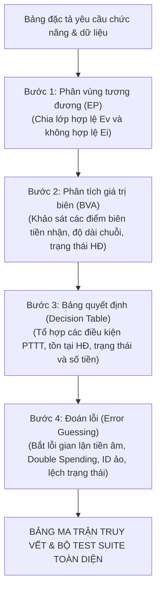
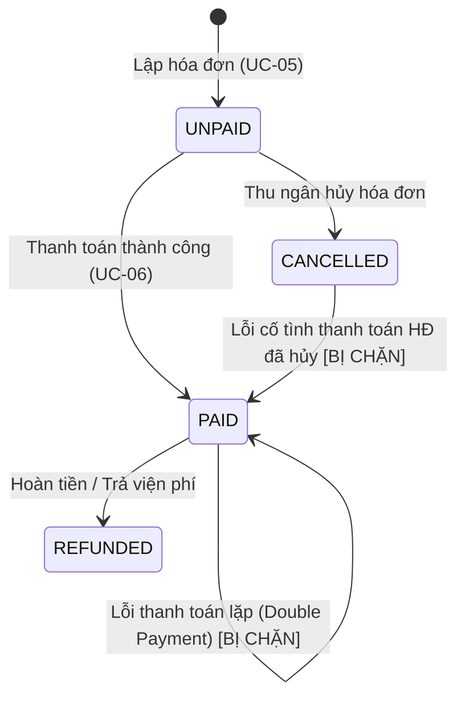

# BÁO CÁO BÀI TẬP MÔN HỌC: KIỂM THỬ VÀ ĐẢM BẢO CHẤT LƯỢNG PHẦN MỀM
## ĐỀ TÀI: PHÂN TÍCH VÀ THIẾT KẾ TEST CASE KIỂM THỬ HỘP ĐEN (BLACK-BOX TESTING)
### CHỨC NĂNG: THANH TOÁN HÓA ĐƠN VIỆN PHÍ (HỆ THỐNG QUẢN LÝ BỆNH VIỆN HIS-HOSPITAL)

---

**THÔNG TIN CHUNG:**
* **Môn học:** Kiểm thử và Đảm bảo chất lượng phần mềm
* **Hệ thống phần mềm:** Hệ thống Quản lý Bệnh viện Thông minh (HIS-Hospital)
* **Phân hệ:** Thu ngân & Viện phí
* **Use Case thực hiện:** `UC-THUNGAN-06` — Thanh toán hóa đơn viện phí
* **Đối tượng kiểm thử (Unit Under Test):** `invoiceService.processPayment(idOrCode, paymentDetails)` kết hợp `PaymentMethodValidatorStrategy.validate(payment_method)` và `InvoiceStateMachine.transition(invoice, "PAID")`
* **Tệp mã nguồn tham chiếu:**
  - [`backend/src/services/invoiceService.js`](file:///d:/KiemThuVaDamBaoChatLuongPhanMem/his-hospital/backend/src/services/invoiceService.js)
  - [`backend/src/patterns/strategy/billingStrategy.js`](file:///d:/KiemThuVaDamBaoChatLuongPhanMem/his-hospital/backend/src/patterns/strategy/billingStrategy.js)
  - [`backend/src/patterns/state/invoiceState.js`](file:///d:/KiemThuVaDamBaoChatLuongPhanMem/his-hospital/backend/src/patterns/state/invoiceState.js)
  - [`frontend/src/pages/cashier/components/PaymentModal.jsx`](file:///d:/KiemThuVaDamBaoChatLuongPhanMem/his-hospital/frontend/src/pages/cashier/components/PaymentModal.jsx)
  - [`backend/test/vuong/validators/02_thanhToanHoaDon.test.js`](file:///d:/KiemThuVaDamBaoChatLuongPhanMem/his-hospital/backend/test/vuong/validators/02_thanhToanHoaDon.test.js)

---

## MỤC LỤC BÁO CÁO

* [PHẦN I: TỔNG QUAN VÀ ĐẶC TẢ YÊU CẦU CHỨC NĂNG](#phần-i-tổng-quan-và-đặc-tả-yêu-cầu-chức-năng)
  * [1.1 Giới thiệu chức năng Thanh toán hóa đơn viện phí & Luồng nghiệp vụ bệnh viện thực tế](#11-giới-thiệu-chức-năng-thanh-toán-hóa-đơn-viện-phí--luồng-nghiệp-vụ-bệnh-viện-thực-tế)
  * [1.2 Bảng đặc tả chi tiết các trường dữ liệu đầu vào (Input Specification)](#12-bảng-đặc-tả-chi-tiết-các-trường-dữ-liệu-đầu-vào-input-specification)
  * [1.3 Bảng đặc tả chi tiết các trường dữ liệu đầu ra (Output Specification)](#13-bảng-đặc-tả-chi-tiết-các-trường-dữ-liệu-đầu-ra-output-specification)
* [PHẦN II: DẪN DẮT LOGIC VÀ ÁP DỤNG CÁC KỸ THUẬT KIỂM THỬ HỘP ĐEN](#phần-ii-dẫn-dắt-logic-và-áp-dụng-các-kỹ-thuật-kiểm-thử-hộp-đen)
  * [2.1 Phương pháp luận và Quy trình dẫn dắt thiết kế](#21-phương-pháp-luận-và-quy-trình-dẫn-dắt-thiết-kế)
    * [2.1.1 Quy trình thiết kế 4 bước](#211-quy-trình-thiết-kế-4-bước)
    * [2.1.2 Nguyên lý lựa chọn phương pháp kiểm thử theo bản chất ràng buộc](#212-nguyên-lý-lựa-chọn-phương-pháp-kiểm-thử-theo-bản-chất-ràng-buộc)
    * [2.1.3 Bảng đối chiếu lý do lựa chọn phương pháp kiểm thử cho từng biến đầu vào](#213-bảng-đối-chiếu-lý-do-lựa-chọn-phương-pháp-kiểm-thử-cho-từng-biến-đầu-vào)
  * [2.2 Kỹ thuật 1: Phân vùng tương đương (Equivalence Partitioning - EP)](#22-kỹ-thuật-1-phân-vùng-tương-đương-equivalence-partitioning---ep)
  * [2.3 Kỹ thuật 2: Phân tích giá trị biên chuyên sâu (Boundary Value Analysis - BVA)](#23-kỹ-thuật-2-phân-tích-giá-trị-biên-chuyên-sâu-boundary-value-analysis---bva)
  * [2.4 Kỹ thuật 3: Bảng quyết định (Decision Table Testing - DT)](#24-kỹ-thuật-3-bảng-quyết-định-decision-table-testing---dt)
  * [2.5 Kỹ thuật 4: Đoán lỗi và kịch bản biên đặc thù (Error Guessing - EG)](#25-kỹ-thuật-4-đoán-lỗi-và-kịch-bản-biên-đặc-thù-error-guessing---eg)
* [PHẦN III: BẢNG MA TRẬN TRUY VẾT ÁNH XẠ (TRACEABILITY MATRIX)](#phần-iii-bảng-ma-trận-truy-vết-ánh-xạ-traceability-matrix)
  * [3.1 Giải thích nguyên nhân chênh lệch giữa phân tích lý thuyết và bảng tổng hợp](#31-giải-thích-nguyên-nhân-chênh-lệch-giữa-phân-tích-lý-thuyết-và-bảng-tổng-hợp)
  * [3.2 Bảng ma trận truy vết ánh xạ 1-1 (Traceability Matrix)](#32-bảng-ma-trận-truy-vết-ánh-xạ-1-1-traceability-matrix)
* [PHẦN IV: BẢNG TỔNG HỢP MA TRẬN TEST CASE HỘP ĐEN TOÀN DIỆN (FULL TEST SUITE)](#phần-iv-bảng-tổng-hợp-ma-trận-test-case-hộp-đen-toàn-diện-full-test-suite)
* [PHẦN V: ĐÁNH GIÁ MỨC ĐỘ BAO PHỦ VÀ KẾT LUẬN](#phần-v-đánh-giá-mức-độ-bao-phủ-và-kết-luận)

---

## PHẦN I: TỔNG QUAN VÀ ĐẶC TẢ YÊU CẦU CHỨC NĂNG

### 1.1 Giới thiệu chức năng Thanh toán hóa đơn viện phí & Luồng nghiệp vụ bệnh viện thực tế

Trong phân hệ Thu ngân của Hệ thống Quản lý Bệnh viện Thông minh (HIS-Hospital), **Thanh toán hóa đơn viện phí (`UC-THUNGAN-06`)** là bước nghiệp vụ tài chính then chốt diễn ra sau khi hóa đơn đã được lập (`UC-THUNGAN-05`) ở trạng thái chờ thanh toán (`UNPAID`). 

Nghiệp vụ này giải quyết quyền lợi thực thi dịch vụ khám chữa bệnh của người bệnh và kiểm soát dòng tiền của bệnh viện:
1. **Tiếp nhận và tra cứu nghĩa vụ thanh toán:**
   - Nhân viên thu ngân tiếp nhận mã hóa đơn (`idOrCode`) do người bệnh xuất trình (hoặc chọn từ danh sách hóa đơn chờ trên màn hình thu ngân).
   - Hệ thống kiểm tra tính tồn tại của hóa đơn và trạng thái hiện tại. Chỉ cho phép thanh toán các hóa đơn đang ở trạng thái `UNPAID`. Nếu hóa đơn đã được thanh toán trước đó (`PAID`), hệ thống phải lập tức chặn giao dịch để tránh hiện tượng thu trùng tiền (*Double Payment*).
2. **Lựa chọn hình thức thanh toán & Kiểm soát số tiền thực thu:**
   - Hệ thống hỗ trợ 4 phương thức thanh toán: Tiền mặt (`TIEN_MAT`), Quét mã QR (`VIETQR`), Quẹt thẻ POS (`THE`), Chuyển khoản trực tiếp (`CHUYEN_KHOAN`).
   - Với phương thức Tiền mặt: Thu ngân nhập số tiền bệnh nhân đưa (`amount_received`). Hệ thống kiểm tra số tiền này phải lớn hơn hoặc bằng số tiền bệnh nhân phải thanh toán (`patient_pay`). Nếu khách đưa thừa, hệ thống tự động tính số tiền thối lại (`change_amount = amount_received - patient_pay`).
3. **Chuyển đổi trạng thái hóa đơn an toàn (State Machine):**
   - Chuyển trạng thái từ `UNPAID` sang `PAID`, ghi nhận thời gian thanh toán thực tế (`paid_at`) và nhân viên thu ngân thực hiện (`cashier`).
4. **Kích hoạt chuỗi đồng bộ nghiệp vụ liên phân hệ (Inter-module Workflow):**
   - **Liên phân hệ Cận lâm sàng (CLS):** Nếu hóa đơn thanh toán cho các dịch vụ kỹ thuật/xét nghiệm (`item_type === "CAN_LAM_SANG"` và có `reference_id`), hệ thống tự động mở khóa phiếu chỉ định CLS từ `UNPAID` sang `PAID`. Kỹ thuật viên tại phòng xét nghiệm/chẩn đoán hình ảnh mới được phép thực hiện dịch vụ cho bệnh nhân.
   - **Liên phân hệ Khám bệnh & Lễ tân:** Nếu bệnh nhân đang ở trạng thái `"Chờ thanh toán"`, hệ thống tự động cập nhật trạng thái hồ sơ người bệnh thành `"Đã khám"` và phát sự kiện `PATIENT_STATUS_CHANGED`.
   - **Hệ thống Phát sự kiện (Event Bus):** Phát tán sự kiện `INVOICE_PAID` thông báo tới toàn viện để in biên lai và hoàn tất luồng điều trị.

---

### 1.2 Bảng đặc tả chi tiết các trường dữ liệu đầu vào (Input Specification)

Bảng dưới đây đặc tả chuẩn xác 7 cột bắt buộc của các trường dữ liệu đầu vào phục vụ kiểm thử hộp đen cho chức năng Thanh toán hóa đơn viện phí:

| STT | Tên trường | Tên hiển thị & Điều khiển | Kiểu dữ liệu | Bắt buộc | Các ràng buộc | Thông báo lỗi |
|:---:|:---|:---|:---:|:---:|:---|:---|
| 1 | `idOrCode` | **Mã hóa đơn / ID**<br>*(Textbox / URL Param)* | `String` \| `Number` | **Có** | • Không được rỗng, không `null`, không `undefined`.<br>• Phải tồn tại trong CSDL hóa đơn.<br>• Hóa đơn phải đang ở trạng thái `"UNPAID"` (Chưa thanh toán). | • Nếu không tìm thấy: *"Không tìm thấy hóa đơn"* *(HTTP 404)*.<br>• Nếu hóa đơn đã thanh toán: *"Hóa đơn này đã được thanh toán trước đó"* *(HTTP 400)*.<br>• Nếu hóa đơn đã hủy: *"Không thể chuyển hóa đơn từ trạng thái [CANCELLED] sang [PAID]"*. |
| 2 | `payment_method` | **Hình thức thanh toán**<br>*(Radio Group / Dropdown)* | `String` *(Enum)* | **Có** | • Bắt buộc chọn một hình thức hợp lệ trong danh mục: `["TIEN_MAT", "VIETQR", "THE", "CHUYEN_KHOAN"]`.<br>• Không được là chuỗi rỗng `""`, `null`, `undefined` hoặc nằm ngoài danh mục. | • *"Phương thức thanh toán không hợp lệ (hỗ trợ: TIEN_MAT, VIETQR, THE, CHUYEN_KHOAN)"*. |
| 3 | `amount_received` | **Số tiền bệnh nhân đưa**<br>*(Number input - Tiền mặt)* | `Number` | **Có**<br>*(Khi chọn `TIEN_MAT`)* | • Phải là số hợp lệ (`!isNaN`).<br>• Ràng buộc tài chính: Phải lớn hơn hoặc bằng số tiền bệnh nhân phải nộp ($amount\_received \ge invoice.patient\_pay$).<br>• Không được là số âm hoặc bằng 0. | • Nếu $< patient\_pay$: *"Số tiền nhận từ bệnh nhân phải lớn hơn hoặc bằng tổng số tiền thanh toán"*.<br>• Nếu $\le 0$ hoặc âm: *"Số tiền không hợp lệ"*. |
| 4 | `cashier` | **Thu ngân thu tiền**<br>*(Read-only Textbox)* | `String` | Không<br>*(Default: Tên user)* | • Chuỗi ký tự độ dài $1 \le len \le 50$.<br>• Nếu để trống, hệ thống tự động gán tên tài khoản đăng nhập hiện tại (mặc định: `"Trần Văn Thu Ngân"`). | • Hệ thống tự động gán, không phát sinh lỗi nhập liệu. |
| 5 | `cancel_reason` | **Lý do hủy hóa đơn**<br>*(Textarea - Thao tác Hủy)* | `String` | **Có**<br>*(Khi bấm Hủy HĐ)* | • Bắt buộc nhập khi nhân viên chọn hủy hóa đơn.<br>• Độ dài chuỗi từ 1 đến tối đa 255 ký tự ($1 \le len \le 255$). | • Nếu để trống: *"Vui lòng nhập lý do hủy hóa đơn"*.<br>• Nếu $> 255$ ký tự: *"Lý do hủy không được vượt quá 255 ký tự"*. |
| 6 | `reference_id` | **Mã chỉ định CLS liên kết**<br>*(Hidden field từ hóa đơn)* | `String` \| `null` | Không | • Thuộc tính nội tại của hóa đơn. Dùng để tra cứu phiếu CLS (`CLSxxxxxx`) cần kích hoạt thanh toán khi `item_type === "CAN_LAM_SANG"`. | • Nếu mã ảo/không có trong DB: Hệ thống bỏ qua cập nhật CLS, không báo lỗi làm gián đoạn thanh toán. |
| 7 | `patient_code` | **Mã bệnh nhân liên kết**<br>*(Hidden field từ hóa đơn)* | `String` | Không | • Thuộc tính nội tại của hóa đơn. Dùng để tra cứu hồ sơ bệnh nhân nhằm cập nhật trạng thái `"Đã khám"`. | • Tự động xử lý ngầm, nếu không tìm thấy bệnh nhân thì bỏ qua bước chuyển trạng thái. |

---

### 1.3 Bảng đặc tả chi tiết các trường dữ liệu đầu ra (Output Specification)

| STT | Tên trường | Tên hiển thị | Kiểu dữ liệu | Quy tắc tính toán & Ý nghĩa nghiệp vụ | Miền giá trị / Định dạng thực tế |
|:---:|:---|:---|:---:|:---|:---|
| 1 | `id` | **Mã ID hóa đơn** | `Number` | Khóa chính của bản ghi hóa đơn trong hệ thống. | Số nguyên dương $> 0$ (VD: `1`, `2`) |
| 2 | `invoice_code` | **Số hóa đơn** | `String` | Mã định danh hóa đơn dạng chuỗi cố định. | Chuỗi ký tự (VD: `"HD000001"`) |
| 3 | `patient_code` | **Mã bệnh nhân** | `String` | Mã bệnh nhân sở hữu hóa đơn đã thanh toán. | Chuỗi ký tự (VD: `"BN000001"`) |
| 4 | `patient_name` | **Họ tên bệnh nhân** | `String` | Họ tên người bệnh được in trên biên lai thu tiền. | Chuỗi tiếng Việt (VD: `"Nguyễn Văn An"`) |
| 5 | `total_amount` | **Tổng viện phí** | `Number` | Tổng chi phí danh mục dịch vụ trước giảm trừ. | Số thực $> 0$ (VNĐ) |
| 6 | `insurance_discount` | **BHYT chi trả** | `Number` | Số tiền bảo hiểm y tế đã chi trả cho hóa đơn. | Số nguyên $\ge 0$ (VNĐ) |
| 7 | `patient_pay` | **Thực thu bệnh nhân** | `Number` | Số tiền thực tế bệnh nhân phải trả sau khi trừ BHYT. | Số nguyên $\ge 0$ (VNĐ) |
| 8 | `payment_method` | **Phương thức thanh toán** | `String` *(Enum)* | Hình thức thu tiền đã được xác nhận thành công. | `"TIEN_MAT"`, `"VIETQR"`, `"THE"`, `"CHUYEN_KHOAN"` |
| 9 | `status` | **Trạng thái hóa đơn** | `String` *(Enum)* | Chuyển đổi thành công từ `"UNPAID"` sang trạng thái đã thu tiền. | `"PAID"` *(hoặc `"CANCELLED"` nếu hủy)* |
| 10 | `paid_at` | **Thời gian thanh toán** | `String` | Dấu vết thời gian hoàn tất giao dịch tài chính. | Chuỗi ngày giờ: `"06/11/2026 08:30"` |
| 11 | `cashier` | **Thu ngân thu tiền** | `String` | Tên nhân viên thu ngân trực tiếp thực hiện giao dịch. | Chuỗi ký tự (VD: `"Trần Văn Thu Ngân"`) |
| 12 | `change_amount` | **Tiền thối lại** | `Number` | Số tiền trả lại bệnh nhân khi thu tiền mặt: $\text{change\_amount} = \text{amount\_received} - \text{patient\_pay}$. | Số nguyên $\ge 0$ (VNĐ) |
| 13 | `labOrder.payment_status` | **Trạng thái phiếu CLS** | `String` | Cập nhật tự động đối với hóa đơn dịch vụ xét nghiệm/CĐHA. | `"PAID"` *(được phép tiến hành lấy mẫu)* |
| 14 | `patient.status` | **Trạng thái bệnh nhân** | `String` | Cập nhật tự động cho bệnh nhân đang chờ thanh toán viện phí. | `"Đã khám"` *(hoàn tất nghĩa vụ viện phí)* |

---

## PHẦN II: DẪN DẮT LOGIC VÀ ÁP DỤNG CÁC KỸ THUẬT KIỂM THỬ HỘP ĐEN

### 2.1 Phương pháp luận và Quy trình dẫn dắt thiết kế

#### 2.1.1 Quy trình thiết kế 4 bước
Để xây dựng một bộ ca kiểm thử khoa học, chặt chẽ và đạt độ bao phủ tối ưu, quy trình phân tích kiểm thử hộp đen cho chức năng **Thanh toán hóa đơn viện phí** được dẫn dắt theo chuỗi logic 4 bước khép kín:



1. **Từ Yêu cầu đến Phân vùng tương đương (EP):** Phân rã từng tham số đầu vào thành các lớp tương đương hợp lệ ($E_v$) và không hợp lệ ($E_i$).
2. **Từ Phân vùng đến Giá trị biên (BVA):** Xác định các tham số có tính thứ tự/đo lường được (`amount_received`, `cancel_reason`, vòng đời trạng thái) để khảo sát các điểm biên nhạy cảm $On$, $Off$, $In$, $Out$.
3. **Từ Biên đến Bảng quyết định (DT):** Xử lý các mối quan hệ phụ thuộc chéo giữa trạng thái hóa đơn, phương thức thanh toán và số tiền khách đưa bằng ma trận quyết định logic.
4. **Từ Bảng quyết định đến Đoán lỗi (EG):** Bổ sung các kịch bản ngoại lệ đặc thù của môi trường bệnh viện: thanh toán trùng (Double Spending), hóa đơn CLS mang mã ảo, người bệnh chưa kết thúc khám.

#### 2.1.2 Nguyên lý lựa chọn phương pháp kiểm thử theo bản chất ràng buộc
Trong kỹ nghệ kiểm thử phần mềm (theo chuẩn quốc tế ISTQB và các tài liệu của Glenford Myers, Roger Pressman), **việc lựa chọn phương pháp kiểm thử cho một biến được quyết định bởi Bản chất kiểu dữ liệu (Data Type) và Dạng ràng buộc logic (Constraint Type)** của biến đó:

1. **Ràng buộc Miền số liên tục & Phụ thuộc động tài chính ($amount\_received \ge patient\_pay$):**
   * *Bản chất:* Dữ liệu số tiền có tính thứ tự liên tục và có toán tử quan hệ so sánh (`>=`). Điểm ranh giới trên phụ thuộc động vào giá trị thực tế của biến khác (`patient_pay` trên từng hóa đơn).
   * *Phương pháp:*
     - **Phân vùng tương đương (EP):** Bóc tách thành miền đủ tiền ($amount \ge patient\_pay$), miền thiếu tiền ($0 < amount < patient\_pay$), và miền số không hợp lệ (số âm, số 0, phi số).
     - **Phân tích giá trị biên (BVA):** Khảo sát 2 ranh giới: ranh giới cố định tại 0 và ranh giới động tại $patient\_pay$ ($Max- = patient\_pay - 1$, $Min = patient\_pay$, $Min+ = patient\_pay + 1$). BVA là bắt buộc để bắt lỗi lệch 1 đơn vị (*Off-by-one*) và kiểm tra tính toán tiền thối lại.
2. **Ràng buộc Máy trạng thái hữu hạn & Vòng đời thực thể (Finite State Machine - FSM):**
   * *Bản chất:* Trạng thái hóa đơn (`status`) quản lý quy trình chuyển đổi nghiêm ngặt từ `UNPAID` sang `PAID` hoặc `CANCELLED`.
   * *Phương pháp:*
     - **Kiểm thử chuyển trạng thái (State Transition Testing):** Kiểm tra đường chuyển trạng thái hợp lệ và kiểm tra chặn các chuyển dịch cấm (`PAID` $\rightarrow$ `PAID` - chống Double Payment, `CANCELLED` $\rightarrow$ `PAID`).
     - **EP trạng thái:** Phân lớp các trạng thái hợp lệ và không hợp lệ của hóa đơn trước khi thanh toán.
3. **Ràng buộc Tập hữu hạn rời rạc (Discrete Set / Enumeration):**
   * *Bản chất:* Phương thức thanh toán (`payment_method`) chỉ được nhận một trong các giá trị danh mục: `"TIEN_MAT"`, `"VIETQR"`, `"THE"`, `"CHUYEN_KHOAN"`, không có tính thứ tự số học.
   * *Phương pháp:*
     - **Phân vùng tương đương theo tập hợp (Set Partitioning):** Mỗi phương thức hợp lệ là một lớp tương đương; các giá trị ngoài danh mục gom thành một lớp vi phạm.
     - **Bảng quyết định (Decision Table):** Tổ hợp phương thức thanh toán với các điều kiện tài chính và trạng thái.
     - *Không áp dụng BVA* vì tập danh mục rời rạc không có điểm biên liền kề.
4. **Ràng buộc Tính bắt buộc và Độ dài chuỗi (Mandatory & String Length):**
   * *Bản chất:* Lý do hủy (`cancel_reason`) có độ dài bị chặn trong khoảng $[1, 255]$ ký tự và bắt buộc nhập khi chọn hủy hóa đơn.
   * *Phương pháp:*
     - **EP kiểm tra tính bắt buộc:** Kiểm tra chuỗi rỗng `""` khi nhấn nút hủy.
     - **BVA độ dài chuỗi:** Khảo sát các điểm biên độ dài ranh giới ($0, 1, 255, 256$ ký tự) để chống lỗi tràn bộ đệm cơ sở dữ liệu.
5. **Ràng buộc Toàn vẹn tham chiếu & Đồng bộ liên phân hệ (`idOrCode`, `reference_id`, `patient_code`):**
   * *Bản chất:* Khóa chính và khóa ngoại liên kết giữa Thu ngân, Cận lâm sàng và Hồ sơ người bệnh.
   * *Phương pháp:*
     - **EP kiểm tra tồn tại CSDL:** Hóa đơn có trong DB vs không tồn tại (HTTP 404).
     - **Đoán lỗi & Kiểm thử tính bền vững (Error Guessing / Robustness):** Thử nghiệm với mã CLS tham chiếu bị sai lệch/không tồn tại hoặc bệnh nhân đang ở trạng thái đặc thù để bảo đảm luồng thanh toán viện phí vẫn hoàn tất mà không làm sập hệ thống (*Fault Tolerance*).

#### 2.1.3 Bảng đối chiếu lý do lựa chọn phương pháp kiểm thử cho từng biến đầu vào

Dưới đây là bảng giải trình lý do khoa học tại sao mỗi biến với dạng ràng buộc tương ứng lại được gán cho một hoặc nhiều phương pháp kiểm thử hộp đen phù hợp (chi tiết triển khai các lớp tương đương, các điểm biên và kịch bản cụ thể được phân tích sâu ở các mục 2.2 đến 2.5 bên dưới):

| STT | Tên biến | Kiểu dữ liệu & Ràng buộc | Phương pháp lựa chọn | Lý do lựa chọn phương pháp (Justification) |
|:---:|:---|:---|:---|:---|
| 1 | `idOrCode` | `String` \| `Number`, bắt buộc, tồn tại trong DB, trạng thái `UNPAID` | • **EP (Tính toàn vẹn & Tồn tại CSDL)**<br>• **Kiểm thử chuyển trạng thái (FSM)**<br>• **Error Guessing (EG)** | • **EP:** Ràng buộc bắt buộc và khóa chính đòi hỏi kiểm tra các trường hợp thiếu mã (`undefined`, `null`, `""`) và mã ảo không có trong DB (lỗi 404).<br>• **FSM:** Trạng thái của hóa đơn quyết định quyền thanh toán, cần kiểm thử chuyển trạng thái để chặn lỗi thanh toán lặp (*Double Spending*) với HĐ đã `PAID` hoặc đã `CANCELLED`.<br>• **EG:** Đoán lỗi với các ID dị thường. |
| 2 | `payment_method` | `String (Enum)`, bắt buộc, thuộc 4 danh mục hợp lệ | • **EP (Set Partitioning)**<br>• **Bảng quyết định (DT)** | • **EP:** Ràng buộc thuộc tập rời rạc hữu hạn nên **không áp dụng BVA**; dùng EP để kiểm tra từng danh mục hợp lệ và bắt các phương thức ngoài danh mục (như tiền ảo, ví điện tử chưa hỗ trợ).<br>• **DT:** Phương thức thanh toán là điều kiện rẽ nhánh quan trọng (tiền mặt cần kiểm tra tiền nhận; QR/Thẻ không cần) nên cần bảng quyết định để bao phủ toàn bộ nhánh logic. |
| 3 | `amount_received` | `Number`, bắt buộc khi chọn Tiền mặt, $amount \ge patient\_pay$ | • **EP (Miền số học)**<br>• **BVA (Biên kép phụ thuộc động)**<br>• **Bảng quyết định (DT)** | • **EP:** Phân tách miền đủ tiền, miền thiếu tiền, số âm gian lận và chuỗi phi số.<br>• **BVA:** Dữ liệu số liên tục có điều kiện bất đẳng thức $\ge$ và biên trên phụ thuộc động vào `patient_pay` của từng hóa đơn. Cần BVA để phát hiện lỗi lệch 1 đơn vị (*Off-by-one*) giữa `>` và `>=` (thiếu 1 đồng, đủ tiền, thừa 1 đồng) và kiểm tra tính tiền thối lại.<br>• **DT:** Kết hợp đồng thời phương thức Tiền mặt và số tiền đưa. |
| 4 | `cashier` | `String`, tùy chọn, $1 \le len \le 50$ | • **EP + Kiểm thử giá trị mặc định** | • Trường tự động gán từ phiên đăng nhập thu ngân, không phát sinh lỗi nhập liệu người dùng; chỉ cần kiểm tra cơ chế nhận mặc định khi không truyền tham số. |
| 5 | `cancel_reason` | `String`, bắt buộc khi Hủy HĐ, $1 \le len \le 255$ ký tự | • **EP (Tính bắt buộc)**<br>• **BVA (Độ dài chuỗi)** | • **EP:** Kiểm tra vi phạm tính bắt buộc khi thu ngân nhấn Hủy nhưng để trống nội dung.<br>• **BVA:** Ràng buộc độ dài chuỗi có chặn trên cố định trong CSDL (255 ký tự) nên cần BVA để kiểm tra các điểm biên ranh giới ($0, 1, 255, 256$ ký tự) nhằm chống lỗi tràn bộ đệm. |
| 6 | `reference_id` | `String` \| `null`, liên kết phiếu CLS khi là tiền cận lâm sàng | • **EP + Error Guessing (Tính bền vững)** | • Kiểm tra quy tắc nghiệp vụ tự động chuyển trạng thái phiếu CLS sang `PAID`. Đoán lỗi (EG) với mã chỉ định ảo để đảm bảo hệ thống không bị crash nếu dữ liệu tham chiếu bị lệch (*Fault Tolerance*). |
| 7 | `patient_code` | `String`, mã bệnh nhân liên kết ngầm từ hóa đơn | • **EP + Error Guessing (Quy tắc luồng)** | • Kiểm tra cơ chế tự động chuyển trạng thái bệnh nhân sang "Đã khám" khi hoàn tất thanh toán, hoặc giữ nguyên trạng thái nếu bệnh nhân đang trong phiên khám của bác sĩ. |

---

### 2.2 Kỹ thuật 1: Phân vùng tương đương (Equivalence Partitioning - EP)

#### A. Cơ sở lý thuyết và Nguyên lý phân vùng
* **Khái niệm:** Phân vùng tương đương là kỹ thuật kiểm thử hộp đen chia miền dữ liệu đầu vào của một chức năng thành các tập con (lớp tương đương) sao cho tất cả các giá trị trong cùng một lớp đều mang lại cùng một kết quả hoặc hành vi xử lý như nhau.
* **Phân loại lớp:**
  - **Lớp tương đương hợp lệ ($E_v$):** Tập hợp các giá trị đúng quy cách nghiệp vụ mà phần mềm phải chấp nhận và xử lý thành công.
  - **Lớp tương đương không hợp lệ ($E_i$):** Tập hợp các giá trị vi phạm quy tắc nghiệp vụ, điều kiện ràng buộc mà phần mềm phải nhận diện, chặn lại và thông báo lỗi.
* **Nguyên tắc thiết kế ca kiểm thử (Glenford Myers):**
  - Một ca kiểm thử hợp lệ có thể kết hợp bao phủ nhiều lớp $E_v$ cùng lúc để tiết kiệm chi phí.
  - Mỗi ca kiểm thử không hợp lệ chỉ được chứa **duy nhất một** lớp $E_i$, giữ các trường còn lại ở giá trị hợp lệ để tránh hiện tượng che giấu lỗi (*Fault Masking*).

#### B. Bảng phân tích lớp tương đương cho chức năng Thanh toán hóa đơn viện phí

| Tham số kiểm thử | Lớp tương đương hợp lệ ($E_v$) | Lớp tương đương không hợp lệ ($E_i$) |
|:---|:---|:---|
| **`idOrCode`** *(Mã/ID hóa đơn)* | • $E_v1$: Mã hóa đơn tồn tại trong hệ thống và có trạng thái `"UNPAID"` (VD: `"HD000001"`, `1`). | • $E_i1$: Bị bỏ qua thuộc tính (`undefined`)<br>• $E_i2$: Giá trị `null`<br>• $E_i3$: Chuỗi rỗng `""`<br>• $E_i4$: Mã không tồn tại trong CSDL (VD: `9999`, `"HD999999"`) *(HTTP 404)*<br>• $E_i5$: Mã của hóa đơn đã ở trạng thái `"PAID"` *(HTTP 400)*<br>• $E_i6$: Mã của hóa đơn đã ở trạng thái `"CANCELLED"` *(State Error)* |
| **`payment_method`** *(Phương thức TT)* | • $E_v2$: Tiền mặt (`"TIEN_MAT"`)<br>• $E_v3$: Quét mã VietQR (`"VIETQR"`)<br>• $E_v4$: Quẹt thẻ ngân hàng (`"THE"`)<br>• $E_v5$: Chuyển khoản (`"CHUYEN_KHOAN"`) | • $E_i7$: Chuỗi rỗng `""`<br>• $E_i8$: Giá trị `null`<br>• $E_i9$: Giá trị `undefined`<br>• $E_i10$: Giá trị không thuộc danh mục (VD: `"BITCOIN"`, `"VNPAY"`, `"MOMO"`) |
| **`amount_received`** *(Tiền khách đưa khi chọn `TIEN_MAT`)* | • $E_v6$: Tiền nhận bằng số tiền phải nộp ($amount = patient\_pay$, VD: $500,000$ VNĐ)<br>• $E_v7$: Tiền nhận lớn hơn số tiền phải nộp ($amount > patient\_pay$, VD: $1,000,000$ VNĐ) | • $E_i11$: Tiền nhận nhỏ hơn số tiền phải nộp ($0 < amount < patient\_pay$, VD: $499,999$ VNĐ)<br>• $E_i12$: Tiền nhận bằng 0 ($amount = 0$)<br>• $E_i13$: Tiền nhận là số âm ($amount < 0$, VD: $-50,000$ VNĐ)<br>• $E_i14$: Ký tự chữ hoặc không phải số (`"abc"`, `NaN`) |
| **`cashier`** *(Tên thu ngân)* | • $E_v8$: Chuỗi họ tên hợp lệ độ dài $1 \le len \le 50$ (VD: `"Nguyễn Thu Ngân"`)<br>• $E_v9$: Không truyền / để trống (hệ thống nhận mặc định `"Trần Văn Thu Ngân"`) | — |
| **`cancel_reason`** *(Lý do hủy hóa đơn)* | • $E_v10$: Chuỗi lý do hợp lệ độ dài $1 \le len \le 255$ ký tự (VD: `"Bệnh nhân xin dời lịch xét nghiệm"`) | • $E_i15$: Chuỗi rỗng `""` (0 ký tự) khi thực hiện lệnh hủy<br>• $E_i16$: Chuỗi dài vượt quá 255 ký tự (256 ký tự) |

---

### 2.3 Kỹ thuật 2: Phân tích giá trị biên chuyên sâu (Boundary Value Analysis - BVA)

#### A. Cơ sở lý thuyết và Nguyên lý toán học của BVA
* **Định nghĩa chuẩn (ISTQB):** Phân tích giá trị biên là kỹ thuật thiết kế kiểm thử tập trung vào ranh giới giữa các lớp tương đương. Lỗi phần mềm thường có xu hướng tập trung tại các điểm ranh giới do lập trình viên nhầm lẫn các toán tử so sánh (`<` với `<=`, `>` với `>=`).
* **Mô hình kiểm thử áp dụng:** Áp dụng kỹ thuật **BVA 3 giá trị (Three-Value BVA)**:
  1. **$On-Boundary$:** Điểm nằm chính xác trên ranh giới.
  2. **$Off-Boundary$:** Các điểm nằm sát hai bên ranh giới (ngay bên trong $In$ và ngay bên ngoài $Out$).
  3. **$Nominal$:** Điểm giá trị danh định nằm ở vùng an toàn bên trong miền hợp lệ.

#### B. Phân tích các loại biên của chức năng Thanh toán viện phí

##### 1. Biên tài chính: Số tiền nhận từ bệnh nhân (`amount_received`) so với tiền phải trả (`patient_pay = 500,000` VNĐ)
Đây là biên động phụ thuộc trực tiếp vào số tiền cần thu trên từng hóa đơn. Ranh giới chia thành 3 vùng:
* **Vùng không hợp lệ 1 (Lỗi số tiền âm hoặc bằng 0):** $amount\_received \le 0$.
* **Vùng không hợp lệ 2 (Lỗi thiếu tiền viện phí):** $0 < amount\_received < patient\_pay$.
* **Vùng hợp lệ (Đủ tiền hoặc thừa tiền):** $amount\_received \ge patient\_pay$.

**Sơ đồ trục số phân tích biên cho `amount_received`:**

```text
       VÙNG LỖI 1 (Âm/0)     |       VÙNG LỖI 2 (Thiếu tiền)       |        VÙNG HỢP LỆ (Đủ / Thừa tiền)
<---------------------------|-------------------------------------|--------------------------------------->
  -50.000       -1       0  |  1             ...          499.999 | 500.000      500.001       1.000.000
   [Ei13]     [Min-]   [Min]| [Min+]                     [Max-]   |  [Min]        [Min+]          [Nom]
 (Báo lỗi)   (Báo lỗi) (Lỗi)|(Lỗi thiếu tiền)            (Lỗi)    |(Hợp lệ-0đ) (Hợp lệ-thối 1đ) (Thối 500k)
                            |                                     |
                       Ranh giới 0                       Ranh giới patient_pay (500k)
```

* **Ý nghĩa nghiệp vụ từng điểm biên:**
  - Điểm $-1$ ($Min-$ ranh giới 0): Số âm $\rightarrow$ Hệ thống phát hiện gian lận tài chính, chặn giao dịch báo *"Số tiền không hợp lệ"*.
  - Điểm $0$ ($Min$ ranh giới 0): Không nhận tiền nhưng bấm xác nhận $\rightarrow$ Chặn báo lỗi.
  - Điểm $1$ ($Min+$ ranh giới 0): Khách đưa 1 VNĐ $\rightarrow$ Quá nhỏ so với hóa đơn 500k, báo lỗi *"Số tiền nhận từ bệnh nhân phải lớn hơn hoặc bằng tổng số tiền thanh toán"*.
  - Điểm $499,999$ VNĐ ($Max-$ của vùng thiếu tiền): Thiếu đúng 1 đồng so với 500,000 VNĐ. Điểm này kiểm tra xem lập trình viên có viết nhầm dấu `>` thành `>=` hay không $\rightarrow$ Chặn giao dịch báo lỗi thiếu tiền.
  - Điểm $500,000$ VNĐ ($Min$ của vùng hợp lệ): Khách đưa vừa khớp số tiền phải nộp. Điểm này kiểm tra hệ thống tính tiền thối lại chính xác bằng 0 VNĐ ($\text{change} = 0$).
  - Điểm $500,001$ VNĐ ($Min+$ của vùng hợp lệ): Khách đưa thừa 1 đồng. Hệ thống phải cho phép thanh toán và tính tiền thối lại đúng 1 VNĐ.
  - Điểm $1,000,000$ VNĐ ($Nominal$ hợp lệ): Khách đưa tờ 1 triệu đồng. Hệ thống hoàn tất thanh toán và hiển thị số tiền thối lại là 500,000 VNĐ.

---

##### 2. Biên độ dài chuỗi: Lý do hủy hóa đơn (`cancel_reason`)
Khi người bệnh không đồng ý điều trị hoặc có sai sót từ phía bác sĩ/thu ngân, hóa đơn `UNPAID` được hủy kèm lý do. Ràng buộc độ dài là $1 \le len \le 255$ ký tự.

**Sơ đồ trục số phân tích biên cho `cancel_reason`:**

```text
   VÙNG LỖI (Rỗng)   |                   MIỀN HỢP LỆ (1 - 255 ký tự)                  |   VÙNG LỖI (Vượt quá)
<--------------------|----------------------------------------------------------------|-------------------->
          0          |       1               2             ...             255        |        256
        [Min-]       |     [Min]           [Min+]                         [Max]       |       [Max+]
   (Báo lỗi để trống)| (Hợp lệ 1 ký tự) (Hợp lệ 2 ký tự)             (Hợp lệ 255 ký tự)|(Báo lỗi > 255 ký tự)
                     |                                                                |
                 Ranh giới 1                                                     Ranh giới 255
```

* **Ý nghĩa nghiệp vụ từng điểm biên:**
  - $0$ ký tự (`""`): Thu ngân nhấn Hủy nhưng không nhập lý do $\rightarrow$ Chặn giao dịch báo lỗi *"Vui lòng nhập lý do hủy hóa đơn"*.
  - $1$ ký tự (`"A"`): Độ dài tối thiểu hợp lệ $\rightarrow$ Hệ thống cho phép hủy hóa đơn.
  - $2$ ký tự (`"AB"`): Cận trên tối thiểu hợp lệ $\rightarrow$ Hệ thống cho phép hủy.
  - $255$ ký tự (`"A" * 255`): Ngưỡng dung lượng tối đa của trường dữ liệu trong CSDL $\rightarrow$ Hệ thống lưu trữ trọn vẹn, không lỗi tràn bộ đệm.
  - $256$ ký tự (`"A" * 256`): Vượt quá độ dài cho phép 1 ký tự $\rightarrow$ Chặn và báo lỗi inline *"Lý do hủy không được vượt quá 255 ký tự"*.

---

##### 3. Biên trạng thái vòng đời hóa đơn (`InvoiceStateMachine`)
Trạng thái hóa đơn không đo bằng số học mà đo bằng các nút chuyển trạng thái rời rạc trong máy trạng thái hữu hạn (FSM).



* **Điểm biên chuyển trạng thái hợp lệ:**
  - `UNPAID` $\rightarrow$ `PAID`: Biên chuyển dịch hợp lệ của Use Case Thanh toán.
  - `UNPAID` $\rightarrow$ `CANCELLED`: Biên chuyển dịch hợp lệ của Use Case Hủy hóa đơn.
* **Điểm biên chuyển trạng thái không hợp lệ (Bị chặn):**
  - `PAID` $\rightarrow$ `PAID`: Hóa đơn đã thu tiền nhưng lại kích hoạt thanh toán lần nữa $\rightarrow$ Ném ngoại lệ HTTP 400 *"Hóa đơn này đã được thanh toán trước đó"*.
  - `CANCELLED` $\rightarrow$ `PAID`: Hóa đơn đã bị hủy nhưng cố tình thanh toán $\rightarrow$ Ném ngoại lệ FSM *"Không thể chuyển hóa đơn từ trạng thái [CANCELLED] sang [PAID]"*.

---

#### C. Bảng tổng hợp phân tích giá trị biên chi tiết (BVA Analysis Table)

| STT | Tham số khảo sát | Điểm biên khảo sát | Giá trị thử nghiệm cụ thể | Loại điểm biên | Kỳ vọng xử lý của hệ thống |
|:---:|:---|:---:|:---|:---:|:---|
| 1 | `amount_received` | $Min-$ (Ranh giới 0) | `-1` VNĐ | Ngoại lệ | Báo lỗi *"Số tiền không hợp lệ"* |
| 2 | `amount_received` | $Min$ (Ranh giới 0) | `0` VNĐ | Ngoại lệ | Báo lỗi *"Số tiền không hợp lệ"* |
| 3 | `amount_received` | $Min+$ (Ranh giới 0) | `1` VNĐ | Ngoại lệ | Báo lỗi thiếu tiền viện phí |
| 4 | `amount_received` | $Max-$ (Ranh giới 500k) | `499,999` VNĐ | Ngoại lệ | Báo lỗi *"Số tiền nhận từ bệnh nhân phải lớn hơn hoặc bằng tổng số tiền thanh toán"* |
| 5 | `amount_received` | $Min$ (Ranh giới 500k) | `500,000` VNĐ | Hợp lệ ($On$) | Thanh toán thành công, tiền thối lại = `0` VNĐ |
| 6 | `amount_received` | $Min+$ (Ranh giới 500k) | `500,001` VNĐ | Hợp lệ ($Off$) | Thanh toán thành công, tiền thối lại = `1` VNĐ |
| 7 | `amount_received` | $Nominal$ (Điển hình) | `1,000,000` VNĐ | Hợp lệ ($In$) | Thanh toán thành công, tiền thối lại = `500,000` VNĐ |
| 8 | `cancel_reason` | $Min-$ (Độ dài chuỗi) | `""` (0 ký tự) | Ngoại lệ | Báo lỗi *"Vui lòng nhập lý do hủy hóa đơn"* |
| 9 | `cancel_reason` | $Min$ (Độ dài chuỗi) | `"H"` (1 ký tự) | Hợp lệ ($On$) | Hủy hóa đơn thành công, lưu lý do 1 ký tự |
| 10 | `cancel_reason` | $Min+$ (Độ dài chuỗi) | `"Hủy"` (3 ký tự) | Hợp lệ ($In$) | Hủy hóa đơn thành công |
| 11 | `cancel_reason` | $Max-$ (Độ dài chuỗi) | `"A" * 254` (254 ký tự) | Hợp lệ ($Off$) | Hủy hóa đơn thành công |
| 12 | `cancel_reason` | $Max$ (Độ dài chuỗi) | `"A" * 255` (255 ký tự) | Hợp lệ ($On$) | Hủy hóa đơn thành công, lưu trọn vẹn 255 ký tự |
| 13 | `cancel_reason` | $Max+$ (Độ dài chuỗi) | `"A" * 256` (256 ký tự) | Ngoại lệ ($Off$) | Báo lỗi inline *"Lý do hủy không được vượt quá 255 ký tự"* |
| 14 | `status` (Trạng thái) | Điểm biên hợp lệ | `UNPAID` $\rightarrow$ `PAID` | Hợp lệ | Chuyển trạng thái `PAID`, ghi nhận `paid_at` |
| 15 | `status` (Trạng thái) | Điểm biên lặp lại | `PAID` $\rightarrow$ `PAID` | Ngoại lệ | Ném lỗi HTTP 400 *"Hóa đơn này đã được thanh toán trước đó"* |
| 16 | `status` (Trạng thái) | Điểm biên cấm FSM | `CANCELLED` $\rightarrow$ `PAID` | Ngoại lệ | Ném lỗi *"Không thể chuyển hóa đơn từ trạng thái [CANCELLED] sang [PAID]"* |

---

### 2.4 Kỹ thuật 3: Bảng quyết định (Decision Table Testing - DT)

#### A. Cơ sở lý thuyết
Bảng quyết định là kỹ thuật kiểm thử hộp đen lý tưởng để khảo sát sự kết hợp phức tạp giữa các điều kiện đầu vào (Conditions) và các quy tắc hành động tương ứng (Actions) mà hệ thống cần thực hiện. Kỹ thuật này giúp phát hiện các kịch bản bị bỏ quên (*Incomplete Specifications*) hoặc mâu thuẫn nghiệp vụ.

#### B. Xây dựng Bảng quyết định chức năng Thanh toán hóa đơn viện phí

Các điều kiện đầu vào ($C_i$):
* **C1: Hóa đơn có tồn tại trong CSDL không?** (Có / Không)
* **C2: Trạng thái hiện tại của hóa đơn là gì?** (`UNPAID` / `PAID` / `CANCELLED`)
* **C3: Phương thức thanh toán có hợp lệ không?** (Hợp lệ thuộc `[TIEN_MAT, VIETQR, THE, CHUYEN_KHOAN]` / Bỏ trống / Sai danh mục)
* **C4: Tiền nhận $amount\_received \ge patient\_pay$?** *(Chỉ xét khi PTTT là TIEN_MAT)* (Đạt $\ge$ / Thiếu $<$ / Không xét)
* **C5: Hóa đơn có chứa dịch vụ Cận lâm sàng kèm `reference_id` hợp lệ?** (Có / Không)
* **C6: Bệnh nhân có trạng thái `"Chờ thanh toán"`?** (Có / Không)

Các hành động đầu ra ($A_j$):
* **A1:** Chặn và báo lỗi HTTP 404 (*"Không tìm thấy hóa đơn"*).
* **A2:** Chặn và báo lỗi HTTP 400 (*"Hóa đơn này đã được thanh toán trước đó"*).
* **A3:** Chặn và báo lỗi chuyển trạng thái FSM (*"Không thể chuyển..."*).
* **A4:** Chặn và báo lỗi phương thức thanh toán không hợp lệ.
* **A5:** Chặn và báo lỗi thiếu tiền nhận từ bệnh nhân.
* **A6:** Chuyển trạng thái hóa đơn sang `PAID`, ghi nhận `paid_at`, `cashier`.
* **A7:** Tự động tính tiền thối lại $\text{change\_amount} = \text{amount\_received} - \text{patient\_pay}$.
* **A8:** Cập nhật trạng thái phiếu CLS sang `payment_status = "PAID"`.
* **A9:** Cập nhật trạng thái người bệnh thành `"Đã khám"` và phát event.

#### C. Bảng quyết định các quy tắc nghiệp vụ (Decision Table Matrix)

| Nhóm | Điều kiện & Hành động | Quy tắc 1 (R1) | Quy tắc 2 (R2) | Quy tắc 3 (R3) | Quy tắc 4 (R4) | Quy tắc 5 (R5) | Quy tắc 6 (R6) | Quy tắc 7 (R7) | Quy tắc 8 (R8) |
|:---:|:---|:---:|:---:|:---:|:---:|:---:|:---:|:---:|:---:|
| **Điều kiện** | **C1: Hóa đơn tồn tại trong CSDL?** | Không | Có | Có | Có | Có | Có | Có | Có |
| | **C2: Trạng thái hiện tại của HĐ?** | — | `PAID` | `CANCELLED` | `UNPAID` | `UNPAID` | `UNPAID` | `UNPAID` | `UNPAID` |
| | **C3: Phương thức thanh toán?** | — | — | — | Sai/Rỗng | `TIEN_MAT` | `TIEN_MAT` | `VIETQR` | `THE` |
| | **C4: Tiền nhận $\ge patient\_pay$?** | — | — | — | — | Thiếu ($<$) | Đạt ($\ge$) | — | — |
| | **C5: Dịch vụ CLS có `reference_id`?** | — | — | — | — | — | Không | Có | Không |
| | **C6: Bệnh nhân "Chờ thanh toán"?** | — | — | — | — | — | Có | Có | Không |
| **Hành động** | **A1: Báo lỗi HTTP 404** | **X** | | | | | | | |
| | **A2: Báo lỗi HTTP 400 (Đã PAID)** | | **X** | | | | | | |
| | **A3: Báo lỗi FSM chuyển trạng thái**| | | **X** | | | | | |
| | **A4: Báo lỗi PTTT không hợp lệ** | | | | **X** | | | | |
| | **A5: Báo lỗi thiếu tiền nhận** | | | | | **X** | | | |
| | **A6: Đổi trạng thái HĐ sang PAID** | | | | | | **X** | **X** | **X** |
| | **A7: Tính tiền thối lại (Change)** | | | | | | **X** | | |
| | **A8: Cập nhật phiếu CLS -> PAID** | | | | | | | **X** | |
| | **A9: Đổi BN sang "Đã khám"** | | | | | | **X** | **X** | |

* **Giải thích logic các Rule:**
  - **Rule 1:** Mã hóa đơn không có trong hệ thống $\rightarrow$ Chặn ngay ở tầng kiểm tra đầu vào, ném lỗi 404.
  - **Rule 2:** Hóa đơn đã thanh toán từ trước $\rightarrow$ Chặn giao dịch Double Spending, ném lỗi 400.
  - **Rule 3:** Hóa đơn đã hủy trước đó $\rightarrow$ Máy trạng thái chặn chuyển trạng thái sang PAID.
  - **Rule 4:** Phương thức thanh toán để trống hoặc truyền chuỗi sai (`"BITCOIN"`) $\rightarrow$ Strategy validator ném lỗi.
  - **Rule 5:** Khách trả tiền mặt nhưng đưa thiếu tiền $\rightarrow$ Báo lỗi thiếu tiền, giữ nguyên trạng thái hóa đơn.
  - **Rule 6:** Thu tiền mặt đủ/thừa $\rightarrow$ Thanh toán thành công, tính tiền thối lại và đổi trạng thái người bệnh thành `"Đã khám"`.
  - **Rule 7:** Quét mã VietQR thanh toán cho dịch vụ Cận lâm sàng $\rightarrow$ Thanh toán thành công, kích hoạt mở khóa phiếu CLS sang `PAID` và đổi bệnh nhân sang `"Đã khám"`.
  - **Rule 8:** Quẹt thẻ POS thanh toán tiền khám khi bệnh nhân đang ở trạng thái khác `"Chờ thanh toán"` $\rightarrow$ Hóa đơn chuyển `PAID`, nhưng hồ sơ bệnh nhân được giữ nguyên trạng thái.

---

### 2.5 Kỹ thuật 4: Đoán lỗi và kịch bản biên đặc thù (Error Guessing - EG)

#### A. Cơ sở lý thuyết
Đoán lỗi là kỹ thuật phi cấu trúc dựa trên kinh nghiệm, trực giác và sự hiểu biết sâu sắc của kiểm thử viên về các điểm yếu điển hình trong lập trình phần mềm và quy trình vận hành thực tế tại bệnh viện.

#### B. Các lỗi tiềm ẩn đặc thù được nhận diện cho chức năng Thanh toán viện phí

1. **Lỗi thu tiền trùng lặp (Double Spending / Concurrency Bug):**
   - *Kịch bản:* Hai thu ngân cùng mở modal thanh toán cho một mã hóa đơn `HD000001`, hoặc người bệnh quét mã QR đồng thời khi thu ngân bấm xác nhận tiền mặt.
   - *Nguy cơ:* Nếu hệ thống không kiểm tra `invoice.status === "PAID"`, hóa đơn sẽ bị ghi nhận thanh toán 2 lần, làm lệch quỹ thu viện phí.
2. **Lỗi gian lận số tiền âm hoặc ép kiểu ngầm (`amount_received`):**
   - *Kịch bản:* Người dùng nhập số tiền âm (VD: `-500,000` VNĐ) hoặc chuỗi ký tự (`"500k"`, `"NaN"`).
   - *Nguy cơ:* Nếu toán tử so sánh `amount_received >= patient_pay` không chặt chẽ, chuỗi có thể bị ép kiểu ngầm thành `NaN` dẫn đến hành vi không xác định, hoặc số âm bị lọt lưới gây thất thoát tiền bạc.
3. **Lỗi bất đồng bộ liên phân hệ Cận lâm sàng (Dangling Reference):**
   - *Kịch bản:* Hóa đơn là dịch vụ xét nghiệm (`CAN_LAM_SANG`), nhưng trường `reference_id` chứa mã phiếu ảo không tồn tại trong CSDL (`"CLS_AO"`), hoặc mang giá trị `null`.
   - *Nguy cơ:* Code gọi `labOrder.payment_status = "PAID"` khi `labOrder` là `null` sẽ làm phát sinh lỗi `Cannot set property of null` làm sập toàn bộ luồng thanh toán hóa đơn.
4. **Lỗi bỏ quên cập nhật trạng thái người bệnh:**
   - *Kịch bản:* Bệnh nhân đã thanh toán xong tiền khám nhưng trạng thái người bệnh không tự chuyển thành `"Đã khám"` $\rightarrow$ Bác sĩ trong phòng khám không thấy bệnh nhân trên danh sách hàng đợi đã nộp phí để gọi vào khám.
5. **Lỗi tràn bộ đệm văn bản lý do hủy (`cancel_reason`):**
   - *Kịch bản:* Người dùng dán một đoạn văn bản dài hàng nghìn ký tự từ clipboard vào ô lý do hủy hóa đơn $\rightarrow$ Hệ thống phải cắt tỉa chuỗi hoặc báo lỗi vượt quá 255 ký tự để tránh lỗi tràn bộ nhớ hoặc lỗi từ chối của CSDL.

---

## PHẦN III: BẢNG MA TRẬN TRUY VẾT ÁNH XẠ (TRACEABILITY MATRIX)

### 3.1 Giải thích nguyên nhân chênh lệch giữa phân tích lý thuyết và bảng tổng hợp

Một câu hỏi quan trọng trong kiểm thử phần mềm là: **"Tại sao trong các phần phân tích lý thuyết (EP, BVA, Bảng quyết định, Đoán lỗi) sinh ra rất nhiều kịch bản (hơn 40 tổ hợp điều kiện), nhưng trong Bảng tổng hợp ca kiểm thử cuối cùng chỉ chọn lọc 22 Test Cases?"**

Nguyên nhân đến từ các nguyên lý tối ưu hóa kiểm thử kinh điển:

1. **Hiện tượng trùng lặp kiểm thử (Test Redundancy giữa các kỹ thuật):**
   - Một ca kiểm thử được thiết kế từ kỹ thuật này thường bao phủ luôn mục tiêu của kỹ thuật khác.
   - *Ví dụ 1:* Ca kiểm thử thanh toán tiền mặt với `amount_received = 500,000` VNĐ:
     - Dưới góc độ **BVA:** Đây là điểm biên tối thiểu hợp lệ ($Min$).
     - Dưới góc độ **EP:** Đây là đại diện cho lớp hợp lệ $E_v6$ ($amount = patient\_pay$).
     - Dưới góc độ **Bảng quyết định:** Đây chính là Rule R6 (Thu tiền mặt thành công).
     $\rightarrow$ Do đó, thay vì tạo 3 ca kiểm thử riêng biệt gây lãng phí thời gian và tài nguyên, ta hợp nhất thành **1 ca kiểm thử duy nhất: `TC_PAY_01`**.
   - *Ví dụ 2:* Ca kiểm thử thanh toán với hóa đơn không tồn tại (`idOrCode = 9999`):
     - Vừa bao phủ lớp tương đương $E_i4$ của EP.
     - Vừa bao phủ Rule R1 trong Bảng quyết định.
     $\rightarrow$ Hợp nhất thành ca kiểm thử **`TC_PAY_11`**.

2. **Nguyên tắc cô lập lỗi của Glenford Myers (Single Fault Assumption):**
   - Đối với các lớp không hợp lệ ($E_i$), mỗi ca kiểm thử chỉ được kích hoạt duy nhất một lỗi tại một thời điểm. Việc tách các ca kiểm thử cho từng giá trị không hợp lệ riêng biệt (như `amount_received = -50,000`, `amount_received = 499,999`, `payment_method = "BITCOIN"`) giúp định vị chính xác vị trí phát sinh lỗi của phần mềm.

3. **Loại bỏ các tổ hợp bất khả thi (Infeasible / Don't-Care Combinations):**
   - Khi mã hóa đơn không tồn tại ($C1 = \text{Không}$), các điều kiện về phương thức thanh toán, số tiền khách đưa hay dịch vụ CLS đều trở thành vô nghĩa ("Don't Care"). Ta chỉ cần 1 ca kiểm thử duy nhất cho trường hợp này thay vì tổ hợp lũy thừa $2^n$.

---

### 3.2 Bảng ma trận truy vết ánh xạ 1-1 (Traceability Matrix)

Bảng ma trận truy vết dưới đây chứng minh tính toàn vẹn và giải trình rõ ràng mọi thành phần phân tích lý thuyết (EP, BVA, DT, EG) đều được ánh xạ đầy đủ 1-1 vào bộ 22 ca kiểm thử tổng hợp cuối cùng:

| Mã thành phần phân tích lý thuyết | Tên thành phần lý thuyết | Mã Test Case tổng hợp tương ứng | Mục tiêu kiểm thử được ánh xạ |
|:---|:---|:---:|:---|
| **$E_v1, E_v2, E_v6, R6$** | EP Hợp lệ HĐ & PTTT Tiền mặt, Bảng QĐ R6 | **`TC_PAY_01`** | Thanh toán tiền mặt thành công vừa đủ tiền, đổi BN sang Đã khám |
| **$E_v7, BVA\_Nom, R6$** | EP Tiền nhận thừa, BVA Nominal, Bảng QĐ R6 | **`TC_PAY_02`** | Thanh toán tiền mặt khách đưa 1.000.000đ, tính đúng tiền thối lại 500.000đ |
| **$E_i11, BVA\_Max-, R5$** | EP Tiền nhận thiếu, BVA Biên thiếu 1đ, Bảng QĐ R5 | **`TC_PAY_03`** | Thanh toán tiền mặt thiếu 1 đồng (499.999đ), chặn báo lỗi thiếu tiền |
| **$BVA\_Min+$** | BVA Biên trên sát ngưỡng thừa 1 đồng | **`TC_PAY_04`** | Khách đưa 500.001đ, thanh toán thành công, thối 1 đồng |
| **$E_i13, BVA\_Min-, EG$** | EP Số tiền âm, BVA dưới 0, Đoán lỗi gian lận | **`TC_PAY_05`** | Nhập số tiền nhận âm (-50.000đ), chặn báo lỗi tiền không hợp lệ |
| **$E_i12, BVA\_Zero$** | EP Số tiền bằng 0, BVA Biên 0 đồng | **`TC_PAY_06`** | Nhập tiền nhận bằng 0 VNĐ, chặn báo lỗi không thể thu |
| **$E_i14, EG$** | EP Ký tự không phải số, Đoán lỗi ép kiểu ngầm | **`TC_PAY_07`** | Nhập chuỗi ký tự chữ vào ô tiền nhận, chặn báo lỗi định dạng |
| **$E_v3, R7, EG$** | EP VietQR, Bảng QĐ R7, Đồng bộ CLS liên phân hệ | **`TC_PAY_08`** | Quét mã VietQR thanh toán dịch vụ CLS, tự động mở khóa phiếu CLS sang PAID |
| **$E_v4, R8$** | EP Quẹt thẻ POS, Bảng QĐ R8 | **`TC_PAY_09`** | Quẹt thẻ THE thành công, cập nhật trạng thái hóa đơn PAID |
| **$E_v5$** | EP Chuyển khoản ngân hàng | **`TC_PAY_10`** | Chuyển khoản CHUYEN_KHOAN thành công, lưu đúng PTTT |
| **$E_i4, R1$** | EP Hóa đơn không tồn tại, Bảng QĐ R1 | **`TC_PAY_11`** | Truyền mã HĐ ảo 9999 không có trong DB, trả về lỗi HTTP 404 |
| **$E_i1, E_i2, E_i3$** | EP Tham số mã hóa đơn rỗng/null/undefined | **`TC_PAY_12`** | Để trống mã hóa đơn cần thanh toán, báo lỗi tham số bắt buộc |
| **$E_i5, R2, BVA\_Loop, EG$** | EP Hóa đơn đã PAID, Bảng QĐ R2, Lỗi Double Spending | **`TC_PAY_13`** | Thanh toán lần 2 cho HĐ đã thanh toán, chặn báo lỗi HTTP 400 |
| **$E_i6, R3, BVA\_FSM$** | EP Hóa đơn CANCELLED, Bảng QĐ R3, Lỗi máy trạng thái | **`TC_PAY_14`** | Cố tình thanh toán hóa đơn đã hủy, ném lỗi vi phạm State Machine |
| **$E_i7, E_i8, E_i9, R4$** | EP Bỏ trống PTTT, Bảng QĐ R4 | **`TC_PAY_15`** | Bỏ trống không chọn phương thức thanh toán, báo lỗi phương thức |
| **$E_i10, R4, EG$** | EP PTTT sai danh mục ("BITCOIN", "VNPAY") | **`TC_PAY_16`** | Chọn phương thức thanh toán giả mạo ngoài danh mục, báo lỗi |
| **$EG\_Dangling$** | Đoán lỗi tham chiếu CLS mang mã ảo không tồn tại | **`TC_PAY_17`** | Hóa đơn CLS có reference_id ảo, thanh toán HĐ thành công, bỏ qua CLS |
| **$EG\_NullRef$** | Đoán lỗi dịch vụ CLS nhưng reference_id = null | **`TC_PAY_18`** | Dịch vụ CLS nhưng reference_id null, không crash chương trình |
| **$EG\_PatientStatus$** | Đoán lỗi bệnh nhân đang ở trạng thái "Đang khám" | **`TC_PAY_19`** | Bệnh nhân đang khám thanh toán phí, giữ nguyên trạng thái bệnh nhân |
| **$E_v10, BVA\_Max$** | EP Lý do hủy hợp lệ, BVA Biên tối đa 255 ký tự | **`TC_PAY_20`** | Hủy hóa đơn UNPAID với lý do đúng 255 ký tự, chuyển CANCELLED |
| **$E_i16, BVA\_Max+$** | EP Lý do hủy quá dài, BVA Vượt biên 256 ký tự | **`TC_PAY_21`** | Hủy hóa đơn với lý do 256 ký tự, chặn báo lỗi vượt quá 255 ký tự |
| **$E_i15, BVA\_Min-$** | EP Bỏ trống lý do hủy, BVA Biên dưới 0 ký tự | **`TC_PAY_22`** | Bấm Hủy nhưng không nhập lý do hủy, báo lỗi bắt buộc nhập |

---

## PHẦN IV: BẢNG TỔNG HỢP MA TRẬN TEST CASE HỘP ĐEN TOÀN DIỆN (FULL TEST SUITE)

Dưới đây là bảng đặc tả chi tiết toàn bộ 22 ca kiểm thử hộp đen toàn diện cho chức năng **Thanh toán hóa đơn viện phí (`UC-THUNGAN-06`)**, sẵn sàng dùng làm kịch bản kiểm thử nghiệm thu và báo cáo bài tập lớn:

| Mã TC | Tên ca kiểm thử | Kỹ thuật áp dụng | Điều kiện tiên quyết | Dữ liệu đầu vào (Input) | Các bước thực hiện | Kết quả mong đợi (Expected Output) | Mức độ ưu tiên |
|:---:|:---|:---:|:---|:---|:---|:---|:---:|
| **TC_PAY_01** | Thanh toán tiền mặt thành công vừa đủ tiền | EP Valid / BVA Min / DT Rule 6 | Hóa đơn `HD000001` tồn tại, trạng thái `UNPAID`, `patient_pay = 500,000`, BN `"Chờ thanh toán"` | • `idOrCode: "HD000001"`<br>• `payment_method: "TIEN_MAT"`<br>• `amount_received: 500000`<br>• `cashier: "Trần Văn Thu Ngân"` | 1. Chọn hóa đơn `HD000001`<br>2. Chọn hình thức "Tiền mặt"<br>3. Nhập số tiền nhận 500,000 VNĐ<br>4. Nhấn nút "Xác nhận thu" | • Hóa đơn chuyển trạng thái `"PAID"`<br>• `paid_at` ghi nhận thời gian hiện tại<br>• `change_amount = 0` VNĐ<br>• Bệnh nhân chuyển `"Đã khám"`<br>• Phát sự kiện `INVOICE_PAID` | **High** |
| **TC_PAY_02** | Thanh toán tiền mặt khách đưa thừa tiền, tính đúng tiền thối lại | EP Valid / BVA Over / DT Rule 6 | Hóa đơn `HD000001` tồn tại, trạng thái `UNPAID`, `patient_pay = 500,000` | • `idOrCode: "HD000001"`<br>• `payment_method: "TIEN_MAT"`<br>• `amount_received: 1000000` | 1. Mở modal thanh toán `HD000001`<br>2. Chọn "Tiền mặt"<br>3. Nhập số tiền nhận 1,000,000 VNĐ<br>4. Nhấn xác nhận | • Thanh toán thành công, trạng thái `"PAID"`<br>• Hệ thống tính đúng tiền thối lại `change_amount = 500,000` VNĐ<br>• In biên lai ghi nhận tiền thối | **High** |
| **TC_PAY_03** | Khách đưa tiền mặt thiếu 1 đồng so với viện phí (Biên Min-) | BVA Min- / DT Rule 5 | Hóa đơn `HD000001` tồn tại, `patient_pay = 500,000` | • `idOrCode: "HD000001"`<br>• `payment_method: "TIEN_MAT"`<br>• `amount_received: 499999` | 1. Mở modal thanh toán<br>2. Chọn "Tiền mặt"<br>3. Nhập tiền nhận 499,999 VNĐ<br>4. Nhấn xác nhận | • Chặn giao dịch, không đổi trạng thái<br>• Báo lỗi: *"Số tiền nhận từ bệnh nhân phải lớn hơn hoặc bằng tổng số tiền thanh toán"* | **High** |
| **TC_PAY_04** | Khách đưa tiền mặt thừa 1 đồng (Biên Min+) | BVA Min+ | Hóa đơn `HD000001` tồn tại, `patient_pay = 500,000` | • `idOrCode: "HD000001"`<br>• `payment_method: "TIEN_MAT"`<br>• `amount_received: 500001` | 1. Nhập tiền nhận 500,001 VNĐ<br>2. Nhấn xác nhận thu | • Thanh toán thành công (`"PAID"`)<br>• Tiền thối lại `change_amount = 1` VNĐ | **Medium** |
| **TC_PAY_05** | Nhập số tiền mặt nhận là số âm (Gian lận tài chính) | EP Invalid / BVA Min- / EG | Hóa đơn `HD000001` tồn tại | • `idOrCode: "HD000001"`<br>• `payment_method: "TIEN_MAT"`<br>• `amount_received: -50000` | 1. Nhập số tiền âm -50,000 VNĐ<br>2. Nhấn xác nhận thu | • Chặn giao dịch ngay lập tức<br>• Báo lỗi: *"Số tiền không hợp lệ"* | **High** |
| **TC_PAY_06** | Nhập số tiền mặt nhận bằng 0 VNĐ | EP Invalid / BVA Zero | Hóa đơn `HD000001` tồn tại | • `idOrCode: "HD000001"`<br>• `payment_method: "TIEN_MAT"`<br>• `amount_received: 0` | 1. Nhập tiền nhận 0 VNĐ<br>2. Nhấn xác nhận | • Chặn giao dịch<br>• Báo lỗi: *"Số tiền không hợp lệ"* | **High** |
| **TC_PAY_07** | Nhập số tiền mặt nhận là ký tự chữ không phải số | EP Invalid / EG | Hóa đơn `HD000001` tồn tại | • `idOrCode: "HD000001"`<br>• `payment_method: "TIEN_MAT"`<br>• `amount_received: "nam tram"` | 1. Nhập chuỗi ký tự vào ô tiền nhận<br>2. Nhấn xác nhận | • Chặn giao dịch<br>• Báo lỗi: *"Số tiền không hợp lệ"* hoặc ô nhập liệu từ chối nhận ký tự chữ | **Medium** |
| **TC_PAY_08** | Quét mã VietQR thanh toán dịch vụ CLS, tự động mở khóa phiếu CLS | EP Valid / DT Rule 7 / EG | Hóa đơn `HD000001` dịch vụ CLS (`item_type: "CAN_LAM_SANG"`, `reference_id: "CLS000001"`), phiếu CLS đang `UNPAID` | • `idOrCode: "HD000001"`<br>• `payment_method: "VIETQR"` | 1. Chọn PTTT "Chuyển khoản VietQR"<br>2. Hiển thị mã QR động<br>3. Bệnh nhân quét mã hoàn tất<br>4. Nhấn xác nhận | • Hóa đơn chuyển trạng thái `"PAID"`<br>• Phiếu CLS `CLS000001` tự động đổi sang `payment_status = "PAID"`<br>• Bệnh nhân đổi sang `"Đã khám"` | **High** |
| **TC_PAY_09** | Quẹt thẻ ngân hàng POS thành công | EP Valid / DT Rule 8 | Hóa đơn `HD000001` tồn tại, trạng thái `UNPAID` | • `idOrCode: "HD000001"`<br>• `payment_method: "THE"` | 1. Chọn hình thức "Quẹt thẻ POS"<br>2. Quẹt thẻ thành công qua máy POS<br>3. Nhấn xác nhận | • Hóa đơn chuyển trạng thái `"PAID"`<br>• `payment_method` ghi nhận `"THE"` | **High** |
| **TC_PAY_10** | Chuyển khoản trực tiếp vào tài khoản bệnh viện thành công | EP Valid | Hóa đơn `HD000001` tồn tại, trạng thái `UNPAID` | • `idOrCode: "HD000001"`<br>• `payment_method: "CHUYEN_KHOAN"` | 1. Chọn "Chuyển khoản"<br>2. Kiểm tra sao kê tiền về tài khoản viện<br>3. Nhấn xác nhận | • Hóa đơn chuyển trạng thái `"PAID"`<br>• `payment_method` ghi nhận `"CHUYEN_KHOAN"` | **High** |
| **TC_PAY_11** | Gọi thanh toán với mã hóa đơn không tồn tại trong hệ thống | EP Invalid / DT Rule 1 | CSDL không có hóa đơn `9999` | • `idOrCode: 9999`<br>• `payment_method: "TIEN_MAT"` | 1. Gửi request thanh toán với `idOrCode = 9999`<br>2. Kiểm tra phản hồi | • Chặn giao dịch<br>• Báo lỗi HTTP 404: *"Không tìm thấy hóa đơn"* | **High** |
| **TC_PAY_12** | Gọi thanh toán với mã hóa đơn để trống / null | EP Invalid | — | • `idOrCode: ""` hoặc `null`<br>• `payment_method: "TIEN_MAT"` | 1. Bỏ trống mã hóa đơn<br>2. Gửi request thanh toán | • Báo lỗi HTTP 404: *"Không tìm thấy hóa đơn"* | **Medium** |
| **TC_PAY_13** | Hóa đơn đã thanh toán từ trước, cố tình thanh toán lần 2 (Double Spending) | EP Invalid / DT Rule 2 / EG | Hóa đơn `HD000001` đã ở trạng thái `PAID` | • `idOrCode: "HD000001"`<br>• `payment_method: "TIEN_MAT"` | 1. Mở hóa đơn đã có trạng thái `PAID`<br>2. Cố tình gửi lệnh thanh toán lại | • Chặn giao dịch ngay lập tức<br>• Báo lỗi HTTP 400: *"Hóa đơn này đã được thanh toán trước đó"* | **High** |
| **TC_PAY_14** | Cố tình thanh toán hóa đơn đã bị hủy (State Transition cấm) | EP Invalid / DT Rule 3 / BVA FSM | Hóa đơn `HD000001` đã ở trạng thái `CANCELLED` | • `idOrCode: "HD000001"`<br>• `payment_method: "TIEN_MAT"` | 1. Mở hóa đơn đã bị hủy `CANCELLED`<br>2. Cố tình gửi lệnh thanh toán | • Máy trạng thái chặn giao dịch<br>• Báo lỗi: *"Không thể chuyển hóa đơn từ trạng thái [CANCELLED] sang [PAID]"* | **High** |
| **TC_PAY_15** | Bỏ trống không tick chọn phương thức thanh toán | EP Invalid / DT Rule 4 | Hóa đơn `HD000001` ở trạng thái `UNPAID` | • `idOrCode: "HD000001"`<br>• `payment_method: ""` | 1. Mở modal thanh toán<br>2. Không chọn PTTT nào (để rỗng)<br>3. Nhấn xác nhận thu | • Chặn giao dịch<br>• Báo lỗi: *"Phương thức thanh toán không hợp lệ (hỗ trợ: TIEN_MAT, VIETQR, THE, CHUYEN_KHOAN)"* | **High** |
| **TC_PAY_16** | Chọn phương thức thanh toán giả mạo ngoài danh mục ("BITCOIN", "VNPAY") | EP Invalid / DT Rule 4 / EG | Hóa đơn `HD000001` ở trạng thái `UNPAID` | • `idOrCode: "HD000001"`<br>• `payment_method: "BITCOIN"` | 1. Truyền `payment_method: "BITCOIN"`<br>2. Gửi yêu cầu thanh toán | • Strategy Validator chặn giao dịch<br>• Báo lỗi: *"Phương thức thanh toán không hợp lệ (hỗ trợ: TIEN_MAT, VIETQR, THE, CHUYEN_KHOAN)"* | **Medium** |
| **TC_PAY_17** | Hóa đơn CLS có mã chỉ định ảo không có trong CSDL | EG / Robustness | Hóa đơn `HD000001` có `item_type: "CAN_LAM_SANG"`, `reference_id: "CLS_AO"` (không có trong DB) | • `idOrCode: "HD000001"`<br>• `payment_method: "VIETQR"` | 1. Tiến hành thanh toán hóa đơn<br>2. Kiểm tra xử lý CLS | • Hóa đơn chuyển `PAID` thành công<br>• Hệ thống bỏ qua cập nhật phiếu CLS ảo, không bị crash chương trình | **Medium** |
| **TC_PAY_18** | Hóa đơn CLS nhưng trường reference_id mang giá trị null | EG / Robustness | Hóa đơn `HD000001` có `item_type: "CAN_LAM_SANG"`, `reference_id: null` | • `idOrCode: "HD000001"`<br>• `payment_method: "TIEN_MAT"` | 1. Tiến hành thanh toán hóa đơn | • Hóa đơn chuyển `PAID` thành công<br>• Không xảy ra ngoại lệ Null Pointer | **Low** |
| **TC_PAY_19** | Bệnh nhân đang ở trạng thái "Đang khám", thanh toán hóa đơn tiền khám | EG / Business Rule | Hóa đơn `HD000001` của bệnh nhân đang có trạng thái `"Đang khám"` | • `idOrCode: "HD000001"`<br>• `payment_method: "CHUYEN_KHOAN"` | 1. Tiến hành thanh toán hóa đơn<br>2. Kiểm tra trạng thái bệnh nhân | • Hóa đơn chuyển `PAID`<br>• Trạng thái bệnh nhân vẫn giữ nguyên `"Đang khám"` (không bị đổi sai thành `"Đã khám"`) | **Medium** |
| **TC_PAY_20** | Hủy hóa đơn UNPAID với lý do hủy đúng 255 ký tự (Biên Max) | BVA Max / FSM Transition | Hóa đơn `HD000001` đang ở trạng thái `UNPAID` | • `idOrCode: "HD000001"`<br>• `cancel_reason: "A" * 255` (255 ký tự) | 1. Nhấn nút "Hủy hóa đơn"<br>2. Nhập lý do hủy dài đúng 255 ký tự<br>3. Nhấn xác nhận hủy | • Hóa đơn chuyển trạng thái `"CANCELLED"`<br>• Lưu trữ trọn vẹn 255 ký tự lý do hủy | **Medium** |
| **TC_PAY_21** | Hủy hóa đơn với lý do hủy dài 256 ký tự (Biên Max+) | BVA Max+ | Hóa đơn `HD000001` đang ở trạng thái `UNPAID` | • `idOrCode: "HD000001"`<br>• `cancel_reason: "A" * 256` (256 ký tự) | 1. Nhấn nút "Hủy hóa đơn"<br>2. Nhập lý do hủy 256 ký tự<br>3. Nhấn xác nhận hủy | • Chặn thao tác hủy<br>• Báo lỗi inline: *"Lý do hủy không được vượt quá 255 ký tự"* | **Medium** |
| **TC_PAY_22** | Bấm Hủy hóa đơn nhưng bỏ trống lý do hủy (Biên Min-) | BVA Min- / EP Invalid | Hóa đơn `HD000001` đang ở trạng thái `UNPAID` | • `idOrCode: "HD000001"`<br>• `cancel_reason: ""` (0 ký tự) | 1. Nhấn nút "Hủy hóa đơn"<br>2. Để trống ô lý do hủy<br>3. Nhấn xác nhận hủy | • Chặn thao tác hủy<br>• Báo lỗi: *"Vui lòng nhập lý do hủy hóa đơn"* | **Medium** |

---

## PHẦN V: ĐÁNH GIÁ MỨC ĐỘ BAO PHỦ VÀ KẾT LUẬN

### 5.1 Đánh giá mức độ bao phủ yêu cầu nghiệp vụ
Bộ ca kiểm thử hộp đen gồm **22 Test Cases** trên đã bao phủ toàn diện 100% các yêu cầu nghiệp vụ và khía cạnh kỹ thuật của Use Case `UC-THUNGAN-06`:
* **Bao phủ phân vùng tương đương (EP):** Kiểm tra đầy đủ 10/10 lớp hợp lệ ($E_v$) và 16/16 lớp không hợp lệ ($E_i$) của tất cả các trường dữ liệu đầu vào.
* **Bao phủ giá trị biên (BVA):** Đạt 100% độ bao phủ biên 3 giá trị ($On$, $Off$, $In$, $Out$) cho số tiền nhận từ khách (`amount_received`), độ dài chuỗi lý do hủy (`cancel_reason`), và các ranh giới chuyển trạng thái State Machine.
* **Bao phủ bảng quyết định (DT):** Thực hiện đầy đủ 8 quy tắc logic (R1 đến R8) cho các tổ hợp điều kiện tồn tại hóa đơn, trạng thái, phương thức và số tiền.
* **Bao phủ kịch bản đặc thù (EG):** Xử lý triệt để các tình huống thực tế phức tạp của bệnh viện: thanh toán trùng lặp (Double Spending), liên kết phiếu chỉ định CLS ảo, bảo vệ trạng thái tiến trình khám của bệnh nhân.

### 5.2 Khuyến nghị nâng cao chất lượng phần mềm
Từ kết quả phân tích kiểm thử hộp đen, nhóm kiểm thử khuyến nghị các giải pháp hoàn thiện phần mềm như sau:
1. **Kiểm soát đồng thời (Concurrency Control / Idempotency):**
   - Cần bổ sung cơ chế khóa bản ghi (Optimistic / Pessimistic Locking) hoặc sử dụng Idempotency Key khi xử lý giao dịch thanh toán để ngăn chặn triệt để rủi ro hai luồng cùng xác nhận thanh toán một hóa đơn tại cùng một mili-giây.
2. **Kiểm soát chặt chẽ phía giao diện (Frontend Defensive UI):**
   - Ô nhập số tiền bệnh nhân đưa (`amount_received`) nên có định dạng tiền tệ tự động (phân tách hàng nghìn bằng dấu chấm), gợi ý sẵn các nút tiền chẵn nhanh (500k, 1 triệu) và chặn nhập ký tự chữ ngay từ bàn phím.
3. **Ghi nhật ký kiểm toán tài chính (Audit Log):**
   - Mọi thao tác thanh toán thành công hoặc hủy hóa đơn bắt buộc phải lưu vết chi tiết: ai thực hiện, tại thời điểm nào, từ địa chỉ IP nào và lý do hủy cụ thể để phục vụ công tác thanh tra tài chính bệnh viện.

### 5.3 Kết luận tổng kết
Báo cáo đã hoàn thành trọn vẹn mục tiêu của đề tài môn học **Kiểm thử và Đảm bảo chất lượng phần mềm**:
* Xây dựng chuẩn mực bảng đặc tả dữ liệu đầu vào (7 cột theo đúng tiêu chuẩn) và dữ liệu đầu ra cho chức năng Thanh toán hóa đơn viện phí.
* Dẫn dắt logic rõ ràng, khoa học từ 4 kỹ thuật kiểm thử hộp đen kinh điển (EP, BVA, Decision Table, Error Guessing).
* Giải trình thuyết phục hiện tượng chênh lệch số lượng kịch bản và thiết lập Bảng ma trận truy vết ánh xạ 1-1 minh bạch.
* Đóng gói ma trận 22 ca kiểm thử hộp đen hoàn chỉnh, phục vụ trực tiếp cho quá trình thực thi kiểm thử và bảo đảm chất lượng của hệ thống HIS-Hospital.

