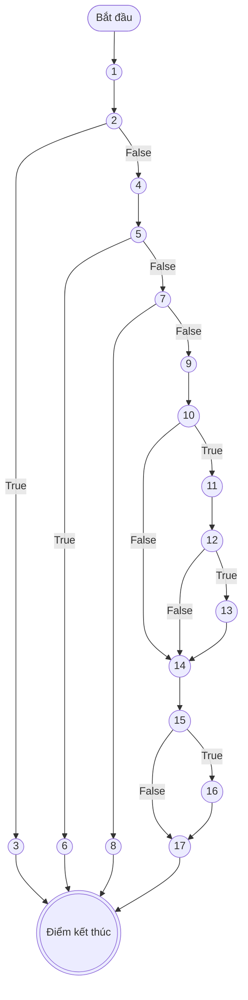
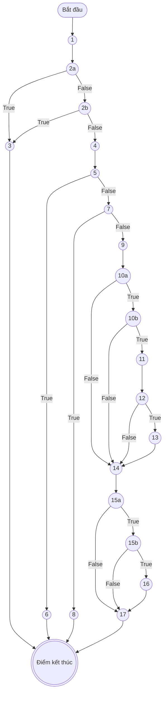
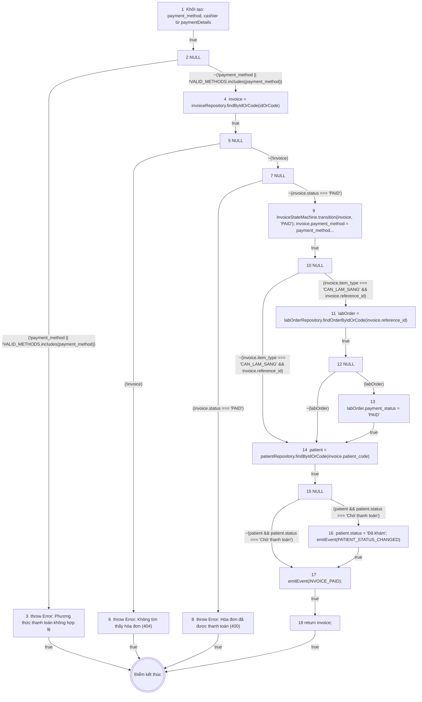
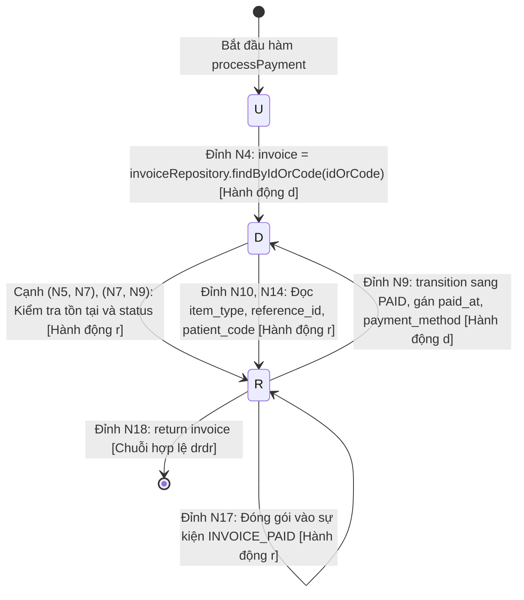

# KẾ HOẠCH & BÁO CÁO KIỂM THỬ HỘP TRẮNG (WHITE-BOX TESTING REPORT)
## CHỨC NĂNG: THANH TOÁN HÓA ĐƠN VIỆN PHÍ (HỆ THỐNG HIS-HOSPITAL)

**Người thực hiện:** Senior QA / White-Box Test Engineer (5 năm kinh nghiệm)  
**Phạm vi kiểm thử:** Chức năng Thanh toán hóa đơn viện phí (`processPayment` kết hợp kiểm tra phương thức thanh toán của `PaymentMethodValidatorStrategy.validate`, chuyển trạng thái `InvoiceStateMachine.transition`, đồng bộ trạng thái cận lâm sàng và bệnh nhân)  
**Tập tin mã nguồn kiểm thử:** 
- [`backend/src/services/invoiceService.js`](file:///d:/KiemThuVaDamBaoChatLuongPhanMem/his-hospital/backend/src/services/invoiceService.js#L349-L403) (`processPayment`)
- [`backend/src/patterns/strategy/billingStrategy.js`](file:///d:/KiemThuVaDamBaoChatLuongPhanMem/his-hospital/backend/src/patterns/strategy/billingStrategy.js#L49-L58) (`PaymentMethodValidatorStrategy.validate`)
- [`backend/src/patterns/state/invoiceState.js`](file:///d:/KiemThuVaDamBaoChatLuongPhanMem/his-hospital/backend/src/patterns/state/invoiceState.js#L23-L44) (`InvoiceStateMachine.transition`)

**Tài liệu tham chiếu chuẩn:** [`Kiem_Thu_Hop_Trang_Control_Data_Flow.md`](file:///d:/KiemThuVaDamBaoChatLuongPhanMem/his-hospital/Kiem_Thu_Hop_Trang_Control_Data_Flow.md) & [`Kiem_Thu_Hop_Trang_LapHoaDonVienPhi.md`](file:///d:/KiemThuVaDamBaoChatLuongPhanMem/his-hospital/Kiem_Thu_Hop_Trang_LapHoaDonVienPhi.md) (Dựa trên tài liệu đào tạo kiểm thử phần mềm `D:\Dowload\Cac ky thuat kiem thu phan mem 16-9-25.docx`).

---

## MỤC LỤC
- [KẾ HOẠCH \& BÁO CÁO KIỂM THỬ HỘP TRẮNG (WHITE-BOX TESTING REPORT)](#kế-hoạch--báo-cáo-kiểm-thử-hộp-trắng-white-box-testing-report)
  - [CHỨC NĂNG: THANH TOÁN HÓA ĐƠN VIỆN PHÍ (HỆ THỐNG HIS-HOSPITAL)](#chức-năng-thanh-toán-hóa-đơn-viện-phí-hệ-thống-his-hospital)
  - [MỤC LỤC](#mục-lục)
  - [1. TỔNG QUAN NGHIỆP VỤ \& QUY TẮC NGHIỆP VỤ](#1-tổng-quan-nghiệp-vụ--quy-tắc-nghiệp-vụ)
  - [2. ĐÁNH SỐ DÒNG MÃ NGUỒN CHUẨN THUẬT TOÁN (CHỈ ĐÁNH SỐ CÂU LỆNH THỰC THI)](#2-đánh-số-dòng-mã-nguồn-chuẩn-thuật-toán-chỉ-đánh-số-câu-lệnh-thực-thi)
  - [3. PHẦN I: KIỂM THỬ DÒNG ĐIỀU KHIỂN (CONTROL FLOW TESTING)](#3-phần-i-kiểm-thử-dòng-điều-khiển-control-flow-testing)
    - [3.1 Đồ thị dòng điều khiển CFG cho Độ đo C1 và C2](#31-đồ-thị-dòng-điều-khiển-cfg-cho-độ-đo-c1-và-c2)
    - [3.2 Phân tích độ phức tạp Cyclomatic $V(G)$ cho C1/C2](#32-phân-tích-độ-phức-tạp-cyclomatic-vg-cho-c1c2)
    - [3.3 Thiết kế ca kiểm thử cho Độ đo C1 (Statement Coverage)](#33-thiết-kế-ca-kiểm-thử-cho-độ-đo-c1-statement-coverage)
    - [3.4 Thiết kế ca kiểm thử cho Độ đo C2 (Branch / Decision Coverage)](#34-thiết-kế-ca-kiểm-thử-cho-độ-đo-c2-branch--decision-coverage)
      - [Bảng tổng hợp ca kiểm thử đạt 100% C2:](#bảng-tổng-hợp-ca-kiểm-thử-đạt-100-c2)
    - [3.5 Đồ thị dòng điều khiển CFG riêng cho Độ đo C3 (Multiple Condition Coverage)](#35-đồ-thị-dòng-điều-khiển-cfg-riêng-cho-độ-đo-c3-multiple-condition-coverage)
    - [3.6 Bảng phân tích điều kiện con và Thiết kế ca kiểm thử đạt 100% C3](#36-bảng-phân-tích-điều-kiện-con-và-thiết-kế-ca-kiểm-thử-đạt-100-c3)
      - [Bảng trạng thái chân lý của các điều kiện con:](#bảng-trạng-thái-chân-lý-của-các-điều-kiện-con)
      - [Bảng chi tiết bộ ca kiểm thử đạt 100% C3:](#bảng-chi-tiết-bộ-ca-kiểm-thử-đạt-100-c3)
  - [4. PHẦN II: KIỂM THỬ DÒNG DỮ LIỆU (DATA FLOW TESTING)](#4-phần-ii-kiểm-thử-dòng-dữ-liệu-data-flow-testing)
    - [4.1 Cơ sở lý thuyết đồ thị dòng dữ liệu (DFG - Data Flow Graph)](#41-cơ-sở-lý-thuyết-đồ-thị-dòng-dữ-liệu-dfg---data-flow-graph)
    - [4.2 Bảng 1: Bảng mô tả `def(i)` và `c-use(i)` tại các đỉnh](#42-bảng-1-bảng-mô-tả-defi-và-c-usei-tại-các-đỉnh)
    - [4.3 Bảng 2: Các điều kiện và `p-use` của các cạnh](#43-bảng-2-các-điều-kiện-và-p-use-của-các-cạnh)
    - [4.4 Đồ thị dòng dữ liệu (DFG - Data Flow Graph)](#44-đồ-thị-dòng-dữ-liệu-dfg---data-flow-graph)
    - [4.5 Bảng tổng hợp chi tiết Def-Use theo biến (All Variables Mapping)](#45-bảng-tổng-hợp-chi-tiết-def-use-theo-biến-all-variables-mapping)
    - [4.6 Phân tích bất thường dòng dữ liệu (Anomalies Loại 1 `dd`, Loại 2 `ur`, Loại 3 `du`)](#46-phân-tích-bất-thường-dòng-dữ-liệu-anomalies-loại-1-dd-loại-2-ur-loại-3-du)
    - [4.7 Sơ đồ chuyển trạng thái U-D-R-A cho biến cốt lõi `invoice`](#47-sơ-đồ-chuyển-trạng-thái-u-d-r-a-cho-biến-cốt-lõi-invoice)
    - [4.8 Sinh đường đi và Ca kiểm thử ứng với Độ đo All c-use](#48-sinh-đường-đi-và-ca-kiểm-thử-ứng-với-độ-đo-all-c-use)
      - [1. Định nghĩa độ đo All c-use (Tất cả các sử dụng tính toán):](#1-định-nghĩa-độ-đo-all-c-use-tất-cả-các-sử-dụng-tính-toán)
      - [2. Bảng sinh đường đi cho độ đo All c-use:](#2-bảng-sinh-đường-đi-cho-độ-đo-all-c-use)
      - [3. Bảng thiết kế các ca kiểm thử đạt 100% độ đo All c-use:](#3-bảng-thiết-kế-các-ca-kiểm-thử-đạt-100-độ-đo-all-c-use)
    - [4.9 Sinh đường đi và Ca kiểm thử ứng với Độ đo All p-use](#49-sinh-đường-đi-và-ca-kiểm-thử-ứng-với-độ-đo-all-p-use)
      - [1. Định nghĩa độ đo All p-use (Tất cả các sử dụng vị từ / rẽ nhánh):](#1-định-nghĩa-độ-đo-all-p-use-tất-cả-các-sử-dụng-vị-từ--rẽ-nhánh)
      - [2. Bảng sinh đường đi cho độ đo All p-use:](#2-bảng-sinh-đường-đi-cho-độ-đo-all-p-use)
      - [3. Bảng thiết kế các ca kiểm thử đạt 100% độ đo All p-use:](#3-bảng-thiết-kế-các-ca-kiểm-thử-đạt-100-độ-đo-all-p-use)
    - [4.10 Bảng so sánh mức độ bao phủ giữa All c-use và All p-use](#410-bảng-so-sánh-mức-độ-bao-phủ-giữa-all-c-use-và-all-p-use)
  - [5. KỊCH BẢN THỰC THI KIỂM THỬ TỰ ĐỘNG (AUTOMATED TEST SUITE)](#5-kịch-bản-thực-thi-kiểm-thử-tự-động-automated-test-suite)
  - [6. TỔNG KẾT \& KHUYẾN NGHỊ TỐI ƯU](#6-tổng-kết--khuyến-nghị-tối-ưu)

---

## 1. TỔNG QUAN NGHIỆP VỤ & QUY TẮC NGHIỆP VỤ

Chức năng **Thanh toán hóa đơn viện phí** tiếp nhận yêu cầu thanh toán hóa đơn từ thu ngân (hoặc người bệnh qua quét QR/thẻ/chuyển khoản) và cập nhật trạng thái hóa đơn, lệnh cận lâm sàng (nếu có), trạng thái bệnh nhân, đồng thời phát tán sự kiện thông báo cho toàn hệ thống.

Quy trình nghiệp vụ bao gồm:
1. **Tiếp nhận tham số & Xác thực phương thức thanh toán:**
   - Tiếp nhận `idOrCode` và `paymentDetails` (bao gồm `payment_method` mặc định `"TIEN_MAT"`, `cashier` mặc định `"Trần Văn Thu Ngân"`).
   - Kiểm tra phương thức thanh toán: Bắt buộc thuộc danh sách hỗ trợ: `["TIEN_MAT", "VIETQR", "THE", "CHUYEN_KHOAN"]`. Nếu không hợp lệ $\rightarrow$ Ném ngoại lệ lỗi nghiệp vụ.
2. **Kiểm tra tồn tại của hóa đơn:**
   - Tìm kiếm hóa đơn theo `idOrCode`. Nếu không tìm thấy $\rightarrow$ Báo lỗi HTTP 404 (*"Không tìm thấy hóa đơn"*).
3. **Kiểm tra trạng thái thanh toán của hóa đơn:**
   - Nếu hóa đơn đã ở trạng thái `PAID` $\rightarrow$ Báo lỗi HTTP 400 (*"Hóa đơn này đã được thanh toán trước đó"*).
4. **Chuyển đổi trạng thái hóa đơn:**
   - Sử dụng `InvoiceStateMachine.transition(invoice, "PAID")` để kiểm tra và chuyển trạng thái an toàn từ `UNPAID` sang `PAID`.
   - Cập nhật thông tin thanh toán: `payment_method`, thời gian thanh toán `paid_at`, thu ngân `cashier`.
5. **Đồng bộ hóa trạng thái cận lâm sàng (nếu hóa đơn là dịch vụ CLS):**
   - Nếu `invoice.item_type === "CAN_LAM_SANG"` và có `reference_id`: Tìm kiếm phiếu chỉ định CLS tương ứng.
   - Nếu tìm thấy: Cập nhật `labOrder.payment_status = "PAID"`.
6. **Đồng bộ hóa trạng thái người bệnh (Workflow Bệnh viện):**
   - Tìm thông tin bệnh nhân theo `invoice.patient_code`.
   - Nếu bệnh nhân đang ở trạng thái `"Chờ thanh toán"` $\rightarrow$ Cập nhật thành `"Đã khám"` và phát sự kiện `PATIENT_STATUS_CHANGED`.
7. **Phát sự kiện & Hoàn tất:**
   - Phát sự kiện phân tán `INVOICE_PAID` kèm chi tiết hóa đơn, mã bệnh nhân và thông điệp thanh toán.
   - Trả về đối tượng `invoice` đã cập nhật.

---

## 2. ĐÁNH SỐ DÒNG MÃ NGUỒN CHUẨN THUẬT TOÁN (CHỈ ĐÁNH SỐ CÂU LỆNH THỰC THI)

> **Quy chuẩn đánh số:** Tuyệt đối **không đánh số dòng comment** và **không đánh số dòng trống**. Chỉ đánh số các câu lệnh gán, khai báo, điều kiện quyết định, quăng lỗi hoặc gọi hàm thực thi.

```javascript
function executeProcessPayment(idOrCode, paymentDetails) {

1.  const { payment_method = "TIEN_MAT", cashier = "Trần Văn Thu Ngân" } = paymentDetails || {};

2.  if (!payment_method || !VALID_METHODS.includes(payment_method))

3.      throw new Error("Phương thức thanh toán không hợp lệ (hỗ trợ: TIEN_MAT, VIETQR, THE, CHUYEN_KHOAN)");

4.  const invoice = invoiceRepository.findByIdOrCode(idOrCode);

5.  if (!invoice)

6.      throw Object.assign(new Error("Không tìm thấy hóa đơn"), { statusCode: 404 });

7.  if (invoice.status === "PAID")

8.      throw Object.assign(new Error("Hóa đơn này đã được thanh toán trước đó"), { statusCode: 400 });

9.  InvoiceStateMachine.transition(invoice, "PAID");
    invoice.payment_method = payment_method;
    invoice.paid_at = dayjs().format("DD/MM/YYYY HH:mm");
    invoice.cashier = cashier;

10. if (invoice.item_type === "CAN_LAM_SANG" && invoice.reference_id)

11.     const labOrder = labOrderRepository.findOrderByIdOrCode(invoice.reference_id);

12.     if (labOrder)

13.         labOrder.payment_status = "PAID";

14. const patient = patientRepository.findByIdOrCode(invoice.patient_code);

15. if (patient && patient.status === "Chờ thanh toán")

16.     patient.status = "Đã khám";
        eventBus.emitEvent("PATIENT_STATUS_CHANGED", { patient_code: patient.patient_code, status: "Đã khám", message: `Bệnh nhân [${patient.name}] đã hoàn tất thanh toán viện phí.` });

17. eventBus.emitEvent("INVOICE_PAID", { invoice, patient_code: invoice.patient_code, message: `Hóa đơn [${invoice.invoice_code}] đã được thanh toán thành công qua [${payment_method}] bởi ${cashier}` });

18. return invoice;

}
```

---

## 3. PHẦN I: KIỂM THỬ DÒNG ĐIỀU KHIỂN (CONTROL FLOW TESTING)

### 3.1 Đồ thị dòng điều khiển CFG cho Độ đo C1 và C2

Trong đồ thị C1/C2, mỗi cấu trúc rẽ nhánh `if` được xem như **một điểm quyết định đơn nhất** (xét giá trị chân lý toàn cục của biểu thức True hoặc False):
- **Đỉnh 1:** Khởi tạo và bóc tách `paymentDetails`.
- **Đỉnh 2:** Điểm quyết định kiểm tra phương thức thanh toán: `(!payment_method || !VALID_METHODS.includes(payment_method))`.
- **Đỉnh 3:** Quăng ngoại lệ phương thức thanh toán không hợp lệ $\rightarrow$ Kết thúc sớm lỗi 1.
- **Đỉnh 4:** Khối gọi hàm tìm hóa đơn: `const invoice = invoiceRepository.findByIdOrCode(idOrCode)`.
- **Đỉnh 5:** Điểm quyết định kiểm tra tồn tại hóa đơn: `(!invoice)`.
- **Đỉnh 6:** Quăng ngoại lệ không tìm thấy hóa đơn (HTTP 404) $\rightarrow$ Kết thúc sớm lỗi 2.
- **Đỉnh 7:** Điểm quyết định kiểm tra hóa đơn đã thanh toán: `(invoice.status === "PAID")`.
- **Đỉnh 8:** Quăng ngoại lệ hóa đơn đã thanh toán trước đó (HTTP 400) $\rightarrow$ Kết thúc sớm lỗi 3.
- **Đỉnh 9:** Khối chuyển trạng thái hóa đơn sang `PAID` và cập nhật thông tin (`paid_at`, `payment_method`, `cashier`).
- **Đỉnh 10:** Điểm quyết định kiểm tra dịch vụ cận lâm sàng: `(invoice.item_type === "CAN_LAM_SANG" && invoice.reference_id)`.
- **Đỉnh 11:** Khối tìm phiếu chỉ định CLS: `const labOrder = labOrderRepository.findOrderByIdOrCode(invoice.reference_id)`.
- **Đỉnh 12:** Điểm quyết định kiểm tra tìm thấy phiếu chỉ định CLS: `(labOrder)`.
- **Đỉnh 13:** Khối cập nhật `labOrder.payment_status = "PAID"`.
- **Đỉnh 14:** Khối tìm kiếm hồ sơ bệnh nhân: `const patient = patientRepository.findByIdOrCode(invoice.patient_code)`.
- **Đỉnh 15:** Điểm quyết định kiểm tra trạng thái bệnh nhân: `(patient && patient.status === "Chờ thanh toán")`.
- **Đỉnh 16:** Khối cập nhật trạng thái bệnh nhân thành `"Đã khám"` và phát sự kiện `PATIENT_STATUS_CHANGED`.
- **Đỉnh 17-18:** Khối phát sự kiện `INVOICE_PAID` và `return invoice` $\rightarrow$ Kết thúc thành công.
- **Đỉnh Exit (Kết thúc):** Điểm kết thúc của hàm (hội tụ cả các nhánh kết thúc sớm do ném ngoại lệ và nhánh trả về thành công).



---

### 3.2 Phân tích độ phức tạp Cyclomatic $V(G)$ cho C1/C2

Trên đồ thị C1/C2:
- Số đỉnh: $N = 18$ (trong đó 17_18 gom cụm câu lệnh kết thúc).
- Số cạnh: $E = 23$.
- Số điểm quyết định đơn: $P = 6$ (tại các đỉnh 2, 5, 7, 10, 12, 15).
- Công thức McCabe:
  $$V(G) = P + 1 = 6 + 1 = 7$$
  *(Hoặc $V(G) = E - N + 2 = 23 - 18 + 2 = 7$)*

$\Rightarrow$ Cần tối thiểu **7 đường đi cơ sở (Basis Paths)** để bao phủ toàn bộ luồng rẽ nhánh của đồ thị C1/C2.

---

### 3.3 Thiết kế ca kiểm thử cho Độ đo C1 (Statement Coverage)

Mục tiêu C1: Thực thi qua tất cả các câu lệnh từ câu lệnh 1 đến câu lệnh 18 ít nhất một lần.  
Tập hợp các ca kiểm thử đạt 100% C1 cần kích hoạt:
- 3 nhánh lỗi `throw`: câu lệnh 3, 6, 8.
- Nhánh xử lý thành công không có CLS và không đổi trạng thái bệnh nhân.
- Nhánh xử lý thành công có CLS (câu lệnh 11, 13) và có đổi trạng thái bệnh nhân (câu lệnh 16).

| TT | Mã TC | Đường đi kiểm thử | Bộ dữ liệu đầu vào | Kết quả mong đợi | Câu lệnh được phủ |
| :---: | :---: | :--- | :--- | :--- | :--- |
| 1 | **TC_PAY_C1_01** | $1 \rightarrow 2 \rightarrow 3$ | `idOrCode: 1`, `paymentDetails: { payment_method: "BITCOIN" }` | Lỗi: *"Phương thức thanh toán không hợp lệ..."* | 1, 2, 3 |
| 2 | **TC_PAY_C1_02** | $1 \rightarrow 2 \rightarrow 4 \rightarrow 5 \rightarrow 6$ | `idOrCode: 9999` *(hóa đơn không tồn tại)*, `paymentDetails: { payment_method: "TIEN_MAT" }` | Lỗi HTTP 404: *"Không tìm thấy hóa đơn"* | 4, 5, 6 |
| 3 | **TC_PAY_C1_03** | $1 \rightarrow 2 \rightarrow 4 \rightarrow 5 \rightarrow 7 \rightarrow 8$ | `idOrCode: "HD000001"` *(hóa đơn đã có status = "PAID")*, `paymentDetails: { payment_method: "TIEN_MAT" }` | Lỗi HTTP 400: *"Hóa đơn này đã được thanh toán trước đó"* | 7, 8 |
| 4 | **TC_PAY_C1_04** | $1 \rightarrow 2 \rightarrow 4 \rightarrow 5 \rightarrow 7 \rightarrow 9 \rightarrow 10 \rightarrow 14 \rightarrow 15 \rightarrow 17 \rightarrow 18$ | `idOrCode: "HD000002"` *(status = "UNPAID", item_type = "TIEN_KHAM", BN trạng thái "Đang khám")*, `paymentDetails: { payment_method: "TIEN_MAT" }` | Thành công: `invoice.status = "PAID"`, không gọi CLS, không đổi trạng thái BN | 9, 10, 14, 15, 17, 18 |
| 5 | **TC_PAY_C1_05** | $1 \rightarrow 2 \rightarrow 4 \rightarrow 5 \rightarrow 7 \rightarrow 9 \rightarrow 10 \rightarrow 11 \rightarrow 12 \rightarrow 13 \rightarrow 14 \rightarrow 15 \rightarrow 16 \rightarrow 17 \rightarrow 18$ | `idOrCode: "HD000003"` *(status = "UNPAID", item_type = "CAN_LAM_SANG", reference_id = "CLS001" tồn tại, BN trạng thái "Chờ thanh toán")*, `paymentDetails: { payment_method: "VIETQR" }` | Thành công: `invoice.status = "PAID"`, `labOrder.payment_status = "PAID"`, `patient.status = "Đã khám"` | 11, 12, 13, 16 |

> **Tỷ lệ bao phủ C1:** $\mathbf{18 / 18}$ câu lệnh = **100%**.

---

### 3.4 Thiết kế ca kiểm thử cho Độ đo C2 (Branch / Decision Coverage)

Mục tiêu C2: Mọi điểm quyết định tại các đỉnh 2, 5, 7, 10, 12, 15 đều phải được thực thi ở cả hai nhánh **ĐÚNG (True)** và **SAI (False)**.

| Điểm quyết định | Biểu thức điều kiện | Nhánh ĐÚNG (True) | Nhánh SAI (False) |
| :---: | :--- | :---: | :---: |
| **Đỉnh 2** | `!payment_method \|\| !VALID_METHODS.includes(payment_method)` | **TC_PAY_C2_01** (Đi sang Đỉnh 3) | **TC_PAY_C2_02** (Đi tiếp Đỉnh 4) |
| **Đỉnh 5** | `!invoice` | **TC_PAY_C2_03** (Đi sang Đỉnh 6) | **TC_PAY_C2_04** (Đi tiếp Đỉnh 7) |
| **Đỉnh 7** | `invoice.status === "PAID"` | **TC_PAY_C2_05** (Đi sang Đỉnh 8) | **TC_PAY_C2_06** (Đi tiếp Đỉnh 9) |
| **Đỉnh 10** | `invoice.item_type === "CAN_LAM_SANG" && invoice.reference_id` | **TC_PAY_C2_07** (Đi sang Đỉnh 11) | **TC_PAY_C2_08** (Bỏ qua sang Đỉnh 14) |
| **Đỉnh 12** | `labOrder` (tồn tại phiếu chỉ định) | **TC_PAY_C2_09** (Đi sang Đỉnh 13) | **TC_PAY_C2_10** (Bỏ qua sang Đỉnh 14) |
| **Đỉnh 15** | `patient && patient.status === "Chờ thanh toán"` | **TC_PAY_C2_11** (Đi sang Đỉnh 16) | **TC_PAY_C2_12** (Bỏ qua sang Đỉnh 17) |

#### Bảng tổng hợp ca kiểm thử đạt 100% C2:

| Mã TC | Điểm QĐ phủ | Bộ dữ liệu đầu vào | Kết quả mong đợi |
| :---: | :--- | :--- | :--- |
| **TC_PAY_C2_01** | Đỉnh 2 (True) | `idOrCode: 1`, `paymentDetails: { payment_method: "PAYPAL" }` | Quăng lỗi: Phương thức thanh toán không hợp lệ |
| **TC_PAY_C2_02** | Đỉnh 2 (False), Đỉnh 5 (False), Đỉnh 7 (False), Đỉnh 10 (False), Đỉnh 15 (False) | `idOrCode: "HD01"`, `{ payment_method: "TIEN_MAT" }` (Hóa đơn khám, BN có `status = "Đang khám"`) | Thanh toán thành công, hóa đơn chuyển `PAID` |
| **TC_PAY_C2_03** | Đỉnh 5 (True) | `idOrCode: "HD_KHONG_TON_TAI"`, `{ payment_method: "TIEN_MAT" }` | Quăng lỗi HTTP 404: Không tìm thấy hóa đơn |
| **TC_PAY_C2_05** | Đỉnh 7 (True) | `idOrCode: "HD_DA_THANH_TOAN"` (`status = "PAID"`), `{ payment_method: "TIEN_MAT" }` | Quăng lỗi HTTP 400: Hóa đơn đã được thanh toán trước đó |
| **TC_PAY_C2_07** | Đỉnh 10 (True), Đỉnh 12 (True) | `idOrCode: "HD_CLS_01"` (`item_type = "CAN_LAM_SANG"`, `reference_id = "CLS01"` có tồn tại trong DB), `{ payment_method: "VIETQR" }` | Thanh toán thành công, `labOrder.payment_status = "PAID"` |
| **TC_PAY_C2_10** | Đỉnh 10 (True), Đỉnh 12 (False) | `idOrCode: "HD_CLS_02"` (`item_type = "CAN_LAM_SANG"`, `reference_id = "CLS_AO"` không tồn tại trong DB) | Thanh toán thành công hóa đơn, bỏ qua cập nhật phiếu CLS |
| **TC_PAY_C2_11** | Đỉnh 15 (True) | `idOrCode: "HD_BN_CHO"` (Hóa đơn hợp lệ của BN có `status = "Chờ thanh toán"`), `{ payment_method: "THE" }` | Thanh toán thành công, `patient.status = "Đã khám"`, phát `PATIENT_STATUS_CHANGED` |

> **Tỷ lệ bao phủ C2:** $\mathbf{12 / 12}$ nhánh quyết định = **100%**.

---

### 3.5 Đồ thị dòng điều khiển CFG riêng cho Độ đo C3 (Multiple Condition Coverage)

Tại độ đo C3, các biểu thức điều kiện phức hợp được tách nhỏ thành **từng điều kiện con độc lập** để kiểm soát cơ chế ngắn mạch (short-circuit evaluation):
- **Điểm quyết định 2** gồm 2 điều kiện con:
  - (2a): `!payment_method`
  - (2b): `!VALID_METHODS.includes(payment_method)`
- **Điểm quyết định 10** gồm 2 điều kiện con:
  - (10a): `invoice.item_type === "CAN_LAM_SANG"`
  - (10b): `Boolean(invoice.reference_id)`
- **Điểm quyết định 15** gồm 2 điều kiện con:
  - (15a): `Boolean(patient)`
  - (15b): `patient.status === "Chờ thanh toán"`



---

### 3.6 Bảng phân tích điều kiện con và Thiết kế ca kiểm thử đạt 100% C3

#### Bảng trạng thái chân lý của các điều kiện con:

| Điểm QĐ | Điều kiện con | Biến cố kiểm tra | Trạng thái cần đạt | Ca kiểm thử phủ |
| :---: | :--- | :--- | :---: | :---: |
| **2** | $2a: !\text{payment\_method}$ | `payment_method = ""` hoặc `null` | **True** / **False** | TC_PAY_C3_01 (True) / TC_PAY_C3_02 (False) |
| **2** | $2b: !\text{VALID\_METHODS.includes}(...)$ | `payment_method = "MOMO"` | **True** / **False** | TC_PAY_C3_02 (True) / TC_PAY_C3_03 (False) |
| **5** | $5: !\text{invoice}$ | `invoice` không tồn tại | **True** / **False** | TC_PAY_C3_04 (True) / TC_PAY_C3_05 (False) |
| **7** | $7: \text{invoice.status} === \text{"PAID"}$ | `status = "PAID"` | **True** / **False** | TC_PAY_C3_06 (True) / TC_PAY_C3_07 (False) |
| **10** | $10a: \text{invoice.item\_type} === \text{"CAN\_LAM\_SANG"}$ | `item_type = "TIEN_THUOC"` vs `"CAN_LAM_SANG"` | **False** / **True** | TC_PAY_C3_07 (False) / TC_PAY_C3_08 (True) |
| **10** | $10b: \text{Boolean}(\text{invoice.reference\_id})$ | `reference_id = null` vs `"CLS01"` | **False** / **True** | TC_PAY_C3_08 (False) / TC_PAY_C3_09 (True) |
| **12** | $12: \text{Boolean}(labOrder)$ | Phiếu CLS có trong DB vs không có | **False** / **True** | TC_PAY_C3_10 (False) / TC_PAY_C3_09 (True) |
| **15** | $15a: \text{Boolean}(patient)$ | Bệnh nhân không tồn tại vs có tồn tại | **False** / **True** | TC_PAY_C3_11 (False) / TC_PAY_C3_12 (True) |
| **15** | $15b: \text{patient.status} === \text{"Chờ thanh toán"}$ | `status = "Đang khám"` vs `"Chờ thanh toán"` | **False** / **True** | TC_PAY_C3_12 (False) / TC_PAY_C3_13 (True) |

#### Bảng chi tiết bộ ca kiểm thử đạt 100% C3:

| Mã TC | Điều kiện con kích hoạt | Dữ liệu đầu vào (`idOrCode`, `paymentDetails`) | Trạng thái Mock DB | Kết quả mong đợi |
| :---: | :--- | :--- | :--- | :--- |
| **TC_PAY_C3_01** | $2a = \text{True}$ | `id: 1`, `{ payment_method: null }` | Bất kỳ | Quăng lỗi: Phương thức thanh toán không hợp lệ |
| **TC_PAY_C3_02** | $2a = \text{F}, 2b = \text{True}$ | `id: 1`, `{ payment_method: "TIEN_AO" }` | Bất kỳ | Quăng lỗi: Phương thức thanh toán không hợp lệ |
| **TC_PAY_C3_04** | $2 = \text{F}, 5 = \text{True}$ | `id: "HD_999"`, `{ payment_method: "TIEN_MAT" }` | Không có hóa đơn | Quăng lỗi HTTP 404: Không tìm thấy hóa đơn |
| **TC_PAY_C3_06** | $5 = \text{F}, 7 = \text{True}$ | `id: "HD_01"`, `{ payment_method: "TIEN_MAT" }` | `invoice.status = "PAID"` | Quăng lỗi HTTP 400: Hóa đơn đã thanh toán trước đó |
| **TC_PAY_C3_07** | $7 = \text{F}, 10a = \text{False}$ | `id: "HD_02"`, `{ payment_method: "TIEN_MAT" }` | Hóa đơn `item_type = "TIEN_KHAM"` | Không gọi CLS, chuyển sang kiểm tra BN |
| **TC_PAY_C3_08** | $10a = \text{True}, 10b = \text{False}$ | `id: "HD_03"`, `{ payment_method: "TIEN_MAT" }` | Hóa đơn `item_type = "CAN_LAM_SANG"`, `reference_id = null` | Bỏ qua tìm CLS |
| **TC_PAY_C3_09** | $10a = \text{T}, 10b = \text{T}, 12 = \text{True}$ | `id: "HD_04"`, `{ payment_method: "VIETQR" }` | Hóa đơn CLS có `reference_id = "CLS01"`, có `labOrder` | `labOrder.payment_status = "PAID"` |
| **TC_PAY_C3_10** | $10a = \text{T}, 10b = \text{T}, 12 = \text{False}$ | `id: "HD_05"`, `{ payment_method: "VIETQR" }` | Hóa đơn CLS có `reference_id = "CLS_AO"`, không thấy `labOrder` | Bỏ qua cập nhật CLS |
| **TC_PAY_C3_11** | $15a = \text{False}$ | `id: "HD_06"`, `{ payment_method: "THE" }` | `patientRepository` trả về `null` | Không quăng lỗi, bỏ qua đổi trạng thái BN |
| **TC_PAY_C3_12** | $15a = \text{True}, 15b = \text{False}$ | `id: "HD_07"`, `{ payment_method: "CHUYEN_KHOAN" }` | BN có trạng thái `"Đang khám"` | Giữ nguyên trạng thái BN, không phát `PATIENT_STATUS_CHANGED` |
| **TC_PAY_C3_13** | $15a = \text{True}, 15b = \text{True}$ | `id: "HD_08"`, `{ payment_method: "CHUYEN_KHOAN" }` | BN có trạng thái `"Chờ thanh toán"` | `patient.status = "Đã khám"`, phát `PATIENT_STATUS_CHANGED` |

---

## 4. PHẦN II: KIỂM THỬ DÒNG DỮ LIỆU (DATA FLOW TESTING)

### 4.1 Cơ sở lý thuyết đồ thị dòng dữ liệu (DFG - Data Flow Graph)

Theo **Định nghĩa 6** trong tài liệu kiểm thử phần mềm chuẩn:
Đồ thị dòng dữ liệu của hàm `processPayment` là một đồ thị có hướng $G = \langle N, E \rangle$:
- **Tập đỉnh ($N$):** Tương ứng với các câu lệnh định nghĩa (`def`) hoặc sử dụng tính toán (`c-use`) của các biến.
- **Tập cạnh ($E$):** Tương ứng với các câu lệnh hoặc biểu thức sử dụng trong điều kiện rẽ nhánh (`p-use`) của các biến.

---

### 4.2 Bảng 1: Bảng mô tả `def(i)` và `c-use(i)` tại các đỉnh

| Đỉnh $i$ | $def(i)$ | $c\text{-}use(i)$ |
| :---: | :--- | :--- |
| **1** | {payment_method, cashier} | {paymentDetails} |
| **2** | {} | {} |
| **3** | {} | {} |
| **4** | {invoice} | {idOrCode} |
| **5** | {} | {} |
| **6** | {} | {} |
| **7** | {} | {} |
| **8** | {} | {} |
| **9** | {invoice.status, invoice.payment_method, invoice.paid_at, invoice.cashier} | {invoice, payment_method, cashier} |
| **10** | {} | {} |
| **11** | {labOrder} | {invoice.reference_id} |
| **12** | {} | {} |
| **13** | {labOrder.payment_status} | {} |
| **14** | {patient} | {invoice.patient_code} |
| **15** | {} | {} |
| **16** | {patient.status} | {patient} |
| **17** | {} | {invoice, payment_method, cashier} |
| **18** | {} | {invoice} |

---

### 4.3 Bảng 2: Các điều kiện và `p-use` của các cạnh

| $(i, j)$ | Điều kiện tại cạnh $(i, j)$ | $p\text{-}use(i, j)$ |
| :---: | :--- | :---: |
| **(1, 2)** | True | {} |
| **(2, 3)** | (!payment_method \|\| !VALID_METHODS.includes(payment_method)) | {payment_method} |
| **(2, 4)** | ~(!payment_method \|\| !VALID_METHODS.includes(payment_method)) | {payment_method} |
| **(4, 5)** | True | {} |
| **(5, 6)** | (!invoice) | {invoice} |
| **(5, 7)** | ~( !invoice) | {invoice} |
| **(7, 8)** | (invoice.status === 'PAID') | {invoice.status} |
| **(7, 9)** | ~(invoice.status === 'PAID') | {invoice.status} |
| **(9, 10)** | True | {} |
| **(10, 11)** | (invoice.item_type === 'CAN_LAM_SANG' && invoice.reference_id) | {invoice.item_type, invoice.reference_id} |
| **(10, 14)** | ~(invoice.item_type === 'CAN_LAM_SANG' && invoice.reference_id) | {invoice.item_type, invoice.reference_id} |
| **(11, 12)** | True | {} |
| **(12, 13)** | (labOrder) | {labOrder} |
| **(12, 14)** | ~(labOrder) | {labOrder} |
| **(13, 14)** | True | {} |
| **(14, 15)** | True | {} |
| **(15, 16)** | (patient && patient.status === 'Chờ thanh toán') | {patient, patient.status} |
| **(15, 17)** | ~(patient && patient.status === 'Chờ thanh toán') | {patient, patient.status} |
| **(16, 17)** | True | {} |
| **(17, 18)** | True | {} |

---

### 4.4 Đồ thị dòng dữ liệu (DFG - Data Flow Graph)

Dưới đây là **Đồ thị dòng dữ liệu của hàm `processPayment`** theo phong cách tài liệu kiểm thử mẫu:
- Các đỉnh xử lý/tính toán/khởi tạo chứa câu lệnh tương ứng.
- Các đỉnh rẽ nhánh kiểm tra điều kiện được gán nhãn **`NULL`**.
- Các cạnh chuyển tiếp mang nhãn **biểu thức điều kiện**, **phủ định `~(...)`** hoặc **`true`**.



---

### 4.5 Bảng tổng hợp chi tiết Def-Use theo biến (All Variables Mapping)

| Tên biến | Điểm định nghĩa (`def`) | Điểm sử dụng tính toán (`c-use`) | Cạnh sử dụng trong điều kiện rẽ nhánh (`p-use`) |
| :--- | :--- | :--- | :--- |
| `idOrCode` | Tham số hàm ($N_1$) | $N_4$ (`findByIdOrCode(idOrCode)`) | - |
| `paymentDetails` | Tham số hàm ($N_1$) | $N_1$ (Bóc tách destructuring) | - |
| `payment_method` | $N_1$ | $N_9$ (`invoice.payment_method = payment_method`), $N_{17}$ (`emitEvent message`) | $(N_2, N_3)$, $(N_2, N_4)$ |
| `cashier` | $N_1$ | $N_9$ (`invoice.cashier = cashier`), $N_{17}$ (`emitEvent message`) | - |
| `invoice` | $N_4$ | $N_9$ (`transition`, gán thuộc tính), $N_{11}$ (`reference_id`), $N_{14}$ (`patient_code`), $N_{17}$ (`emitEvent`), $N_{18}$ (`return`) | $(N_5, N_6)$, $(N_5, N_7)$, $(N_7, N_8)$, $(N_7, N_9)$, $(N_{10}, N_{11})$, $(N_{10}, N_{14})$ |
| `labOrder` | $N_{11}$ | $N_{13}$ (`labOrder.payment_status = "PAID"`) | $(N_{12}, N_{13})$, $(N_{12}, N_{14})$ |
| `patient` | $N_{14}$ | $N_{16}$ (`patient.status = "Đã khám"`, `emitEvent`) | $(N_{15}, N_{16})$, $(N_{15}, N_{17})$ |

---

### 4.6 Phân tích bất thường dòng dữ liệu (Anomalies Loại 1 `dd`, Loại 2 `ur`, Loại 3 `du`)

1. **Bất thường Loại 1 (`dd` - Định nghĩa lại biến trước khi dùng):**
   - *Đánh giá:* **KHÔNG CÓ**. Các biến đối tượng và tham số `idOrCode`, `paymentDetails`, `invoice`, `labOrder`, `patient` đều được khởi tạo một lần dạng tham chiếu và chỉ thay đổi trạng thái các thuộc tính nội tại, không bị gán đè biến (`re-assignment`).
2. **Bất thường Loại 2 (`ur` - Sử dụng biến khi chưa định nghĩa):**
   - *Phòng vệ mã nguồn:*
     - `paymentDetails` có giá trị fallback `paymentDetails || {}` phòng ngừa gọi `processPayment(id)` mà không truyền tham số thứ hai.
     - `invoice.status` chỉ được truy cập sau khi đã vượt qua rào chắn kiểm tra `!invoice` tại $N_5$.
     - `labOrder.payment_status` chỉ được gán khi đã vượt qua rào chắn `labOrder` tại $N_{12}$.
     - `patient.status` chỉ được đọc khi đã kiểm tra tồn tại `patient` qua biểu thức ngắn mạch `patient && patient.status...` tại $N_{15}$.
3. **Bất thường Loại 3 (`du` - Định nghĩa biến nhưng không bao giờ dùng):**
   - *Đánh giá:* **KHÔNG CÓ**. Tất cả các biến được trích xuất hoặc khởi tạo (`payment_method`, `cashier`, `invoice`, `labOrder`, `patient`) đều được sử dụng trong việc cập nhật CSDL, kích hoạt máy trạng thái hoặc phát sự kiện EventBus.

---

### 4.7 Sơ đồ chuyển trạng thái U-D-R-A cho biến cốt lõi `invoice`



Chuỗi biến đổi trạng thái của `invoice` tuân thủ nghiêm ngặt chu trình $U \xrightarrow{d} D \xrightarrow{r} R \xrightarrow{d} D \xrightarrow{r} R$, hoàn toàn không gặp trạng thái bất thường $A$ (Anomaly).

---

### 4.8 Sinh đường đi và Ca kiểm thử ứng với Độ đo All c-use

#### 1. Định nghĩa độ đo All c-use (Tất cả các sử dụng tính toán):
- Với mỗi câu lệnh định nghĩa `def(v)` của biến $v$, bộ kiểm thử phải chứa ít nhất một đường đi **def-clear** từ điểm định nghĩa đó đến **mọi điểm sử dụng tính toán `c-use(v)`** của biến $v$.

#### 2. Bảng sinh đường đi cho độ đo All c-use:

| Tên biến | Điểm `def` | Điểm `c-use` | Đường đi kiểm thử hợp lệ (def-clear path) | Mục đích kiểm tra |
| :--- | :---: | :---: | :--- | :--- |
| `paymentDetails` | Tham số ($N_1$) | $N_1$ | $N_1$ | Trích xuất `payment_method` và `cashier`. |
| `idOrCode` | Tham số ($N_1$) | $N_4$ | $N_1 \rightarrow N_2 \rightarrow N_4$ | Truy vấn hóa đơn từ DB bằng mã hoặc ID. |
| `payment_method` | $N_1$ | $N_9$ | $N_1 \rightarrow N_4 \rightarrow N_9$ | Cập nhật `invoice.payment_method`. |
| `payment_method` | $N_1$ | $N_{17}$ | $N_1 \rightarrow N_4 \rightarrow N_9 \rightarrow N_{17}$ | Ghép chuỗi thông điệp trong `INVOICE_PAID`. |
| `cashier` | $N_1$ | $N_9$ | $N_1 \rightarrow N_4 \rightarrow N_9$ | Cập nhật `invoice.cashier`. |
| `cashier` | $N_1$ | $N_{17}$ | $N_1 \rightarrow N_4 \rightarrow N_9 \rightarrow N_{17}$ | Ghép chuỗi thông điệp trong `INVOICE_PAID`. |
| `invoice` | $N_4$ | $N_9$ | $N_4 \rightarrow N_9$ | Chuyển đổi trạng thái hóa đơn qua State Machine. |
| `invoice` | $N_4$ | $N_{11}$ | $N_4 \rightarrow N_9 \rightarrow N_{11}$ | Lấy `invoice.reference_id` để tìm CLS. |
| `invoice` | $N_4$ | $N_{14}$ | $N_4 \rightarrow N_9 \rightarrow N_{14}$ | Lấy `invoice.patient_code` để tìm người bệnh. |
| `invoice` | $N_4$ | $N_{17}$ | $N_4 \rightarrow N_9 \rightarrow N_{17}$ | Đính kèm `invoice` vào dữ liệu sự kiện EventBus. |
| `invoice` | $N_4$ | $N_{18}$ | $N_4 \rightarrow N_9 \rightarrow N_{17} \rightarrow N_{18}$ | Trả về `invoice` cho caller. |
| `labOrder` | $N_{11}$ | $N_{13}$ | $N_{11} \rightarrow N_{13}$ | Cập nhật `labOrder.payment_status = "PAID"`. |
| `patient` | $N_{14}$ | $N_{16}$ | $N_{14} \rightarrow N_{16}$ | Cập nhật `patient.status = "Đã khám"` và phát event. |

#### 3. Bảng thiết kế các ca kiểm thử đạt 100% độ đo All c-use:

| Mã TC | Biến & Cặp `def -> c-use` được phủ | Dữ liệu đầu vào (`idOrCode`, `paymentDetails`) | Trạng thái Mock Data | Kết quả mong đợi |
| :---: | :--- | :--- | :--- | :--- |
| **TC_PAY_CUSE_01** | `payment_method`, `cashier`, `invoice` ($N_4 \rightarrow N_9, N_{14}, N_{17}, N_{18}$), `patient` ($N_{14} \rightarrow N_{16}$) | `id: 101`, `{ payment_method: "TIEN_MAT", cashier: "Nguyễn Thu Ngân" }` | Hóa đơn khám bệnh, BN có `status = "Chờ thanh toán"` | Hóa đơn chuyển `PAID`, thu ngân được cập nhật, BN chuyển `Đã khám`, trả về `invoice`. |
| **TC_PAY_CUSE_02** | `invoice` ($N_4 \rightarrow N_{11}$), `labOrder` ($N_{11} \rightarrow N_{13}$) | `id: 102`, `{ payment_method: "VIETQR" }` | Hóa đơn CLS có `reference_id = "CLS_102"`, BN có `status = "Đã khám"` | `labOrder.payment_status = "PAID"`, hóa đơn chuyển `PAID`. |
| **TC_PAY_CUSE_03** | Fallback của `payment_method` & `cashier` ($N_1 \rightarrow N_9, N_{17}$) | `id: 103` *(không truyền paymentDetails)* | Hóa đơn hợp lệ | Dùng giá trị mặc định: `payment_method = "TIEN_MAT"`, `cashier = "Trần Văn Thu Ngân"`. |

---

### 4.9 Sinh đường đi và Ca kiểm thử ứng với Độ đo All p-use

#### 1. Định nghĩa độ đo All p-use (Tất cả các sử dụng vị từ / rẽ nhánh):
- Với mỗi câu lệnh định nghĩa `def(v)` của biến $v$, bộ kiểm thử phải chứa ít nhất một đường đi **def-clear** từ điểm định nghĩa đó đến **mọi cạnh sử dụng vị từ `p-use(v)`** của biến $v$.

#### 2. Bảng sinh đường đi cho độ đo All p-use:

| Tên biến | Điểm `def` | Cạnh `p-use` tương ứng | Đường đi kiểm thử hợp lệ (def-clear path) | Điều kiện kích hoạt cạnh |
| :--- | :---: | :---: | :--- | :--- |
| `payment_method` | $N_1$ | $(N_2, N_3)$ | $N_1 \rightarrow N_2 \rightarrow N_3$ | Phương thức rỗng hoặc không nằm trong danh mục hỗ trợ. |
| `payment_method` | $N_1$ | $(N_2, N_4)$ | $N_1 \rightarrow N_2 \rightarrow N_4$ | Phương thức hợp lệ (`TIEN_MAT`, `VIETQR`,...). |
| `invoice` | $N_4$ | $(N_5, N_6)$ | $N_4 \rightarrow N_5 \rightarrow N_6$ | Không tìm thấy hóa đơn (`invoice == null`). |
| `invoice` | $N_4$ | $(N_5, N_7)$ | $N_4 \rightarrow N_5 \rightarrow N_7$ | Tìm thấy hóa đơn. |
| `invoice` | $N_4$ | $(N_7, N_8)$ | $N_4 \rightarrow N_7 \rightarrow N_8$ | `invoice.status === "PAID"` (đã thanh toán). |
| `invoice` | $N_4$ | $(N_7, N_9)$ | $N_4 \rightarrow N_7 \rightarrow N_9$ | `invoice.status !== "PAID"` (chưa thanh toán). |
| `invoice` | $N_4$ | $(N_{10}, N_{11})$ | $N_4 \rightarrow N_9 \rightarrow N_{10} \rightarrow N_{11}$ | Hóa đơn là CLS và có `reference_id`. |
| `invoice` | $N_4$ | $(N_{10}, N_{14})$ | $N_4 \rightarrow N_9 \rightarrow N_{10} \rightarrow N_{14}$ | Hóa đơn không phải CLS hoặc thiếu `reference_id`. |
| `labOrder` | $N_{11}$ | $(N_{12}, N_{13})$ | $N_{11} \rightarrow N_{12} \rightarrow N_{13}$ | Tìm thấy phiếu chỉ định CLS trong DB. |
| `labOrder` | $N_{11}$ | $(N_{12}, N_{14})$ | $N_{11} \rightarrow N_{12} \rightarrow N_{14}$ | Không tìm thấy phiếu chỉ định CLS trong DB. |
| `patient` | $N_{14}$ | $(N_{15}, N_{16})$ | $N_{14} \rightarrow N_{15} \rightarrow N_{16}$ | Bệnh nhân tồn tại và có `status === "Chờ thanh toán"`. |
| `patient` | $N_{14}$ | $(N_{15}, N_{17})$ | $N_{14} \rightarrow N_{15} \rightarrow N_{17}$ | Bệnh nhân không tồn tại hoặc `status !== "Chờ thanh toán"`. |

#### 3. Bảng thiết kế các ca kiểm thử đạt 100% độ đo All p-use:

| Mã TC | Biến & Cạnh `p-use` được phủ | Dữ liệu đầu vào (`idOrCode`, `paymentDetails`) | Trạng thái Mock Data | Kết quả mong đợi |
| :---: | :--- | :--- | :--- | :--- |
| **TC_PAY_PUSE_01** | `payment_method` trên $(N_2, N_3)$ | `id: 1`, `{ payment_method: "VNPAY" }` | Bất kỳ | Quăng lỗi: Phương thức thanh toán không hợp lệ |
| **TC_PAY_PUSE_02** | `payment_method` trên $(N_2, N_4)$, `invoice` trên $(N_5, N_6)$ | `id: "HD_KHONG_CO"`, `{ payment_method: "TIEN_MAT" }` | Không có hóa đơn | Quăng lỗi HTTP 404: Không tìm thấy hóa đơn |
| **TC_PAY_PUSE_03** | `invoice` trên $(N_5, N_7)$ và $(N_7, N_8)$ | `id: "HD_DA_TRA"`, `{ payment_method: "TIEN_MAT" }` | `invoice.status = "PAID"` | Quăng lỗi HTTP 400: Hóa đơn này đã được thanh toán trước đó |
| **TC_PAY_PUSE_04** | `invoice` trên $(N_7, N_9)$ và $(N_{10}, N_{14})$, `patient` trên $(N_{15}, N_{17})$ | `id: "HD_TIEN_KHAM"`, `{ payment_method: "TIEN_MAT" }` | Hóa đơn khám, BN có `status = "Đã khám"` | Bỏ qua CLS, bỏ qua đổi trạng thái BN, hoàn tất thành công |
| **TC_PAY_PUSE_05** | `invoice` trên $(N_{10}, N_{11})$, `labOrder` trên $(N_{12}, N_{13})$ | `id: "HD_CLS_HOP_LE"`, `{ payment_method: "VIETQR" }` | Hóa đơn CLS có `reference_id = "CLS01"` có trong DB | `labOrder.payment_status = "PAID"` |
| **TC_PAY_PUSE_06** | `labOrder` trên $(N_{12}, N_{14})$ | `id: "HD_CLS_AO"`, `{ payment_method: "VIETQR" }` | Hóa đơn CLS có `reference_id = "CLS_AO"` không có trong DB | Bỏ qua gán `labOrder`, hoàn tất thành công |
| **TC_PAY_PUSE_07** | `patient` trên $(N_{15}, N_{16})$ | `id: "HD_CHO_TT"`, `{ payment_method: "THE" }` | BN có `status = "Chờ thanh toán"` | `patient.status = "Đã khám"`, phát `PATIENT_STATUS_CHANGED` |

---

### 4.10 Bảng so sánh mức độ bao phủ giữa All c-use và All p-use

| Tiêu chí | Độ đo All c-use (Tất cả tính toán) | Độ đo All p-use (Tất cả vị từ) |
| :--- | :--- | :--- |
| **Trọng tâm kiểm tra** | Tính toàn vẹn của dữ liệu từ khi nhận, qua cập nhật trạng thái hóa đơn, CLS, người bệnh cho đến khi phát tán sự kiện EventBus. | Mọi nhánh rẽ logic kiểm tra điều kiện của biến (`p-use`), đảm bảo không bỏ sót bất kỳ trường hợp biên nào. |
| **Số đường đi kiểm thử cơ sở** | 13 đường đi def-clear | 12 đường đi def-clear |
| **Số ca kiểm thử tối thiểu** | **3 ca kiểm thử** (TC_PAY_CUSE_01 đến TC_PAY_CUSE_03) | **7 ca kiểm thử** (TC_PAY_PUSE_01 đến TC_PAY_PUSE_07) |
| **Lỗi tiêu biểu phát hiện** | Lỗi không đồng bộ dữ liệu giữa các module (ví dụ: hóa đơn thanh toán nhưng CLS không đổi), lỗi thất thoát thông tin thu ngân. | Lỗi sai sót logic chuyển đổi trạng thái, lỗi không kiểm tra hóa đơn đã thanh toán gây trùng lặp giao dịch (Double Spending). |

---

## 5. KỊCH BẢN THỰC THI KIỂM THỬ TỰ ĐỘNG (AUTOMATED TEST SUITE)

Mã nguồn kiểm thử tự động sử dụng **Node.js Test Runner & Assert** (chạy trực tiếp bằng lệnh `node --test`):

```javascript
import assert from "node:assert/strict";
import { test, describe, beforeEach, afterEach } from "node:test";
import { invoiceService } from "./invoiceService.js";
import { invoiceRepository } from "../repositories/invoiceRepository.js";
import { labOrderRepository } from "../repositories/labOrderRepository.js";
import { patientRepository } from "../repositories/patientRepository.js";
import { eventBus } from "../events/eventBus.js";

describe("KIỂM THỬ HỘP TRẮNG: HÀM processPayment (HIS-HOSPITAL)", () => {
  let capturedEvents = [];
  let originalFindInvoice, originalFindLabOrder, originalFindPatient, originalEmit;

  beforeEach(() => {
    capturedEvents = [];
    originalFindInvoice = invoiceRepository.findByIdOrCode;
    originalFindLabOrder = labOrderRepository.findOrderByIdOrCode;
    originalFindPatient = patientRepository.findByIdOrCode;
    originalEmit = eventBus.emitEvent;

    eventBus.emitEvent = (event, data) => {
      capturedEvents.push({ event, data });
    };
  });

  afterEach(() => {
    invoiceRepository.findByIdOrCode = originalFindInvoice;
    labOrderRepository.findOrderByIdOrCode = originalFindLabOrder;
    patientRepository.findByIdOrCode = originalFindPatient;
    eventBus.emitEvent = originalEmit;
  });

  /* ---------------- PHẦN I: KIỂM THỬ DÒNG ĐIỀU KHIỂN (C1, C2, C3) ---------------- */

  test("TC_PAY_C3_01: Điều kiện con 2a (True) - Phương thức thanh toán bị rỗng", () => {
    assert.throws(
      () => invoiceService.processPayment(1, { payment_method: "" }),
      /Phương thức thanh toán không hợp lệ/
    );
  });

  test("TC_PAY_C3_02: Điều kiện con 2b (True) - Phương thức thanh toán không hỗ trợ", () => {
    assert.throws(
      () => invoiceService.processPayment(1, { payment_method: "BITCOIN" }),
      /Phương thức thanh toán không hợp lệ/
    );
  });

  test("TC_PAY_C3_04: Điểm quyết định 5 (True) - Không tìm thấy hóa đơn (404)", () => {
    invoiceRepository.findByIdOrCode = () => null;

    assert.throws(
      () => invoiceService.processPayment(9999, { payment_method: "TIEN_MAT" }),
      (err) => err.statusCode === 404 && err.message.includes("Không tìm thấy hóa đơn")
    );
  });

  test("TC_PAY_C3_06: Điểm quyết định 7 (True) - Hóa đơn đã thanh toán trước đó (400)", () => {
    invoiceRepository.findByIdOrCode = () => ({
      id: 1,
      invoice_code: "HD000001",
      status: "PAID"
    });

    assert.throws(
      () => invoiceService.processPayment(1, { payment_method: "TIEN_MAT" }),
      (err) => err.statusCode === 400 && err.message.includes("đã được thanh toán trước đó")
    );
  });

  test("TC_PAY_C3_07: Điểm quyết định 10a (False) - Hóa đơn tiền khám (không phải CLS)", () => {
    const mockInvoice = {
      id: 2,
      invoice_code: "HD000002",
      status: "UNPAID",
      item_type: "TIEN_KHAM",
      patient_code: "BN01"
    };
    invoiceRepository.findByIdOrCode = () => mockInvoice;
    patientRepository.findByIdOrCode = () => ({ patient_code: "BN01", status: "Đang khám" });

    const result = invoiceService.processPayment(2, { payment_method: "TIEN_MAT", cashier: "Thu Ngân A" });

    assert.equal(result.status, "PAID");
    assert.equal(result.payment_method, "TIEN_MAT");
    assert.equal(result.cashier, "Thu Ngân A");
    assert.ok(result.paid_at);
  });

  test("TC_PAY_C3_09: Điểm quyết định 10 (True) & 12 (True) - Thanh toán CLS và đồng bộ labOrder", () => {
    const mockInvoice = {
      id: 3,
      invoice_code: "HD000003",
      status: "UNPAID",
      item_type: "CAN_LAM_SANG",
      reference_id: "CLS001",
      patient_code: "BN01"
    };
    const mockLabOrder = { id: "CLS001", payment_status: "UNPAID" };

    invoiceRepository.findByIdOrCode = () => mockInvoice;
    labOrderRepository.findOrderByIdOrCode = () => mockLabOrder;
    patientRepository.findByIdOrCode = () => null;

    const result = invoiceService.processPayment(3, { payment_method: "VIETQR" });

    assert.equal(result.status, "PAID");
    assert.equal(mockLabOrder.payment_status, "PAID");
  });

  test("TC_PAY_C3_10: Điểm quyết định 12 (False) - Hóa đơn CLS nhưng không tìm thấy labOrder", () => {
    const mockInvoice = {
      id: 4,
      invoice_code: "HD000004",
      status: "UNPAID",
      item_type: "CAN_LAM_SANG",
      reference_id: "CLS_KHONG_CO",
      patient_code: "BN01"
    };

    invoiceRepository.findByIdOrCode = () => mockInvoice;
    labOrderRepository.findOrderByIdOrCode = () => null;
    patientRepository.findByIdOrCode = () => null;

    const result = invoiceService.processPayment(4, { payment_method: "VIETQR" });

    assert.equal(result.status, "PAID");
  });

  test("TC_PAY_C3_13: Điểm quyết định 15 (True) - BN 'Chờ thanh toán' -> chuyển 'Đã khám'", () => {
    const mockInvoice = {
      id: 5,
      invoice_code: "HD000005",
      status: "UNPAID",
      item_type: "TIEN_THUOC",
      patient_code: "BN02"
    };
    const mockPatient = { patient_code: "BN02", name: "Trần Văn B", status: "Chờ thanh toán" };

    invoiceRepository.findByIdOrCode = () => mockInvoice;
    patientRepository.findByIdOrCode = () => mockPatient;

    invoiceService.processPayment(5, { payment_method: "THE" });

    assert.equal(mockPatient.status, "Đã khám");
    const statusEvent = capturedEvents.find((e) => e.event === "PATIENT_STATUS_CHANGED");
    assert.ok(statusEvent);
    assert.equal(statusEvent.data.status, "Đã khám");
  });

  /* ---------------- PHẦN II: KIỂM THỬ DÒNG DỮ LIỆU (DATA FLOW) ---------------- */

  test("TC_PAY_DF_01: DFG cho giá trị mặc định của paymentDetails (TIEN_MAT và Thu ngân mặc định)", () => {
    const mockInvoice = {
      id: 6,
      invoice_code: "HD000006",
      status: "UNPAID",
      patient_code: "BN03"
    };
    invoiceRepository.findByIdOrCode = () => mockInvoice;
    patientRepository.findByIdOrCode = () => null;

    const result = invoiceService.processPayment(6); // Không truyền tham số paymentDetails

    assert.equal(result.payment_method, "TIEN_MAT");
    assert.equal(result.cashier, "Trần Văn Thu Ngân");
  });

  test("TC_PAY_DF_02: DFG tính toàn vẹn sự kiện INVOICE_PAID", () => {
    const mockInvoice = {
      id: 7,
      invoice_code: "HD000007",
      status: "UNPAID",
      patient_code: "BN07"
    };
    invoiceRepository.findByIdOrCode = () => mockInvoice;
    patientRepository.findByIdOrCode = () => null;

    invoiceService.processPayment(7, { payment_method: "CHUYEN_KHOAN", cashier: "Lê Thu Ngân" });

    const paidEvent = capturedEvents.find((e) => e.event === "INVOICE_PAID");
    assert.ok(paidEvent);
    assert.equal(paidEvent.data.patient_code, "BN07");
    assert.ok(paidEvent.data.message.includes("CHUYEN_KHOAN"));
    assert.ok(paidEvent.data.message.includes("Lê Thu Ngân"));
  });
});
```

---

## 6. TỔNG KẾT & KHUYẾN NGHỊ TỐI ƯU

1. **Về phương pháp kiểm thử:**
   - **Tách biệt 2 sơ đồ CFG rõ ràng:**
     - Sơ đồ **C1/C2**: Xem các cấu trúc `if` phức hợp là một khối rẽ nhánh đơn nhất để kiểm tra tính bao phủ nhánh tổng thể và tính toán độ phức tạp McCabe $V(G) = 7$.
     - Sơ đồ **C3**: Bóc tách chi tiết từng điều kiện con độc lập để phát hiện các lỗi do cơ chế ngắn mạch (short-circuit evaluation).
   - **Đánh số dòng code chuẩn mực:** Đã chuẩn hóa chỉ đánh số các câu lệnh thực thi (1 đến 18), loại bỏ hoàn toàn việc đánh số dòng comment và dòng trống.
   - **Data Flow Testing (DFG):** Phân tích toàn diện các cặp `def-use`, chứng minh không tồn tại lỗi bất thường dữ liệu `dd`, `ur`, `du` và thiết kế bộ kiểm thử đạt 100% độ đo All c-use và All p-use.
2. **Khuyến nghị từ Senior QA:**
   - **Giao dịch Cơ sở dữ liệu (Database Transaction):** Nghiệp vụ `processPayment` bao gồm nhiều hành động cập nhật liên chuỗi (Cập nhật Invoice $\rightarrow$ Cập nhật LabOrder $\rightarrow$ Cập nhật Patient). Cần bọc toàn bộ khối xử lý này vào một Database Transaction (Atomic Transaction) để tránh trường hợp hóa đơn đã đổi `PAID` nhưng tiến trình bị ngắt đột ngột dẫn đến LabOrder hoặc Patient không được đồng bộ.
   - **Chuẩn hóa chữ hoa/chữ thường đối với phương thức thanh toán:** Khi nhận `payment_method`, nên chuyển về dạng `toUpperCase()` trước khi gọi Strategy kiểm tra (`String(payment_method).toUpperCase()`) nhằm gia tăng tính thân thiện và độ bền vững của hệ thống.
